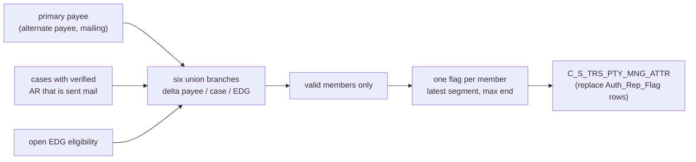

# 002 m_Tgt_C_S_TRS_Pty_Mng_Attr_Auth_Rep_Ongoing

| | |
|---|---|
| Source system | TRS, runs after 007 (`m_Tgt_C_S_TRS_Pty_Mng_Attr_Sw`) |
| Sub-domain | Party-Managed-Attrib |
| Sources | `STG_TRS_D_DC_PRIMARY_PAYEE`, `STG_TRS_DC_PRIMARY_PAYEE`, `STG_TRS_CV_ED_MCI_EDG_INDV`, `STG_TRS_D_CV_ED_MCI_EDG_INDV`, `STG_TRS_DC_CASES`, `STG_TRS_D_DC_CASES`, `STG_TRS_DC_CASE_INDV`, `STG_TRS_VALID_MEMBERS`
 |
| Targets | `C_S_TRS_PTY_MNG_ATTR` (attribute type `Auth_Rep_Flag` only) |
| Java | `com.idq.cli.source.trs.etlmap.svc.TrsAuthorizedRepresentativeService` |

## Business purpose

Flags members whose case has a verified authorized representative (AR) who receives the mailings. The flag is a
managed attribute `Auth_Rep_Flag = Y` with the open eligibility period of the member.

## Process



## IdqMapInitQuery

### TRS-002 Authorized representative flags

* A case qualifies when its AR verification code is `CS`, `FH`, `LD` or `OA` and mail is sent to the AR
  (`SENT_AUTHREP_SW = 'Y'`).
* Branches 1-3 (AR for specific individuals): the case's primary payee has an alternate payee (`ALT_PAYEE_EXISTS_SW
  = 'Y'`) with a mailing or empty address type and is tied to an open EDG eligibility; each branch takes its delta
  from a different table (payee, case, EDG) so that any change re-publishes the flag.
* Branches 4-6 (AR for the whole case): every individual of a qualifying case with an open eligibility gets the
  flag, again once per delta table.
* Only valid members are kept; the result is ordered by individual and eligibility dates.
* No stale filter found. Comments removed.

Entity: `TrsQueryRows.AuthorizedRepresentative` - named query: `TrsDcPrimaryPayeeDeltaRepository#fetchAuthorizedRepresentatives`.

```sql
SELECT DISTINCT a.indv_id, a.ar_flag, a.eff_begin_dt, a.eff_end_dt, a.create_dt
FROM (
    SELECT ed.indv_id, 'Y' ar_flag, ed.elig_eff_begin_dt eff_begin_dt, ed.elig_eff_end_dt eff_end_dt,
           p.create_dt
    FROM stg_trs_d_dc_primary_payee p
    JOIN stg_trs_cv_ed_mci_edg_indv ed
      ON p.case_num = ed.case_num AND p.edg_num = ed.edg_num AND ed.elig_eff_end_dt IS NULL
    JOIN stg_trs_dc_cases c ON p.case_num = c.case_num
    WHERE (p.addr_type_cd = 'MA' OR p.addr_type_cd IS NULL) AND p.alt_payee_exists_sw = 'Y'
      AND c.authrep_verf_cd IN ('CS', 'FH', 'LD', 'OA') AND c.sent_authrep_sw = 'Y'
    UNION ALL
    SELECT ed.indv_id, 'Y', ed.elig_eff_begin_dt, ed.elig_eff_end_dt, p.create_dt
    FROM stg_trs_d_dc_cases c
    JOIN stg_trs_dc_primary_payee p ON p.case_num = c.case_num
    JOIN stg_trs_cv_ed_mci_edg_indv ed
      ON p.case_num = ed.case_num AND p.edg_num = ed.edg_num AND ed.elig_eff_end_dt IS NULL
    WHERE (p.addr_type_cd = 'MA' OR p.addr_type_cd IS NULL) AND p.alt_payee_exists_sw = 'Y'
      AND c.authrep_verf_cd IN ('CS', 'FH', 'LD', 'OA') AND c.sent_authrep_sw = 'Y'
    UNION ALL
    SELECT ed.indv_id, 'Y', ed.elig_eff_begin_dt, ed.elig_eff_end_dt, p.create_dt
    FROM stg_trs_dc_cases c
    JOIN stg_trs_dc_primary_payee p ON p.case_num = c.case_num
    JOIN stg_trs_d_cv_ed_mci_edg_indv ed
      ON p.case_num = ed.case_num AND p.edg_num = ed.edg_num AND ed.elig_eff_end_dt IS NULL
    WHERE (p.addr_type_cd = 'MA' OR p.addr_type_cd IS NULL) AND p.alt_payee_exists_sw = 'Y'
      AND c.authrep_verf_cd IN ('CS', 'FH', 'LD', 'OA') AND c.sent_authrep_sw = 'Y'
    UNION ALL
    SELECT ci.indv_id, 'Y', ed.elig_eff_begin_dt, ed.elig_eff_end_dt, NVL(p.create_dt, ed.create_dt)
    FROM stg_trs_d_cv_ed_mci_edg_indv ed
    LEFT JOIN stg_trs_dc_primary_payee p
      ON ed.case_num = p.case_num AND ed.edg_num = p.edg_num AND ed.elig_eff_end_dt IS NULL
     AND (p.addr_type_cd = 'MA' OR p.addr_type_cd IS NULL) AND p.alt_payee_exists_sw = 'Y'
     AND p.edg_num IS NULL
    JOIN stg_trs_dc_cases c ON ed.case_num = c.case_num
    JOIN stg_trs_dc_case_indv ci ON c.case_num = ci.case_num
    WHERE c.authrep_verf_cd IN ('CS', 'FH', 'LD', 'OA') AND c.sent_authrep_sw = 'Y'
    UNION ALL
    SELECT ci.indv_id, 'Y', ed.elig_eff_begin_dt, ed.elig_eff_end_dt, p.create_dt
    FROM stg_trs_cv_ed_mci_edg_indv ed
    JOIN stg_trs_d_dc_primary_payee p
      ON ed.case_num = p.case_num AND ed.edg_num = p.edg_num AND ed.elig_eff_end_dt IS NULL
     AND (p.addr_type_cd = 'MA' OR p.addr_type_cd IS NULL) AND p.alt_payee_exists_sw = 'Y'
     AND p.edg_num IS NULL
    JOIN stg_trs_dc_cases c ON ed.case_num = c.case_num
    JOIN stg_trs_dc_case_indv ci ON c.case_num = ci.case_num
    WHERE c.authrep_verf_cd IN ('CS', 'FH', 'LD', 'OA') AND c.sent_authrep_sw = 'Y'
    UNION ALL
    SELECT ci.indv_id, 'Y', ed.elig_eff_begin_dt, ed.elig_eff_end_dt, NVL(p.create_dt, ed.create_dt)
    FROM stg_trs_cv_ed_mci_edg_indv ed
    LEFT JOIN stg_trs_dc_primary_payee p
      ON ed.case_num = p.case_num AND ed.edg_num = p.edg_num AND ed.elig_eff_end_dt IS NULL
     AND (p.addr_type_cd = 'MA' OR p.addr_type_cd IS NULL) AND p.alt_payee_exists_sw = 'Y'
     AND p.edg_num IS NULL
    JOIN stg_trs_d_dc_cases c ON ed.case_num = c.case_num
    JOIN stg_trs_dc_case_indv ci ON c.case_num = ci.case_num
    WHERE c.authrep_verf_cd IN ('CS', 'FH', 'LD', 'OA') AND c.sent_authrep_sw = 'Y'
) a
JOIN stg_trs_valid_members im ON TO_CHAR(a.indv_id) = im.pty_pk
ORDER BY a.indv_id, a.eff_begin_dt, a.eff_end_dt
```

## Business rules

1. One row per member key; the latest eligibility segment (by begin date) supplies the begin and create dates, the
   period end is the greatest segment end (`agg_Dedup_TRS_Pty_Mng_Attr`, `MAX(EFF_END_DT)`).
2. Value `MNG_ATTR_VAL` = `AR_FLAG` (`Y`), type `MNG_ATTR_TP` = `$ATTR_TP_AUTH_REP` = `Auth_Rep_Flag`.
3. Load: the IDQ pre-SQL deletes the existing `Auth_Rep_Flag` rows, then inserts. Mapping 007 empties the table
   first, so 002 must run after 007 (workflow order).

## PKEY formulation

| Target | PKEY_SRC_OBJECT | Example |
|---|---|---|
| `C_S_TRS_PTY_MNG_ATTR` | `TO_CHAR(INDV_ID)|Auth_Rep_Flag`, `PTY_FK` = `TO_CHAR(INDV_ID)` | `123|Auth_Rep_Flag` |

Unit test: `TrsPkeyTest#m_Tgt_C_S_TRS_Pty_Mng_Attr_Auth_Rep_Ongoing_pkey_test`.

## Retired / not ported

* `exp_Rank` (`VERSION_SEQ_NUM`, hard-coded to 1) and the distinct re-sort around it - MDM timeline.

## Java implementation

* `TrsAuthorizedRepresentativeService.transform`: sort by individual and begin date, compute the maximum end per key,
  keep the last row per key (`Rows.lastPerKey`), build `TrsTargets.ManagedAttribute`.
* Load mode `TargetBatch.replaceWhere(..., "MNG_ATTR_TP", "Auth_Rep_Flag", rows)` - the IDQ pre-SQL delete.
* Source entities (raw source tables, captured in the `adhoc_runs_*` audit reports): `TrsSources.DcPrimaryPayeeDelta`
  (`STG_TRS_D_DC_PRIMARY_PAYEE`), `TrsSources.DcPrimaryPayee` (`STG_TRS_DC_PRIMARY_PAYEE`),
  `TrsSources.CvEdMciEdgIndv` (`STG_TRS_CV_ED_MCI_EDG_INDV`), `TrsSources.CvEdMciEdgIndvDelta`
  (`STG_TRS_D_CV_ED_MCI_EDG_INDV`), `TrsSources.DcCases` (`STG_TRS_DC_CASES`), `TrsSources.DcCasesDelta`
  (`STG_TRS_D_DC_CASES`), `TrsSources.DcCaseIndv` (`STG_TRS_DC_CASE_INDV`), `TrsSources.ValidMember`
  (`STG_TRS_VALID_MEMBERS`).
