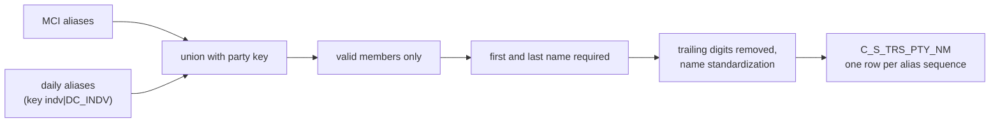

# 003 m_Tgt_C_S_TRS_Pty_Nm

| | |
|---|---|
| Source system | TRS |
| Sub-domain | Alternate-Name |
| Sources | `STG_TRS_D_CV_DC_MCI_ALIAS`, `STG_TRS_D_DC_ALIAS`, `STG_TRS_VALID_MEMBERS`
 |
| Targets | `C_S_TRS_PTY_NM` |
| Java | `com.idq.cli.source.trs.etlmap.svc.TrsPartyNameService` |

## Business purpose

Publishes the aliases (other names) of valid members. MCI aliases belong to the MCI party key, daily aliases to the
`|DC_INDV` party key; every alias sequence becomes its own name record of type `002` (Alias).

## Process



## IdqMapInitQuery

### TRS-003 Member aliases

* MCI aliases get the plain individual id as party key, daily aliases `INDV_ID|DC_INDV`.
* Only aliases of registered valid members (`PTY_PK` match) are returned; names are trimmed.
* No stale filter found; the commented-out absent-parent branch is removed.

Entity: `TrsQueryRows.MemberAlias` - named query: `TrsDcAliasDeltaRepository#fetchMemberAliases`.

```sql
SELECT DISTINCT a.indv_id, a.pkey_pty, RTRIM(LTRIM(a.first_name)) AS first_name,
       RTRIM(LTRIM(a.mid_name)) AS mid_name, RTRIM(LTRIM(a.last_name)) AS last_name,
       RTRIM(a.sufx_name) AS sufx_name, RTRIM(a.prefix_name) AS prefix_name, a.create_dt, a.sequence_num
FROM (
    SELECT indv_id, TO_CHAR(indv_id) AS pkey_pty, first_name, mid_name, last_name, sufx_name,
           prefix_name, create_dt, sequence_num
    FROM stg_trs_d_cv_dc_mci_alias
    UNION ALL
    SELECT indv_id, TO_CHAR(indv_id) || '|DC_INDV', first_name, mid_name, last_name, sufx_name,
           prefix_name, create_dt, seq_num
    FROM stg_trs_d_dc_alias
) a
JOIN stg_trs_valid_members vm ON a.pkey_pty = vm.pty_pk
```

## Business rules

1. Aliases without a first **and** a last name are dropped (`fltr_Null_Fn_Ln`).
2. Trailing digits are removed first (`mplt_Name_Standardization_Trailing_Num_Removal`), then the regular name
   standardization runs; prefix / suffix are translated ([000](000_mapplets.md#name-standardization)).
3. `SRC_FULL_NM` keeps the unstandardized `first [middle] last`.
4. Name type `NM_TP` = `$MemberNameTypeCode` = `002`.
5. Distinct rows; one row per key.

## PKEY formulation

| Target | PKEY_SRC_OBJECT | Example |
|---|---|---|
| `C_S_TRS_PTY_NM` | `<party key>|002|<alias sequence>`, `PTY_FK` = party key | `123|DC_INDV|002|2` |

Unit test: `TrsPkeyTest#m_Tgt_C_S_TRS_Pty_Nm_pkey_test`.

## Retired / not ported

* `exp_Party_Consolidation` version / duplicate ranking and `PERIOD_START_DATE_OUT` carry-forward - MDM timeline.
  The period start is the alias create date.

## Java implementation

* `TrsPartyNameService.transform`: filter, `NameStandardization.removeTrailingNumbers`, `NameStandardization.standardize`,
  build `TrsTargets.PartyName` (`Columns.PartyName`), `Rows.lastPerKey`.
* Source entities (raw source tables, captured in the `adhoc_runs_*` audit reports): `TrsSources.CvDcMciAliasDelta`
  (`STG_TRS_D_CV_DC_MCI_ALIAS`), `TrsSources.DcAliasDelta` (`STG_TRS_D_DC_ALIAS`), `TrsTargets.ValidMember`
  (`STG_TRS_VALID_MEMBERS`).
