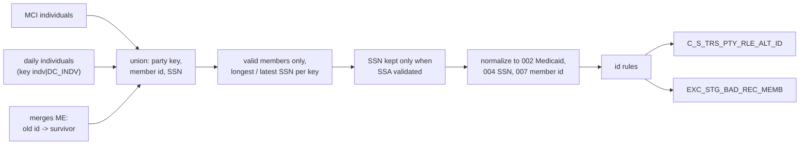

# 004 m_Tgt_C_S_TRS_Pty_Rle_Alt_Id

| | |
|---|---|
| Source system | TRS |
| Sub-domain | Alternate-ID |
| Sources | `STG_TRS_D_CV_DC_MCI_INDV`, `STG_TRS_D_DC_INDV`, `STG_TRS_D_CV_DC_MRG_SPRT_INDV`, `STG_TRS_VALID_MEMBERS`, `STG_TRS_H_DC_INDV`
 |
| Targets | `C_S_TRS_PTY_RLE_ALT_ID`, `EXC_STG_BAD_REC_MEMB` |
| Java | `com.idq.cli.source.trs.TrsAlternateId` (with `mplt_TRS_Pty_Rle_Alt_Id_Normalization`) |

## Business purpose

Publishes the identifiers of each valid member role: the Medicaid id and the member id (both the TIERS individual
id) and the SSN when SSA has validated it. Old individual ids that TIERS merged into a surviving individual are
published under the old party key, pointing to the surviving id.

## Process



## IdqMapInitQuery

### TRS-004 Member SSN and ids

* `all_indv`: MCI individuals (party key = id, `cv_ind = '1'`), daily individuals (party key `id|DC_INDV`) and
  merge records of type `ME` (party key = the *old* id, member id = the surviving id, no SSN).
* `de_dup_indv`: only registered valid members; per party key the row with the longest, then most recent SSN is
  kept (`key_rn = 1`) - a business de-duplication, kept as is.
* **Stale filter removed**: `INDV_ID=504937068` on the source qualifier.

Entity: `TrsQueries.MemberIdentifiers` - named query: `TrsQueries#fetchMemberIdentifiers`.

```sql
WITH all_indv AS (
    SELECT DISTINCT TO_CHAR(indv_id) AS pty_pkey, indv_id AS member_id, create_dt, ssn, '1' cv_ind
    FROM stg_trs_d_cv_dc_mci_indv
    UNION ALL
    SELECT DISTINCT TO_CHAR(indv_id) || '|DC_INDV', indv_id, create_dt, ssn, NULL
    FROM stg_trs_d_dc_indv
    UNION ALL
    SELECT DISTINCT TO_CHAR(old_indv_id), mrg.indv_id, mrg.create_dt, NULL, NULL
    FROM stg_trs_d_cv_dc_mrg_sprt_indv mrg
    WHERE type_cd = 'ME'
),
de_dup_indv AS (
    SELECT pty_pkey, TO_CHAR(member_id) AS member_id, create_dt AS start_dt, ssn, cv_ind,
           ROW_NUMBER() OVER (PARTITION BY pty_pkey ORDER BY LENGTH(ssn) DESC, create_dt DESC) key_rn
    FROM all_indv
    JOIN stg_trs_valid_members vm ON all_indv.pty_pkey = vm.pty_pk
)
SELECT pty_pkey, member_id, start_dt, ssn, cv_ind FROM de_dup_indv WHERE key_rn = 1
```

### Lookup: SSA validated SSNs

`lkp_Valid_SSN` - entity `TrsQueries.ValidSsn` - named query `TrsQueries#fetchValidSsns`.

```sql
SELECT DISTINCT indv_id, ssn FROM stg_trs_h_dc_indv WHERE ssa_validation_sw = 'Y' AND ssn > 0
```

## Business rules

1. The SSN is used only if the pair (member id, SSN) is SSA validated; it is left-padded to 9 digits.
2. Normalization (`NRM_ALT_ID`): Medicaid id `002` = member id, SSN `004`, member id `007` = member id.
3. Rules ([000](000_mapplets.md#identifier-rules)): Medicaid id must be 9 characters, member id 9 or 10; an invalid
   SSN is blanked.
4. Blank values are dropped - therefore an invalid SSN never reaches the exception queue (as in IDQ).
5. The type is looked up in `LOOKUP_CODE_VALUE` (`ALT_ID_TP`, source `TRS`, by master code); identifiers with an
   exception go to `EXC_STG_BAD_REC_MEMB` (type `Bad Value`, attribute = type label), the others are loaded with
   status `Issued`.

## PKEY formulation

| Target | PKEY_SRC_OBJECT | Example |
|---|---|---|
| `C_S_TRS_PTY_RLE_ALT_ID` | `<party key>|Member|<type master code>|<value>`, `PTY_RLE_FK` = `<party key>|Member` | `123456789|DC_INDV|Member|004|512345678` |

Unit test: `TrsPkeyTest#m_Tgt_C_S_TRS_Pty_Rle_Alt_Id_pkey_test`.

## Retired / not ported

* `exp_Rank` / `fltr_Rank` (`VERSION_SEQ = 1`, hard-coded) - MDM timeline; one row per key is kept instead.

## Java implementation

* `TrsAlternateId.normalize` = the normalizer (one `Candidate` per type), `IdentifierRules` = the rules,
  `transform` routes candidates to `TrsTargets.AlternateId` or `BadRecords`.
* `Lookups(validSsns)` is the `lkp_Valid_SSN` cache.
* Source entities (raw source tables, captured in the `adhoc_runs_*` audit reports): `TrsSources.CvDcMciIndvDelta`
  (`STG_TRS_D_CV_DC_MCI_INDV`), `TrsSources.DcIndvDelta` (`STG_TRS_D_DC_INDV`), `TrsSources.CvDcMrgSprtIndvDelta`
  (`STG_TRS_D_CV_DC_MRG_SPRT_INDV`), `TrsTargets.ValidMember` (`STG_TRS_VALID_MEMBERS`), `TrsSources.DcIndvHist`
  (`STG_TRS_H_DC_INDV`).
