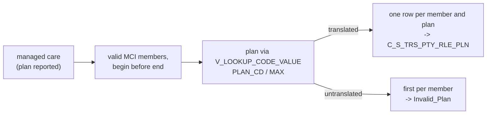

# 005 m_Tgt_C_S_TRS_Pty_Rle_Pln

| | |
|---|---|
| Source system | TRS |
| Sub-domain | Role |
| Sources | `STG_TRS_D_IN_MANAGED_CARE`, `STG_TRS_VALID_MEMBERS`
 |
| Targets | `C_S_TRS_PTY_RLE_PLN`, `EXC_STG_BAD_REC_MEMB` |
| Java | `com.idq.cli.source.trs.etlmap.svc.TrsPlanService` |

## Business purpose

Publishes the managed care plan enrolments of MCI members. Plans are reported in the Medicaid (MAX) plan code and
translated to the MDM plan code.

## Process



## IdqMapInitQuery

### TRS-005 Managed care plans

* Managed care rows with a plan, a begin date before the end date (or no end date), for individuals registered with
  their MCI key.
* No stale filter found. The SQL override supersedes the source-qualifier filter / join (identical conditions).

Entity: `TrsQueryRows.ManagedCarePlan` - named query: `TrsInManagedCareDeltaRepository#fetchManagedCarePlans`.

```sql
SELECT DISTINCT m.indv_id, m.begin_dt, m.mc_plan, m.history_seq, m.end_dt, m.create_dt
FROM stg_trs_d_in_managed_care m
JOIN stg_trs_valid_members vm ON m.indv_id = vm.indv_id AND vm.src_tbl = 'MCI'
WHERE m.mc_plan IS NOT NULL AND (m.begin_dt < m.end_dt OR m.end_dt IS NULL)
ORDER BY m.indv_id, m.mc_plan, m.begin_dt, m.end_dt
```

## Business rules

1. Plan translation: `V_LOOKUP_CODE_VALUE` code type `PLAN_CD`, source system `MAX`.
2. Translated plans: one row per `member|plan` key, the last after sorting by key, begin and end date.
3. Untranslated plans: only the first such row per individual (source order) is reported as `Invalid_Plan`
   (`SRC_SYS_ID_1` = individual, `SRC_SYS_ID_2` = begin date `yyyy-MM-dd`, attribute `Plan`).
4. `CREATE_DATE` = run time, `SRC_LAST_UPD_DT` = source create date, period = begin / end date.

## PKEY formulation

| Target | PKEY_SRC_OBJECT | Example |
|---|---|---|
| `C_S_TRS_PTY_RLE_PLN` | `<indv id>|Member|<MDM plan code>`, `PTY_RLE_FK` = `<indv id>|Member`, `PLN_FK` = plan code | `123|Member|PLN1` |

Unit test: `TrsPkeyTest#m_Tgt_C_S_TRS_Pty_Rle_Pln_pkey_test`.

## Retired / not ported

* `VERSION_SEQ` (hard-coded 1), `PERIOD_REFERENCE_TIME`, `TIMELINE_ACTION` - MDM timeline.

## Java implementation

* `TrsPlanService.transform`: `master()` = the lookup, `Rows.firstPerKey` for the exceptions, sort + `Rows.lastPerKey` for
  `agg_Dedup_Rec`; entity `TrsTargets.Plan` (`Columns.Plan`).
* Source entities (raw source tables, captured in the `adhoc_runs_*` audit reports): `TrsSources.InManagedCareDelta`
  (`STG_TRS_D_IN_MANAGED_CARE`), `TrsTargets.ValidMember` (`STG_TRS_VALID_MEMBERS`).
