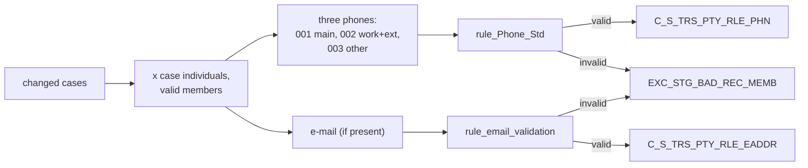

# 006 m_Tgt_C_S_TRS_Pty_Rle_Phn_And_EAddr

| | |
|---|---|
| Source system | TRS |
| Sub-domain | Phone-email |
| Sources | `STG_TRS_D_DC_CASES`, `STG_TRS_DC_CASE_INDV`, `STG_TRS_VALID_MEMBERS`
 |
| Targets | `C_S_TRS_PTY_RLE_PHN`, `C_S_TRS_PTY_RLE_EADDR`, `EXC_STG_BAD_REC_MEMB` |
| Java | `com.idq.cli.source.trs.etlmap.svc.TrsPhoneEmailService` |

## Business purpose

TIERS keeps phone numbers and e-mail on the *case*. This mapping applies the case's main, work and other phone and
its e-mail to every valid member of the case.

## Process



## IdqMapInitQuery

### TRS-006 Case phones and e-mail

* Delta cases joined to all individuals of the case; only registered valid members (MCI key).
* **Stale filter removed**: `rownum < 100000` on the source qualifier (a volume limit left from testing).

Entity: `TrsQueryRows.CaseContact` - named query: `TrsDcCasesDeltaRepository#fetchCaseContacts`.

```sql
SELECT DISTINCT i.indv_id, c.case_num, c.create_dt, c.work_ph_num, c.other_ph_num, c.email, c.ph_num,
       c.office_num, c.work_ph_num_ext, TO_CHAR(i.indv_id) AS pty_pk
FROM stg_trs_d_dc_cases c
JOIN stg_trs_dc_case_indv i ON c.case_num = i.case_num
JOIN stg_trs_valid_members vm ON TO_CHAR(i.indv_id) = vm.pty_pk
```

## Business rules

1. Phone normalization (`mplt_Member_Pty_Rle_Phn_Normalization`): `Primary` / `001` = `PH_NUM`; `Secondary` /
   `002` = `WORK_PH_NUM` followed by a space and the extension (when a work number exists); `Tertiary` / `003` =
   `OTHER_PH_NUM`; all of phone type `Telephone`.
2. Each number goes through `rule_Phone_Std` ([000](000_mapplets.md#contact-rules)). The normalization mapplet does
   not pass the source system or usage type to the rule, so the ECI and toll-free checks do not apply here. A work
   number with extension is therefore 11+ digits and is rejected - the IDQ behaviour.
3. Missing numbers are dropped; invalid numbers go to the exception queue (`Bad Value`, attribute `Main / Work /
   Other Phone`, `SRC_SYS_ID_1` = individual, `_2` = case, `_3` = usage).
4. The usage type is labelled with `LOOKUP_CODE_VALUE` (`PHN_USG_TP`, `TRS`) by master code.
5. E-mail: trimmed / lower-cased by the rule. It is rejected only when the exception code is configured in
   `EXC_LOOKUP_CODE_VALUE` (the router tests the looked-up code); otherwise it is loaded with address type `001`,
   status `Active`, valid `Y`.
6. Consolidation (`mplt_*_Consolidation`): distinct rows, the latest per key.

## PKEY formulation

| Target | PKEY_SRC_OBJECT | Example |
|---|---|---|
| `C_S_TRS_PTY_RLE_PHN` | `<indv>|Member|Telephone|<usage master code>|<standardized number>` | `123|Member|Telephone|001|5125551234` |
| `C_S_TRS_PTY_RLE_EADDR` | `<indv>|Member|001|<e-mail as reported>` | `123|Member|001|Ann@Example.org` |

`PTY_RLE_FK` = `<indv>|Member`. Unit test: `TrsPkeyTest#m_Tgt_C_S_TRS_Pty_Rle_Phn_And_EAddr_pkey_test`.

## Retired / not ported

* `VERSION_SEQ` ranking in the consolidation mapplets and `MAX(PERIOD_END_DATE)` of always-empty end dates.
* Pre/post SQL `Utility.Table_*_Load_Maint` (the phone target names the table with a leading `_`).

## Java implementation

* `TrsPhoneEmailService.phoneSlots` = the normalizer; `ContactRules.phone` / `ContactRules.email`;
  `EtlPatterns.write2TargetPhone` / `write2TargetEmail` / `badData4Phone` / `badData4Email`; `Rows.latestPerKey`.
* Source entities (raw source tables, captured in the `adhoc_runs_*` audit reports): `TrsSources.DcCasesDelta`
  (`STG_TRS_D_DC_CASES`), `TrsSources.DcCaseIndv` (`STG_TRS_DC_CASE_INDV`), `TrsSources.ValidMember`
  (`STG_TRS_VALID_MEMBERS`).
