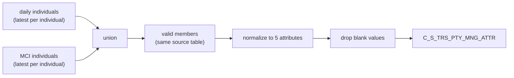

# 007 m_Tgt_C_S_TRS_Pty_Mng_Attr_Sw

| | |
|---|---|
| Source system | TRS, runs before 002 |
| Sub-domain | Party-Managed-Attrib |
| Sources | `STG_TRS_D_DC_INDV`, `STG_TRS_D_CV_DC_MCI_INDV`, `STG_TRS_VALID_MEMBERS`
 |
| Targets | `C_S_TRS_PTY_MNG_ATTR` (table emptied first) |
| Java | `com.idq.cli.source.trs.TrsSwitches` |

## Business purpose

Publishes TIERS switches of a member as managed attributes: file clearance, SSA validation, TW and LTC conversion
indicators, and the source table the member came from.

## Process



## IdqMapInitQuery

### TRS-007 Member switches

* Daily individuals carry file clearance and SSA validation switches (party key `indv|DC_INDV`); MCI individuals
  carry the TW / LTC conversion indicators (party key = id). Each source keeps only its latest row per individual
  (`key_rn = 1`) - a business de-duplication.
* Joined to the registry on individual **and** source table.
* No stale filter found (the commented `ora_hash` sample is removed).

Entity: `TrsQueries.MemberSwitches` - named query: `TrsQueries#fetchMemberSwitches`.

```sql
WITH daily_indv AS (
    SELECT dc.indv_id, dc.file_clearance_sw, dc.ssa_validation_sw, dc.create_dt AS eff_begin_dt,
           NULL AS tw_convert_ind, NULL AS ltc_convert_ind, TO_CHAR(dc.indv_id) || '|DC_INDV' AS pty_pk,
           create_dt, 'DC_INDV' src_tbl,
           ROW_NUMBER() OVER (PARTITION BY indv_id ORDER BY create_dt DESC) key_rn
    FROM stg_trs_d_dc_indv dc
    UNION
    SELECT indv_id, NULL, NULL, create_dt, tw_convert_ind, ltc_convert_ind, TO_CHAR(indv_id), create_dt,
           'MCI', ROW_NUMBER() OVER (PARTITION BY indv_id ORDER BY create_dt DESC)
    FROM stg_trs_d_cv_dc_mci_indv cv
)
SELECT dly.indv_id, dly.file_clearance_sw, dly.ssa_validation_sw, dly.eff_begin_dt, dly.tw_convert_ind,
       dly.ltc_convert_ind, dly.pty_pk, dly.create_dt, dly.src_tbl
FROM daily_indv dly
JOIN stg_trs_valid_members im ON dly.indv_id = im.indv_id AND dly.src_tbl = im.src_tbl
WHERE key_rn = 1
```

## Business rules

1. Normalizer `nrm_Attribute_Types` - five attributes per row, in order: `File_Clearance_SW`, `SSA_Validation_SW`,
   `TW_Convert_Ind`, `LTC_Convert_Ind`, `Source_Table` (value `DC_INDV` / `MCI`).
2. Null or blank values are dropped.
3. Distinct rows; one row per key (latest begin date).
4. `CREATE_DATE` and `LAST_UPDATE_DATE` = run time, `SRC_LAST_UPD_DT` = source create date.
5. The target is emptied (IDQ truncate) - mapping 002 adds the `Auth_Rep_Flag` rows afterwards.

## PKEY formulation

| Target | PKEY_SRC_OBJECT | Example |
|---|---|---|
| `C_S_TRS_PTY_MNG_ATTR` | `<party key>|<attribute type>`, `PTY_FK` = party key | `123|DC_INDV|File_Clearance_SW` |

The IDQ comment records a correction (10/24/2020) from the individual id to the party key. Unit test:
`TrsPkeyTest#m_Tgt_C_S_TRS_Pty_Mng_Attr_Sw_pkey_test`.

## Retired / not ported

* `exp_Version_Seq_No` (`VERSION_SEQ`, hard-coded 1) - MDM timeline.

## Java implementation

* `TrsSwitches.attributes` = the normalizer (`Attribute` record), `transform` filters, builds
  `TrsTargets.ManagedAttribute`, sorts and keeps one row per key; load `replaceAll`.
* Source entities (raw source tables, captured in the `adhoc_runs_*` audit reports): `TrsSources.DcIndvDelta`
  (`STG_TRS_D_DC_INDV`), `TrsSources.CvDcMciIndvDelta` (`STG_TRS_D_CV_DC_MCI_INDV`), `TrsTargets.ValidMember`
  (`STG_TRS_VALID_MEMBERS`).
