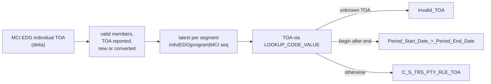

# 008 m_Tgt_C_S_TRS_Pty_Rle_TOA

| | |
|---|---|
| Source system | TRS |
| Sub-domain | Role |
| Targets | `C_S_TRS_PTY_RLE_TOA`, `EXC_STG_BAD_REC_MEMB` |
| Java | `com.idq.cli.source.trs.TrsTypeOfAssistance` |

## Business purpose

Publishes the type of assistance (TOA) of each eligibility segment of a member: which program and assistance type
the member is eligible for, from when to when, and whether it came from a TIERS conversion.

## Process



## IdqMapInitQuery

### TRS-008 Type of assistance segments

* Rows with a TOA, not converted or converted (`CONVERSION_IND` null or `C`), of registered valid members.
* Per segment (individual, EDG, program, MCI create sequence) only the latest row by create date (`key_rn = 1`).
* Source table label `MCI_EDG_INDV`.
* No stale filter found.

Entity: `TrsQueries.AssistanceSegment` - named query: `TrsQueries#fetchAssistanceSegments`.

```sql
WITH toa_src AS (
    SELECT TO_CHAR(toa.indv_id) AS indv_id, type_of_assistance_cd, elig_eff_begin_dt AS begin_dt,
           elig_eff_end_dt AS end_dt, 'MCI_EDG_INDV' AS src_tbl,
           ROW_NUMBER() OVER (PARTITION BY toa.indv_id || '|' || toa.edg_num || '|' || toa.program_cd
                              || '|' || toa.mci_create_seq ORDER BY toa.create_dt DESC) AS key_rn,
           TO_CHAR(toa.indv_id) AS pty_pk, edg_num, case_num, mci_create_seq, program_cd, part_status_cd,
           system_cd, convert_dt, toa.create_dt
    FROM stg_trs_d_cv_mci_edg_indv_toa toa
    JOIN stg_trs_valid_members vm ON TO_CHAR(toa.indv_id) = vm.pty_pk
    WHERE type_of_assistance_cd IS NOT NULL AND (conversion_ind IS NULL OR conversion_ind = 'C')
)
SELECT indv_id, type_of_assistance_cd, begin_dt, end_dt, src_tbl, pty_pk, edg_num, case_num,
       mci_create_seq, program_cd, part_status_cd, system_cd, convert_dt, create_dt
FROM toa_src
WHERE key_rn = 1
```

## Business rules

1. TOA source: `MCI_EDG_INDV` -> `TIERS`, `LTSS_ELIG_PER` -> `DADS`.
2. Segment key `SGMNT_KEY` = `EDG_NUM|PROGRAM_CD|MCI_CREATE_SEQ`.
3. TOA code translated with `LOOKUP_CODE_VALUE` (`TOA`, source `TRS`) to the master code.
4. Router: an untranslated TOA raises `Invalid_TOA` (ids individual / EDG / MCI sequence); a begin date after the
   end date raises `Period_Start_Date_>_Period_End_Date` (ids TOA key / role key). A row can raise both. Only rows
   with neither are loaded (`Default` group).
5. Loaded columns: effective start / end, participation status, individual, case, EDG, segment key, conversion
   system and date.

## PKEY formulation

| Target | PKEY_SRC_OBJECT | Example |
|---|---|---|
| `C_S_TRS_PTY_RLE_TOA` | `<indv>|Member|<TOA master code>|<TOA source>|<EDG>|<program>|<MCI seq>`, `PTY_RLE_FK` = `<indv>|Member` | `123|Member|100|TIERS|77|MA|3` |

Unit test: `TrsPkeyTest#m_Tgt_C_S_TRS_Pty_Rle_TOA_pkey_test`.

## Retired / not ported

* `VERSION_SEQ` passed from the query rank, `PERIOD_REFERENCE_TIME`, `TIMELINE_ACTION` - MDM timeline (the rank is
  still used in SQL to keep the latest row per segment).

## Java implementation

* `TrsTypeOfAssistance.transform` with `segmentKey`, `toaSource`, `pkey`; entity `TrsTargets.TypeOfAssistance`
  (`Columns.TypeOfAssistance`).
