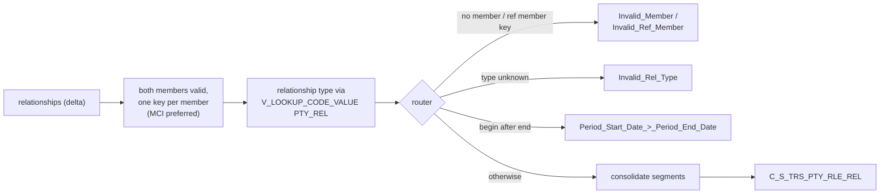

# 009 m_Tgt_C_S_TRS_Pty_Rle_Rel_1_Mem_To_Mem

| | |
|---|---|
| Source system | TRS |
| Sub-domain | Role |
| Sources | `STG_TRS_D_DC_RELATIONSHIPS`, `STG_TRS_VALID_MEMBERS`
 |
| Targets | `C_S_TRS_PTY_RLE_REL`, `EXC_STG_BAD_REC_MEMB` |
| Java | `com.idq.cli.source.trs.etlmap.svc.TrsMemberRelationshipService` |

## Business purpose

Publishes the relationships TIERS reports between two members (parent, child, spouse, ...). When a person is known
under both an MCI and a daily key, the MCI key is used (`MIN(PTY_PK)` - the plain id sorts before `id|DC_INDV`).

## Process



## IdqMapInitQuery

### TRS-009 Member relationships

* `min_pk`: one source key per individual from the registry, the MCI key when both exist.
* Relationship rows where both individuals have a key, with dates, type, history flag, create / update dates.
* IDQ parameter `$INDV_ID_ALT_ID_TP` = `007` inlined. No stale filter (commented `ora_hash` sample removed).

Entity: `TrsQueryRows.MemberRelationship` - named query: `TrsDcRelationshipsDeltaRepository#fetchMemberRelationships`.

```sql
WITH min_pk AS (
    SELECT indv_id, MIN(pty_pk) pty_pk FROM stg_trs_valid_members GROUP BY indv_id
)
SELECT rel.indv_id, rel.ref_indv_id, rel.eff_begin_dt, rel.eff_end_dt, rel.hist_nav_ind,
       rel.relationship_type_cd, pk1.pty_pk AS pty_pkey, pk2.pty_pk AS ref_pty_pkey,
       '007' AS pty_alt_id_tp, rel.create_dt, rel.update_dt
FROM stg_trs_d_dc_relationships rel
JOIN min_pk pk1 ON rel.indv_id = pk1.indv_id
JOIN min_pk pk2 ON rel.ref_indv_id = pk2.indv_id
ORDER BY rel.indv_id, rel.eff_end_dt
```

## Business rules

1. Role keys: `trim(party key)|Member` for the member and the related member.
2. Relationship type via `V_LOOKUP_CODE_VALUE` (`PTY_REL`, source `TRS`).
3. Router groups (a row may hit several): missing member key -> `Invalid_Member`, missing related key ->
   `Invalid_Ref_Member`, untranslated type -> `Invalid_Rel_Type` (attribute `Relationship Type`), begin after end
   -> `Period_Start_Date_>_Period_End_Date`. Only rows in no group are loaded.
4. `REL_TYPE_CODE` = `Member Relationship`, `HIERARCHY_CODE` = `Member`, `REL_TP` = the master type.
5. `SRC_LAST_UPD_DT` = the later of create and update date (or whichever exists).
6. Consolidation: distinct segments ordered by key, end date (open last) and start date; one row per key.

## PKEY formulation

| Target | PKEY_SRC_OBJECT | Example |
|---|---|---|
| `C_S_TRS_PTY_RLE_REL` | `<member key>|Member|<related member key>|Member|<type>`; `PTY_RLE_FK_1` / `_2` = the two role keys | `123|Member|456|DC_INDV|Member|PAR` |

Unit test: `TrsPkeyTest#m_Tgt_C_S_TRS_Pty_Rle_Rel_1_Mem_To_Mem_pkey_test`.

## Retired / not ported

* `mplt_Pty_Rle_Rel_Timeline_Validation` and its `mplt_DST_Correction` (duplicating end-dated relationships into
  open / closed versions, version ranking, forced hub state) - MDM timeline. See
  [000](000_mapplets.md#retired-mdm-timeline).
* `PERIOD_REFERENCE_TIME`, `TIMELINE_ACTION`.

## Java implementation

* `TrsMemberRelationshipService.transform` with `roleOf`, `pkey`, `sourceLastUpdate`; consolidation
  `Rows.currentSegmentPerKey`; entity `TrsTargets.Relationship` (`Columns.Relationship`).
* Source entities (raw source tables, captured in the `adhoc_runs_*` audit reports): `TrsSources.DcRelationshipsDelta`
  (`STG_TRS_D_DC_RELATIONSHIPS`), `TrsSources.ValidMember` (`STG_TRS_VALID_MEMBERS`).
