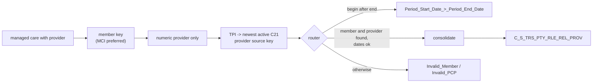

# 010 m_Tgt_C_S_TRS_Pty_Rle_Rel_2_Mem_To_PCP

| | |
|---|---|
| Source system | TRS |
| Sub-domain | Role |
| Sources | `STG_TRS_D_IN_MANAGED_CARE`, `STG_TRS_VALID_MEMBERS`, `C_B_PTY_RLE_ALT_ID`, `C_B_PTY_RLE_ALT_ID_XREF`
 |
| Targets | `C_S_TRS_PTY_RLE_REL_PROV`, `EXC_STG_BAD_REC_MEMB` |
| Java | `com.idq.cli.source.trs.etlmap.svc.TrsPrimaryCareProviderService` |

## Business purpose

Links a member to the primary care provider (or clinic) of their managed care enrolment. The provider is reported
by its TPI number and resolved to the provider party role that MDM already knows from the C21 provider source.

## Process



## IdqMapInitQuery

### TRS-010 Member primary care providers

* Managed care rows with a provider number for registered individuals, one source key per individual (MCI first).
* No stale filter (commented `ora_hash` sample and the old query are removed).

Entity: `TrsQueryRows.PrimaryCareProvider` - named query: `TrsInManagedCareDeltaRepository#fetchPrimaryCareProviders`.

```sql
WITH min_pk AS (
    SELECT indv_id, MIN(pty_pk) pty_pk FROM stg_trs_valid_members GROUP BY indv_id
)
SELECT mc.indv_id, mc.history_seq, mc.mc_prog_code, mc.begin_dt, mc.create_dt, mc.provider_num,
       mc.end_dt, vm.pty_pk
FROM stg_trs_d_in_managed_care mc
JOIN min_pk vm ON mc.indv_id = vm.indv_id
WHERE mc.provider_num IS NOT NULL
ORDER BY mc.indv_id, mc.end_dt
```

### Lookup: provider TPI to provider source key

`Lookup_C_B_PTY_RLE_ALT_ID` (MDM base object, connection `HHS_MDM_ORS`): alternate ids of type `006` (TPI) whose
C21 cross-reference is active; when a provider was re-classed, the source key with the latest source update wins.
Entity `TrsQueryRows.ProviderKey` - named query `TrsPartyRoleAltIdRepository#fetchProviderKeys`.

```sql
WITH tpi_src_key AS (
    SELECT bo.alt_id_val, xr.pkey_src_object,
           ROW_NUMBER() OVER (PARTITION BY bo.alt_id_val ORDER BY xr.src_last_upd_dt DESC) src_key_rn
    FROM c_b_pty_rle_alt_id bo
    JOIN c_b_pty_rle_alt_id_xref xr ON bo.rowid_object = xr.rowid_object
    WHERE bo.alt_id_tp = '006' AND xr.rowid_system = 'C21' AND xr.hub_state_ind = 1
)
SELECT alt_id_val, pkey_src_object FROM tpi_src_key WHERE src_key_rn = 1
```

<!-- lookups:begin -->
## Lookups

Connected lookups, grouped by the transformation that feeds their input ports. In a lookup condition the
left side is the lookup table column and the right side is the lookup input port. Output ports are the
returned table columns (or input ports passed through) and the downstream port each one feeds.

### Fed by `Exp_safe_STG_TRS_D_IN_MANAGED_CARE` (Expression)

| Lookup | Table | Condition | Input ports | Output ports |
|---|---|---|---|---|
| `Lookup_C_B_PTY_RLE_ALT_ID` | `C_B_PTY_RLE_ALT_ID` (HHS_MDM_ORS)<br>SQL override (below)<br>multiple match: any row | `ALT_ID_VAL = PROVIDER_NUM` | `PROVIDER_NUM` &larr; `PROVIDER_NUM` | `PKEY_SRC_OBJECT` &rarr; `Exp_Build_FK.in_PTY_RLE_FK_PROVIDER` (Expression) |

### Fed by `Expression` (Expression)

| Lookup | Table | Condition | Input ports | Output ports |
|---|---|---|---|---|
| `Lookup_EXC_LOOKUP_CODE_VALUE` | `EXC_LOOKUP_CODE_VALUE` (STAGING)<br>multiple match: any row | `EXCEPTION_CODE = EXC_ID_INV_PCP` | `EXC_ID_INV_PCP` &larr; `EXC_CODE_INV_PCP` | `EXCEPTION_DESC` &rarr; `Exp_safe_EXC_STG_BAD_REC_MEMB.EXCEPTION_DESC_PCP` (Expression)<br>`EXCEPTION_TYPE` &rarr; `Exp_safe_EXC_STG_BAD_REC_MEMB.EXCEPTION_TYPE_PCP` (Expression) |
| `Lookup_EXC_LOOKUP_CODE_VALUE1` | `EXC_LOOKUP_CODE_VALUE` (STAGING)<br>multiple match: any row | `EXCEPTION_CODE = EXC_ID_INV_MEMB` | `EXC_ID_INV_MEMB` &larr; `EXC_CODE_INV_MEMB` | `EXCEPTION_DESC` &rarr; `Exp_safe_EXC_STG_BAD_REC_MEMB.EXCEPTION_DESC_MEMB` (Expression)<br>`EXCEPTION_TYPE` &rarr; `Exp_safe_EXC_STG_BAD_REC_MEMB.EXCEPTION_TYPE_MEMB` (Expression) |

### Fed by `EXC_STG_BAD_REC_REL_TP_Start_Date_End_Date` (Expression)

| Lookup | Table | Condition | Input ports | Output ports |
|---|---|---|---|---|
| `Lookup_EXC_LOOKUP_CODE_VALUE2` | `EXC_LOOKUP_CODE_VALUE` (STAGING)<br>multiple match: any row | `EXCEPTION_CODE = EXC_CODE_LKP` | `EXC_CODE_LKP` &larr; `EXC_CODE_LKP` | `EXCEPTION_DESC` &rarr; `Write_EXC_STG_BAD_REC_MEMB_Start_Date_End_Date.EXCEPTION_DESC` (Target)<br>`EXCEPTION_TYPE` &rarr; `Write_EXC_STG_BAD_REC_MEMB_Start_Date_End_Date.EXCEPTION_TYPE` (Target) |

SQL override of `Lookup_C_B_PTY_RLE_ALT_ID`:

```sql
with tpi_src_key as
(
select
	bo.alt_id_val
	,xr.pkey_src_object
	-- In the event the record has been re-classed use the source key with the latest system update date via row number
	,row_number() over (partition by bo.alt_id_val order by xr.src_last_upd_dt desc) src_key_rn
from c_b_pty_rle_alt_id bo
inner join c_b_pty_rle_alt_id_xref xr
	on bo.rowid_object = xr.rowid_object
where bo.alt_id_tp = '006'
	and xr.rowid_system = 'C21'
	and xr.hub_state_ind = 1
)
select
	alt_id_val
	,pkey_src_object
from tpi_src_key
where  src_key_rn = 1
```

Lookups inside the mapplets / rules this mapping calls are listed in
[000](000_mapplets.md#lookups-inside-mapplets-and-rules): `mplt_DST_Correction`.

<!-- lookups:end -->

## Business rules

1. Only numeric provider numbers are kept (`IS_NUMBER`).
2. Provider role key = the provider source key up to its second `|` (`<tpi>|HCP` or `<tpi>|HCO`).
3. `REL_TYPE_CODE` = `Member PCO` when the source key contains `|HCO`, else `Member PCP`; `REL_TP` =
   `$PCP_REL_TP` = `100`; `HIERARCHY_CODE` = `Member`.
4. Router: begin after end -> `Period_Start_Date_>_Period_End_Date`; member and provider key present and dates in
   order (or open) -> loaded; anything else -> `Invalid_Member` (no member key) or `Invalid_PCP` (provider not
   found), attribute `Provider`.
5. Consolidation as in 009: one row per key.

## PKEY formulation

| Target | PKEY_SRC_OBJECT | Example |
|---|---|---|
| `C_S_TRS_PTY_RLE_REL_PROV` | `<member key>|Member|<provider role key>|100` | `123|Member|700000001|HCO|100` |

Unit test: `TrsPkeyTest#m_Tgt_C_S_TRS_Pty_Rle_Rel_2_Mem_To_PCP_pkey_test`.

## Retired / not ported

* Timeline validation mapplet, `PERIOD_REFERENCE_TIME`, `TIMELINE_ACTION` - MDM timeline.

## Java implementation

* `TrsPrimaryCareProviderService.transform`, `providerRoleKey`, `pkey`; `Lookups(providerKeyByTpi)`;
  `Rows.currentSegmentPerKey`; entity `TrsTargets.ProviderRelationship`.
* Source entities (raw source tables, captured in the `adhoc_runs_*` audit reports): `TrsSources.InManagedCareDelta`
  (`STG_TRS_D_IN_MANAGED_CARE`), `TrsSources.ValidMember` (`STG_TRS_VALID_MEMBERS`), `MdmBaseTables.PartyRoleAltId`
  (`C_B_PTY_RLE_ALT_ID`), `MdmBaseTables.PartyRoleAltIdXref` (`C_B_PTY_RLE_ALT_ID_XREF`).
