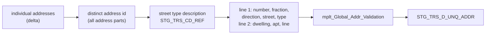

# 011 m_Tgt_C_S_TRS_Addr_1

| | |
|---|---|
| Source system | TRS, followed by 012 |
| Sub-domain | Address |
| Targets | `STG_TRS_D_UNQ_ADDR` (staging, emptied first) |
| Java | `com.idq.cli.source.trs.TrsUniqueAddress` |

## Business purpose

Validates every distinct TIERS address once, so that the many members sharing an address do not each call address
validation. The result is a staging table of validated addresses keyed by the raw address text; mapping 012 assigns
them to members.

## Process



## IdqMapInitQuery

### TRS-011 Distinct member addresses

* Every distinct address of the delta. `ADDR_ID` concatenates all address parts with `|` and is the key that
  012 joins on.
* No stale filter found.

Entity: `TrsQueries.DistinctAddress` - named query: `TrsQueries#fetchDistinctAddresses`.

```sql
SELECT DISTINCT
       a.addr_st_num || '|' || a.addr_st_num_frac || '|' || a.addr_st_nm || '|' || a.addr_st_dir_cd || '|'
       || a.addr_st_type_cd || '|' || a.addr_dwelling_type_cd || '|' || a.addr_apt_num || '|'
       || a.addr_line || '|' || a.addr_city || '|' || a.addr_state_cd || '|' || a.addr_zip5 || '|'
       || a.addr_zip4 AS addr_id,
       a.addr_st_num, a.addr_st_num_frac, a.addr_st_nm, a.addr_apt_num, a.addr_line, a.addr_city,
       a.addr_state_cd, a.addr_zip5, a.addr_zip4, a.addr_dwelling_type_cd, a.addr_st_type_cd,
       a.addr_st_dir_cd
FROM stg_trs_d_indv_addr a
```

## Business rules

1. Street type description via `STG_TRS_CD_REF.CODE` (the IDQ lookup has no table-name filter).
2. Directions `EA`, `NO`, `SO`, `WE` shortened to `E`, `N`, `S`, `W` (USPS style); others kept.
3. Line 1 = `number + ' ' + fraction + ' ' + direction + ' ' + street + ' ' + type`, trimmed (inner double spaces
   from missing parts are kept, as in IDQ); line 2 = `dwelling type + ' ' + apartment + ' ' + address line`.
4. Validation input: lines, city, state, `zip5-zip4`, country `US`, source `TRS`
   ([000](000_mapplets.md#address-validation)).
5. Source attributes kept: lines, city, state, `US`, zip5, zip4.

## PKEY formulation

`STG_TRS_D_UNQ_ADDR` is a staging table without `PKEY_SRC_OBJECT`; its key is `ADDR_ID` =
`num|frac|street|dir|type|dwelling|apt|line|city|state|zip5|zip4`. Unit test:
`TrsPkeyTest#m_Tgt_C_S_TRS_Addr_1_pkey_test` (checks `ADDR_ID` and line 1).

## Java implementation

* `TrsUniqueAddress.direction`, `line1`, `line2`, `transform`; `AddressValidator` (default
  `PassThroughAddressValidator`); entity `TrsTargets.UniqueAddress`; load `replaceAll`.
* Source entities (raw source tables, captured in the `adhoc_runs_*` audit reports): `TrsSources.DIndvAddr`
  (`STG_TRS_D_INDV_ADDR`), `TrsSources.CdRef` (`STG_TRS_CD_REF`).
