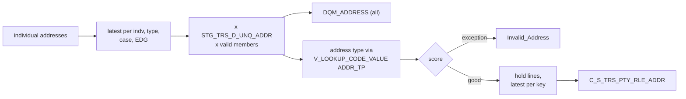

# 012 m_Tgt_C_S_TRS_Addr_2

| | |
|---|---|
| Source system | TRS, after 011 |
| Sub-domain | Address |
| Sources | `STG_TRS_D_INDV_ADDR`, `STG_TRS_D_UNQ_ADDR`, `STG_TRS_VALID_MEMBERS`
 |
| Targets | `C_S_TRS_PTY_RLE_ADDR`, `DQM_ADDRESS`, `EXC_STG_BAD_REC_MEMB` |
| Java | `com.idq.cli.source.trs.etlmap.svc.TrsAddressService` |

## Business purpose

Assigns the validated addresses of 011 to member roles, per address type, case and eligibility group, keeping only
the most recent report per assignment. Every assignment is audited in `DQM_ADDRESS`; addresses that fail the
mailability scoring go to the exception queue instead of the target.

## Process



## IdqMapInitQuery

### TRS-012 Member address assignments

* `addr_de_dup`: per individual, address type, case and EDG the row with the latest of create / update date, then
  latest begin date (`key_rn = 1`) - business de-duplication.
* Joined to the validated address (`STG_TRS_D_UNQ_ADDR`) and to every registered key of the individual (a person
  reported by two sources gets the address on both keys).
* No stale filter found.

Entity: `TrsQueryRows.AddressAssignment` - named query: `TrsIndvAddrDeltaRepository#fetchAddressAssignments`.

```sql
WITH addr_de_dup AS (
    SELECT indv_id, case_num, edg_num, addr_type_cd,
           a.addr_st_num || '|' || a.addr_st_num_frac || '|' || a.addr_st_nm || '|' || addr_st_dir_cd
           || '|' || addr_st_type_cd || '|' || addr_dwelling_type_cd || '|' || a.addr_apt_num || '|'
           || a.addr_line || '|' || a.addr_city || '|' || a.addr_state_cd || '|' || a.addr_zip5 || '|'
           || a.addr_zip4 AS addr_id,
           GREATEST(create_dt, NVL(update_dt, create_dt)) create_dt, eff_begin_dt, eff_end_dt,
           ROW_NUMBER() OVER (PARTITION BY indv_id, addr_type_cd, case_num, edg_num
                              ORDER BY GREATEST(create_dt, NVL(update_dt, create_dt)) DESC,
                                       eff_begin_dt DESC) key_rn
    FROM stg_trs_d_indv_addr a
)
SELECT a.indv_id, a.case_num, a.edg_num, vm.pty_pk, a.addr_type_cd, a.create_dt, a.eff_begin_dt,
       a.eff_end_dt, u.addr_id, u.addr_ln_1 AS addr_ln1, u.addr_ln_2 AS addr_ln2, u.bldng_nm, u.flr_num,
       u.city, u.county, u.state, u.cntry_cd, u.pstl_cd, u.pstl_cd_ext, u.lattd, u.lngtd, u.vldtn_msg,
       u.vldtn_desc, u.mlblty_scr, u.addr_tp_cd, u.org_desc, u.org_dept, u.org_nm, u.bldg_nmbr,
       u.sub_bldg_nm, u.sub_bldg_desc, u.geocd_sts_cd, u.rsdntl_dlvry_ind, u.addrdr_rslt_pct,
       u.erly_wrng_cd, u.cass_err_cd, u.dlvry_pnt_vldn, u.src_addr_ln_1 AS src_addr_ln1,
       u.src_addr_ln_2 AS src_addr_ln2, u.src_city, u.src_county, u.src_state, u.src_cntry, u.src_pstl_cd,
       u.src_pstl_cd_ext
FROM addr_de_dup a
JOIN stg_trs_d_unq_addr u ON a.addr_id = u.addr_id
JOIN stg_trs_valid_members vm ON a.indv_id = vm.indv_id
WHERE key_rn = 1
```

## Business rules

1. `DQM_ADDRESS` row for every assignment: key = validated `line1|line2|city|zip[-ext]|state|country`, source
   type = TIERS address type code.
2. Address type via `V_LOOKUP_CODE_VALUE` (`ADDR_TP`, `TRS`), then scoring
   ([000](000_mapplets.md#address-validation)); exceptions carry the source address and AddressDoctor verdict
   (ids individual / case / EDG).
3. Good addresses: lines held (empty line 1 replaced by line 2), preference `Primary`, hierarchy `Member`,
   relationship type `Member Addr`, location id `case|EDG`.
4. End dates more than 50 years ahead become open (`mplt_Date_Greater_Than_Fifty_Years`).
5. Sorted by key, source update (desc), end (desc), begin (desc); the first (latest) row per key is loaded.

## PKEY formulation

| Target | PKEY_SRC_OBJECT | Example |
|---|---|---|
| `C_S_TRS_PTY_RLE_ADDR` | `<party key>|Member|<address type master>|<case>|<EDG>|<begin YYYYMMDD>`, `PTY_RLE_FK` = `<party key>|Member` | `123|Member|002|9|77|20260115` |

Unit test: `TrsPkeyTest#m_Tgt_C_S_TRS_Addr_2_pkey_test`.

## Retired / not ported

* `VERSION_SEQ_NUM` ranking and `SRC_ROWID = key|version` - MDM timeline; `SRC_ROWID` = key (truncated to 30).
* `PERIOD_REFERENCE_TIME`.

## Java implementation

* `TrsAddressService.transform`, `pkey`, `dqmKey`, `dqmRow`; `AddressRules.score` / `holdLines`;
  `PersonRules.notBeyondFiftyYears`; `AddressPatterns.badData4Address`; entities `TrsTargets.Address`,
  `DqmAddress`.
* Source entities (raw source tables, captured in the `adhoc_runs_*` audit reports): `TrsSources.IndvAddrDelta`
  (`STG_TRS_D_INDV_ADDR`), `TrsTargets.UniqueAddressDelta` (`STG_TRS_D_UNQ_ADDR`), `TrsTargets.ValidMember`
  (`STG_TRS_VALID_MEMBERS`).
