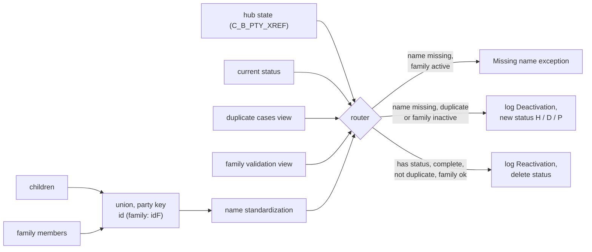

# 013 m_Tgt_C_S_ECI_Pty_Validation

| | |
|---|---|
| Source system | ECI, workflow `wf_ECI_Stage_Load`, first mapping |
| Sub-domain | Demographics (party activation status) |
| Sources | `STG_ECI_D_CHILD`, `STG_ECI_D_FAMILY`, `C_B_PTY_XREF`, `STG_ECI_PTY_INACTIVE_STS`, `V_ECI_ETL_LU_DUP_CASES`, `V_ECI_ETL_LU_FAMILY_VALIDATION`
 |
| Targets | `STG_ECI_PTY_INACTIVE_STS`, `STG_ECI_PTY_INACTIVE_LOG`, `EXC_STG_BAD_REC_MEMB` |
| Java | `com.idq.cli.source.eci.EciPartyValidation` |

## Business purpose

Decides, before anything is loaded, which ECI children and family members are inactive. Every later ECI mapping
skips a party whose source key has a deactivation status. A party is deactivated when its name is incomplete, when
all its cases are duplicates, or when its family is flagged by the family validation view; it is reactivated when
it is complete again.

## Process



## IdqMapInitQuery

### ECI-013 Children and family members

Children and family members with names, birth date and audit dates. No stale filter found.

Entity: `EciQueries.PartyName` - named query: `EciQueries#fetchPartyNames`.

```sql
SELECT 'ECI_CHILD' AS source_table, id_child AS id, first_name, last_name, middle_initial, dob,
       date_created, date_modified, modified_by, created_by, load_date
FROM stg_eci_d_child
UNION ALL
SELECT 'ECI_FAMILY', id_family, first_name, last_name, middle_initial, dob, date_created, date_modified,
       modified_by, created_by, load_date
FROM stg_eci_d_family
```

### Lookups

`Lookup_STG_ECI_PTY_INACTIVE_STS` - `EciQueries#fetchInactiveStatuses`:

```sql
SELECT src_key AS lookup_key, deactivation_sts AS lookup_value FROM stg_eci_pty_inactive_sts
WHERE rowid_system = 'ECI' AND deactivation_sts IS NOT NULL
```

`Lookup_C_B_PTY_XREF` (hub state of the party in MDM) - `EciQueries#fetchHubStates`:

```sql
SELECT pkey_src_object AS lookup_key, hub_state_ind AS lookup_value FROM c_b_pty_xref
WHERE rowid_system = 'ECI'
```

`Lookup_V_ECI_ETL_LU_DUP_CASES` - `EciQueries#fetchDuplicateCases`:

```sql
SELECT source_table || '|' || id AS lookup_key, TO_CHAR(id) AS lookup_value FROM v_eci_etl_lu_dup_cases
```

`Lookup_V_ECI_ETL_LU_FAMILY_VALIDATION` - `EciQueries#fetchFamilyValidations`:

```sql
SELECT source_table, id_family, fam_name_status, fam_phone_and_address_sts, fam_inactive_sts
FROM v_eci_etl_lu_family_validation
```

The two `V_ECI_ETL_*` views and `C_B_PTY_XREF` are not part of the exports; see `db/missing-objects.sql`.

## Business rules

1. Party key = id left-padded to 10 digits, family members suffixed `F`.
2. Family inactive = any of the family name, phone-and-address or inactive statuses is set.
3. `Invalid_Party_Name`: standardized first or last name missing **and** family not inactive ->
   `Missing_First_Name` / `Missing_Last_Name`.
4. `Deactivation`: name missing, or all cases duplicate (id in the duplicate-cases view), or family inactive. A log
   row is written; if the party has no status yet a status row is added: `H` (no MDM cross-reference),
   `D` (hub state -1) or `P` (pending).
5. `Reactivation`: the party has a status and both names, is not a duplicate and the family is not inactive. A log
   row is written and the status row deleted (`DD_DELETE`).

## PKEY formulation

No `C_S_*` target. Status / log key `SRC_KEY` = party key, `ROWID_SYSTEM` = `ECI`. Unit test:
`EciPkeyTest#m_Tgt_C_S_ECI_Pty_Validation_pkey_test` (status keys `0000000042` and `0000000007F`).

## Java implementation

* `EciPartyValidation.transform` + `InactiveStatus.Changes` (deactivate / reactivate) + `InactiveStatus.output`
  (log append, status delete by key, status append). Entities `EciTargets.InactiveStatus`,
  `EciTargets.InactiveLog`.
* Source entities (raw source tables, captured in the `adhoc_runs_*` audit reports): `EciSources.ChildDelta`
  (`STG_ECI_D_CHILD`), `EciSources.FamilyDelta` (`STG_ECI_D_FAMILY`), `MdmBaseTables.PartyXref` (`C_B_PTY_XREF`),
  `EciTargets.InactiveStatus` (`STG_ECI_PTY_INACTIVE_STS`), `EciSources.EtlLuDupCases` (`V_ECI_ETL_LU_DUP_CASES`),
  `EciSources.EtlLuFamilyValidation` (`V_ECI_ETL_LU_FAMILY_VALIDATION`).
