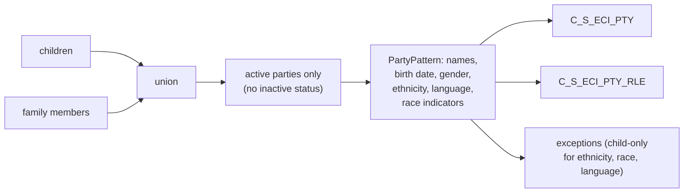

# 014 m_Tgt_C_S_ECI_Pty

| | |
|---|---|
| Source system | ECI, after 013 |
| Sub-domain | Demographics (plus Role) |
| Sources | `STG_ECI_D_CHILD`, `STG_ECI_D_FAMILY`, `STG_ECI_PTY_INACTIVE_STS`
 |
| Targets | `C_S_ECI_PTY`, `C_S_ECI_PTY_RLE`, `EXC_STG_BAD_REC_MEMB` |
| Java | `com.idq.cli.source.eci.EciParty` |

## Business purpose

Publishes the demographics of active ECI children and family members and their member role, including birth weight,
preferred language and race from the five race indicators.

## Process



## IdqMapInitQuery

### ECI-014 Child and family demographics

* Children with all demographics; family members with names, birth date, gender and audit dates (other columns
  `NULL`). `DATE_MODIFIED` falls back to `DATE_CREATED`.
* **Stale filter removed**: `ID_CHILD IN ('0001252185','0001252521','0001267262','0001303720','0001252810')` on the
  source qualifier.

Entity: `EciQueries.PartyDemographics` - named query: `EciQueries#fetchPartyDemographics`.

```sql
SELECT 'ECI_CHILD' AS source_table, child.id_child AS id, child.child_ssn, child.first_name,
       child.last_name, child.middle_initial, child.dob, child.gestation_age, child.gender,
       child.birth_wt_lb, child.birth_wt_oz, child.interpret_ind, child.language_cd, child.race_cd,
       child.date_created, COALESCE(child.date_modified, child.date_created) AS date_modified,
       child.modified_by, child.created_by, child.ethnicity, child.race_white, child.race_aa,
       child.race_asian, child.race_pi, child.race_an, child.load_date
FROM stg_eci_d_child child
UNION ALL
SELECT 'ECI_FAMILY', fam.id_family, NULL, fam.first_name, fam.last_name, fam.middle_initial, fam.dob,
       NULL, fam.gender, NULL, NULL, NULL, NULL, NULL, fam.date_created,
       COALESCE(fam.date_modified, fam.date_created), fam.modified_by, fam.created_by, NULL, NULL, NULL,
       NULL, NULL, NULL, fam.load_date
FROM stg_eci_d_family fam
```

Lookup: `EciQueries#fetchInactiveStatuses` (see [013](013_m_Tgt_C_S_ECI_Pty_Validation.md)).

## Business rules

1. Inactive parties (status set by 013) are skipped.
2. `PartyPattern` with spec ECI: race from indicators, language rule on, suffix rule off; ethnicity, race and
   language exceptions only for children (`SRC_TBL = 'ECI_CHILD'`); birth date and gender for everyone
   ([000](000_mapplets.md#person-rules)). Every party is loaded (`Valid_Party: TRUE`).
3. Birth weight in grams = `BIRTH_WT_LB * 453.6 + BIRTH_WT_OZ * 28.35`.
4. `PRFRD_LANG_CD` = translated language, `SRC_PRFRD_LANG_CD` = source code; `RACE_CD` from indicators,
   `SRC_RACE_CD` = indicator list (`WH1AA0...`).
5. Audit: period start = date modified, create date / creator = created, updated by = modified by, hub state 1.

## PKEY formulation

| Target | PKEY_SRC_OBJECT | Example |
|---|---|---|
| `C_S_ECI_PTY` | `LPAD(ID,10,'0')`, family members + `F` | `0000000042F` |
| `C_S_ECI_PTY_RLE` | `<party key>|Member`, `PTY_FK` = party key | `0000000042|Member` |

Unit test: `EciPkeyTest#m_Tgt_C_S_ECI_Pty_pkey_test`.

## Retired / not ported

* `exp_Party_Consolidation` MD5 / version / duplicate rank (version hard-coded 1) - MDM timeline.

## Java implementation

* `EciParty.transform` -> `PartyPattern.apply(SPEC, ...)` -> `EciTargets.Party` (`Columns.Party` + birth weight and
  language columns) and `EciTargets.PartyRole`; `birthWeightGrams`.
* Source entities (raw source tables, captured in the `adhoc_runs_*` audit reports): `EciSources.ChildDelta`
  (`STG_ECI_D_CHILD`), `EciSources.FamilyDelta` (`STG_ECI_D_FAMILY`), `EciTargets.InactiveStatus`
  (`STG_ECI_PTY_INACTIVE_STS`).
