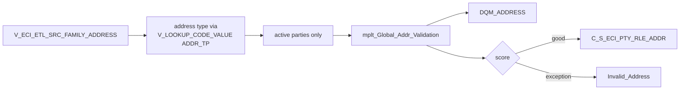

# 015 m_Tgt_C_S_ECI_Pty_Addr

| | |
|---|---|
| Source system | ECI |
| Sub-domain | Address |
| Sources | `V_ECI_ETL_SRC_FAMILY_ADDRESS`, `STG_ECI_PTY_INACTIVE_STS`
 |
| Targets | `C_S_ECI_PTY_RLE_ADDR`, `DQM_ADDRESS`, `EXC_STG_BAD_REC_MEMB` |
| Java | `com.idq.cli.source.eci.etlmap.svc.EciAddressService` |

## Business purpose

Publishes the family addresses of active ECI children and family members after address validation.

## Process



## IdqMapInitQuery

### ECI-015 Family addresses

All rows of the source view (the view's own definition is not part of the exports). No filter in IDQ.

Entity: `EciQueryRows.FamilyAddress` - named query: `EciFamilyAddressViewRepository#fetchFamilyAddresses`.

```sql
SELECT source_table, id, id_family_address, address1, address2, address_cd, city_name, county_name,
       state_abbrev, zip_code, zip_sfx, last_update_date
FROM v_eci_etl_src_family_address
```

<!-- lookups:begin -->
## Lookups

Connected lookups, grouped by the transformation that feeds their input ports. In a lookup condition the
left side is the lookup table column and the right side is the lookup input port. Output ports are the
returned table columns (or input ports passed through) and the downstream port each one feeds.

### Fed by `Exp_src` (Expression)

| Lookup | Table | Condition | Input ports | Output ports |
|---|---|---|---|---|
| `lkp_Address_Type` | `V_LOOKUP_CODE_VALUE` (STAGING)<br>filter: `"V_LOOKUP_CODE_VALUE"."CODE_TYPE"='ADDR_TP'`<br>multiple match: any row | `SRC_CODE_VALUE = SRC_ADDR_TP AND SRC_SYS = SRC_SYS_IN` | `SRC_ADDR_TP` &larr; `ADDRESS_CD`<br>`SRC_SYS_IN` &larr; `SRC_SYS` | `MSTR_CODE_VALUE` &rarr; `Exp_Build_Src_key.MSTR_ADDR_TP` (Expression) |

### Fed by `Exp_Build_Src_key` (Expression)

| Lookup | Table | Condition | Input ports | Output ports |
|---|---|---|---|---|
| `Lkp_STG_ECI_PTY_INACTIVE_STS` | `STG_ECI_PTY_INACTIVE_STS` (STAGING)<br>multiple match: any row | `SRC_KEY = PTY_SRC_KEY AND ROWID_SYSTEM = SRC_SYSTEM` | `SRC_SYSTEM` &larr; `SRC_SYS`<br>`PTY_SRC_KEY` &larr; `PTY_SRC_KEY` | `DEACTIVATION_STS` &rarr; `Fil_Inactive_recs.DEACTIVATION_STS` (Filter) |

Lookups inside the mapplets / rules this mapping calls are listed in
[000](000_mapplets.md#lookups-inside-mapplets-and-rules): `mplt_Global_Addr_Validation`.

<!-- lookups:end -->

## Business rules

1. Address type: `ADDRESS_CD` translated with `V_LOOKUP_CODE_VALUE` (`ADDR_TP`, `ECI`).
2. Inactive parties skipped (party key as in [013](013_m_Tgt_C_S_ECI_Pty_Validation.md)).
3. Validation input: lines, city, state, `zip[-sfx]`, country `US`
   ([000](000_mapplets.md#address-validation)); `DQM_ADDRESS` for every active row.
4. Scoring; exceptions use the hard-coded description `Invalid Address per Address Doctor`, type `Bad Value`
   (ids id / family address id / source table).
5. Good rows: lines held, preference `Primary`, location id `id|family address id`, hierarchy `Member`,
   `Member Addr`, period start / effective start = last update date, hub state 1, updated by = mapping name.

## PKEY formulation

| Target | PKEY_SRC_OBJECT | Example |
|---|---|---|
| `C_S_ECI_PTY_RLE_ADDR` | `<party key>|Member|<type>|LPAD(address id,10)|UPPER(TRIM(line1))|UPPER(TRIM(line2))|UPPER(city)|UPPER(state)|zip|zip sfx` | `0000000042F|Member|002|0000000005|1 MAIN ST||AUSTIN|TX|78701|1234` |

`PTY_RLE_FK` = `<party key>|Member`. Unit test: `EciPkeyTest#m_Tgt_C_S_ECI_Pty_Addr_pkey_test`.

## Retired / not ported

* `VERSION_SEQ_NUM = 1`, `PERIOD_REFERENCE_TIME` - MDM timeline.

## Java implementation

* `EciAddressService.pkey` + `AddressPatterns.route` (validate, DQM, score, hold lines, exception) shared with FSS / WIC;
  entity `EciTargets.Address`.
* Source entities (raw source tables, captured in the `adhoc_runs_*` audit reports): `EciSources.EtlSrcFamilyAddress`
  (`V_ECI_ETL_SRC_FAMILY_ADDRESS`), `EciSources.InactiveStatus` (`STG_ECI_PTY_INACTIVE_STS`).
