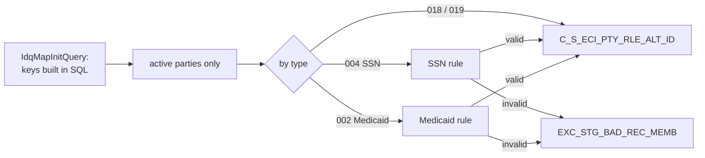

# 016 m_Tgt_C_S_ECI_Pty_Rle_Alt_Id

| | |
|---|---|
| Source system | ECI |
| Sub-domain | Alternate-ID |
| Sources | `STG_ECI_D_CHILD`, `STG_ECI_D_FAMILY`, `STG_ECI_D_MEDICAID`, `STG_ECI_SN_CASE`, `STG_ECI_PTY_INACTIVE_STS`
 |
| Targets | `C_S_ECI_PTY_RLE_ALT_ID`, `EXC_STG_BAD_REC_MEMB` |
| Java | `com.idq.cli.source.eci.EciAlternateId` |

## Business purpose

Publishes the identifiers of ECI parties: the ECI child id (`018`), the ECI family id (`019`), the child SSN
(`004`) and the Medicaid number (`002`) of the child's cases.

## Process



## IdqMapInitQuery

### ECI-016 Child and family identifiers

Four branches, each producing the role key, the type, the value and the complete `PKEY_SRC_OBJECT`:
child id (`018`), child SSN (`004`, only when present), Medicaid number (`002`, from the Medicaid records of the
child's cases) and family id (`019`, role key suffixed `F`). No stale filter found.

Entity: `EciQueries.PartyIdentifier` - named query: `EciQueries#fetchPartyIdentifiers`.

```sql
SELECT id_child AS id, LPAD(id_child, 10, '0') || '|Member' AS pty_rel_fk,
       LPAD(id_child, 10, '0') AS src_key_sfx, '018' alt_id_tp, LPAD(id_child, 10, '0') alt_id_val,
       date_created, date_modified,
       LPAD(id_child, 10, '0') || '|Member' || '|018' || '|' || LPAD(id_child, 10, '0') AS pkey_src_object
FROM stg_eci_d_child
UNION ALL
SELECT id_child, LPAD(id_child, 10, '0') || '|Member', LPAD(id_child, 10, '0'), '004', child_ssn,
       date_created, date_modified,
       LPAD(id_child, 10, '0') || '|Member' || '|004' || '|' || LPAD(id_child, 10, '0')
FROM stg_eci_d_child
WHERE child_ssn IS NOT NULL
UNION ALL
SELECT id_child, LPAD(id_child, 10, '0') || '|Member', LPAD(id_medicaid, 9, '0'), '002', medicaid_nbr,
       m.date_created, m.date_modified,
       LPAD(id_child, 10, '0') || '|Member' || '|002' || '|' || LPAD(id_medicaid, 10, '0')
FROM stg_eci_d_medicaid m
JOIN stg_eci_sn_case c ON m.id_case = c.id_case
UNION ALL
SELECT id_family, LPAD(id_family, 10, '0') || 'F|Member', LPAD(id_family, 10, '0'), '019',
       LPAD(id_family, 10, '0'), date_created, date_modified,
       LPAD(id_family, 10, '0') || 'F|Member' || '|019' || '|' || LPAD(id_family, 10, '0')
FROM stg_eci_d_family
```

`STG_ECI_SN_CASE` is not part of the exports; the placeholder in `db/missing-objects.sql` carries the columns this
query needs (`ID_CASE`, `ID_CHILD`).

## Business rules

1. Party key = first 11 characters of the role key without a trailing `|`; inactive parties skipped.
2. SSN: `rule_USA_SSN_Validation_post_June2011`; invalid -> `Invalid_SSN` (attribute `ALT_ID_Type_SSN`).
3. Medicaid: `rule_MEDICAID_ID_Std`; anything but 9 characters -> `Invalid_Medicaid_Id` (attribute
   `ALT_ID_TP_MedicaidId`). The value loaded is the reported value.
4. Loaded with status `Issued`, hub state 1, `SRC_ROWID` = `id|type`, source update = modified else created.

## PKEY formulation

| Target | PKEY_SRC_OBJECT | Example |
|---|---|---|
| `C_S_ECI_PTY_RLE_ALT_ID` | child: `LPAD(child,10)|Member|018|LPAD(child,10)`; SSN: `...|004|LPAD(child,10)`; Medicaid: `...|002|LPAD(medicaid record id,10)`; family: `LPAD(family,10)F|Member|019|LPAD(family,10)` | `0000000042|Member|018|0000000042` |

Note the SSN key ends with the child id, not the SSN. Unit test: `EciPkeyTest#m_Tgt_C_S_ECI_Pty_Rle_Alt_Id_pkey_test`.

## Java implementation

* `EciAlternateId.transform` switches on the type (`IdentifierRules.ssn` / `medicaidId`); `partyKey`; entity
  `EciTargets.AlternateId`.
* Source entities (raw source tables, captured in the `adhoc_runs_*` audit reports): `EciSources.ChildDelta`
  (`STG_ECI_D_CHILD`), `EciSources.FamilyDelta` (`STG_ECI_D_FAMILY`), `EciSources.MedicaidDelta` (`STG_ECI_D_MEDICAID`),
  `EciSources.SnCase` (`STG_ECI_SN_CASE`), `EciTargets.InactiveStatus` (`STG_ECI_PTY_INACTIVE_STS`).
