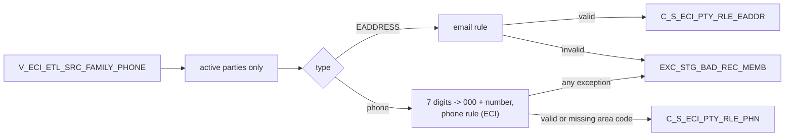

# 017 m_Tgt_C_S_ECI_Pty_Rle_Phn_And_EAddr

| | |
|---|---|
| Source system | ECI |
| Sub-domain | Phone-email |
| Sources | `V_ECI_ETL_SRC_FAMILY_PHONE`, `STG_ECI_PTY_INACTIVE_STS`
 |
| Targets | `C_S_ECI_PTY_RLE_PHN`, `C_S_ECI_PTY_RLE_EADDR`, `EXC_STG_BAD_REC_MEMB` |
| Java | `com.idq.cli.source.eci.etlmap.svc.EciPhoneEmailService` |

## Business purpose

Publishes the family phone numbers and e-mail addresses of active ECI parties. Seven-digit phone numbers are
completed with area code `000` so that they can be loaded while being reported as missing an area code.

## Process



## IdqMapInitQuery

### ECI-017 Family phones and e-mail

All rows of the source view (phones and e-mail in one column, `PHONE_EMAIL_TYPE` tells them apart). No filter.

Entity: `EciQueryRows.FamilyContact` - named query: `EciFamilyPhoneViewRepository#fetchFamilyContacts`.

```sql
SELECT source_table, id_family_phone, id_case, id, period_start_date, phone_email_type, phone_email,
       work_ext, phone_tp, usg_tp, pref_lvl
FROM v_eci_etl_src_family_phone
```

## Business rules

1. Party key in this mapping = the view id as reported (no padding) plus `F` for family rows; inactive skipped.
2. E-mail: rejected only when the exception code is configured (router on the looked-up code); loaded with
   address type `001`, `Active`, `Y`, hub state 1.
3. Phone: a 7-character number becomes `000` + number; `rule_Phone_Std` with source `ECI` and the usage type, so
   ECI numbers with area code `000` raise `Missing_AreaCode` and main / other numbers may not be toll free.
4. Phones with no exception **or** `Missing_AreaCode` are loaded (with the work extension as `PHN_NUM_EXT`); every
   phone with an exception (including `Missing_AreaCode`) is also written to the exception queue.

## PKEY formulation

| Target | PKEY_SRC_OBJECT | Example |
|---|---|---|
| `C_S_ECI_PTY_RLE_PHN` | `<id>[F]|Member|<phone type>|<usage>|<phone row id>|TRIM(number as reported)` | `42F|Member|Telephone|001|P1|5125551234` |
| `C_S_ECI_PTY_RLE_EADDR` | `<id>[F]|Member|001|<row id>|TRIM(e-mail as reported)` | `42|Member|001|E1|a@b.org` |

`SRC_ROWID` uses the untrimmed value. Unit test: `EciPkeyTest#m_Tgt_C_S_ECI_Pty_Rle_Phn_And_EAddr_pkey_test`.

## Java implementation

* `EciPhoneEmailService.partyKey`, `pkey`, `srcRowid`, `transform`; `ContactRules`; entities `EciTargets.Phone`
  (`PHN_NUM_EXT`), `EciTargets.Email`.
* Source entities (raw source tables, captured in the `adhoc_runs_*` audit reports): `EciSources.EtlSrcFamilyPhone`
  (`V_ECI_ETL_SRC_FAMILY_PHONE`), `EciSources.InactiveStatus` (`STG_ECI_PTY_INACTIVE_STS`).
