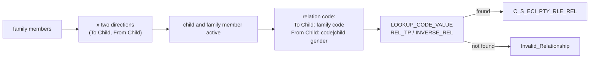

# 018 m_Tgt_C_S_ECI_Pty_Rle_Rel

| | |
|---|---|
| Source system | ECI |
| Sub-domain | Role |
| Targets | `C_S_ECI_PTY_RLE_REL`, `EXC_STG_BAD_REC_MEMB` |
| Java | `com.idq.cli.source.eci.EciRelationship` |

## Business purpose

Publishes the relationship between each family member and the child, in both directions: family member -> child
(e.g. mother) and child -> family member (e.g. son, using the child's gender).

## Process



## IdqMapInitQuery

### ECI-018 Child family relations

Each family row twice (cartesian join with the two directions). No stale filter.

Entity: `EciQueries.FamilyRelation` - named query: `EciQueries#fetchFamilyRelations`.

```sql
SELECT d.relation_direction, f.id_family, f.gender AS family_gender, f.id_child,
       TO_CHAR(f.family_cd) AS family_cd, COALESCE(f.date_modified, f.date_created) AS date_modified,
       f.date_created
FROM stg_eci_d_family f
JOIN (SELECT 'From Child' relation_direction FROM dual
      UNION ALL
      SELECT 'To Child' FROM dual) d ON 1 = 1
```

Lookups: `EciQueries#fetchInactiveStatuses`, and the child gender `Lkp_STG_ECI_SN_CHILD`:

```sql
SELECT TO_CHAR(id_child) AS lookup_key, gender AS lookup_value FROM stg_eci_sn_child
```

## Business rules

1. Child key `LPAD(child,10)`, family key `LPAD(family,10)F`; both must be active.
2. Relation code: "To Child" = family code; "From Child" = `family code|child gender`.
3. Type: `LOOKUP_CODE_VALUE` with code type `REL_TP` or `INVERSE_REL`, source `ECI` (first match).
4. From / to roles follow the direction; `REL_TYPE_CODE` `Member Relationship`, hierarchy `Member`, hub state 1,
   creator / updated by = mapping name.
5. Untranslated codes -> `Invalid_Relationship` (ids family / child / relationship key, attribute `FAMILY_CD`).

## PKEY formulation

| Target | PKEY_SRC_OBJECT | Example |
|---|---|---|
| `C_S_ECI_PTY_RLE_REL` | `<from role>|<to role>|<MDM relationship code>` | `0000000007F|Member|0000000042|Member|MTH` |

Unit test: `EciPkeyTest#m_Tgt_C_S_ECI_Pty_Rle_Rel_pkey_test`.

## Java implementation

* `EciRelationship.childKey`, `familyKey`, `fromRole`, `toRole`, `relationCode`, `relationType`, `pkey`; entity
  `EciTargets.Relationship`.
* Source entities (raw source tables, captured in the `adhoc_runs_*` audit reports): `EciSources.DFamily`
  (`STG_ECI_D_FAMILY`), `EciSources.SnChild` (`STG_ECI_SN_CHILD`), `EciTargets.InactiveStatus`
  (`STG_ECI_PTY_INACTIVE_STS`).
