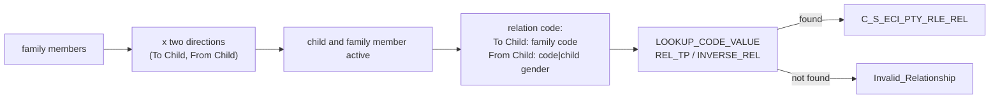

# 018 m_Tgt_C_S_ECI_Pty_Rle_Rel

| | |
|---|---|
| Source system | ECI |
| Sub-domain | Role |
| Sources | `STG_ECI_D_FAMILY`, `STG_ECI_SN_CHILD`, `STG_ECI_PTY_INACTIVE_STS`
 |
| Targets | `C_S_ECI_PTY_RLE_REL`, `EXC_STG_BAD_REC_MEMB` |
| Java | `com.idq.cli.source.eci.etlmap.svc.EciRelationshipService` |

## Business purpose

Publishes the relationship between each family member and the child, in both directions: family member -> child
(e.g. mother) and child -> family member (e.g. son, using the child's gender).

## Process



## IdqMapInitQuery

### ECI-018 Child family relations

Each family row twice (cartesian join with the two directions). No stale filter.

Entity: `EciQueryRows.FamilyRelation` - named query: `EciFamilyDeltaRepository#fetchFamilyRelations`.

```sql
SELECT d.relation_direction, f.id_family, f.gender AS family_gender, f.id_child,
       TO_CHAR(f.family_cd) AS family_cd, COALESCE(f.date_modified, f.date_created) AS date_modified,
       f.date_created
FROM stg_eci_d_family f
JOIN (SELECT 'From Child' relation_direction FROM dual
      UNION ALL
      SELECT 'To Child' FROM dual) d ON 1 = 1
```

Lookups: `EciInactiveStatusRepository#fetchInactiveStatuses`, and the child gender `Lkp_STG_ECI_SN_CHILD`:

```sql
SELECT TO_CHAR(id_child) AS lookup_key, gender AS lookup_value FROM stg_eci_sn_child
```

<!-- lookups:begin -->
## Lookups

Connected lookups, grouped by the transformation that feeds their input ports. In a lookup condition the
left side is the lookup table column and the right side is the lookup input port. Output ports are the
returned table columns (or input ports passed through) and the downstream port each one feeds.

### Fed by `Exp_Build_Keys` (Expression)

| Lookup | Table | Condition | Input ports | Output ports |
|---|---|---|---|---|
| `Lkp_CHILD_STG_ECI_PTY_INACTIVE_STS` | `STG_ECI_PTY_INACTIVE_STS` (STAGING)<br>multiple match: any row | `SRC_KEY = PKEY_SRC_OBJECT AND ROWID_SYSTEM = SRC_SYSTEM` | `PKEY_SRC_OBJECT` &larr; `Child_Pty_Src_Key`<br>`SRC_SYSTEM` &larr; `Source_System` | `DEACTIVATION_STS` &rarr; `Filter_Fam_Child_Valid.CHILD_DEACTIVATION_STS` (Filter) |
| `Lkp_FAM_STG_ECI_PTY_INACTIVE_STS` | `STG_ECI_PTY_INACTIVE_STS` (STAGING)<br>multiple match: any row | `SRC_KEY = PKEY_SRC_OBJECT AND ROWID_SYSTEM = SRC_SYSTEM` | `PKEY_SRC_OBJECT` &larr; `Family_Pty_Src_Key`<br>`SRC_SYSTEM` &larr; `Source_System` | `DEACTIVATION_STS` &rarr; `Filter_Fam_Child_Valid.FAM_DEACTIVATION_STS1` (Filter) |

### Fed by `Exp_Prep_Family_cd` (Expression)

| Lookup | Table | Condition | Input ports | Output ports |
|---|---|---|---|---|
| `Lkp_Rel_Tp_Code_Value` | `LOOKUP_CODE_VALUE` (STAGING)<br>filter: `"LOOKUP_CODE_VALUE"."CODE_TYPE" IN ('REL_TP','INVERSE_REL')`<br>multiple match: any row | `SRC_SYS = Source_System AND SRC_CODE_VALUE = FAMILY_CD` | `Source_System` &larr; `Source_System`<br>`FAMILY_CD` &larr; `out_FAMILY_CD` | `MSTR_REF_CODE` &rarr; `Route_Good_vs_Exceptions.MSTR_REF_CODE` (Router)<br>`MSTR_REF_LABEL` &rarr; `Route_Good_vs_Exceptions.MSTR_REF_LABEL` (Router)<br>`MSTR_REF_DESC` &rarr; `Route_Good_vs_Exceptions.MSTR_REF_DESC` (Router)<br>`FAMILY_CD` (pass-through) &rarr; `Route_Good_vs_Exceptions.all_FAMILY_CD` (Router) |

### Fed by `Filter_Fam_Child_Valid` (Filter)

| Lookup | Table | Condition | Input ports | Output ports |
|---|---|---|---|---|
| `Lkp_STG_ECI_SN_CHILD` | `STG_ECI_SN_CHILD` (STAGING)<br>multiple match: any row | `ID_CHILD = in_ID_CHILD` | `in_ID_CHILD` &larr; `ID_CHILD` | `GENDER` &rarr; `Exp_Prep_Family_cd.GENDER` (Expression) |

### Fed by `Exp_Build_Exception` (Expression)

| Lookup | Table | Condition | Input ports | Output ports |
|---|---|---|---|---|
| `Lookup_EXC_LOOKUP_CODE_VALUE` | `EXC_LOOKUP_CODE_VALUE` (STAGING)<br>multiple match: any row | `EXCEPTION_CODE = in_Exception_Code` | `in_Exception_Code` &larr; `Exception_Code` | `EXCEPTION_TYPE` &rarr; `Write_EXC_STG_BAD_REC_MEMB.EXCEPTION_TYPE` (Target)<br>`EXCEPTION_CODE` &rarr; `Write_EXC_STG_BAD_REC_MEMB.EXCEPTION_CODE` (Target)<br>`EXCEPTION_DESC` &rarr; `Write_EXC_STG_BAD_REC_MEMB.EXCEPTION_DESC` (Target) |

<!-- lookups:end -->

## Business rules

1. Child key `LPAD(child,10)`, family key `LPAD(family,10)F`; both must be active.
2. Relation code: "To Child" = family code; "From Child" = `family code|child gender`.
3. Type: `LOOKUP_CODE_VALUE` with code type `REL_TP` or `INVERSE_REL`, source `ECI` (first match).
4. From / to roles follow the direction; `REL_TYPE_CODE` `Member Relationship`, hierarchy `Member`, hub state 1,
   creator / updated by = mapping name.
5. Untranslated codes -> `Invalid_Relationship` (ids family / child / relationship key, attribute `FAMILY_CD`).

## PKEY formulation

| Target | PKEY_SRC_OBJECT | Example |
|---|---|---|
| `C_S_ECI_PTY_RLE_REL` | `<from role>|<to role>|<MDM relationship code>` | `0000000007F|Member|0000000042|Member|MTH` |

Unit test: `EciPkeyTest#m_Tgt_C_S_ECI_Pty_Rle_Rel_pkey_test`.

## Java implementation

* `EciRelationshipService.childKey`, `familyKey`, `fromRole`, `toRole`, `relationCode`, `relationType`, `pkey`; entity
  `EciTargets.Relationship`.
* Source entities (raw source tables, captured in the `adhoc_runs_*` audit reports): `EciSources.FamilyDelta`
  (`STG_ECI_D_FAMILY`), `EciSources.SnChild` (`STG_ECI_SN_CHILD`), `EciSources.InactiveStatus`
  (`STG_ECI_PTY_INACTIVE_STS`).
