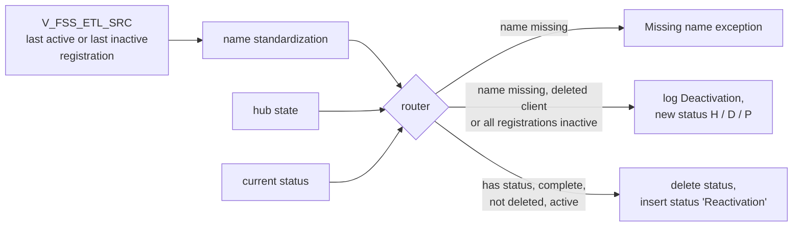

# 019 m_Tgt_C_S_FSS_Pty_Validation

| | |
|---|---|
| Source system | FSS, workflow `wf_FSS_Stage_Load`, first mapping |
| Sub-domain | Demographics (party activation status) |
| Sources | `V_FSS_ETL_SRC`, `C_B_PTY_XREF`, `STG_FSS_PTY_INACTIVE_STS`
 |
| Targets | `STG_FSS_PTY_INACTIVE_STS`, `STG_FSS_PTY_INACTIVE_LOG`, `EXC_STG_BAD_REC_MEMB` |
| Java | `com.idq.cli.source.fss.etlmap.svc.FssPartyValidationService` |

## Business purpose

Decides which FSS clients are inactive before the other FSS mappings run. A client is deactivated when its name is
incomplete, the client was deleted at the source, or all its registrations are inactive; it is reactivated when it
becomes complete and active again.

## Process



## IdqMapInitQuery

### FSS-019 Active and inactive clients

Rows of the client view that are the last active registration of a client or mark that all registrations are
inactive. The view supplies the party source key `PTY_SRC_KEY`. The testing filters were already commented out in
IDQ.

Entity: `FssQueryRows.ClientName` - named query: `FssEtlSrcViewRepository#fetchClientNames`.

```sql
SELECT source_type, id_client, pty_src_key, nm_first, nm_last, nm_middle, dt_dob, dt_last_update,
       stg_update_date, client_dtl__capxaction AS client_dtl_capxaction, last_inactv_client_yn
FROM v_fss_etl_src
WHERE last_active_client_registration_yn = 'Y' OR last_inactv_client_yn = 'Y'
```

Lookups: `FssInactiveStatusRepository#fetchInactiveStatuses`, `FssPartyXrefRepository#fetchHubStates`:

```sql
SELECT src_key AS lookup_key, deactivation_sts AS lookup_value FROM stg_fss_pty_inactive_sts
WHERE rowid_system = 'FSS' AND deactivation_sts IS NOT NULL
```

```sql
SELECT pkey_src_object AS lookup_key, hub_state_ind AS lookup_value FROM c_b_pty_xref
WHERE rowid_system = 'FSS'
```

<!-- lookups:begin -->
## Lookups

Connected lookups, grouped by the transformation that feeds their input ports. In a lookup condition the
left side is the lookup table column and the right side is the lookup input port. Output ports are the
returned table columns (or input ports passed through) and the downstream port each one feeds.

### Fed by `Exp_Invalid_PTY_NM` (Expression)

| Lookup | Table | Condition | Input ports | Output ports |
|---|---|---|---|---|
| `Lkp_EXC_LOOKUP_CODE_VALUE_Name` | `EXC_LOOKUP_CODE_VALUE` (STAGING)<br>multiple match: default | `EXCEPTION_CODE = Exception_Code_Name` | `Exception_Code_Name` &larr; `Exception_Code_Name` | `EXCEPTION_DESC` &rarr; `Write_Invalid_Party_Name.EXCEPTION_DESC` (Target)<br>`EXCEPTION_TYPE` &rarr; `Write_Invalid_Party_Name.EXCEPTION_TYPE` (Target) |

### Fed by `Exp_ECI_Data_Load` (Expression)

| Lookup | Table | Condition | Input ports | Output ports |
|---|---|---|---|---|
| `Lookup_C_B_PTY_XREF` | `C_B_PTY_XREF` (HHS_MDM_ORS)<br>filter: `"C_B_PTY_XREF"."ROWID_SYSTEM" = 'FSS'`<br>multiple match: default | `PKEY_SRC_OBJECT = PKEY_SRC_OBJECT1` | `SRC_SYSTEM` &larr; `SRC_SYSTEM`<br>`PKEY_SRC_OBJECT1` &larr; `PKEY_SRC_OBJECT` | `HUB_STATE_IND` &rarr; `Exp_Consolidate_Exceptions.HUB_STATE_IND` (Expression) |
| `Lookup_STG_FSS_PTY_INACTIVE_STS` | `STG_FSS_PTY_INACTIVE_STS` (STAGING)<br>multiple match: any row | `SRC_KEY = PKEY_SRC_OBJECT AND ROWID_SYSTEM = SRC_SYSTEM` | `PKEY_SRC_OBJECT` &larr; `PKEY_SRC_OBJECT`<br>`SRC_SYSTEM` &larr; `SRC_SYSTEM` | `DEACTIVATION_STS` &rarr; `Exp_Consolidate_Exceptions.DEACTIVATION_STS` (Expression) |

Lookups inside the mapplets / rules this mapping calls are listed in
[000](000_mapplets.md#lookups-inside-mapplets-and-rules): `mplt_Name_Standardization_Indv_Member`.

<!-- lookups:end -->

## Business rules

1. `Invalid_Party_Name`: standardized first or last name missing -> `Missing_First_Name` / `Missing_Last_Name`
   (attribute value = source full name).
2. `Deactivation`: name missing, `CLIENT_DTL__CAPXACTION = 'D'` (client deleted) or `LAST_INACTV_CLIENT_YN = 'Y'`.
   Log row; new status `H` / `D` / `P` when the client has none.
3. `Reactivation`: status present, both names present, capture action not `D` and not all registrations inactive
   (both flags must be present - Informatica compares `NULL <> 'D'` as false).
4. **Observed IDQ behaviour, ported as is:** FSS writes the reactivation to `STG_FSS_PTY_INACTIVE_STS` (status
   value `Reactivation`) instead of to the log, after deleting the old status row. Because later mappings skip any
   party with a non-null status, a reactivated FSS client stays excluded. ECI, TTF and WIC log reactivations
   instead. Confirm with the business whether this should be corrected.

## PKEY formulation

No `C_S_*` target; status / log key `SRC_KEY` = `PTY_SRC_KEY`, `ROWID_SYSTEM` = `FSS`. Unit test:
`FssPkeyTest#m_Tgt_C_S_FSS_Pty_Validation_pkey_test`.

## Java implementation

* `FssPartyValidationService.transform` with `InactiveStatus.Changes`; reactivation log rows are converted into status rows
  to mirror IDQ; `InactiveStatus.output`.
* Source entities (raw source tables, captured in the `adhoc_runs_*` audit reports): `FssSources.EtlSrc`
  (`V_FSS_ETL_SRC`), `MdmBaseTables.PartyXref` (`C_B_PTY_XREF`), `FssSources.InactiveStatus`
  (`STG_FSS_PTY_INACTIVE_STS`).
