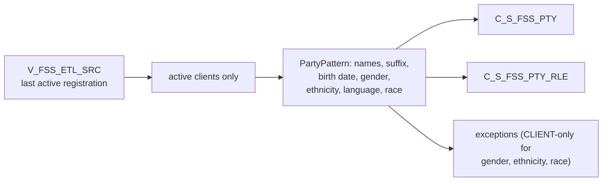

# 020 m_Tgt_C_S_FSS_Pty

| | |
|---|---|
| Source system | FSS, after 019 |
| Sub-domain | Demographics (plus Role) |
| Targets | `C_S_FSS_PTY`, `C_S_FSS_PTY_RLE`, `EXC_STG_BAD_REC_MEMB` |
| Java | `com.idq.cli.source.fss.FssParty` |

## Business purpose

Publishes the demographics and member role of active FSS clients (last active registration), with suffix
standardization, language and race from indicators.

## Process



## IdqMapInitQuery

### FSS-020 Client demographics

Client view rows that are the last active registration. Commented testing filters were already inactive in IDQ.

Entity: `FssQueries.ClientDemographics` - named query: `FssQueries#fetchClientDemographics`.

```sql
SELECT source_type, dt_last_update, id_client, pty_src_key, nm_first, nm_last, nm_middle, dt_dob,
       cd_gender, language_cd, cd_hispanic, race_white, race_aa, race_asian, race_pi, race_an, cd_suffix
FROM v_fss_etl_src
WHERE last_active_client_registration_yn = 'Y'
```

## Business rules

1. Inactive clients skipped.
2. `PartyPattern` spec FSS: race from indicators, language and suffix rules on; gender, ethnicity and race
   exceptions only for `CLIENT` rows; language, suffix and birth date for all ([000](000_mapplets.md#person-rules)).
3. Ethnicity source = `CD_HISPANIC`; `SFX_NM` = standardized suffix; `PRFRD_LANG_CD` = translated language;
   `BIRTH_DT` = the reported birth date (the FSS target takes the source date, not the validated one).
4. Audit: period start, create date and source update = `DT_LAST_UPDATE`; hub state 1.

## PKEY formulation

| Target | PKEY_SRC_OBJECT | Example |
|---|---|---|
| `C_S_FSS_PTY` | `TRIM(PTY_SRC_KEY)` (key built by the view) | `0000000011` |
| `C_S_FSS_PTY_RLE` | `<party key>|Member` | `0000000011|Member` |

Unit test: `FssPkeyTest#m_Tgt_C_S_FSS_Pty_pkey_test`.

## Retired / not ported

* Version / duplicate rank of `exp_Party_Consolidation` - MDM timeline.

## Java implementation

* `FssParty.transform` -> `PartyPattern.apply(SPEC, ...)`; entities `FssTargets.Party`, `FssTargets.PartyRole`.
* Source entities (raw source tables, captured in the `adhoc_runs_*` audit reports): `FssSources.EtlSrc`
  (`V_FSS_ETL_SRC`), `FssTargets.InactiveStatus` (`STG_FSS_PTY_INACTIVE_STS`).
