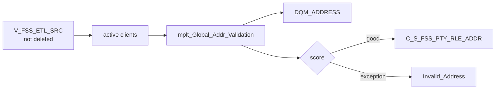

# 021 m_Tgt_C_S_FSS_Pty_Addr

| | |
|---|---|
| Source system | FSS |
| Sub-domain | Address |
| Sources | `V_FSS_ETL_SRC`, `STG_FSS_PTY_INACTIVE_STS`
 |
| Targets | `C_S_FSS_PTY_RLE_ADDR`, `DQM_ADDRESS`, `EXC_STG_BAD_REC_MEMB` |
| Java | `com.idq.cli.source.fss.etlmap.svc.FssAddressService` |

## Business purpose

Publishes the registration address of active FSS clients as a physical mailing address (type `002`) after address
validation.

## Process



## IdqMapInitQuery

### FSS-021 Registration addresses

Client view rows whose capture action is not delete (`DTL__CAPXACTION <> 'D'`). No stale filter.

Entity: `FssQueryRows.ClientAddress` - named query: `FssEtlSrcViewRepository#fetchClientAddresses`.

```sql
SELECT source_type, id_client, id_registration_client, pty_src_key, addr_line1, addr_line2, addr_city,
       cd_cnty, addr_state, addr_zip, dt_created, dt_last_update
FROM v_fss_etl_src
WHERE dtl__capxaction <> 'D'
```

## Business rules

1. Address type is the constant `002` (no lookup), country `US`.
2. Validation input postal code = `ADDR_ZIP` (no extension); scoring and holding as in
   [000](000_mapplets.md#address-validation).
3. `DQM_ADDRESS.PTY_SRC_KEY` = `LPAD(ID_CLIENT,10,'0')` (the IDQ expression is copied from ECI and also tests for an
   `ECI_FAMILY` source table, which never occurs in FSS).
4. Period start = registration create date, effective start / source update = last update; location id =
   `client|registration client`.

## PKEY formulation

| Target | PKEY_SRC_OBJECT | Example |
|---|---|---|
| `C_S_FSS_PTY_RLE_ADDR` | `<PTY_SRC_KEY>|Member|002|LPAD(registration client id,10)|UPPER(TRIM(line1))|UPPER(TRIM(line2))|UPPER(city)|UPPER(state)|zip` | `0000000011|Member|002|0000000600|1 MAIN ST||AUSTIN|TX|78701` |

Unit test: `FssPkeyTest#m_Tgt_C_S_FSS_Pty_Addr_pkey_test`.

## Java implementation

* `FssAddressService.pkey` + `AddressPatterns.route`; entity `FssTargets.Address`.
* Source entities (raw source tables, captured in the `adhoc_runs_*` audit reports): `FssSources.EtlSrc`
  (`V_FSS_ETL_SRC`), `FssTargets.InactiveStatus` (`STG_FSS_PTY_INACTIVE_STS`).
