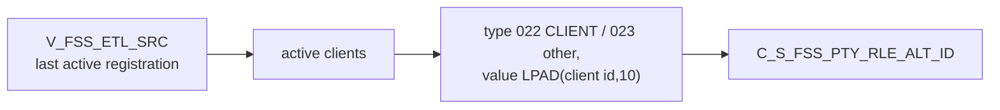

# 022 m_Tgt_C_S_FSS_Pty_Rle_Alt_Id

| | |
|---|---|
| Source system | FSS |
| Sub-domain | Alternate-ID |
| Sources | `V_FSS_ETL_SRC`, `STG_FSS_PTY_INACTIVE_STS`
 |
| Targets | `C_S_FSS_PTY_RLE_ALT_ID` |
| Java | `com.idq.cli.source.fss.etlmap.svc.FssAlternateIdService` |

## Business purpose

Publishes the FSS client id as an alternate identifier: type `022` for clients, `023` for registration-only
parties.



## IdqMapInitQuery

### FSS-022 Client and registration ids

Client view rows that are the last active registration. No stale filter (testing filters already commented out).

Entity: `FssQueryRows.ClientIdentifier` - named query: `FssEtlSrcViewRepository#fetchClientIdentifiers`.

```sql
SELECT id_client, dt_created, dt_last_update, pty_src_key, source_type
FROM v_fss_etl_src
WHERE last_active_client_registration_yn = 'Y'
```

## Business rules

1. Type `022` when `SOURCE_TYPE = 'CLIENT'`, else `023`; value `LPAD(ID_CLIENT,10,'0')`; status `Issued`.
2. `SRC_ROWID` = `client id|type`; period start / create date = `DT_CREATED`; source update = run time (the IDQ
   mapping maps `LAST_UPDATE_DATE` there).

## PKEY formulation

| Target | PKEY_SRC_OBJECT | Example |
|---|---|---|
| `C_S_FSS_PTY_RLE_ALT_ID` | `<PTY_SRC_KEY>|Member|<022/023>|LPAD(client id,10)` | `0000000011|Member|022|0000000011` |

Unit test: `FssPkeyTest#m_Tgt_C_S_FSS_Pty_Rle_Alt_Id_pkey_test`.

## Java implementation

* `FssAlternateIdService.altIdType`, `pkey`, `transform`; entity `FssTargets.AlternateId`.
* Source entities (raw source tables, captured in the `adhoc_runs_*` audit reports): `FssSources.EtlSrc`
  (`V_FSS_ETL_SRC`), `FssSources.InactiveStatus` (`STG_FSS_PTY_INACTIVE_STS`).
