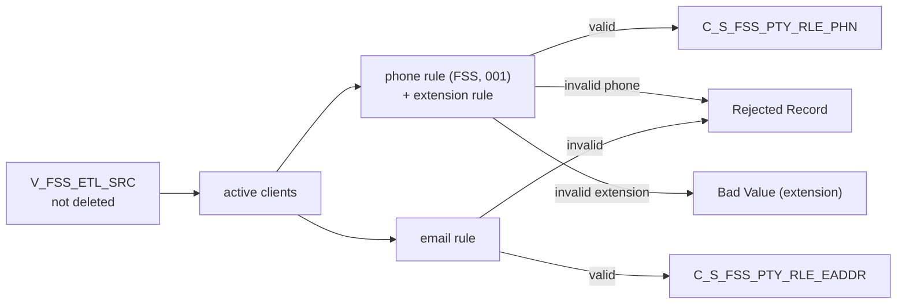

# 023 m_Tgt_C_S_FSS_Pty_Rle_Phn_And_EAddr

| | |
|---|---|
| Source system | FSS |
| Sub-domain | Phone-email |
| Sources | `V_FSS_ETL_SRC`, `STG_FSS_PTY_INACTIVE_STS`
 |
| Targets | `C_S_FSS_PTY_RLE_PHN`, `C_S_FSS_PTY_RLE_EADDR`, `EXC_STG_BAD_REC_MEMB` |
| Java | `com.idq.cli.source.fss.etlmap.svc.FssPhoneEmailService` |

## Business purpose

Publishes the registration phone (with extension) and e-mail of active FSS clients.



## IdqMapInitQuery

### FSS-023 Registration phone and e-mail

Client view rows whose capture action is not delete. No stale filter.

Entity: `FssQueryRows.ClientContact` - named query: `FssEtlSrcViewRepository#fetchClientContacts`.

```sql
SELECT id_registration_client, dt_last_update, nbr_phone, addr_email, source_type, pty_src_key,
       nbr_phone_ext
FROM v_fss_etl_src
WHERE dtl__capxaction <> 'D'
```

## Business rules

1. Phone (when present): type `Telephone`, usage `001`, preference `Primary`; `rule_Phone_Std` with source `FSS`.
   Valid phones are loaded; invalid ones go to the exception queue with type `Rejected Record`.
2. Extension: `rule_Phone_Extension_Std`; an invalid extension raises its own exception (`Bad Value`, attribute
   `Main Phone Ext`) and is loaded empty.
3. E-mail (when present): rejected only when the exception code is configured; loaded with `001`, `Active`, `Y`.

## PKEY formulation

| Target | PKEY_SRC_OBJECT | Example |
|---|---|---|
| `C_S_FSS_PTY_RLE_PHN` | `<party>|Member|Telephone|001|LPAD(registration client,10)|TRIM(phone as reported)` | `0000000011|Member|Telephone|001|0000000600|512-555-1234` |
| `C_S_FSS_PTY_RLE_EADDR` | `<party>|Member|001|LPAD(registration client,10)|TRIM(e-mail as reported)` | `0000000011|Member|001|0000000600|Ann@Example.org` |

Unit test: `FssPkeyTest#m_Tgt_C_S_FSS_Pty_Rle_Phn_And_EAddr_pkey_test`.

## Java implementation

* `FssPhoneEmailService.phoneKey`, `emailKey`, `transform`; `ContactRules.phone`, `phoneExtension`, `email`; entities
  `FssTargets.Phone` (`PHN_NUM_EXT`), `FssTargets.Email`.
* Source entities (raw source tables, captured in the `adhoc_runs_*` audit reports): `FssSources.EtlSrc`
  (`V_FSS_ETL_SRC`), `FssSources.InactiveStatus` (`STG_FSS_PTY_INACTIVE_STS`).
