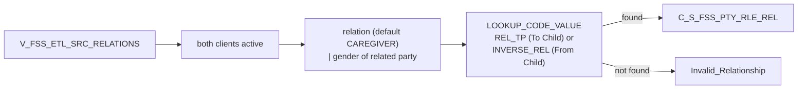

# 024 m_Tgt_C_S_FSS_Pty_Rle_Rel

| | |
|---|---|
| Source system | FSS |
| Sub-domain | Role |
| Targets | `C_S_FSS_PTY_RLE_REL`, `EXC_STG_BAD_REC_MEMB` |
| Java | `com.idq.cli.source.fss.FssRelationship` |

## Business purpose

Publishes the relationship between a client and the related client of the registration in both directions; the
relationship code is combined with the gender of the related party to obtain e.g. mother / son / daughter.



## IdqMapInitQuery

### FSS-024 Client relations

All rows of the relations view (two rows per relation, one per direction). No filter.

Entity: `FssQueries.ClientRelation` - named query: `FssQueries#fetchClientRelations`.

```sql
SELECT relation_direction, reln_id_client, reln_cd_gender, id_client, pty_src_key, reln_pty_src_key,
       reln_dt_last_update, reln_dt_created, cd_reltshp_to_tc, cd_gender, id_registration
FROM v_fss_etl_src_relations
```

## Business rules

1. Both party keys must be active.
2. Relation code `NULL` -> `CAREGIVER`; combined with the family member's gender for "To Child", with the child's
   gender otherwise. Code type `REL_TP` for "To Child", `INVERSE_REL` otherwise; source `FSS`.
3. From / to roles follow the direction (family member -> child for "To Child").
4. Loaded with `Member Relationship`, `Member`, hub state 1, creator / updated by `batchload`; period start =
   relation create date, source update = relation last update.
5. Not found -> `Invalid_Relationship` (attribute `Relationship|Sex`, ids related client / client / registration).

## PKEY formulation

| Target | PKEY_SRC_OBJECT | Example |
|---|---|---|
| `C_S_FSS_PTY_RLE_REL` | `<from party key>|Member|<to party key>|Member|<MDM relationship code>` | `0000000010|Member|0000000011|Member|MTH` |

Unit test: `FssPkeyTest#m_Tgt_C_S_FSS_Pty_Rle_Rel_pkey_test`.

## Java implementation

* `FssRelationship.relationCode`, `codeType`, `fromRole`, `toRole`, `pkey`; entity `FssTargets.Relationship`.
