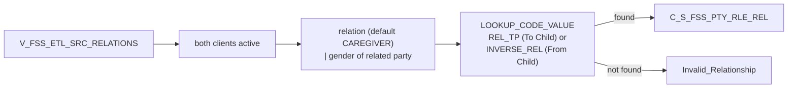

# 024 m_Tgt_C_S_FSS_Pty_Rle_Rel

| | |
|---|---|
| Source system | FSS |
| Sub-domain | Role |
| Sources | `V_FSS_ETL_SRC_RELATIONS`, `STG_FSS_PTY_INACTIVE_STS`
 |
| Targets | `C_S_FSS_PTY_RLE_REL`, `EXC_STG_BAD_REC_MEMB` |
| Java | `com.idq.cli.source.fss.etlmap.svc.FssRelationshipService` |

## Business purpose

Publishes the relationship between a client and the related client of the registration in both directions; the
relationship code is combined with the gender of the related party to obtain e.g. mother / son / daughter.



## IdqMapInitQuery

### FSS-024 Client relations

All rows of the relations view (two rows per relation, one per direction). No filter.

Entity: `FssQueryRows.ClientRelation` - named query: `FssEtlSrcRelationsViewRepository#fetchClientRelations`.

```sql
SELECT relation_direction, reln_id_client, reln_cd_gender, id_client, pty_src_key, reln_pty_src_key,
       reln_dt_last_update, reln_dt_created, cd_reltshp_to_tc, cd_gender, id_registration
FROM v_fss_etl_src_relations
```

<!-- lookups:begin -->
## Lookups

Connected lookups, grouped by the transformation that feeds their input ports. In a lookup condition the
left side is the lookup table column and the right side is the lookup input port. Output ports are the
returned table columns (or input ports passed through) and the downstream port each one feeds.

### Fed by `Exp_Build_Keys` (Expression)

| Lookup | Table | Condition | Input ports | Output ports |
|---|---|---|---|---|
| `Lkp_CHILD_STG_FSS_PTY_INACTIVE_STS` | `STG_FSS_PTY_INACTIVE_STS` (STAGING)<br>multiple match: any row | `SRC_KEY = PKEY_SRC_OBJECT AND ROWID_SYSTEM = SRC_SYSTEM` | `PKEY_SRC_OBJECT` &larr; `Child_Pty_Src_Key`<br>`SRC_SYSTEM` &larr; `Source_System` | `DEACTIVATION_STS` &rarr; `Filter_Fam_Child_Valid.CHILD_DEACTIVATION_STS` (Filter) |
| `Lkp_FAM_STG_FSS_PTY_INACTIVE_STS` | `STG_FSS_PTY_INACTIVE_STS` (STAGING)<br>multiple match: any row | `SRC_KEY = PKEY_SRC_OBJECT AND ROWID_SYSTEM = SRC_SYSTEM` | `PKEY_SRC_OBJECT` &larr; `Family_Pty_Src_Key`<br>`SRC_SYSTEM` &larr; `Source_System` | `DEACTIVATION_STS` &rarr; `Filter_Fam_Child_Valid.FAM_DEACTIVATION_STS1` (Filter) |

### Fed by `Exp_Map_Code_Val_and_Gender` (Expression)

| Lookup | Table | Condition | Input ports | Output ports |
|---|---|---|---|---|
| `Lkp_Rel_Tp_Code_Value` | `LOOKUP_CODE_VALUE` (STAGING)<br>filter: `"LOOKUP_CODE_VALUE"."CODE_TYPE" IN ('REL_TP','INVERSE_REL')`<br>multiple match: any row | `SRC_SYS = Source_System AND SRC_CODE_VALUE = RELATION_CD AND CODE_TYPE = IN_CODE_TYPE` | `Source_System` &larr; `Source_System`<br>`RELATION_CD` &larr; `out_RELATION_CD`<br>`IN_CODE_TYPE` &larr; `out_CODE_TYPE` | `MSTR_REF_CODE` &rarr; `Route_Good_vs_Exceptions.MSTR_REF_CODE` (Router)<br>`MSTR_REF_LABEL` &rarr; `Route_Good_vs_Exceptions.MSTR_REF_LABEL` (Router)<br>`MSTR_REF_DESC` &rarr; `Route_Good_vs_Exceptions.MSTR_REF_DESC` (Router)<br>`RELATION_CD` (pass-through) &rarr; `Route_Good_vs_Exceptions.all_FAMILY_CD` (Router) |

### Fed by `Exp_Build_Exception` (Expression)

| Lookup | Table | Condition | Input ports | Output ports |
|---|---|---|---|---|
| `Lookup_EXC_LOOKUP_CODE_VALUE` | `EXC_LOOKUP_CODE_VALUE` (STAGING)<br>multiple match: any row | `EXCEPTION_CODE = in_Exception_Code` | `in_Exception_Code` &larr; `Exception_Code` | `EXCEPTION_TYPE` &rarr; `Write_EXC_STG_BAD_REC_MEMB.EXCEPTION_TYPE` (Target)<br>`EXCEPTION_CODE` &rarr; `Write_EXC_STG_BAD_REC_MEMB.EXCEPTION_CODE` (Target)<br>`EXCEPTION_DESC` &rarr; `Write_EXC_STG_BAD_REC_MEMB.EXCEPTION_DESC` (Target) |

<!-- lookups:end -->

## Business rules

1. Both party keys must be active.
2. Relation code `NULL` -> `CAREGIVER`; combined with the family member's gender for "To Child", with the child's
   gender otherwise. Code type `REL_TP` for "To Child", `INVERSE_REL` otherwise; source `FSS`.
3. From / to roles follow the direction (family member -> child for "To Child").
4. Loaded with `Member Relationship`, `Member`, hub state 1, creator / updated by `batchload`; period start =
   relation create date, source update = relation last update.
5. Not found -> `Invalid_Relationship` (attribute `Relationship|Sex`, ids related client / client / registration).

## PKEY formulation

| Target | PKEY_SRC_OBJECT | Example |
|---|---|---|
| `C_S_FSS_PTY_RLE_REL` | `<from party key>|Member|<to party key>|Member|<MDM relationship code>` | `0000000010|Member|0000000011|Member|MTH` |

Unit test: `FssPkeyTest#m_Tgt_C_S_FSS_Pty_Rle_Rel_pkey_test`.

## Java implementation

* `FssRelationshipService.relationCode`, `codeType`, `fromRole`, `toRole`, `pkey`; entity `FssTargets.Relationship`.
* Source entities (raw source tables, captured in the `adhoc_runs_*` audit reports): `FssSources.EtlSrcRelations`
  (`V_FSS_ETL_SRC_RELATIONS`), `FssSources.InactiveStatus` (`STG_FSS_PTY_INACTIVE_STS`).
