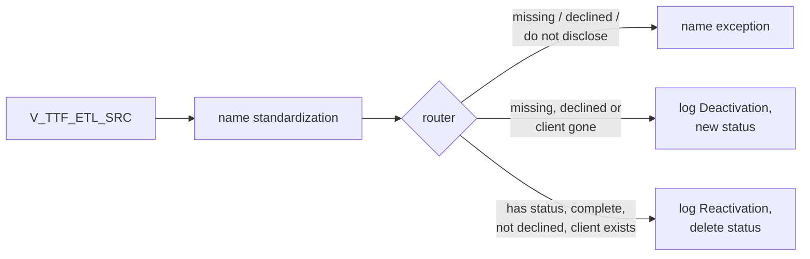

# 025 m_Tgt_C_S_TTF_Pty_Validation

| | |
|---|---|
| Source system | TTF, workflow `wf_TTF_Stage_Load`, first mapping |
| Sub-domain | Demographics (party activation status) |
| Sources | `V_TTF_ETL_SRC`, `C_B_PTY_XREF`, `STG_TTF_PTY_INACTIVE_STS`
 |
| Targets | `STG_TTF_PTY_INACTIVE_STS`, `STG_TTF_PTY_INACTIVE_LOG`, `EXC_STG_BAD_REC_MEMB` |
| Java | `com.idq.cli.source.ttf.etlmap.svc.TtfPartyValidationService` |

## Business purpose

Decides which TTF clients are inactive. Besides missing names, TTF reports clients who *declined* to give their
name (`DECLINED`) or asked not to disclose it (`DO_NOT_DISCLOSE`), and clients that no longer exist at the source.



## IdqMapInitQuery

### TTF-025 Clients for validation

All rows of the TTF client view.

* **Stale filter removed**: the source qualifier carried the malformed test filter
  `"V_TTF_ETL_SRC"."FYCLIENTS_ID" in '22','60','101',...)` as its SQL query.

Entity: `TtfQueryRows.ClientName` - named query: `TtfEtlSrcViewRepository#fetchClientNames`.

```sql
SELECT clients_id, firstname, lastname, middlename, createddate, dob, submitdate, client_exists_flag
FROM v_ttf_etl_src
```

Lookups: `TtfInactiveStatusRepository#fetchInactiveStatuses`, `TtfPartyXrefRepository#fetchHubStates` (`TRIM(ROWID_SYSTEM) = 'TTF'`).

<!-- lookups:begin -->
## Lookups

Connected lookups, grouped by the transformation that feeds their input ports. In a lookup condition the
left side is the lookup table column and the right side is the lookup input port. Output ports are the
returned table columns (or input ports passed through) and the downstream port each one feeds.

### Fed by `Exp_Invalid_PTY_NM` (Expression)

| Lookup | Table | Condition | Input ports | Output ports |
|---|---|---|---|---|
| `Lkp_EXC_LOOKUP_CODE_VALUE_Name` | `EXC_LOOKUP_CODE_VALUE` (STAGING)<br>multiple match: default | `EXCEPTION_CODE = Exception_Code_Name` | `Exception_Code_Name` &larr; `Exception_Code_Name` | `EXCEPTION_DESC` &rarr; `Write_Invalid_Party_Name.EXCEPTION_DESC` (Target)<br>`EXCEPTION_TYPE` &rarr; `Write_Invalid_Party_Name.EXCEPTION_TYPE` (Target) |

### Fed by `Exp_TTF_Data_Load` (Expression)

| Lookup | Table | Condition | Input ports | Output ports |
|---|---|---|---|---|
| `Lookup_STG_TTF_PTY_INACTIVE_STS` | `STG_TTF_PTY_INACTIVE_STS` (STAGING)<br>multiple match: any row | `SRC_KEY = PKEY_SRC_OBJECT AND ROWID_SYSTEM = SRC_SYSTEM` | `PKEY_SRC_OBJECT` &larr; `PKEY_SRC_OBJECT`<br>`SRC_SYSTEM` &larr; `SRC_SYSTEM` | `DEACTIVATION_STS` &rarr; `Exp_Consolidate_Exceptions.DEACTIVATION_STS` (Expression) |
| `Lookup_C_B_PTY_XREF` | `C_B_PTY_XREF` (HHS_MDM_ORS)<br>filter: `TRIM("C_B_PTY_XREF"."ROWID_SYSTEM") = 'TTF'`<br>SQL override (below)<br>multiple match: default | `PKEY_SRC_OBJECT = PKEY_SRC_OBJECT1` | `SRC_SYSTEM` &larr; `SRC_SYSTEM`<br>`PKEY_SRC_OBJECT1` &larr; `PKEY_SRC_OBJECT` | `HUB_STATE_IND` &rarr; `Exp_Consolidate_Exceptions.HUB_STATE_IND` (Expression) |

SQL override of `Lookup_C_B_PTY_XREF`:

```sql
"C_B_PTY_XREF"."ROWID_SYSTEM" = 'TTF'
```

Lookups inside the mapplets / rules this mapping calls are listed in
[000](000_mapplets.md#lookups-inside-mapplets-and-rules): `CopyOf_mplt_Name_Standardization_Indv_Member`.

<!-- lookups:end -->

## Business rules

1. Party key = `LPAD(CLIENTS_ID,10,'0')`.
2. Name exception when first or last name is missing, `DECLINED` or `DO_NOT_DISCLOSE`. The code (also used as
   attribute name) is `Missing_First_Name`, `Invalid_First_Name`, `Missing_Last_Name` or `Invalid_Last_Name`, checked
   in that order; attribute value = source full name.
3. Deactivation: name missing, either name `DECLINED` (not `DO_NOT_DISCLOSE`), or `CLIENT_EXISTS_FLAG = 'N'`.
4. Reactivation: status present, both names present, neither `DECLINED`, `CLIENT_EXISTS_FLAG = 'Y'`.

## PKEY formulation

No `C_S_*` target; status key = `LPAD(CLIENTS_ID,10)`, `ROWID_SYSTEM` = `TTF`. Unit test:
`TtfPkeyTest#m_Tgt_C_S_TTF_Pty_Validation_pkey_test`.

## Java implementation

* `TtfPartyValidationService.nameExceptionCode`, `transform`; `InactiveStatus.Changes` / `output`.
* Source entities (raw source tables, captured in the `adhoc_runs_*` audit reports): `TtfSources.EtlSrc`
  (`V_TTF_ETL_SRC`), `MdmBaseTables.PartyXref` (`C_B_PTY_XREF`), `TtfSources.InactiveStatus`
  (`STG_TTF_PTY_INACTIVE_STS`).
