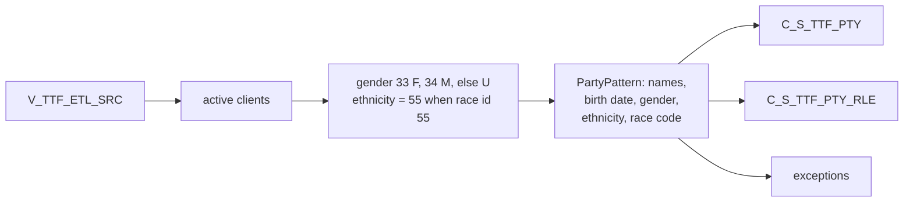

# 026 m_Tgt_C_S_TTF_Pty

| | |
|---|---|
| Source system | TTF, after 025 |
| Sub-domain | Demographics (plus Role) |
| Sources | `V_TTF_ETL_SRC`, `STG_TTF_PTY_INACTIVE_STS`
 |
| Targets | `C_S_TTF_PTY`, `C_S_TTF_PTY_RLE`, `EXC_STG_BAD_REC_MEMB` |
| Java | `com.idq.cli.source.ttf.etlmap.svc.TtfPartyService` |

## Business purpose

Publishes the demographics and member role of active TTF clients. TTF reports gender as a numeric id and a single
combined race / ethnicity id.



## IdqMapInitQuery

### TTF-026 Client demographics

All rows of the TTF view. No filter in IDQ.

Entity: `TtfQueryRows.ClientDemographics` - named query: `TtfEtlSrcViewRepository#fetchClientDemographics`.

```sql
SELECT submitdate, load_date, clients_id, pty_src_key, firstname, lastname, middlename, dob,
       TO_CHAR(sexid) AS sexid, raceethnicityid
FROM v_ttf_etl_src
```

<!-- lookups:begin -->
## Lookups

Connected lookups, grouped by the transformation that feeds their input ports. In a lookup condition the
left side is the lookup table column and the right side is the lookup input port. Output ports are the
returned table columns (or input ports passed through) and the downstream port each one feeds.

### Fed by `Expression` (Expression)

| Lookup | Table | Condition | Input ports | Output ports |
|---|---|---|---|---|
| `Lookup_STG_TTF_PTY_INACTIVE_STS` | `STG_TTF_PTY_INACTIVE_STS` (STAGING)<br>multiple match: any row | `SRC_KEY = PTY_SRC_KEY AND ROWID_SYSTEM = SRC_SYSTEM` | `PTY_SRC_KEY` &larr; `PTY_SRC_KEY`<br>`SRC_SYSTEM` &larr; `SRC_SYSTEM` | `DEACTIVATION_STS` &rarr; `Flt_Remove_Inactive.DEACTIVATION_STS` (Filter) |

Lookups inside the mapplets / rules this mapping calls are listed in
[000](000_mapplets.md#lookups-inside-mapplets-and-rules): `mplt_BirthDate_Validation`, `mplt_Ethnicity_Validation`, `mplt_Gender_Validation`, `mplt_Name_Standardization_Indv_Member`, `mplt_Race_Validation`.

<!-- lookups:end -->

## Business rules

1. Gender: `SEXID` 33 -> `F`, 34 -> `M`, otherwise `U` (which the gender rule maps to `NULL`).
2. Ethnicity = `55` when `RACEETHNICITYID = '55'`, else `NULL`; race = `RACEETHNICITYID` translated with
   `V_LOOKUP_CODE_VALUE` (`RACE`).
3. `PartyPattern` spec TTF: race by code, no language or suffix rule, every exception for every row.
4. Period start of the party = run time; party role period start = submit date; birth date = validated.

## PKEY formulation

| Target | PKEY_SRC_OBJECT | Example |
|---|---|---|
| `C_S_TTF_PTY` | `TRIM(PTY_SRC_KEY)` | `0000000031` |
| `C_S_TTF_PTY_RLE` | `<party key>|Member` | `0000000031|Member` |

Unit test: `TtfPkeyTest#m_Tgt_C_S_TTF_Pty_pkey_test`.

## Retired / not ported

* Version / duplicate rank in `exp_Party_Consolidation` - MDM timeline.

## Java implementation

* `TtfPartyService.gender`, `ethnicity`, `transform`; entities `TtfTargets.Party`, `TtfTargets.PartyRole`.
* Source entities (raw source tables, captured in the `adhoc_runs_*` audit reports): `TtfSources.EtlSrc`
  (`V_TTF_ETL_SRC`), `TtfSources.InactiveStatus` (`STG_TTF_PTY_INACTIVE_STS`).
