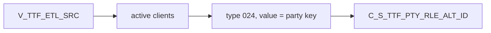

# 027 m_Tgt_C_S_TTF_Pty_Rle_Alt_Id

| | |
|---|---|
| Source system | TTF |
| Sub-domain | Alternate-ID |
| Sources | `V_TTF_ETL_SRC`, `STG_TTF_PTY_INACTIVE_STS`
 |
| Targets | `C_S_TTF_PTY_RLE_ALT_ID` |
| Java | `com.idq.cli.source.ttf.TtfAlternateId` |

## Business purpose

Publishes the TTF party source key itself as the alternate identifier of type `024`.



## IdqMapInitQuery

### TTF-027 Client source key

* **Stale filter removed**: `"V_TTF_ETL_SRC"."CLIENTS_ID" in ('199933','174065',...)` (ten test ids).

Entity: `TtfQueries.ClientIdentifier` - named query: `TtfQueries#fetchClientIdentifiers`.

```sql
SELECT clients_id, submitdate, pty_src_key FROM v_ttf_etl_src
```

## Business rules

1. Status `Issued`, hub state 1, period start = run time, create date / source update = submit date,
   `SRC_ROWID` = key.

## PKEY formulation

| Target | PKEY_SRC_OBJECT | Example |
|---|---|---|
| `C_S_TTF_PTY_RLE_ALT_ID` | `<PTY_SRC_KEY>|Member|024|<PTY_SRC_KEY>` | `0000000031|Member|024|0000000031` |

Unit test: `TtfPkeyTest#m_Tgt_C_S_TTF_Pty_Rle_Alt_Id_pkey_test` (also checks that an inactive client is skipped).

## Java implementation

* `TtfAlternateId.pkey`, `transform`; entity `TtfTargets.AlternateId`.
* Source entities (raw source tables, captured in the `adhoc_runs_*` audit reports): `TtfSources.EtlSrc`
  (`V_TTF_ETL_SRC`), `TtfTargets.InactiveStatus` (`STG_TTF_PTY_INACTIVE_STS`).
