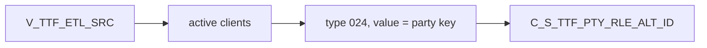

# 027 m_Tgt_C_S_TTF_Pty_Rle_Alt_Id

| | |
|---|---|
| Source system | TTF |
| Sub-domain | Alternate-ID |
| Sources | `V_TTF_ETL_SRC`, `STG_TTF_PTY_INACTIVE_STS`
 |
| Targets | `C_S_TTF_PTY_RLE_ALT_ID` |
| Java | `com.idq.cli.source.ttf.etlmap.svc.TtfAlternateIdService` |

## Business purpose

Publishes the TTF party source key itself as the alternate identifier of type `024`.



## IdqMapInitQuery

### TTF-027 Client source key

* **Stale filter removed**: `"V_TTF_ETL_SRC"."CLIENTS_ID" in ('199933','174065',...)` (ten test ids).

Entity: `TtfQueryRows.ClientIdentifier` - named query: `TtfEtlSrcViewRepository#fetchClientIdentifiers`.

```sql
SELECT clients_id, submitdate, pty_src_key FROM v_ttf_etl_src
```

<!-- lookups:begin -->
## Lookups

Connected lookups, grouped by the transformation that feeds their input ports. In a lookup condition the
left side is the lookup table column and the right side is the lookup input port. Output ports are the
returned table columns (or input ports passed through) and the downstream port each one feeds.

### Fed by `exp_TTF_Pty_Rle_Alt_Id` (Expression)

| Lookup | Table | Condition | Input ports | Output ports |
|---|---|---|---|---|
| `Lkp_STG_TTF_PTY_INACTIVE_STS` | `STG_TTF_PTY_INACTIVE_STS` (STAGING)<br>multiple match: any row | `SRC_KEY = PTY_SRC_KEY AND ROWID_SYSTEM = SRC_SYSTEM` | `SRC_SYSTEM` &larr; `SRC_SYSTEM`<br>`PTY_SRC_KEY` &larr; `PTY_SRC_KEY` | `DEACTIVATION_STS` &rarr; `Filter.DEACTIVATION_STS` (Filter) |

<!-- lookups:end -->

## Business rules

1. Status `Issued`, hub state 1, period start = run time, create date / source update = submit date,
   `SRC_ROWID` = key.

## PKEY formulation

| Target | PKEY_SRC_OBJECT | Example |
|---|---|---|
| `C_S_TTF_PTY_RLE_ALT_ID` | `<PTY_SRC_KEY>|Member|024|<PTY_SRC_KEY>` | `0000000031|Member|024|0000000031` |

Unit test: `TtfPkeyTest#m_Tgt_C_S_TTF_Pty_Rle_Alt_Id_pkey_test` (also checks that an inactive client is skipped).

## Java implementation

* `TtfAlternateIdService.pkey`, `transform`; entity `TtfTargets.AlternateId`.
* Source entities (raw source tables, captured in the `adhoc_runs_*` audit reports): `TtfSources.EtlSrc`
  (`V_TTF_ETL_SRC`), `TtfSources.InactiveStatus` (`STG_TTF_PTY_INACTIVE_STS`).
