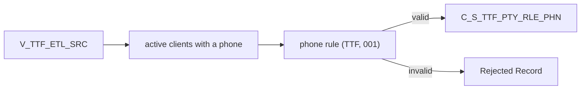

# 028 m_Tgt_C_S_TTF_Pty_Rle_Phn

| | |
|---|---|
| Source system | TTF |
| Sub-domain | Phone-email |
| Targets | `C_S_TTF_PTY_RLE_PHN`, `EXC_STG_BAD_REC_MEMB` |
| Java | `com.idq.cli.source.ttf.TtfPhone` |

## Business purpose

Publishes the phone number of active TTF clients.



## IdqMapInitQuery

### TTF-028 Client phone

* **Stale filter removed**: `"V_TTF_ETL_SRC"."PHONE"in ()` (an empty, invalid test filter).

Entity: `TtfQueries.ClientPhone` - named query: `TtfQueries#fetchClientPhones`.

```sql
SELECT submitdate, phone, pty_src_key FROM v_ttf_etl_src
```

## Business rules

1. Phone type `Telephone`, usage `001`, preference `Primary`; `rule_Phone_Std` with source `TTF`.
2. TTF reports no extension, so the extension rule never raises an exception and no extension column is loaded.
3. Invalid phones -> exception type `Rejected Record`.

## PKEY formulation

| Target | PKEY_SRC_OBJECT | Example |
|---|---|---|
| `C_S_TTF_PTY_RLE_PHN` | `<party>|Member|Telephone|001|<phone as reported>` | `0000000031|Member|Telephone|001|(214) 555-1234` |

The key keeps the reported text; `PHN_NUM` holds the standardized digits. Unit test:
`TtfPkeyTest#m_Tgt_C_S_TTF_Pty_Rle_Phn_pkey_test`.

## Java implementation

* `TtfPhone.pkey`, `transform`; `EtlPatterns.write2TargetPhone`; entity `TtfTargets.Phone`.
