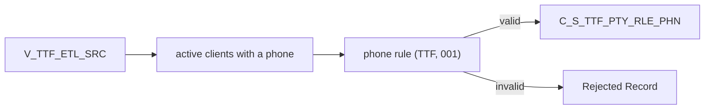

# 028 m_Tgt_C_S_TTF_Pty_Rle_Phn

| | |
|---|---|
| Source system | TTF |
| Sub-domain | Phone-email |
| Sources | `V_TTF_ETL_SRC`, `STG_TTF_PTY_INACTIVE_STS`
 |
| Targets | `C_S_TTF_PTY_RLE_PHN`, `EXC_STG_BAD_REC_MEMB` |
| Java | `com.idq.cli.source.ttf.etlmap.svc.TtfPhoneService` |

## Business purpose

Publishes the phone number of active TTF clients.



## IdqMapInitQuery

### TTF-028 Client phone

* **Stale filter removed**: `"V_TTF_ETL_SRC"."PHONE"in ()` (an empty, invalid test filter).

Entity: `TtfQueryRows.ClientPhone` - named query: `TtfEtlSrcViewRepository#fetchClientPhones`.

```sql
SELECT submitdate, phone, pty_src_key FROM v_ttf_etl_src
```

<!-- lookups:begin -->
## Lookups

Connected lookups, grouped by the transformation that feeds their input ports. In a lookup condition the
left side is the lookup table column and the right side is the lookup input port. Output ports are the
returned table columns (or input ports passed through) and the downstream port each one feeds.

### Fed by `exp_Stage_Source_Attributes` (Expression)

| Lookup | Table | Condition | Input ports | Output ports |
|---|---|---|---|---|
| `Lookup_STG_TTF_PTY_INACTIVE_STS` | `STG_TTF_PTY_INACTIVE_STS` (STAGING)<br>multiple match: any row | `SRC_KEY = PTY_SRC_KEY AND ROWID_SYSTEM = SRC_SYS` | `SRC_SYS` &larr; `SRC_SYS`<br>`PTY_SRC_KEY` &larr; `PTY_SRC_KEY` | `DEACTIVATION_STS` &rarr; `fil_deactivated_status.DEACTIVATION_STS` (Filter) |

Lookups inside the mapplets / rules this mapping calls are listed in
[000](000_mapplets.md#lookups-inside-mapplets-and-rules): `rule_Phone_Extension_Std`, `rule_Phone_Std`.

<!-- lookups:end -->

## Business rules

1. Phone type `Telephone`, usage `001`, preference `Primary`; `rule_Phone_Std` with source `TTF`.
2. TTF reports no extension, so the extension rule never raises an exception and no extension column is loaded.
3. Invalid phones -> exception type `Rejected Record`.

## PKEY formulation

| Target | PKEY_SRC_OBJECT | Example |
|---|---|---|
| `C_S_TTF_PTY_RLE_PHN` | `<party>|Member|Telephone|001|<phone as reported>` | `0000000031|Member|Telephone|001|(214) 555-1234` |

The key keeps the reported text; `PHN_NUM` holds the standardized digits. Unit test:
`TtfPkeyTest#m_Tgt_C_S_TTF_Pty_Rle_Phn_pkey_test`.

## Java implementation

* `TtfPhoneService.pkey`, `transform`; `EtlPatterns.write2TargetPhone`; entity `TtfTargets.Phone`.
* Source entities (raw source tables, captured in the `adhoc_runs_*` audit reports): `TtfSources.EtlSrc`
  (`V_TTF_ETL_SRC`), `TtfSources.InactiveStatus` (`STG_TTF_PTY_INACTIVE_STS`).
