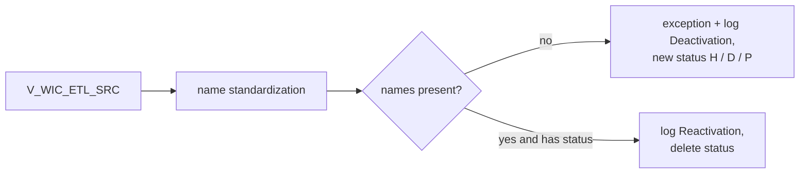

# 029 m_Tgt_C_S_WIC_Pty_Validation

| | |
|---|---|
| Source system | WIC, workflow `wf_WIC_Stage_Load`, first mapping |
| Sub-domain | Demographics (party activation status) |
| Sources | `V_WIC_ETL_SRC`, `C_B_PTY_XREF`, `STG_WIC_PTY_INACTIVE_STS`
 |
| Targets | `STG_WIC_PTY_INACTIVE_STS`, `STG_WIC_PTY_INACTIVE_LOG`, `EXC_STG_BAD_REC_MEMB` |
| Java | `com.idq.cli.source.wic.etlmap.svc.WicPartyValidationService` |

## Business purpose

Decides which WIC clients and family members are inactive: only an incomplete name deactivates a WIC party; a
deactivated party with a complete name is reactivated.



## IdqMapInitQuery

### WIC-029 Clients for validation

All rows of the WIC view. No filter in IDQ.

Entity: `WicQueryRows.ClientName` - named query: `WicEtlSrcViewRepository#fetchClientNames`.

```sql
SELECT id, first_name, last_name, middle_name, datekey, load_date, source_table, pty_src_key, dob
FROM v_wic_etl_src
```

Lookups: `WicInactiveStatusRepository#fetchInactiveStatuses`, `WicPartyXrefRepository#fetchHubStates`.

<!-- lookups:begin -->
## Lookups

Connected lookups, grouped by the transformation that feeds their input ports. In a lookup condition the
left side is the lookup table column and the right side is the lookup input port. Output ports are the
returned table columns (or input ports passed through) and the downstream port each one feeds.

### Fed by `Exp_Invalid_PTY_NM` (Expression)

| Lookup | Table | Condition | Input ports | Output ports |
|---|---|---|---|---|
| `Lkp_EXC_LOOKUP_CODE_VALUE_Name` | `EXC_LOOKUP_CODE_VALUE` (STAGING)<br>multiple match: default | `EXCEPTION_CODE = Exception_Code_Name` | `Exception_Code_Name` &larr; `Exception_Code_Name` | `EXCEPTION_DESC` &rarr; `Write_Invalid_Party_Name.EXCEPTION_DESC` (Target)<br>`EXCEPTION_TYPE` &rarr; `Write_Invalid_Party_Name.EXCEPTION_TYPE` (Target) |

### Fed by `Exp_ECI_Data_Load` (Expression)

| Lookup | Table | Condition | Input ports | Output ports |
|---|---|---|---|---|
| `Lookup_C_B_PTY_XREF` | `C_B_PTY_XREF` (HHS_MDM_ORS)<br>filter: `"C_B_PTY_XREF"."ROWID_SYSTEM" = 'WIC'`<br>multiple match: default | `PKEY_SRC_OBJECT = PKEY_SRC_OBJECT1` | `SRC_SYSTEM` &larr; `SRC_SYSTEM`<br>`PKEY_SRC_OBJECT1` &larr; `PKEY_SRC_OBJECT` | `HUB_STATE_IND` &rarr; `Exp_Consolidate_Exceptions.HUB_STATE_IND` (Expression) |
| `Lookup_STG_WIC_PTY_INACTIVE_STS` | `STG_WIC_PTY_INACTIVE_STS` (STAGING)<br>multiple match: any row | `ROWID_SYSTEM = SRC_SYSTEM AND SRC_KEY = PKEY_SRC_OBJECT` | `PKEY_SRC_OBJECT` &larr; `PKEY_SRC_OBJECT`<br>`SRC_SYSTEM` &larr; `SRC_SYSTEM` | `DEACTIVATION_STS` &rarr; `Exp_Consolidate_Exceptions.DEACTIVATION_STS` (Expression) |

Lookups inside the mapplets / rules this mapping calls are listed in
[000](000_mapplets.md#lookups-inside-mapplets-and-rules): `mplt_Name_Standardization_Indv_Member`.

<!-- lookups:end -->

## Business rules

1. Party key = `PTY_SRC_KEY` (built by the view).
2. Missing first or last name -> exception (`Missing_First_Name` / `Missing_Last_Name`) and deactivation.
3. Status present and both names present -> reactivation.

## PKEY formulation

No `C_S_*` target; status key = `PTY_SRC_KEY`, `ROWID_SYSTEM` = `WIC`. Unit test:
`WicPkeyTest#m_Tgt_C_S_WIC_Pty_Validation_pkey_test` (hub state -1 gives status `D`).

## Java implementation

* `WicPartyValidationService.transform`; `InactiveStatus.Changes` / `output`.
* Source entities (raw source tables, captured in the `adhoc_runs_*` audit reports): `WicSources.EtlSrc`
  (`V_WIC_ETL_SRC`), `MdmBaseTables.PartyXref` (`C_B_PTY_XREF`), `WicSources.InactiveStatus`
  (`STG_WIC_PTY_INACTIVE_STS`).
