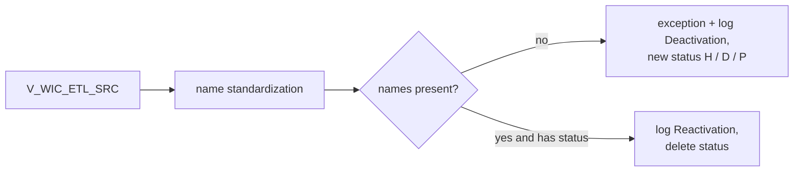

# 029 m_Tgt_C_S_WIC_Pty_Validation

| | |
|---|---|
| Source system | WIC, workflow `wf_WIC_Stage_Load`, first mapping |
| Sub-domain | Demographics (party activation status) |
| Targets | `STG_WIC_PTY_INACTIVE_STS`, `STG_WIC_PTY_INACTIVE_LOG`, `EXC_STG_BAD_REC_MEMB` |
| Java | `com.idq.cli.source.wic.WicPartyValidation` |

## Business purpose

Decides which WIC clients and family members are inactive: only an incomplete name deactivates a WIC party; a
deactivated party with a complete name is reactivated.



## IdqMapInitQuery

### WIC-029 Clients for validation

All rows of the WIC view. No filter in IDQ.

Entity: `WicQueries.ClientName` - named query: `WicQueries#fetchClientNames`.

```sql
SELECT id, first_name, last_name, middle_name, datekey, load_date, source_table, pty_src_key, dob
FROM v_wic_etl_src
```

Lookups: `WicQueries#fetchInactiveStatuses`, `WicQueries#fetchHubStates`.

## Business rules

1. Party key = `PTY_SRC_KEY` (built by the view).
2. Missing first or last name -> exception (`Missing_First_Name` / `Missing_Last_Name`) and deactivation.
3. Status present and both names present -> reactivation.

## PKEY formulation

No `C_S_*` target; status key = `PTY_SRC_KEY`, `ROWID_SYSTEM` = `WIC`. Unit test:
`WicPkeyTest#m_Tgt_C_S_WIC_Pty_Validation_pkey_test` (hub state -1 gives status `D`).

## Java implementation

* `WicPartyValidation.transform`; `InactiveStatus.Changes` / `output`.
