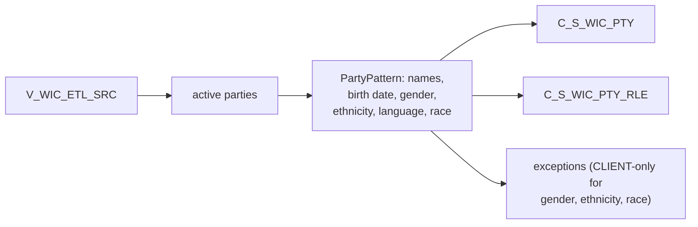

# 030 m_Tgt_C_S_WIC_Pty

| | |
|---|---|
| Source system | WIC, after 029 |
| Sub-domain | Demographics (plus Role) |
| Targets | `C_S_WIC_PTY`, `C_S_WIC_PTY_RLE`, `EXC_STG_BAD_REC_MEMB` |
| Java | `com.idq.cli.source.wic.WicParty` |

## Business purpose

Publishes the demographics and member role of active WIC clients and family members, including birth weight,
preferred language and race from indicators.



## IdqMapInitQuery

### WIC-030 Client demographics

All rows of the WIC view. No filter in IDQ.

Entity: `WicQueries.ClientDemographics` - named query: `WicQueries#fetchClientDemographics`.

```sql
SELECT source_table, datekey, load_date, id, pty_src_key, first_name, last_name, middle_name, dob, gender,
       birth_wt_lb, birth_wt_oz, language_cd, ethnicity, race_white_ind, race_aa_ind, race_asian_ind,
       race_pi_ind, race_an_ind
FROM v_wic_etl_src
```

## Business rules

1. `PartyPattern` spec WIC: race from indicators, language rule on, no suffix rule; gender, ethnicity and race
   exceptions only for `CLIENT` rows.
2. Birth weight in grams = `BIRTH_WT_OZ * 28.35` (the pound term is commented out in IDQ).
3. `BIRTH_DT` = reported birth date; `PRFRD_LANG_CD` translated, `SRC_PRFRD_LANG_CD` source.
4. Audit dates = `DATEKEY`; hub state 1.

## PKEY formulation

| Target | PKEY_SRC_OBJECT | Example |
|---|---|---|
| `C_S_WIC_PTY` | `TRIM(PTY_SRC_KEY)` | `0000000051` |
| `C_S_WIC_PTY_RLE` | `<party key>|Member` | `0000000051|Member` |

Unit test: `WicPkeyTest#m_Tgt_C_S_WIC_Pty_pkey_test`.

## Java implementation

* `WicParty.birthWeightGrams`, `transform`; entities `WicTargets.Party`, `WicTargets.PartyRole`.
* Source entities (raw source tables, captured in the `adhoc_runs_*` audit reports): `WicSources.EtlSrc`
  (`V_WIC_ETL_SRC`), `WicTargets.InactiveStatus` (`STG_WIC_PTY_INACTIVE_STS`).
