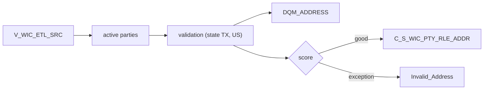

# 031 m_Tgt_C_S_WIC_Pty_Addr

| | |
|---|---|
| Source system | WIC |
| Sub-domain | Address |
| Targets | `C_S_WIC_PTY_RLE_ADDR`, `DQM_ADDRESS`, `EXC_STG_BAD_REC_MEMB` |
| Java | `com.idq.cli.source.wic.WicAddress` |

## Business purpose

Publishes the family address of active WIC parties as a Texas physical mailing address (type `002`).



## IdqMapInitQuery

### WIC-031 Family addresses

All rows of the WIC view. No filter in IDQ.

Entity: `WicQueries.FamilyAddress` - named query: `WicQueries#fetchFamilyAddresses`.

```sql
SELECT source_table, id, fid, pty_src_key, address1, address2, city, county, zip_code,
       date_address_valid_from
FROM v_wic_etl_src
```

## Business rules

1. Address type constant `002`, state `TX`, country `US`; validation postal code = zip.
2. Period start / effective start / source update = `DATE_ADDRESS_VALID_FROM`; location id = `id|family id`.
3. `DQM_ADDRESS.PTY_SRC_KEY` = `LPAD(ID,10,'0')` (expression copied from ECI).

## PKEY formulation

| Target | PKEY_SRC_OBJECT | Example |
|---|---|---|
| `C_S_WIC_PTY_RLE_ADDR` | `<PTY_SRC_KEY>|Member|002|LPAD(family id,12)|UPPER(TRIM(line1))|UPPER(TRIM(line2))|UPPER(city)||zip` | `0000000051|Member|002|000000000401|1 MAIN ST||HOUSTON||77002` |

The state segment is empty in the IDQ expression (`city || '|' || '|' || zip`) and is kept that way. Unit test:
`WicPkeyTest#m_Tgt_C_S_WIC_Pty_Addr_pkey_test`.

## Java implementation

* `WicAddress.pkey` + `AddressPatterns.route`; entity `WicTargets.Address`.
* Source entities (raw source tables, captured in the `adhoc_runs_*` audit reports): `WicSources.EtlSrc`
  (`V_WIC_ETL_SRC`), `WicTargets.InactiveStatus` (`STG_WIC_PTY_INACTIVE_STS`).
