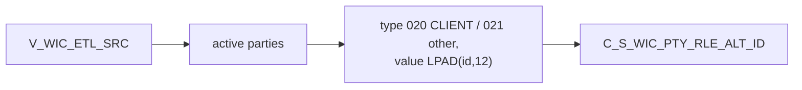

# 032 m_Tgt_C_S_WIC_Pty_Rle_Alt_Id

| | |
|---|---|
| Source system | WIC |
| Sub-domain | Alternate-ID |
| Sources | `V_WIC_ETL_SRC`, `STG_WIC_PTY_INACTIVE_STS`
 |
| Targets | `C_S_WIC_PTY_RLE_ALT_ID` |
| Java | `com.idq.cli.source.wic.WicAlternateId` |

## Business purpose

Publishes the WIC id as alternate identifier: `020` for clients, `021` for family members.



## IdqMapInitQuery

### WIC-032 Client and family ids

All rows of the WIC view. No filter in IDQ.

Entity: `WicQueries.ClientIdentifier` - named query: `WicQueries#fetchClientIdentifiers`.

```sql
SELECT id, datekey, pty_src_key, source_table FROM v_wic_etl_src
```

## Business rules

1. Type `020` when `SOURCE_TABLE = 'CLIENT'`, else `021`; value `LPAD(ID,12,'0')`; status `Issued`.
2. `SRC_ROWID` = `id|type`; dates = `DATEKEY`.

## PKEY formulation

| Target | PKEY_SRC_OBJECT | Example |
|---|---|---|
| `C_S_WIC_PTY_RLE_ALT_ID` | `<PTY_SRC_KEY>|Member|<020/021>|LPAD(id,12)` | `0000000051|Member|020|000000000051` |

Unit test: `WicPkeyTest#m_Tgt_C_S_WIC_Pty_Rle_Alt_Id_pkey_test`.

## Java implementation

* `WicAlternateId.altIdType`, `pkey`, `transform`; entity `WicTargets.AlternateId`.
* Source entities (raw source tables, captured in the `adhoc_runs_*` audit reports): `WicSources.EtlSrc`
  (`V_WIC_ETL_SRC`), `WicTargets.InactiveStatus` (`STG_WIC_PTY_INACTIVE_STS`).
