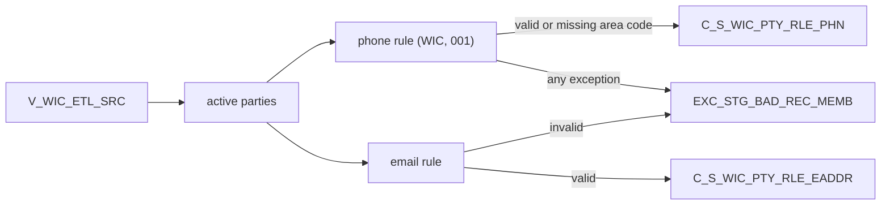

# 033 m_Tgt_C_S_WIC_Pty_Rle_Phn_And_EAddr

| | |
|---|---|
| Source system | WIC |
| Sub-domain | Phone-email |
| Sources | `V_WIC_ETL_SRC`, `STG_WIC_PTY_INACTIVE_STS`
 |
| Targets | `C_S_WIC_PTY_RLE_PHN`, `C_S_WIC_PTY_RLE_EADDR`, `EXC_STG_BAD_REC_MEMB` |
| Java | `com.idq.cli.source.wic.etlmap.svc.WicPhoneEmailService` |

## Business purpose

Publishes the family phone and e-mail of active WIC parties.



## IdqMapInitQuery

### WIC-033 Family phone and e-mail

All rows of the WIC view. No filter in IDQ.

Entity: `WicQueryRows.FamilyContact` - named query: `WicEtlSrcViewRepository#fetchFamilyContacts`.

```sql
SELECT fid, datekey, phone, email, source_table, pty_src_key, id FROM v_wic_etl_src
```

## Business rules

1. Phone (when present): `Telephone`, usage `001`, `Primary`; `rule_Phone_Std` with source `WIC`. Phones without an
   exception or with `Missing_AreaCode` are loaded; every phone with an exception is also queued (`Bad Value`).
2. E-mail (when present): rejected only when the exception code is configured; loaded with `001`, `Active`, `Y`.

## PKEY formulation

| Target | PKEY_SRC_OBJECT | Example |
|---|---|---|
| `C_S_WIC_PTY_RLE_PHN` | `<party>|Member|Telephone|001|<family id>|TRIM(phone as reported)` | `0000000051|Member|Telephone|001|401|7135551234` |
| `C_S_WIC_PTY_RLE_EADDR` | `<party>|Member|001|<family id>|<e-mail as reported>` | `0000000051|Member|001|401|Ann@Example.org` |

Unit test: `WicPkeyTest#m_Tgt_C_S_WIC_Pty_Rle_Phn_And_EAddr_pkey_test`.

## Java implementation

* `WicPhoneEmailService.phoneKey`, `emailKey`, `transform`; entities `WicTargets.Phone`, `WicTargets.Email`.
* Source entities (raw source tables, captured in the `adhoc_runs_*` audit reports): `WicSources.EtlSrc`
  (`V_WIC_ETL_SRC`), `WicSources.InactiveStatus` (`STG_WIC_PTY_INACTIVE_STS`).
