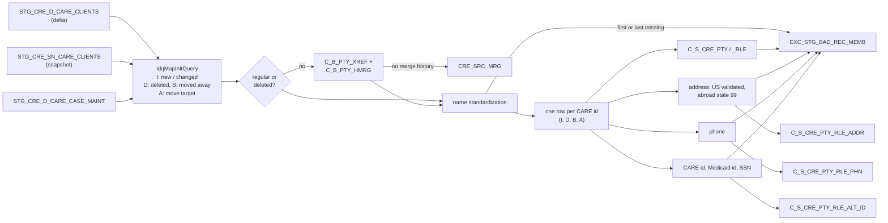

# 034 m_Tgt_C_S_CRE_CARE_Clients

| | |
|---|---|
| Source system | CRE (CARE clients), workflow `wf_CRE_Stage_Load_Ongoing`, its only mapping (task `m_TGT_C_S_CRE_CARE_CLIENTS`) |
| Sub-domain | Demographics (plus Role), Address, Phone-email, Alternate-ID |
| Sources | `STG_CRE_D_CARE_CLIENTS`, `STG_CRE_SN_CARE_CLIENTS`, `STG_CRE_D_CARE_CASE_MAINT`, `C_B_PTY_XREF`, `C_B_PTY_HMRG` |
| Targets | `CRE_SRC_MRG`, `C_S_CRE_PTY`, `C_S_CRE_PTY_RLE`, `C_S_CRE_PTY_RLE_ADDR`, `C_S_CRE_PTY_RLE_PHN`, `C_S_CRE_PTY_RLE_ALT_ID`, `EXC_STG_BAD_REC_MEMB` |
| Java | `com.idq.cli.source.cre.etlmap.svc.CreCareClientsService` |

## Business purpose

Publishes every CARE client of the day with a usable name to MDM in one pass: demographics, member role, one
address, one phone and up to three alternate ids (CARE id, Medicaid id, SSN). Unlike the other sources, CRE has no
validation mapping and no inactive-status table; instead it handles CARE **case maintenance**:

* a **deleted** case (`CASEDEL`) and the **source** of a case move (`CASEMOV`) are re-sent from the snapshot as
  end-dated records;
* the **target** of a move is re-sent as well;
* a move that MDM has not merged yet (neither record has merge history) is written to `CRE_SRC_MRG` for MDM to merge.

## Process



## IdqMapInitQuery

### CRE-034 CARE clients

Three row sets, told apart by `REC_TYPE`:

* `I`: clients of the delta without a maintenance flag;
* `D` / `B`: clients of the delta flagged `D`, read from the **snapshot** and joined to the case maintenance of the
  day as its source (`CASEDEL` gives `D`, `CASEMOV` gives `B`);
* `A`: snapshot clients that are the target of a `CASEMOV`.

The IDQ parallel hint and the commented test filters (`ROWNUM`, `ORA_HASH`, test scenarios) are left out.
`STG_CRE_SN_CARE_CLIENTS` is not in the schema exports; `db/missing-objects.sql` creates it with the columns of the
delta table.

Entity: `CreQueryRows.CareClient` - named query: `CreCareClientsDeltaRepository#fetchCareClients`.

```sql
SELECT DISTINCT
       clients.care_id, clients.care_lastup_dt, clients.firstnm, clients.lastnm, clients.last_suf,
       clients.birth_dt, clients.sex, clients.street, clients.city, clients.cnty, clients.state,
       clients.zip, clients.zipsuf, clients.phone, clients.recip_no, clients.maint_flag, clients.ssn,
       clients.insert_date, clients.fedeth, clients.race,
       NULL AS source_id, NULL AS target_id, NULL AS rec, 'I' AS rec_type
FROM stg_cre_d_care_clients clients
WHERE clients.maint_flag IS NULL
UNION ALL
SELECT DISTINCT
       clients.care_id, clients.care_lastup_dt, clients.firstnm, clients.lastnm, clients.last_suf,
       clients.birth_dt, clients.sex, clients.street, clients.city, clients.cnty, clients.state,
       clients.zip, clients.zipsuf, clients.phone, clients.recip_no, deltas.maint_flag, clients.ssn,
       clients.insert_date, clients.fedeth, clients.race,
       maint.source_id, maint.target_id, maint.rec, DECODE(maint.rec, 'CASEMOV', 'B', 'D')
FROM stg_cre_d_care_clients deltas
LEFT JOIN stg_cre_sn_care_clients clients ON deltas.care_id = clients.care_id
JOIN stg_cre_d_care_case_maint maint
  ON clients.care_id = maint.source_id
 AND deltas.maint_flag = 'D'
 AND maint.rec IN ('CASEMOV', 'CASEDEL')
UNION ALL
SELECT DISTINCT
       clients.care_id, clients.care_lastup_dt, clients.firstnm, clients.lastnm, clients.last_suf,
       clients.birth_dt, clients.sex, clients.street, clients.city, clients.cnty, clients.state,
       clients.zip, clients.zipsuf, clients.phone, clients.recip_no, clients.maint_flag, clients.ssn,
       clients.insert_date, clients.fedeth, clients.race,
       maint.source_id, maint.target_id, maint.rec, 'A' AS rec_type
FROM stg_cre_sn_care_clients clients
JOIN stg_cre_d_care_case_maint maint
  ON clients.care_id = maint.target_id
 AND maint.rec = 'CASEMOV'
```

### Lookup: CRE cross-references

`LKP_XREF_SRC` / `LKP_XREF_TGT` - entity `CreQueryRows.PartyXref` - named query
`CrePartyXrefRepository#fetchCrossReferences`. `ROWID_SYSTEM` is blank-padded (IDQ filters on `'CRE           '`).

```sql
SELECT pkey_src_object, rowid_object, orig_rowid_object FROM c_b_pty_xref
WHERE TRIM(rowid_system) = 'CRE'
```

### Lookup: merge history

`LKP_HMRG_SRC1`, `LKP_HMRG_SRC2`, `LKP_HMRG_TGT1`, `LKP_HMRG_TGT2` - entity `MdmBaseTables.PartyHmrg` - named query
`CrePartyHmrgRepository#fetchMergeHistory`.

```sql
SELECT src_rowid_object, tgt_rowid_object FROM c_b_pty_hmrg
```

<!-- lookups:begin -->
## Lookups

Connected lookups, grouped by the transformation that feeds their input ports. In a lookup condition the
left side is the lookup table column and the right side is the lookup input port. Output ports are the
returned table columns (or input ports passed through) and the downstream port each one feeds.

### Fed by `NRML_ALT_ID` (Normalizer)

| Lookup | Table | Condition | Input ports | Output ports |
|---|---|---|---|---|
| `lkp_ALT_ID_MSTR_REF_CODE` | `LOOKUP_CODE_VALUE` (STAGING)<br>filter: `SRC_SYS='CRE'`<br>multiple match: any row | `SRC_CODE_VALUE = ALT_ID_TYP_SRC` | `ALT_ID_VAL_SRC` &larr; `ALT_ID_VAL_SRC`<br>`ALT_ID_TYP_SRC` &larr; `ALT_ID_TYP_SRC` | `MSTR_REF_CODE` &rarr; `FLTR_NULL_ALT_ID_SEQ1.ALT_ID_TYP_CD` (Filter)<br>`MSTR_REF_LABEL` &rarr; `FLTR_NULL_ALT_ID_SEQ1.ALT_ID_TYP_LBL` (Filter)<br>`SRC_SYS` &rarr; `FLTR_NULL_ALT_ID_SEQ1.SRC_SYS` (Filter)<br>`ALT_ID_VAL_SRC` (pass-through) &rarr; `FLTR_NULL_ALT_ID_SEQ1.ALT_ID_VAL_SRC` (Filter) |

### Fed by `RTR_MERGES` (Router)

| Lookup | Table | Condition | Input ports | Output ports |
|---|---|---|---|---|
| `LKP_XREF_SRC` | `C_B_PTY_XREF` (HHS_MDM_ORS)<br>filter: `"C_B_PTY_XREF"."ROWID_SYSTEM" = 'CRE           '`<br>multiple match: any row | `PKEY_SRC_OBJECT = SOURCE_ID` | `TARGET_ID` &larr; `TARGET_ID`<br>`REC` &larr; `REC`<br>`CARE_ID` &larr; `CARE_ID`<br>`CARE_LASTUP_DT` &larr; `CARE_LASTUP_DT`<br>`SOURCE_ID` &larr; `SOURCE_ID` | `TARGET_ID` (pass-through) &rarr; `EXP_SRC_TGT_MRG_RSLT.TARGET_ID` (Expression)<br>`REC` (pass-through) &rarr; `EXP_SRC_TGT_MRG_RSLT.REC` (Expression)<br>`CARE_ID` (pass-through) &rarr; `EXP_SRC_TGT_MRG_RSLT.CARE_ID` (Expression)<br>`CARE_LASTUP_DT` (pass-through) &rarr; `EXP_SRC_TGT_MRG_RSLT.CARE_LASTUP_DT` (Expression)<br>`SOURCE_ID` (pass-through) &rarr; `EXP_SRC_TGT_MRG_RSLT.SOURCE_ID` (Expression)<br>`ORIG_ROWID_OBJECT` &rarr; `LKP_HMRG_SRC1.ORIG_ROWID_OBJECT_SRC1` (Lookup)<br>`ORIG_ROWID_OBJECT` &rarr; `LKP_HMRG_SRC2.ORIG_ROWID_OBJECT_SRC2` (Lookup)<br>`ROWID_OBJECT` &rarr; `EXP_SRC_TGT_MRG_RSLT.SRC_ROWID_OBJECT` (Expression) |
| `LKP_XREF_TGT` | `C_B_PTY_XREF` (HHS_MDM_ORS)<br>filter: `"C_B_PTY_XREF"."ROWID_SYSTEM" = 'CRE           '`<br>multiple match: any row | `PKEY_SRC_OBJECT = TARGET_ID` | `SOURCE_ID` &larr; `SOURCE_ID`<br>`TARGET_ID` &larr; `TARGET_ID`<br>`REC` &larr; `REC`<br>`CARE_ID` &larr; `CARE_ID`<br>`CARE_LASTUP_DT` &larr; `CARE_LASTUP_DT` | `ORIG_ROWID_OBJECT` &rarr; `LKP_HMRG_TGT1.ORIG_ROWID_OBJECT_TGT1` (Lookup)<br>`ORIG_ROWID_OBJECT` &rarr; `LKP_HMRG_TGT2.ORIG_ROWID_OBJECT_TGT2` (Lookup)<br>`ROWID_OBJECT` &rarr; `EXP_SRC_TGT_MRG_RSLT.TGT_ROWID_OBJECT` (Expression) |

### Fed by `LKP_XREF_TGT` (Lookup)

| Lookup | Table | Condition | Input ports | Output ports |
|---|---|---|---|---|
| `LKP_HMRG_TGT1` | `C_B_PTY_HMRG` (HHS_MDM_ORS)<br>multiple match: any row | `SRC_ROWID_OBJECT = ORIG_ROWID_OBJECT_TGT1` | `ORIG_ROWID_OBJECT_TGT1` &larr; `ORIG_ROWID_OBJECT` | `SRC_ROWID_OBJECT` &rarr; `EXP_SRC_TGT_MRG_RSLT.ORIG_ROWID_OBJECT_TGT1` (Expression) |
| `LKP_HMRG_TGT2` | `C_B_PTY_HMRG` (HHS_MDM_ORS)<br>multiple match: any row | `TGT_ROWID_OBJECT = ORIG_ROWID_OBJECT_TGT2` | `ORIG_ROWID_OBJECT_TGT2` &larr; `ORIG_ROWID_OBJECT` | `TGT_ROWID_OBJECT` &rarr; `EXP_SRC_TGT_MRG_RSLT.ORIG_ROWID_OBJECT_TGT2` (Expression) |

### Fed by `LKP_XREF_SRC` (Lookup)

| Lookup | Table | Condition | Input ports | Output ports |
|---|---|---|---|---|
| `LKP_HMRG_SRC1` | `C_B_PTY_HMRG` (HHS_MDM_ORS)<br>multiple match: any row | `SRC_ROWID_OBJECT = ORIG_ROWID_OBJECT_SRC1` | `ORIG_ROWID_OBJECT_SRC1` &larr; `ORIG_ROWID_OBJECT` | `SRC_ROWID_OBJECT` &rarr; `EXP_SRC_TGT_MRG_RSLT.ORIG_ROWID_OBJECT_SRC1` (Expression) |
| `LKP_HMRG_SRC2` | `C_B_PTY_HMRG` (HHS_MDM_ORS)<br>multiple match: any row | `TGT_ROWID_OBJECT = ORIG_ROWID_OBJECT_SRC2` | `ORIG_ROWID_OBJECT_SRC2` &larr; `ORIG_ROWID_OBJECT` | `TGT_ROWID_OBJECT` &rarr; `EXP_SRC_TGT_MRG_RSLT.ORIG_ROWID_OBJECT_SRC2` (Expression) |

### Fed by `EXP_INVALID_MEMBERS` (Expression)

| Lookup | Table | Condition | Input ports | Output ports |
|---|---|---|---|---|
| `LKP_INVALID_FIRSTNM` | `EXC_LOOKUP_CODE_VALUE` (STAGING)<br>multiple match: any row | `EXCEPTION_CODE = FIRSTNM_EXCEPTION_CODE` | `FIRSTNM_EXCEPTION_CODE` &larr; `FIRSTNM_EXCEPTION_CODE` | `EXCEPTION_CODE` &rarr; `EXP_HOLD_INVALID_NAME.EXCEPTION_CODE_FIRSTNM` (Expression)<br>`EXCEPTION_DESC` &rarr; `EXP_HOLD_INVALID_NAME.EXCEPTION_DESC_FIRSTNM` (Expression)<br>`EXCEPTION_TYPE` &rarr; `EXP_HOLD_INVALID_NAME.EXCEPTION_TYPE_FIRSTNM` (Expression) |
| `LKP_INVALID_LASTNM` | `EXC_LOOKUP_CODE_VALUE` (STAGING)<br>multiple match: any row | `EXCEPTION_CODE = LASTNM_EXCEPTION_CODE` | `LASTNM_EXCEPTION_CODE` &larr; `LASTNM_EXCEPTION_CODE` | `EXCEPTION_CODE` &rarr; `EXP_HOLD_INVALID_NAME.EXCEPTION_CODE_LASTNM` (Expression)<br>`EXCEPTION_DESC` &rarr; `EXP_HOLD_INVALID_NAME.EXCEPTION_DESC_LASTNM` (Expression)<br>`EXCEPTION_TYPE` &rarr; `EXP_HOLD_INVALID_NAME.EXCEPTION_TYPE_LASTNM` (Expression) |

### Fed by `EXP_ADDRESSES` (Expression)

| Lookup | Table | Condition | Input ports | Output ports |
|---|---|---|---|---|
| `LKP_STATE_CODE` | `V_LOOKUP_CODE_VALUE` (STAGING)<br>multiple match: last row | `SRC_CODE_VALUE = STATE AND SRC_SYS = SRC_SYS1` | `SRC_SYS1` &larr; `SRC_SYS`<br>`STATE` &larr; `STATE` | `MSTR_CODE_VALUE` &rarr; `RTR_US_ADDRESSES.STD_STATE_CD` (Router) |

### Fed by `EXP_PTY` (Expression)

| Lookup | Table | Condition | Input ports | Output ports |
|---|---|---|---|---|
| `lkp_EXC_LU_CODE_VALUE_Suffix` | `EXC_LOOKUP_CODE_VALUE` (STAGING)<br>multiple match: any row | `EXCEPTION_CODE = Suffix_Exception_Code` | `Suffix_Exception_Code` &larr; `Suffix_Exception_Code` | `EXCEPTION_TYPE` &rarr; `fltr_Suffix_exc.EXCEPTION_TYPE` (Filter)<br>`EXCEPTION_DESC` &rarr; `fltr_Suffix_exc.EXCEPTION_DESC` (Filter) |

### Fed by `exp_validate_ssn` (Expression)

| Lookup | Table | Condition | Input ports | Output ports |
|---|---|---|---|---|
| `Lkp_EXC_LOOKUP_CODE_VALUE_SSN` | `EXC_LOOKUP_CODE_VALUE` (STAGING)<br>multiple match: any row | `EXCEPTION_CODE = EXCEPTION_CODE1` | `EXCEPTION_CODE1` &larr; `EXCEPTION_CODE1` | `EXCEPTION_CODE` &rarr; `NRML_ALT_ID.SSN_EXCEPTION_CODE` (Normalizer)<br>`EXCEPTION_DESC` &rarr; `NRML_ALT_ID.SSN_EXCEPTION_DESC` (Normalizer)<br>`EXCEPTION_TYPE` &rarr; `NRML_ALT_ID.SSN_EXCEPTION_TYPE` (Normalizer) |

### Fed by `UNION_INVALID_ADDRESSES` (Union)

| Lookup | Table | Condition | Input ports | Output ports |
|---|---|---|---|---|
| `Lkp_EXC_LOOKUP_CODE_VALUE` | `EXC_LOOKUP_CODE_VALUE` (STAGING)<br>multiple match: default | `EXCEPTION_CODE = In_EXCEPTION_CODE` | `In_EXCEPTION_CODE` &larr; `EXCEPTION_CODE` | `EXCEPTION_CODE` &rarr; `Write_EXC_STG_BAD_REC_MEMB_ADDR.EXCEPTION_CODE` (Target)<br>`EXCEPTION_DESC` &rarr; `Write_EXC_STG_BAD_REC_MEMB_ADDR.EXCEPTION_DESC` (Target)<br>`EXCEPTION_TYPE` &rarr; `Write_EXC_STG_BAD_REC_MEMB_ADDR.EXCEPTION_TYPE` (Target) |

### Fed by `rtr_Invalid_First_Last_Name` (Router)

| Lookup | Table | Condition | Input ports | Output ports |
|---|---|---|---|---|
| `Lookup_EXC_LOOKUP_CODE_VALUE` | `EXC_LOOKUP_CODE_VALUE` (STAGING)<br>multiple match: any row | `EXCEPTION_CODE = EXCEPTION_CODE_FIRSTNM` | `EXCEPTION_CODE_FIRSTNM` &larr; `EXCEPTION_CODE_FIRSTNM` | `EXCEPTION_TYPE` &rarr; `Write_EXC_STG_BAD_REC_MEMB_FName.EXCEPTION_TYPE` (Target)<br>`EXCEPTION_DESC` &rarr; `Write_EXC_STG_BAD_REC_MEMB_FName.EXCEPTION_DESC` (Target)<br>`EXCEPTION_CODE` &rarr; `Write_EXC_STG_BAD_REC_MEMB_FName.EXCEPTION_CODE` (Target) |

### Fed by `exp_Last_Name_Exception` (Expression)

| Lookup | Table | Condition | Input ports | Output ports |
|---|---|---|---|---|
| `Lookup_EXC_LOOKUP_CODE_VALUE1` | `EXC_LOOKUP_CODE_VALUE` (STAGING)<br>multiple match: any row | `EXCEPTION_CODE = EXCEPTION_CODE_LASTNM` | `EXCEPTION_CODE_LASTNM` &larr; `EXCEPTION_CODE_LASTNM` | `EXCEPTION_CODE` &rarr; `Write_EXC_STG_BAD_REC_MEMB_LName.EXCEPTION_CODE` (Target)<br>`EXCEPTION_DESC` &rarr; `Write_EXC_STG_BAD_REC_MEMB_LName.EXCEPTION_DESC` (Target)<br>`EXCEPTION_TYPE` &rarr; `Write_EXC_STG_BAD_REC_MEMB_LName.EXCEPTION_TYPE` (Target) |

Lookups inside the mapplets / rules this mapping calls are listed in
[000](000_mapplets.md#lookups-inside-mapplets-and-rules): `mplt_Ethnicity_Validation`, `mplt_Gender_Validation`, `mplt_Global_Addr_Validation`, `mplt_Name_Standardization_Indv_Member`, `mplt_Race_Validation`, `rule_MEDICAID_ID_Std`, `rule_Phone_Std`.

<!-- lookups:end -->

## Business rules

1. **Merges** (`RTR_MERGES`): rows that are neither regular (`MAINT_FLAG` NULL) nor deleted (`MAINT_FLAG = 'D'` and
   `REC = 'CASEDEL'`) look up the source and target CARE ids in `C_B_PTY_XREF` and the original records in
   `C_B_PTY_HMRG` (as merge source and as merge target). When none has merge history, the move is written to
   `CRE_SRC_MRG` (source and target `ROWID_OBJECT`, run date) and the row's **merged CARE id** is the target id.
2. **Name standardization** (`mplt_Name_Standardization_Indv_Member` with first name, last name and suffix; see
   [000](000_mapplets.md#name-standardization)). A member needs a standardized first **and** last name; otherwise
   the missing one is reported (`Missing_First_Name` / `Missing_Last_Name`, only when configured in
   `EXC_LOOKUP_CODE_VALUE`) and the row goes no further.
3. **One row per CARE id**: valid members sorted by CARE id and `REC_TYPE` descending; the first is kept, so a
   delta row (`I`) wins over a deleted (`D`), moved (`B`) or move-target (`A`) row.
4. **End dating**: `B` and `D` rows get period start = `CARE_LASTUP_DT` - 1 day, period end = `CARE_LASTUP_DT` and
   last update = run start - 1 hour (the role keeps the run start). Other rows: period start = `CARE_LASTUP_DT`.
5. **Party**: gender, ethnicity (`FEDETH`) and race (`RACE`) translate through the shared mapplets; the birth date is
   loaded as reported (CRE has no birth-date rule). Gender, ethnicity and race exceptions are reported only when
   configured; an untranslatable suffix is reported as `Invalid_Suffix`. `SRC_LAST_UPD_DT` = `CARE_LASTUP_DT`, else
   `INSERT_DATE`.
6. **Address**: the state is translated through `V_LOOKUP_CODE_VALUE` (source CRE, **any** code type).
   * not `99` (US, or no translation): `mplt_Global_Addr_Validation` with country `US` and zip `ZIP-ZIPSUF`; good
     when (mailability score >= 3 **or** the match code does not start with `I` / `N`) **and** a state FIPS is
     found. County: `996` outside Texas, `998` when Texas has none.
   * `99` (abroad): street and city title cased, state `99`, country `ZZ`, county `996`; good when city and street
     are present.
   * bad addresses go to the exception queue as `Invalid_Address` (code, description and type as looked up).
7. **Phone**: only non-NULL phones; `rule_Phone_Std` gets just the number (no source system, no usage type), so the
   CRE toll-free check never runs. A phone with a configured exception is reported instead of loaded.
8. **Alternate ids** (`NRML_ALT_ID`): the merged CARE id (special characters removed, never an exception), the
   Medicaid id (`RECIP_NO`, `rule_MEDICAID_ID_Std`) and the SSN (`U` / `N` blanked; `Invalid_SSN` only when
   configured). The type name translates through `LOOKUP_CODE_VALUE` (source CRE, any code type). Ids without a
   value are dropped; ids with an exception are reported with `SRC_SYS_ID_1` = merged CARE id.

## PKEY formulation

| Target | PKEY_SRC_OBJECT | Example |
|---|---|---|
| `C_S_CRE_PTY` | `CARE_ID` | `9100000001` |
| `C_S_CRE_PTY_RLE` | `<CARE id>|Member`, `PTY_FK` = CARE id | `9100000001|Member` |
| `C_S_CRE_PTY_RLE_ADDR` | `<CARE id>|Member|002` | `9100000001|Member|002` |
| `C_S_CRE_PTY_RLE_PHN` | `<CARE id>|Member|Telephone|001|<phone>` | `9100000001|Member|Telephone|001|5125551234` |
| `C_S_CRE_PTY_RLE_ALT_ID` | `<CARE id>|Member|<type master code>|<id>` | `9100000001|Member|002|512345678` |
| `CRE_SRC_MRG` | no key: source and target `ROWID_OBJECT`, run date | |

Unit tests: `CrePkeyTest#m_Tgt_C_S_CRE_CARE_Clients_pkey_test`, plus the merge, de-duplication and address tests of
`CrePkeyTest`.

## Retired / not ported

* `VERSION_SEQ`, `PERIOD_REFERENCE_TIME` and `TIMELINE_ACTION` belong to the stale MDM timeline and are not written.
  The `VERSION_SEQ_NUM = 1` filters (`Filt_DeDeup_Seq1`, `FLTR_NULL_ALT_ID_SEQ1`) are kept as what they do here, one
  row per CARE id (rule 3); the version number itself is not written. The Oracle and Snowflake procedures port the
  timeline (marked `TIMELINE`).
* `PKEY_SRC_OBJECT_ADDR` (the validated address text) is computed in IDQ but not linked to any target.

## Java implementation

* `CreCareClientsService.transform`: `regularOrDeleted` and `mergeResult` (merge lookups) -> `CRE_SRC_MRG`;
  `nameExceptions`; then per CARE id `party`, `address`, `phone`, `alternateIds`. `Member` carries the end dating and
  the merged CARE id.
* Lookups: `CreCareClientsService.Lookups` (cross-references, merge sources, merge targets), loaded by
  `fetchMergeLookups`.
* Entities `CreTargets.Party` (`Columns.PartyWithoutFlag`: the CRE table has no `FLAG_SRC`), `CreTargets.PartyRole`,
  `CreTargets.Address` (`Columns.AddressWithUsage`: usage type, no effective dates), `CreTargets.Phone`,
  `CreTargets.AlternateId` (`Columns.AlternateIdWithoutCvInd`), `CreSources.SourceMerge`.
* Source entities (raw source tables, captured in the `adhoc_runs_*` audit reports): `CreSources.CareClientsDelta`
  (`STG_CRE_D_CARE_CLIENTS`), `CreSources.CareClients` (`STG_CRE_SN_CARE_CLIENTS`), `CreSources.CareCaseMaintDelta`
  (`STG_CRE_D_CARE_CASE_MAINT`), `MdmBaseTables.PartyXref` (`C_B_PTY_XREF`), `MdmBaseTables.PartyHmrg`
  (`C_B_PTY_HMRG`).
* With the pass-through address validator (no AddressDoctor) every US address is an exception: the
  `RTR_VALID_ADDRESS` condition is NULL without a score or match code. Addresses abroad are loaded.
