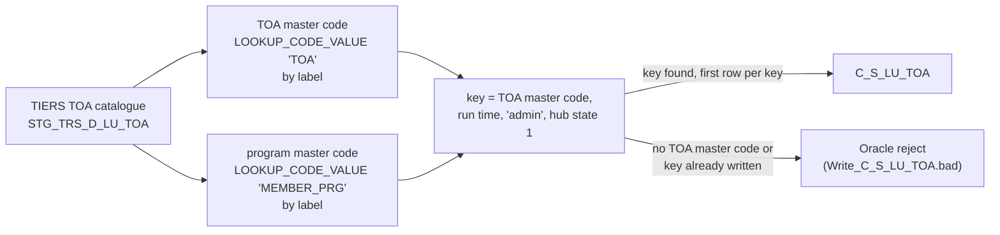

# 035 m_Tgt_C_S_TRS_Stg_TOA

| | |
|---|---|
| Source system | TRS |
| Sub-domain | Reference data (type-of-assistance catalogue) |
| Workflow | `wf_TRS_Stage_Load_TOA` (its only mapping), run after `wf_TRS_Stage_Load_1_Ongoing` by the daily parent workflow |
| Sources | `STG_TRS_D_LU_TOA` |
| Targets | `C_S_LU_TOA` |
| Java | `com.idq.cli.source.trs.etlmap.svc.TrsTypeOfAssistanceCatalogueService` |

## Business purpose

Publishes the TIERS **catalogue of types of assistance (TOA)** to the MDM lookup staging table `C_S_LU_TOA`:
which TOA codes exist, under which member program, with their description and effective dates.

This mapping does **not** load what a member receives. The TOA segments of each member (program, assistance
type, eligibility dates) come from `STG_TRS_D_CV_MCI_EDG_INDV_TOA` and are loaded by
[008 `m_Tgt_C_S_TRS_Pty_Rle_TOA`](008_m_Tgt_C_S_TRS_Pty_Rle_TOA.md) in `wf_TRS_Stage_Load_1_Ongoing`. The two meet
in the MDM: `C_S_TRS_PTY_RLE_TOA.TOA_FK` (008) and `C_S_LU_TOA.PKEY_SRC_OBJECT` (this mapping) both hold the TOA
master code from `LOOKUP_CODE_VALUE`, so a member's TOA row points to its catalogue entry.

Why it is a separate workflow is not documented in the export. What the export shows:

* It is reference data (`C_S_LU_*`, an MDM lookup base object), not member data (`C_S_TRS_*`). It does not join
  `STG_TRS_VALID_MEMBERS` or use any other output of the Ongoing workflow, so the order of the two workflows does
  not change what IDQ writes.
* It has no command task, so unlike every member workflow it writes no `.ind` indicator file.
* It truncates and reloads one small reference table. Keeping it apart means a failure here (for example an
  unconfigured TOA code, see below) cannot stop the member load, and the reverse.

## Process



## IdqMapInitQuery

### TRS-035 Type of assistance catalogue

* Every row of `STG_TRS_D_LU_TOA`: no filter on `HIST_NAV_IND`, `EFF_END_DT` or `ARCHIVE_DT`, so history and
  expired codes are read too. No `ORDER BY`.
* Both lookups match on the **master label** (`MSTR_REF_LABEL`), not on the source value, and have no `SRC_SYS`
  filter; "any row" on several matches.
* The lookups are done in Java on the cached `LOOKUP_CODE_VALUE` (`ReferenceData.codeValueByLabel`), not in SQL.
* No stale filter found.

Entity: `TrsQueryRows.AssistanceType` - named query: `TrsLuToaDeltaRepository#fetchAssistanceTypes`.

```sql
SELECT program_code, toa_code, toa_desc, eff_begin_dt, eff_end_dt, create_dt, update_user_id,
       update_dt, unique_trans_id
FROM stg_trs_d_lu_toa
```

<!-- lookups:begin -->
## Lookups

Connected lookups, grouped by the transformation that feeds their input ports. In a lookup condition the
left side is the lookup table column and the right side is the lookup input port. Output ports are the
returned table columns (or input ports passed through) and the downstream port each one feeds.

### Fed by `Exp_Src_TRS_Input` (Expression)

| Lookup | Table | Condition | Input ports | Output ports |
|---|---|---|---|---|
| `Lkp_LOOKUP_CODE_VALUE_TOA` | `LOOKUP_CODE_VALUE` (STAGING)<br>SQL override (below)<br>multiple match: any row | `MSTR_REF_LABEL = TOA_CODE` | `TOA_CODE` &larr; `TOA_CODE` | `MSTR_REF_CODE` &rarr; `Exp_TOA_Load.PKEY_SRC_OBJECT` (Expression)<br>`MSTR_REF_LABEL` &rarr; `Exp_TOA_Load.MSTR_REF_LABEL` (Expression) |
| `Lkp_LOOKUP_CODE_VALUE_MBR_PGM` | `LOOKUP_CODE_VALUE` (STAGING)<br>SQL override (below)<br>multiple match: any row | `MSTR_REF_LABEL = PROGRAM_CODE` | `PROGRAM_CODE` &larr; `PROGRAM_CODE` | `MSTR_REF_CODE` &rarr; `Exp_TOA_Load.PROGRAM_CODE` (Expression) |

SQL override of `Lkp_LOOKUP_CODE_VALUE_TOA`:

```sql
SELECT 
 Lkp.CREATED_BY
,Lkp.CREATE_DATE
,Lkp.UPDATED_BY
,Lkp.LAST_UPDATE_DATE
,Lkp.CODE_TYPE
,Lkp.MSTR_REF_CODE
,Lkp.MSTR_REF_LABEL
,Lkp.MSTR_REF_DESC
,Lkp.SRC_CODE_VALUE
,Lkp.SRC_SYS
,Lkp.SRC_CODE_DESC
FROM LOOKUP_CODE_VALUE Lkp
WHERE Lkp.CODE_TYPE = 'TOA'
```

SQL override of `Lkp_LOOKUP_CODE_VALUE_MBR_PGM`:

```sql
SELECT 
 Lkp.CREATED_BY
,Lkp.CREATE_DATE
,Lkp.UPDATED_BY
,Lkp.LAST_UPDATE_DATE
,Lkp.CODE_TYPE
,Lkp.MSTR_REF_CODE
,Lkp.MSTR_REF_LABEL
,Lkp.MSTR_REF_DESC
,Lkp.SRC_CODE_VALUE
,Lkp.SRC_SYS
,Lkp.SRC_CODE_DESC
FROM LOOKUP_CODE_VALUE Lkp
WHERE Lkp.CODE_TYPE = 'MEMBER_PRG'
```

<!-- lookups:end -->

## Business rules

1. `SRC_SYS` = `'TRS'` (computed, not written: `C_S_LU_TOA` has no `SRC_SYS` column).
2. TOA code translated with `LOOKUP_CODE_VALUE` (code type `TOA`) by **label**: `MSTR_REF_LABEL = TOA_CODE`. The
   master code becomes `PKEY_SRC_OBJECT`, `SRC_ROWID` and `TOA_CD`; the matched label becomes `TOA_LBL` (so
   `TOA_LBL` equals the source `TOA_CODE` whenever the row is loaded). Mapping 008 translates the same codes by
   **source value** (`SRC_SYS = 'TRS' AND SRC_CODE_VALUE = ...`). If label and source value differ for a code, the
   catalogue and the member TOA rows disagree.
3. Program code translated with `LOOKUP_CODE_VALUE` (code type `MEMBER_PRG`) by label: `MBR_PRG_CD` = master code,
   NULL when the program is not configured (no exception).
4. No validation and no exception table: there is no router, filter or `EXC_STG_BAD_REC_MEMB` target. An
   untranslated TOA code leaves `PKEY_SRC_OBJECT` NULL, and Oracle rejects the row (`PKEY_SRC_OBJECT NOT NULL`)
   into `Write_C_S_LU_TOA.bad`. It is not logged anywhere else.
5. The key is the TOA master code **only** (not the program). `C_S_LU_TOA` is unique on
   (`PKEY_SRC_OBJECT`, `VERSION_SEQ`) and `VERSION_SEQ` is hard-coded to 1, so one row per TOA code survives. When
   a code appears under several programs or history rows (`HISTORY_SEQ`), the first row read wins and the others
   are rejected. The read has no `ORDER BY`, so which program and description survive is not defined.
6. Loaded columns: `EFF_STRT_DT` / `EFF_END_DT` from `EFF_BEGIN_DT` / `EFF_END_DT` (no begin-after-end check),
   `TOA_DESC` (source 300, column 250), `CREATE_DATE` = source `CREATE_DT`, `UPDATED_BY` = source
   `UPDATE_USER_ID` (source 60, column 50), `LAST_UPDATE_DATE` = run start (`$sys.MappingRunStartTime`; the source
   `UPDATE_DT` is dropped), `CREATOR` = `'admin'`, `HUB_STATE_IND` = 1.
7. Read but not written: `DISPLAY_ORDER_NUM`, `HISTORY_SEQ`, `UNIQUE_TRANS_ID`, `HIST_NAV_IND`, `CREATE_USER_ID`,
   `ARCHIVE_DT`, `LOAD_DATE`. `ROWID_OBJECT` is computed (`LTRIM(LTRIM(RTRIM(PKEY_SRC_OBJECT)),0)`, the key without
   leading zeros) but linked nowhere; the MDM fills it.
8. Of the rows that share a key, the latest change is kept (`UPDATE_DT`, then `UNIQUE_TRANS_ID`, descending) in
   every port: IDQ's choice (first row read) is undefined, and this one is still to confirm with the business.
9. The target is emptied before each run (IDQ truncate), so `C_S_LU_TOA` holds what `STG_TRS_D_LU_TOA` holds that
   day. Whether the TIERS extract is the whole catalogue or only the day's changes is not in the export.

## PKEY formulation

| Target | PKEY_SRC_OBJECT | Example |
|---|---|---|
| `C_S_LU_TOA` | `<TOA master code>` (`MSTR_REF_CODE` of `LOOKUP_CODE_VALUE` type `TOA`, matched by label); `SRC_ROWID` and `TOA_CD` are the same value | `100` |

The value passes through a string(10) port in `Exp_TOA_Load` (the lookup returns up to 20 characters); a longer
master code would be cut (port precision, see `docs/common_insights.md` section 9). `MBR_PRG_CD` passes through a
string(9) port.

## Retired / not ported

* `VERSION_SEQ` = `'1'` (literal) - MDM timeline. `PERIOD_START_DATE`, `PERIOD_END_DATE`,
  `PERIOD_REFERENCE_TIME`, `TIMELINE_ACTION` are not linked (NULL / column default).
* Not performed: IDQ "truncate target table" of `C_S_LU_TOA`. This code base never deletes, truncates or drops; a
  port must append (and therefore cannot reproduce the full-refresh semantics without the MDM purging the staging
  table between runs).

## Java implementation

* `TrsTypeOfAssistanceCatalogueService.transform` with `pkey`; entity `TrsTargets.TypeOfAssistanceCatalogue`
  (`C_S_LU_TOA` has no `SRC_LAST_UPD_DT`, so the row carries its own audit columns instead of `MdmAudit`),
  repository `TrsTypeOfAssistanceCatalogueRepository`. Sub-domain `REFERENCE`.
* Runs as the last TRS mapping (`MappingCatalog.TRS_ORDER`): `SourceSystem.TRS.workflows` lists
  `wf_TRS_Stage_Load_1_Ongoing` then `wf_TRS_Stage_Load_TOA`, and the IDQ, ORA_SP and SNOWFLAKE_SP engines run both
  workflows / run scripts in that order.
* Source entity: `TrsSources.LuToaDelta` (`STG_TRS_D_LU_TOA`). Mock data:
  `TrsMockData.fill_sample_mock_data_m_Tgt_C_S_TRS_Stg_TOA`.
* Unit test: `TrsPkeyTest#m_Tgt_C_S_TRS_Stg_TOA_pkey_test`.
* Stored-procedure ports: `idq-to-oracle/wf_TRS_Stage_Load_TOA/sp_ors_main_m_Tgt_C_S_TRS_Stg_TOA.sql` and
  [`idq-to-snowflake/wf_TRS_Stage_Load_TOA/sp_snow_main_m_Tgt_C_S_TRS_Stg_TOA.sql`](../../idq-to-snowflake/wf_TRS_Stage_Load_TOA/sp_snow_main_m_Tgt_C_S_TRS_Stg_TOA.sql)
  ([documented](../../docs-from-snowflake-db-scripts/wf_TRS_Stage_Load_TOA/mappings/m_Tgt_C_S_TRS_Stg_TOA.md)). IDQ /
  CDI specification:
  [`docs-from-idq-exports/wf_TRS_Stage_Load_TOA/mappings/m_Tgt_C_S_TRS_Stg_TOA.md`](../../docs-from-idq-exports/wf_TRS_Stage_Load_TOA/mappings/m_Tgt_C_S_TRS_Stg_TOA.md).
