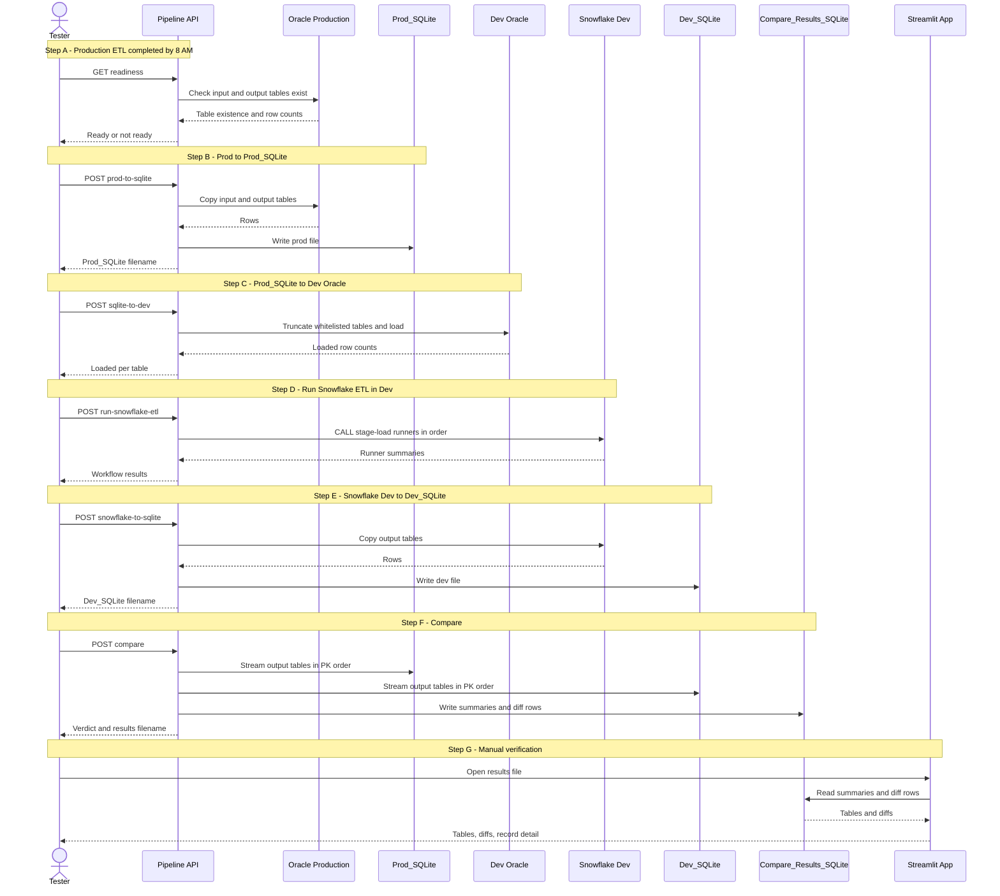
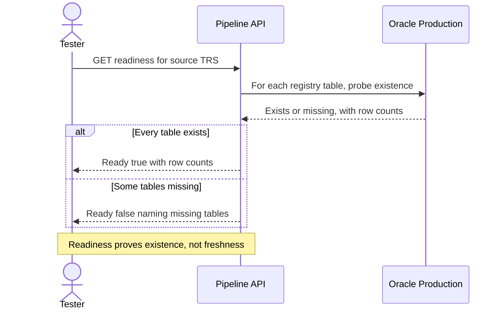
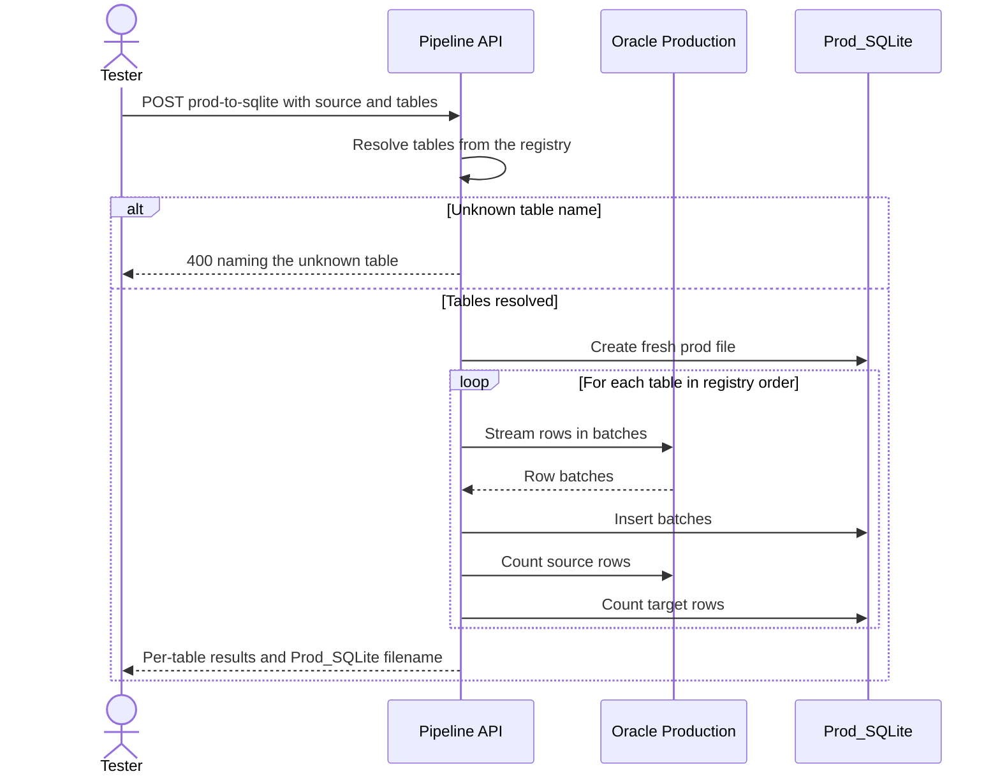
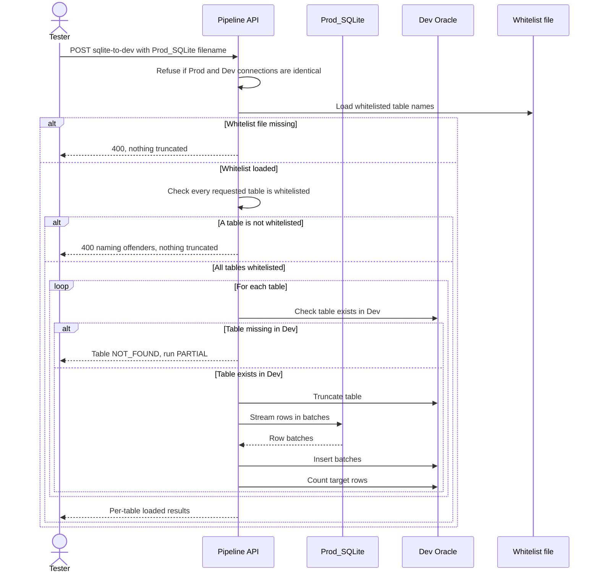
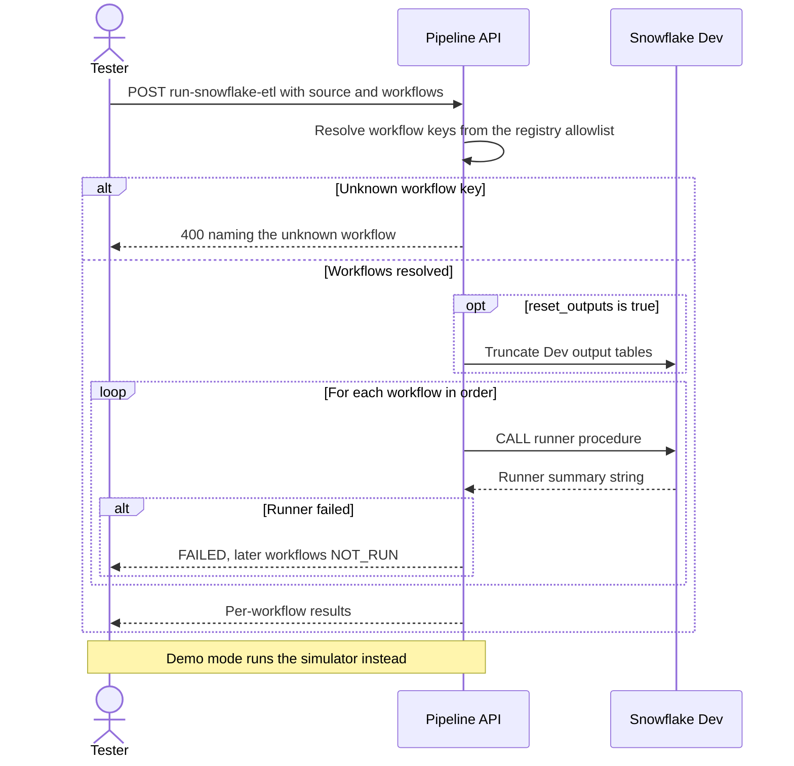
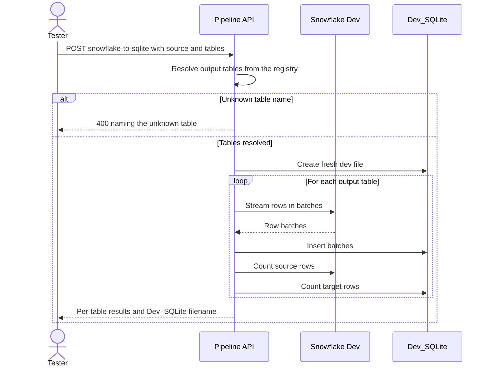
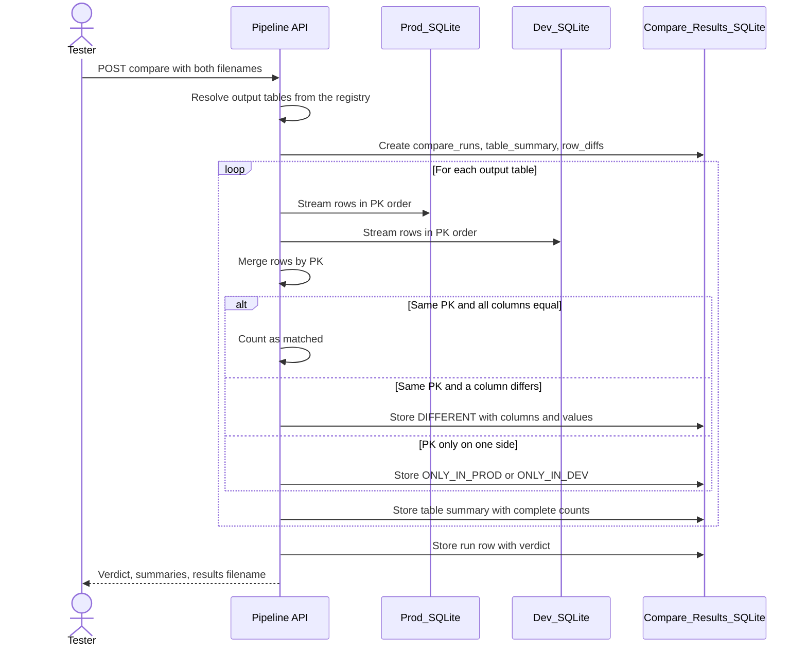
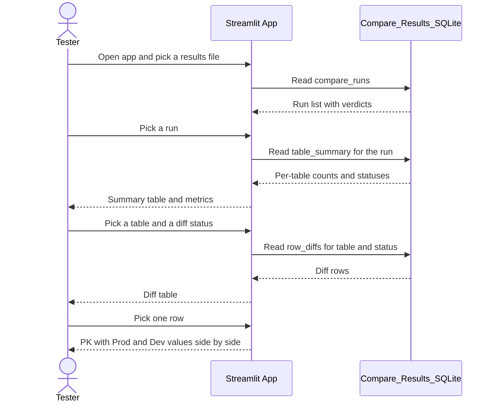

# Tester Pipeline Sequence Diagrams (v5.5.0)

Mermaid `sequenceDiagram` views of the daily tester flow. The
diagrams match the endpoint and safety-gate behaviour in
`PIPELINE_USER_GUIDE.md` exactly: the whitelist refusal in (C),
the failure-stops-later-workflows rule in (D), and the
record-by-record merge in (F) are all drawn, not implied.

## 1. Overall daily flow (steps A to G)

## 2. Step A - Readiness check

## 3. Step B - Prod Oracle to Prod_SQLite

## 4. Step C - Prod_SQLite to Dev Oracle (whitelist-gated)

## 5. Step D - Run the Snowflake ETL in Dev

## 6. Step E - Snowflake Dev to Dev_SQLite

## 7. Step F - Compare Prod_SQLite vs Dev_SQLite

## 8. Step G - Streamlit manual verification

