# m_Tgt_C_S_ECI_Pty_Rle_Alt_Id

IDQ mapping &rarr; CDI **Mapping** `m_Tgt_C_S_ECI_Pty_Rle_Alt_Id`.

> [MLayne 09/27/2024]   Added family ID

## Summary

| IDQ transformation | CDI transformation | Count |
|---|---|---|
| ExpressionTx | Expression | 10 |
| FilterTx | Filter | 1 |
| LookupTx | Lookup | 2 |
| MappletTx | Mapplet | 2 |
| RouterTx | Router | 3 |
| SourceTx | Source | 1 |
| TargetTx | Target | 3 |
| UnionTx | Union | 1 |

Sources:

| Instance | Object | Connection |
|---|---|---|
| Read_STG_ECI_D_CHILD | `STG_ECI_D_CHILD` | STAGING |

Targets:

| Instance | Object | Connection |
|---|---|---|
| Write_C_S_ECI_PTY_RLE_ALT_ID | `C_S_ECI_PTY_RLE_ALT_ID` | HHS_MDM_ORS |
| Write_EXC_STG_BAD_REC_MEMB_SSN | `EXC_STG_BAD_REC_MEMB` | STAGING |
| Write_EXC_STG_BAD_REC_MEMB_MedicaidId | `EXC_STG_BAD_REC_MEMB` | STAGING |

## Flow

```mermaid
flowchart LR
  n0["Read_STG_ECI_D_CHILD<br/><i>Source</i>"]
  n1["exp_ECI_Pty_Rle_Alt_Id<br/><i>Expression</i>"]
  n2["Lkp_STG_ECI_PTY_INACTIVE_STS<br/><i>Lookup</i>"]
  n3["Filter<br/><i>Filter</i>"]
  n4["Rtr_ALT_ID_Type<br/><i>Router</i>"]
  n5["Exp_Pty_Rle_Alt_Id_SSN<br/><i>Expression</i>"]
  n6["rule_USA_SSN_Validation_post_June2011<br/><i>Mapplet</i>"]
  n7["exp_validate_ssn<br/><i>Expression</i>"]
  n8["Exp_Parse_SSN<br/><i>Expression</i>"]
  n9["RTR_Valid_SSN<br/><i>Router</i>"]
  n10["Exp_Pty_Rle_Alt_Id_ECIID<br/><i>Expression</i>"]
  n11["Exp_Pty_Rle_Alt_Id_MedicaidId<br/><i>Expression</i>"]
  n12["rule_MEDICAID_ID_Std<br/><i>Mapplet</i>"]
  n13["Exp_Parse_Medicaid_Id<br/><i>Expression</i>"]
  n14["Lkp_EXC_LOOKUP_CODE_VALUE<br/><i>Lookup</i>"]
  n15["RTR_Valid_Medicaid_ID<br/><i>Router</i>"]
  n16["Union_Valid_ALT_ID_Type<br/><i>Union</i>"]
  n17["Exp_STG_ALT_ID_Type_Load<br/><i>Expression</i>"]
  n18["Write_C_S_ECI_PTY_RLE_ALT_ID<br/><i>Target</i>"]
  n19["Exp_Invalid_MedicaidId<br/><i>Expression</i>"]
  n20["Write_EXC_STG_BAD_REC_MEMB_MedicaidId<br/><i>Target</i>"]
  n21["Exp_SSN_Exceptions<br/><i>Expression</i>"]
  n22["Write_EXC_STG_BAD_REC_MEMB_SSN<br/><i>Target</i>"]
  n0 --> n1
  n1 --> n2
  n1 --> n3
  n2 --> n3
  n3 --> n4
  n4 --> n5
  n4 --> n10
  n4 --> n11
  n5 --> n6
  n5 --> n7
  n5 --> n8
  n6 --> n7
  n7 --> n8
  n8 --> n9
  n9 --> n14
  n9 --> n16
  n9 --> n21
  n10 --> n16
  n11 --> n12
  n11 --> n13
  n12 --> n13
  n13 --> n15
  n14 --> n21
  n15 --> n16
  n15 --> n19
  n16 --> n17
  n17 --> n18
  n19 --> n20
  n21 --> n22
```



## Filtered data

Every step that can stop, divert or collapse rows, and what happens to the rows that do not pass. A Filter keeps a row only when its condition is TRUE: FALSE **or NULL** drops the row silently (no target, no reject file). A Router writes a row to **every** group whose condition is TRUE; a row that matches no group goes to the default group and is discarded when that group is not linked. Comments (`--`, `//`) are removed from the conditions shown here. A `= ...` line reads a null check on a lookup return in plain terms; *no matching row* also covers a matching row whose returned field is NULL.

### Steps that filter rows

| Step | IDQ type | Rule | Rows that pass go to | Rows that do not pass |
|---|---|---|---|---|
| Read_STG_ECI_D_CHILD | SourceTx | custom SQL query (see the step): only the rows it returns | `C_S_ECI_PTY_RLE_ALT_ID`, `EXC_STG_BAD_REC_MEMB` | never read |
| Filter | FilterTx | keep `IsNull(DEACTIVATION_STS)`<br>= no matching row in `STG_ECI_PTY_INACTIVE_STS` | `C_S_ECI_PTY_RLE_ALT_ID`, `EXC_STG_BAD_REC_MEMB` | **discarded** |
| Rtr_ALT_ID_Type | RouterTx | group `CHILD_SSN`: `ALT_ID_TP='004'` | `C_S_ECI_PTY_RLE_ALT_ID`, `EXC_STG_BAD_REC_MEMB` |  |
| Rtr_ALT_ID_Type | RouterTx | group `ECI_IDs`: `ALT_ID_TP='018' or ALT_ID_TP='019'` | `C_S_ECI_PTY_RLE_ALT_ID` |  |
| Rtr_ALT_ID_Type | RouterTx | group `MEDICAID_NBR`: `ALT_ID_TP='002'` | `C_S_ECI_PTY_RLE_ALT_ID`, `EXC_STG_BAD_REC_MEMB` |  |
| Rtr_ALT_ID_Type | RouterTx | default group `Default`: rows that match no other group | nothing: group not linked, **discarded** |  |
| RTR_Valid_SSN | RouterTx | group `Valid_CHILD_SSN`: `ISNULL(SSN_Exception_Code)` | `C_S_ECI_PTY_RLE_ALT_ID` |  |
| RTR_Valid_SSN | RouterTx | group `Invalid_CHILD_SSN`: `NOT ISNULL(SSN_Exception_Code)` | `EXC_STG_BAD_REC_MEMB` |  |
| RTR_Valid_SSN | RouterTx | default group `Default`: rows that match no other group | no row gets here: every row matches `Valid_CHILD_SSN` or `Invalid_CHILD_SSN` |  |
| RTR_Valid_Medicaid_ID | RouterTx | group `VALID_Medicaid_Id`: `ISNULL(Medicaid_Id_Exception_Code)` | `C_S_ECI_PTY_RLE_ALT_ID` |  |
| RTR_Valid_Medicaid_ID | RouterTx | group `INVALID_Medicaid_Id`: `NOT ISNULL(Medicaid_Id_Exception_Code)` | `EXC_STG_BAD_REC_MEMB` |  |
| RTR_Valid_Medicaid_ID | RouterTx | default group `Default`: rows that match no other group | no row gets here: every row matches `VALID_Medicaid_Id` or `INVALID_Medicaid_Id` |  |

### Where the condition fields come from

| Step | Field | Origin |
|---|---|---|
| Filter | `DEACTIVATION_STS` | `DEACTIVATION_STS` returned by lookup `Lkp_STG_ECI_PTY_INACTIVE_STS` on `STG_ECI_PTY_INACTIVE_STS` where `SRC_KEY = PTY_SRC_KEY AND ROWID_SYSTEM = SRC_SYSTEM`; NULL when no row matches; `STG_ECI_PTY_INACTIVE_STS` is loaded by `m_Tgt_C_S_ECI_Pty_Validation` in this workflow |
| Rtr_ALT_ID_Type | `ALT_ID_TP` | source column `ALT_ID_TP` read by `Read_STG_ECI_D_CHILD` |
| RTR_Valid_SSN | `SSN_Exception_Code` | `exp_validate_ssn.EXCEPTION_CODE1` = `IIF( SSN_Status = 'Invalid' ,'Invalid_SSN' ,Null )` |
| RTR_Valid_Medicaid_ID | `Medicaid_Id_Exception_Code` | mapplet `rule_MEDICAID_ID_Std`: `EXCEPTION_CODE1` returned by lookup `Lookup_EXC_LOOKUP_CODE_VALUE1` on `EXC_LOOKUP_CODE_VALUE` where `EXCEPTION_CODE = EXCEPTION_CODE1`; NULL when no row matches |

### Rows that do not reach `C_S_*` tables

**`C_S_ECI_PTY_RLE_ALT_ID`** (`Write_C_S_ECI_PTY_RLE_ALT_ID`): a source row is written only when it passes every step below on one of its 3 paths.

Path 1:

| Step | Must hold | Otherwise the row |
|---|---|---|
| `Read_STG_ECI_D_CHILD` | custom SQL query (see the step): only the rows it returns | never read |
| `Filter` | `IsNull(DEACTIVATION_STS)`<br>= no matching row in `STG_ECI_PTY_INACTIVE_STS` | **discarded** (not written anywhere) |
| `Rtr_ALT_ID_Type` | group `CHILD_SSN`: `ALT_ID_TP='004'` | if `ALT_ID_TP='018' or ALT_ID_TP='019'`: group `ECI_IDs` &rarr; `C_S_ECI_PTY_RLE_ALT_ID`<br>if `ALT_ID_TP='002'`: group `MEDICAID_NBR` &rarr; `C_S_ECI_PTY_RLE_ALT_ID`, `EXC_STG_BAD_REC_MEMB`<br>if no group matches: **discarded** (default group not linked) |
| `RTR_Valid_SSN` | group `Valid_CHILD_SSN`: `ISNULL(SSN_Exception_Code)` | if `NOT ISNULL(SSN_Exception_Code)`: group `Invalid_CHILD_SSN` &rarr; `EXC_STG_BAD_REC_MEMB` |

Path 2:

| Step | Must hold | Otherwise the row |
|---|---|---|
| `Read_STG_ECI_D_CHILD` | custom SQL query (see the step): only the rows it returns | never read |
| `Filter` | `IsNull(DEACTIVATION_STS)`<br>= no matching row in `STG_ECI_PTY_INACTIVE_STS` | **discarded** (not written anywhere) |
| `Rtr_ALT_ID_Type` | group `ECI_IDs`: `ALT_ID_TP='018' or ALT_ID_TP='019'` | if `ALT_ID_TP='004'`: group `CHILD_SSN` &rarr; `C_S_ECI_PTY_RLE_ALT_ID`, `EXC_STG_BAD_REC_MEMB`<br>if `ALT_ID_TP='002'`: group `MEDICAID_NBR` &rarr; `C_S_ECI_PTY_RLE_ALT_ID`, `EXC_STG_BAD_REC_MEMB`<br>if no group matches: **discarded** (default group not linked) |

Path 3:

| Step | Must hold | Otherwise the row |
|---|---|---|
| `Read_STG_ECI_D_CHILD` | custom SQL query (see the step): only the rows it returns | never read |
| `Filter` | `IsNull(DEACTIVATION_STS)`<br>= no matching row in `STG_ECI_PTY_INACTIVE_STS` | **discarded** (not written anywhere) |
| `Rtr_ALT_ID_Type` | group `MEDICAID_NBR`: `ALT_ID_TP='002'` | if `ALT_ID_TP='004'`: group `CHILD_SSN` &rarr; `C_S_ECI_PTY_RLE_ALT_ID`, `EXC_STG_BAD_REC_MEMB`<br>if `ALT_ID_TP='018' or ALT_ID_TP='019'`: group `ECI_IDs` &rarr; `C_S_ECI_PTY_RLE_ALT_ID`<br>if no group matches: **discarded** (default group not linked) |
| `RTR_Valid_Medicaid_ID` | group `VALID_Medicaid_Id`: `ISNULL(Medicaid_Id_Exception_Code)` | if `NOT ISNULL(Medicaid_Id_Exception_Code)`: group `INVALID_Medicaid_Id` &rarr; `EXC_STG_BAD_REC_MEMB` |

## Transformations

In data-flow order.

### Read_STG_ECI_D_CHILD

IDQ `SourceTx` &rarr; CDI **Source**. Oracle connector source; carry the SQL override / filter below verbatim.

| Property | Value |
|---|---|
| Connection | STAGING |
| Object | STG_ECI_D_CHILD |
| queryMode | SEMI |

SQL override (CDI *SQL Override*; translated):

```sql
SELECT
			--'ECI_CHILD' SOURCE_TABLE,
			  ID_CHILD as ID
			, LPAD(ID_CHILD,10, '0') || '|Member' AS PTY_REL_FK
			, LPAD(ID_CHILD,10, '0') AS  SRC_KEY_SFX
			, '018' ALT_ID_TP  -- ECI Child ID
			, LPAD(ID_CHILD,10, '0')  ALT_ID_VAL
			,  DATE_CREATED, DATE_MODIFIED
			, LPAD(ID_CHILD,10, '0') || '|Member' || '|018'||'|'|| LPAD(ID_CHILD,10, '0') AS PKEY_SRC_OBJECT

FROM STG_ECI_D_CHILD


UNION ALL

SELECT
			--'ECI_CHILD' SOURCE_TABLE,
			  ID_CHILD as ID
			, LPAD(ID_CHILD,10, '0') || '|Member' AS PTY_REL_FK
			, LPAD(ID_CHILD,10, '0') AS  SRC_KEY_SFX
			, '004' ALT_ID_TP    -- SSN
			, CHILD_SSN  ALT_ID_VAL
			,  DATE_CREATED, DATE_MODIFIED
			, LPAD(ID_CHILD,10, '0') || '|Member' || '|004'||'|'|| LPAD(ID_CHILD,10, '0') AS PKEY_SRC_OBJECT

FROM STG_ECI_D_CHILD
WHERE CHILD_SSN IS NOT NULL

UNION ALL

SELECT
			--'ECI_CHILD' SOURCE_TABLE,
			  ID_CHILD as ID
			, LPAD(ID_CHILD,10, '0') || '|Member' AS PTY_REL_FK
			, LPAD(ID_MEDICAID,9, '0') AS  SRC_KEY_SFX
			, '002' ALT_ID_TP         -- Medicaid ID
			, MEDICAID_NBR  ALT_ID_VAL
			, M.DATE_CREATED, M.DATE_MODIFIED
			, LPAD(ID_CHILD,10, '0') || '|Member' || '|002'||'|'|| LPAD(ID_MEDICAID,10, '0') AS PKEY_SRC_OBJECT
FROM STG_ECI_D_MEDICAID   M
INNER JOIN STG_ECI_SN_CASE  C
ON M.ID_CASE  = C.ID_CASE

UNION ALL

SELECT
			--'ECI_FAMILY' SOURCE_TABLE,
			  ID_FAMILY as ID
			, LPAD(ID_FAMILY,10, '0') || 'F|Member' AS PTY_REL_FK  -- NOTE 'F' Appended for Family Source
			, LPAD(ID_FAMILY,10, '0') AS  SRC_KEY_SFX
			, '019' ALT_ID_TP  -- NEW ENTRY NEEDED FOR "ECI ID"
			, LPAD(ID_FAMILY,10, '0')  ALT_ID_VAL
			,  DATE_CREATED, DATE_MODIFIED
			, LPAD(ID_FAMILY,10, '0') || 'F|Member' || '|019'||'|'|| LPAD(ID_FAMILY,10, '0') AS PKEY_SRC_OBJECT

FROM STG_ECI_D_FAMILY
```

Columns: `None`, `None`, `None`, `None`, `None`, `None`, `None`, `None`

### exp_ECI_Pty_Rle_Alt_Id

IDQ `ExpressionTx` &rarr; CDI **Expression**. Same expression language; variable fields are supported.

| Field | Kind | Type | Expression (CDI) |
|---|---|---|---|
| ID | in/out | decimal(10) |  |
| PTY_SRC_KEY | out | string(11) | `RTRIM(SUBSTR(PTY_REL_FK,1,11),'\|')` |
| PKEY_SRC_OBJECT | in/out | string(255) |  |
| PTY_REL_FK | in/out | string(255) |  |
| SRC_KEY_SFX | in/out | string(10) |  |
| ALT_ID_TP | in/out | string(3) |  |
| ALT_ID_VAL | in/out | string(10) |  |
| DATE_CREATED | in/out | date/time |  |
| DATE_MODIFIED | in/out | date/time |  |
| SRC_SYSTEM | out | string(10) | `'ECI'` |

Links (target field &larr; upstream field):

| Field | From |
|---|---|
| ID | Read_STG_ECI_D_CHILD.ID_CHILD |
| PTY_REL_FK | Read_STG_ECI_D_CHILD.PTY_REL_FK |
| SRC_KEY_SFX | Read_STG_ECI_D_CHILD.SRC_KEY_SFX |
| ALT_ID_TP | Read_STG_ECI_D_CHILD.ALT_ID_TP |
| ALT_ID_VAL | Read_STG_ECI_D_CHILD.ALT_ID_VAL |
| DATE_CREATED | Read_STG_ECI_D_CHILD.DATE_CREATED |
| DATE_MODIFIED | Read_STG_ECI_D_CHILD.DATE_MODIFIED |
| PKEY_SRC_OBJECT | Read_STG_ECI_D_CHILD.PKEY_SRC_OBJECT |

### Lkp_STG_ECI_PTY_INACTIVE_STS

IDQ `LookupTx` &rarr; CDI **Lookup**. Connected lookup unless a return port is set (then unconnected).

| Property | Value |
|---|---|
| Connection | STAGING |
| Object | STG_ECI_PTY_INACTIVE_STS |
| Lookup condition | SRC_KEY = PTY_SRC_KEY AND ROWID_SYSTEM = SRC_SYSTEM |
| Multiple matches | Return any row |
| Cache | static cache |

| Lookup input field | Type |
|---|---|
| PTY_SRC_KEY | string(255) |
| SRC_SYSTEM | string(10) |

| Return / pass-through field | Feeds |
|---|---|
| DEACTIVATION_STS | Filter.DEACTIVATION_STS |

Links (target field &larr; upstream field):

| Field | From |
|---|---|
| SRC_SYSTEM | exp_ECI_Pty_Rle_Alt_Id.SRC_SYSTEM |
| PTY_SRC_KEY | exp_ECI_Pty_Rle_Alt_Id.PTY_SRC_KEY |

### Filter

IDQ `FilterTx` &rarr; CDI **Filter**. Advanced filter condition.

Filter condition:

```
IsNull(DEACTIVATION_STS)
```

Links (target field &larr; upstream field):

| Field | From |
|---|---|
| ID | exp_ECI_Pty_Rle_Alt_Id.ID |
| PKEY_SRC_OBJECT | exp_ECI_Pty_Rle_Alt_Id.PKEY_SRC_OBJECT |
| PTY_REL_FK | exp_ECI_Pty_Rle_Alt_Id.PTY_REL_FK |
| SRC_KEY_SFX | exp_ECI_Pty_Rle_Alt_Id.SRC_KEY_SFX |
| ALT_ID_TP | exp_ECI_Pty_Rle_Alt_Id.ALT_ID_TP |
| ALT_ID_VAL | exp_ECI_Pty_Rle_Alt_Id.ALT_ID_VAL |
| DATE_CREATED | exp_ECI_Pty_Rle_Alt_Id.DATE_CREATED |
| DATE_MODIFIED | exp_ECI_Pty_Rle_Alt_Id.DATE_MODIFIED |
| SRC_SYSTEM | exp_ECI_Pty_Rle_Alt_Id.SRC_SYSTEM |
| DEACTIVATION_STS | Lkp_STG_ECI_PTY_INACTIVE_STS.DEACTIVATION_STS |

### Rtr_ALT_ID_Type

IDQ `RouterTx` &rarr; CDI **Router**. One output group per IDQ group; the default group is created automatically.

| Output group | Condition |
|---|---|
| CHILD_SSN | `ALT_ID_TP='004'` |
| ECI_IDs | `ALT_ID_TP='018' or ALT_ID_TP='019'` |
| MEDICAID_NBR | `ALT_ID_TP='002'` |
| Default | (default group) |

Links (target field &larr; upstream field):

| Field | From |
|---|---|
| ID | Filter.ID |
| PKEY_SRC_OBJECT | Filter.PKEY_SRC_OBJECT |
| SRC_SYSTEM | Filter.SRC_SYSTEM |
| PTY_REL_FK | Filter.PTY_REL_FK |
| SRC_KEY_SFX | Filter.SRC_KEY_SFX |
| ALT_ID_TP | Filter.ALT_ID_TP |
| ALT_ID_VAL | Filter.ALT_ID_VAL |
| DATE_CREATED | Filter.DATE_CREATED |
| DATE_MODIFIED | Filter.DATE_MODIFIED |

### Exp_Pty_Rle_Alt_Id_SSN

IDQ `ExpressionTx` &rarr; CDI **Expression**. Same expression language; variable fields are supported.

| Field | Kind | Type | Expression (CDI) |
|---|---|---|---|
| ID | in/out | decimal(10) | `ID` |
| PTY_REL_FK | in/out | string(255) | `PTY_REL_FK` |
| SRC_KEY_SFX | in/out | string(10) | `SRC_KEY_SFX` |
| ALT_ID_TP | in/out | string(3) | `ALT_ID_TP` |
| ALT_ID_VAL | in/out | string(10) | `ALT_ID_VAL` |
| DATE_CREATED | in/out | date/time | `DATE_CREATED` |
| DATE_MODIFIED | in/out | date/time | `DATE_MODIFIED` |
| SRC_SYSTEM | in/out | string(10) | `SRC_SYSTEM` |
| PKEY_SRC_OBJECT | in/out | string(255) | `PKEY_SRC_OBJECT` |

Links (target field &larr; upstream field):

| Field | From |
|---|---|
| ID | Rtr_ALT_ID_Type.CHILD_SSN.ID |
| PTY_REL_FK | Rtr_ALT_ID_Type.CHILD_SSN.PTY_REL_FK |
| SRC_KEY_SFX | Rtr_ALT_ID_Type.CHILD_SSN.SRC_KEY_SFX |
| ALT_ID_TP | Rtr_ALT_ID_Type.CHILD_SSN.ALT_ID_TP |
| ALT_ID_VAL | Rtr_ALT_ID_Type.CHILD_SSN.ALT_ID_VAL |
| DATE_CREATED | Rtr_ALT_ID_Type.CHILD_SSN.DATE_CREATED |
| DATE_MODIFIED | Rtr_ALT_ID_Type.CHILD_SSN.DATE_MODIFIED |
| SRC_SYSTEM | Rtr_ALT_ID_Type.CHILD_SSN.SRC_SYSTEM |
| PKEY_SRC_OBJECT | Rtr_ALT_ID_Type.CHILD_SSN.PKEY_SRC_OBJECT |

### rule_USA_SSN_Validation_post_June2011

IDQ `MappletTx` &rarr; CDI **Mapplet**. Reusable CDI mapplet (see the mapplets folder).

Mapplet: [`rule_USA_SSN_Validation_post_June2011`](../mapplets/rule_USA_SSN_Validation_post_June2011.md)

Links (target field &larr; upstream field):

| Field | From |
|---|---|
| Group.In_SSN | Exp_Pty_Rle_Alt_Id_SSN.ALT_ID_VAL |

### exp_validate_ssn

IDQ `ExpressionTx` &rarr; CDI **Expression**. Same expression language; variable fields are supported.

| Field | Kind | Type | Expression (CDI) |
|---|---|---|---|
| ALT_ID_VAL | in | string(10) |  |
| SSN_Status | in/out | string(15) | `SSN_Status` |
| std_SSN_out | out | string(10) | `IIF( SSN_Status = 'Invalid'<br>	,Null<br>	,ALT_ID_VAL<br>)` |
| EXCEPTION_CODE1 | out | string(300) | `IIF( SSN_Status = 'Invalid'<br>	,'Invalid_SSN'<br>	,Null<br>)` |

Links (target field &larr; upstream field):

| Field | From |
|---|---|
| SSN_Status | rule_USA_SSN_Validation_post_June2011.OUTPUT.Out_SSN_Status |
| ALT_ID_VAL | Exp_Pty_Rle_Alt_Id_SSN.ALT_ID_VAL |

### Exp_Parse_SSN

IDQ `ExpressionTx` &rarr; CDI **Expression**. Same expression language; variable fields are supported.

| Field | Kind | Type | Expression (CDI) |
|---|---|---|---|
| ID_CHILD | in/out | decimal(10) | `ID_CHILD` |
| PTY_REL_FK | in/out | string(255) | `PTY_REL_FK` |
| SRC_KEY_SFX | in/out | string(10) | `SRC_KEY_SFX` |
| ALT_ID_TP | in/out | string(3) | `ALT_ID_TP` |
| ALT_ID_VAL | in/out | string(10) | `ALT_ID_VAL` |
| DATE_CREATED | in/out | date/time | `DATE_CREATED` |
| DATE_MODIFIED | in/out | date/time | `DATE_MODIFIED` |
| std_SSN_out | in/out | string(10) | `std_SSN_out` |
| EXCEPTION_CODE | in/out | string(300) | `EXCEPTION_CODE` |
| SSN_Status | in/out | string(15) | `SSN_Status` |
| SRC_SYSTEM | in/out | string(10) | `SRC_SYSTEM` |
| PKEY_SRC_OBJECT | in/out | string(255) | `PKEY_SRC_OBJECT` |

Links (target field &larr; upstream field):

| Field | From |
|---|---|
| ID_CHILD | Exp_Pty_Rle_Alt_Id_SSN.ID |
| PTY_REL_FK | Exp_Pty_Rle_Alt_Id_SSN.PTY_REL_FK |
| SRC_KEY_SFX | Exp_Pty_Rle_Alt_Id_SSN.SRC_KEY_SFX |
| ALT_ID_TP | Exp_Pty_Rle_Alt_Id_SSN.ALT_ID_TP |
| ALT_ID_VAL | Exp_Pty_Rle_Alt_Id_SSN.ALT_ID_VAL |
| DATE_CREATED | Exp_Pty_Rle_Alt_Id_SSN.DATE_CREATED |
| DATE_MODIFIED | Exp_Pty_Rle_Alt_Id_SSN.DATE_MODIFIED |
| std_SSN_out | exp_validate_ssn.std_SSN_out |
| EXCEPTION_CODE | exp_validate_ssn.EXCEPTION_CODE1 |
| SSN_Status | exp_validate_ssn.SSN_Status |
| SRC_SYSTEM | Exp_Pty_Rle_Alt_Id_SSN.SRC_SYSTEM |
| PKEY_SRC_OBJECT | Exp_Pty_Rle_Alt_Id_SSN.PKEY_SRC_OBJECT |

### RTR_Valid_SSN

IDQ `RouterTx` &rarr; CDI **Router**. One output group per IDQ group; the default group is created automatically.

| Output group | Condition |
|---|---|
| Valid_CHILD_SSN | `ISNULL(SSN_Exception_Code)` |
| Invalid_CHILD_SSN | `NOT ISNULL(SSN_Exception_Code)` |
| Default | (default group) |

Links (target field &larr; upstream field):

| Field | From |
|---|---|
| ID_CHILD | Exp_Parse_SSN.ID_CHILD |
| PTY_REL_FK | Exp_Parse_SSN.PTY_REL_FK |
| SRC_KEY_SFX | Exp_Parse_SSN.SRC_KEY_SFX |
| ALT_ID_TP | Exp_Parse_SSN.ALT_ID_TP |
| ALT_ID_VAL | Exp_Parse_SSN.ALT_ID_VAL |
| DATE_CREATED | Exp_Parse_SSN.DATE_CREATED |
| DATE_MODIFIED | Exp_Parse_SSN.DATE_MODIFIED |
| std_SSN_out | Exp_Parse_SSN.std_SSN_out |
| SSN_Exception_Code | Exp_Parse_SSN.EXCEPTION_CODE |
| SSN_Status | Exp_Parse_SSN.SSN_Status |
| SRC_SYSTEM | Exp_Parse_SSN.SRC_SYSTEM |
| PKEY_SRC_OBJECT | Exp_Parse_SSN.PKEY_SRC_OBJECT |

### Exp_Pty_Rle_Alt_Id_ECIID

IDQ `ExpressionTx` &rarr; CDI **Expression**. Same expression language; variable fields are supported.

| Field | Kind | Type | Expression (CDI) |
|---|---|---|---|
| ID_CHILD | in/out | decimal(10) | `ID_CHILD` |
| PTY_REL_FK | in/out | string(255) | `PTY_REL_FK` |
| SRC_KEY_SFX | in/out | string(10) | `SRC_KEY_SFX` |
| ALT_ID_TP | in/out | string(3) | `ALT_ID_TP` |
| ALT_ID_VAL | in/out | string(10) | `ALT_ID_VAL` |
| DATE_CREATED | in/out | date/time | `DATE_CREATED` |
| DATE_MODIFIED | in/out | date/time | `DATE_MODIFIED` |
| SRC_SYSTEM | in/out | string(10) | `SRC_SYSTEM` |
| PKEY_SRC_OBJECT | in/out | string(255) | `PKEY_SRC_OBJECT` |

Links (target field &larr; upstream field):

| Field | From |
|---|---|
| ID_CHILD | Rtr_ALT_ID_Type.ECI_IDs.ID |
| PTY_REL_FK | Rtr_ALT_ID_Type.ECI_IDs.PTY_REL_FK |
| SRC_KEY_SFX | Rtr_ALT_ID_Type.ECI_IDs.SRC_KEY_SFX |
| ALT_ID_TP | Rtr_ALT_ID_Type.ECI_IDs.ALT_ID_TP |
| ALT_ID_VAL | Rtr_ALT_ID_Type.ECI_IDs.ALT_ID_VAL |
| DATE_CREATED | Rtr_ALT_ID_Type.ECI_IDs.DATE_CREATED |
| DATE_MODIFIED | Rtr_ALT_ID_Type.ECI_IDs.DATE_MODIFIED |
| SRC_SYSTEM | Rtr_ALT_ID_Type.ECI_IDs.SRC_SYSTEM |
| PKEY_SRC_OBJECT | Rtr_ALT_ID_Type.ECI_IDs.PKEY_SRC_OBJECT |

### Exp_Pty_Rle_Alt_Id_MedicaidId

IDQ `ExpressionTx` &rarr; CDI **Expression**. Same expression language; variable fields are supported.

| Field | Kind | Type | Expression (CDI) |
|---|---|---|---|
| ID_CHILD | in/out | decimal(10) | `ID_CHILD` |
| PTY_REL_FK | in/out | string(255) | `PTY_REL_FK` |
| SRC_KEY_SFX | in/out | string(10) | `SRC_KEY_SFX` |
| ALT_ID_TP | in/out | string(3) | `ALT_ID_TP` |
| ALT_ID_VAL | in/out | string(10) | `ALT_ID_VAL` |
| DATE_CREATED | in/out | date/time | `DATE_CREATED` |
| DATE_MODIFIED | in/out | date/time | `DATE_MODIFIED` |
| SRC_SYSTEM | in/out | string(10) | `SRC_SYSTEM` |
| PKEY_SRC_OBJECT | in/out | string(255) | `PKEY_SRC_OBJECT` |

Links (target field &larr; upstream field):

| Field | From |
|---|---|
| ID_CHILD | Rtr_ALT_ID_Type.MEDICAID_NBR.ID |
| PTY_REL_FK | Rtr_ALT_ID_Type.MEDICAID_NBR.PTY_REL_FK |
| SRC_KEY_SFX | Rtr_ALT_ID_Type.MEDICAID_NBR.SRC_KEY_SFX |
| ALT_ID_TP | Rtr_ALT_ID_Type.MEDICAID_NBR.ALT_ID_TP |
| ALT_ID_VAL | Rtr_ALT_ID_Type.MEDICAID_NBR.ALT_ID_VAL |
| DATE_CREATED | Rtr_ALT_ID_Type.MEDICAID_NBR.DATE_CREATED |
| DATE_MODIFIED | Rtr_ALT_ID_Type.MEDICAID_NBR.DATE_MODIFIED |
| SRC_SYSTEM | Rtr_ALT_ID_Type.MEDICAID_NBR.SRC_SYSTEM |
| PKEY_SRC_OBJECT | Rtr_ALT_ID_Type.MEDICAID_NBR.PKEY_SRC_OBJECT |

### rule_MEDICAID_ID_Std

IDQ `MappletTx` &rarr; CDI **Mapplet**. Reusable CDI mapplet (see the mapplets folder).

Mapplet: [`rule_MEDICAID_ID_Std`](../mapplets/rule_MEDICAID_ID_Std.md)

Links (target field &larr; upstream field):

| Field | From |
|---|---|
| Group.MEDICAID_ID | Exp_Pty_Rle_Alt_Id_MedicaidId.ALT_ID_VAL |

### Exp_Parse_Medicaid_Id

IDQ `ExpressionTx` &rarr; CDI **Expression**. Same expression language; variable fields are supported.

| Field | Kind | Type | Expression (CDI) |
|---|---|---|---|
| ID_CHILD | in/out | decimal(10) | `ID_CHILD` |
| PTY_REL_FK | in/out | string(255) | `PTY_REL_FK` |
| SRC_KEY_SFX | in/out | string(10) | `SRC_KEY_SFX` |
| ALT_ID_TP | in/out | string(3) | `ALT_ID_TP` |
| ALT_ID_VAL | in/out | string(10) | `ALT_ID_VAL` |
| DATE_CREATED | in/out | date/time | `DATE_CREATED` |
| DATE_MODIFIED | in/out | date/time | `DATE_MODIFIED` |
| Medicaid_Id | in/out | string(10) | `Medicaid_Id` |
| Medicaid_Id_Exception_Type | in/out | string(300) | `Medicaid_Id_Exception_Type` |
| Medicaid_Id_Exception_Code | in/out | string(300) | `Medicaid_Id_Exception_Code` |
| Medicaid_Id_Exception_Desc | in/out | string(300) | `Medicaid_Id_Exception_Desc` |
| SRC_SYSTEM | in/out | string(10) | `SRC_SYSTEM` |
| PKEY_SRC_OBJECT | in/out | string(255) | `PKEY_SRC_OBJECT` |

Links (target field &larr; upstream field):

| Field | From |
|---|---|
| ID_CHILD | Exp_Pty_Rle_Alt_Id_MedicaidId.ID_CHILD |
| PTY_REL_FK | Exp_Pty_Rle_Alt_Id_MedicaidId.PTY_REL_FK |
| SRC_KEY_SFX | Exp_Pty_Rle_Alt_Id_MedicaidId.SRC_KEY_SFX |
| ALT_ID_TP | Exp_Pty_Rle_Alt_Id_MedicaidId.ALT_ID_TP |
| ALT_ID_VAL | Exp_Pty_Rle_Alt_Id_MedicaidId.ALT_ID_VAL |
| DATE_CREATED | Exp_Pty_Rle_Alt_Id_MedicaidId.DATE_CREATED |
| DATE_MODIFIED | Exp_Pty_Rle_Alt_Id_MedicaidId.DATE_MODIFIED |
| SRC_SYSTEM | Exp_Pty_Rle_Alt_Id_MedicaidId.SRC_SYSTEM |
| PKEY_SRC_OBJECT | Exp_Pty_Rle_Alt_Id_MedicaidId.PKEY_SRC_OBJECT |
| Medicaid_Id | rule_MEDICAID_ID_Std.NEWOUTPUT.Medicaid_Id |
| Medicaid_Id_Exception_Type | rule_MEDICAID_ID_Std.NEWOUTPUT.Medicaid_Id_Exception_Type |
| Medicaid_Id_Exception_Code | rule_MEDICAID_ID_Std.NEWOUTPUT.Medicaid_Id_Exception_Code |
| Medicaid_Id_Exception_Desc | rule_MEDICAID_ID_Std.NEWOUTPUT.Medicaid_Id_Exception_Desc |

### Lkp_EXC_LOOKUP_CODE_VALUE

IDQ `LookupTx` &rarr; CDI **Lookup**. Connected lookup unless a return port is set (then unconnected).

| Property | Value |
|---|---|
| Connection | STAGING |
| Object | EXC_LOOKUP_CODE_VALUE |
| Lookup condition | EXCEPTION_CODE = in_EXCEPTION_CODE |
| Multiple matches | Return any row |
| Cache | static cache |

| Lookup input field | Type |
|---|---|
| in_EXCEPTION_CODE | string(300) |

| Return / pass-through field | Feeds |
|---|---|
| EXCEPTION_CODE | Exp_SSN_Exceptions.SSN_EXCEPTION_CODE |
| EXCEPTION_DESC | Exp_SSN_Exceptions.SSN_EXCEPTION_DESC |
| EXCEPTION_TYPE | Exp_SSN_Exceptions.SSN_EXCEPTION_TYPE |

Links (target field &larr; upstream field):

| Field | From |
|---|---|
| in_EXCEPTION_CODE | RTR_Valid_SSN.Invalid_CHILD_SSN.SSN_Exception_Code |

### RTR_Valid_Medicaid_ID

IDQ `RouterTx` &rarr; CDI **Router**. One output group per IDQ group; the default group is created automatically.

| Output group | Condition |
|---|---|
| VALID_Medicaid_Id | `ISNULL(Medicaid_Id_Exception_Code)` |
| INVALID_Medicaid_Id | `NOT ISNULL(Medicaid_Id_Exception_Code)` |
| Default | (default group) |

Links (target field &larr; upstream field):

| Field | From |
|---|---|
| ID_CHILD | Exp_Parse_Medicaid_Id.ID_CHILD |
| PTY_REL_FK | Exp_Parse_Medicaid_Id.PTY_REL_FK |
| SRC_KEY_SFX | Exp_Parse_Medicaid_Id.SRC_KEY_SFX |
| ALT_ID_TP | Exp_Parse_Medicaid_Id.ALT_ID_TP |
| ALT_ID_VAL | Exp_Parse_Medicaid_Id.ALT_ID_VAL |
| DATE_CREATED | Exp_Parse_Medicaid_Id.DATE_CREATED |
| DATE_MODIFIED | Exp_Parse_Medicaid_Id.DATE_MODIFIED |
| SRC_SYSTEM | Exp_Parse_Medicaid_Id.SRC_SYSTEM |
| PKEY_SRC_OBJECT | Exp_Parse_Medicaid_Id.PKEY_SRC_OBJECT |
| Medicaid_Id | Exp_Parse_Medicaid_Id.Medicaid_Id |
| Medicaid_Id_Exception_Type | Exp_Parse_Medicaid_Id.Medicaid_Id_Exception_Type |
| Medicaid_Id_Exception_Code | Exp_Parse_Medicaid_Id.Medicaid_Id_Exception_Code |
| Medicaid_Id_Exception_Desc | Exp_Parse_Medicaid_Id.Medicaid_Id_Exception_Desc |

### Union_Valid_ALT_ID_Type

IDQ `UnionTx` &rarr; CDI **Union**. One input group per IDQ group.

Input groups: `SSN`, `Medicaid`, `ECI`

Links (target field &larr; upstream field):

| Field | From |
|---|---|
| Medicaid.ID_CHILD | RTR_Valid_Medicaid_ID.VALID_Medicaid_Id.ID_CHILD |
| Medicaid.PTY_REL_FK | RTR_Valid_Medicaid_ID.VALID_Medicaid_Id.PTY_REL_FK |
| Medicaid.SRC_KEY_SFX | RTR_Valid_Medicaid_ID.VALID_Medicaid_Id.SRC_KEY_SFX |
| Medicaid.ALT_ID_TP | RTR_Valid_Medicaid_ID.VALID_Medicaid_Id.ALT_ID_TP |
| Medicaid.ALT_ID_VAL | RTR_Valid_Medicaid_ID.VALID_Medicaid_Id.ALT_ID_VAL |
| Medicaid.DATE_CREATED | RTR_Valid_Medicaid_ID.VALID_Medicaid_Id.DATE_CREATED |
| Medicaid.DATE_MODIFIED | RTR_Valid_Medicaid_ID.VALID_Medicaid_Id.DATE_MODIFIED |
| Medicaid.SRC_SYSTEM | RTR_Valid_Medicaid_ID.VALID_Medicaid_Id.SRC_SYSTEM |
| Medicaid.PKEY_SRC_OBJECT | RTR_Valid_Medicaid_ID.VALID_Medicaid_Id.PKEY_SRC_OBJECT |
| SSN.ID_CHILD | RTR_Valid_SSN.Valid_CHILD_SSN.ID_CHILD |
| SSN.PTY_REL_FK | RTR_Valid_SSN.Valid_CHILD_SSN.PTY_REL_FK |
| SSN.SRC_KEY_SFX | RTR_Valid_SSN.Valid_CHILD_SSN.SRC_KEY_SFX |
| SSN.ALT_ID_TP | RTR_Valid_SSN.Valid_CHILD_SSN.ALT_ID_TP |
| SSN.DATE_CREATED | RTR_Valid_SSN.Valid_CHILD_SSN.DATE_CREATED |
| SSN.DATE_MODIFIED | RTR_Valid_SSN.Valid_CHILD_SSN.DATE_MODIFIED |
| SSN.SRC_SYSTEM | RTR_Valid_SSN.Valid_CHILD_SSN.SRC_SYSTEM |
| SSN.PKEY_SRC_OBJECT | RTR_Valid_SSN.Valid_CHILD_SSN.PKEY_SRC_OBJECT |
| SSN.ALT_ID_VAL | RTR_Valid_SSN.Valid_CHILD_SSN.std_SSN_out |
| ECI.ID_CHILD | Exp_Pty_Rle_Alt_Id_ECIID.ID_CHILD |
| ECI.PTY_REL_FK | Exp_Pty_Rle_Alt_Id_ECIID.PTY_REL_FK |
| ECI.SRC_KEY_SFX | Exp_Pty_Rle_Alt_Id_ECIID.SRC_KEY_SFX |
| ECI.ALT_ID_TP | Exp_Pty_Rle_Alt_Id_ECIID.ALT_ID_TP |
| ECI.ALT_ID_VAL | Exp_Pty_Rle_Alt_Id_ECIID.ALT_ID_VAL |
| ECI.DATE_CREATED | Exp_Pty_Rle_Alt_Id_ECIID.DATE_CREATED |
| ECI.DATE_MODIFIED | Exp_Pty_Rle_Alt_Id_ECIID.DATE_MODIFIED |
| ECI.SRC_SYSTEM | Exp_Pty_Rle_Alt_Id_ECIID.SRC_SYSTEM |
| ECI.PKEY_SRC_OBJECT | Exp_Pty_Rle_Alt_Id_ECIID.PKEY_SRC_OBJECT |

### Exp_STG_ALT_ID_Type_Load

IDQ `ExpressionTx` &rarr; CDI **Expression**. Same expression language; variable fields are supported.

| Field | Kind | Type | Expression (CDI) |
|---|---|---|---|
| ID_CHILD | in/out | decimal(10) | `ID_CHILD` |
| PTY_REL_FK | in/out | string(255) | `PTY_REL_FK` |
| SRC_KEY_SFX | in/out | string(10) | `SRC_KEY_SFX` |
| ALT_ID_TP | in/out | string(3) | `ALT_ID_TP` |
| ALT_ID_VAL | in/out | string(10) | `ALT_ID_VAL` |
| DATE_CREATED | in/out | date/time | `DATE_CREATED` |
| DATE_MODIFIED | in/out | date/time | `DATE_MODIFIED` |
| Last_Changed_Dt | out | date/time | `IIF(IsNull(DATE_MODIFIED),DATE_CREATED,DATE_MODIFIED)` |
| SRC_SYSTEM | in/out | string(10) | `SRC_SYSTEM` |
| LAST_UPDATE_DATE | out | date/time | `SYSTIMESTAMP()` |
| PKEY_SRC_OBJECT | in/out | string(255) | `PKEY_SRC_OBJECT` |
| SRC_ROWID | out | string(30) | `TO_CHAR(ID_CHILD)\|\|'\|'\|\|ALT_ID_TP` |
| VERSION_SEQ (stale timeline: omit) | out | decimal(38) | `1` |
| STS_CD | out | string(20) | `'Issued'` |
| HUB_STATE_IND | out | decimal(38) | `1` |

Links (target field &larr; upstream field):

| Field | From |
|---|---|
| ID_CHILD | Union_Valid_ALT_ID_Type.ID_CHILD |
| PTY_REL_FK | Union_Valid_ALT_ID_Type.PTY_REL_FK |
| SRC_KEY_SFX | Union_Valid_ALT_ID_Type.SRC_KEY_SFX |
| ALT_ID_TP | Union_Valid_ALT_ID_Type.ALT_ID_TP |
| ALT_ID_VAL | Union_Valid_ALT_ID_Type.ALT_ID_VAL |
| DATE_CREATED | Union_Valid_ALT_ID_Type.DATE_CREATED |
| DATE_MODIFIED | Union_Valid_ALT_ID_Type.DATE_MODIFIED |
| SRC_SYSTEM | Union_Valid_ALT_ID_Type.SRC_SYSTEM |
| PKEY_SRC_OBJECT | Union_Valid_ALT_ID_Type.PKEY_SRC_OBJECT |

### Write_C_S_ECI_PTY_RLE_ALT_ID

IDQ `TargetTx` &rarr; CDI **Target**. Oracle connector target.

| Property | Value |
|---|---|
| Connection | HHS_MDM_ORS |
| Object | C_S_ECI_PTY_RLE_ALT_ID |
| Operation | Insert |
| Truncate target table | yes |
| Load type | normal (no bulk load) |
| Reject file | Write_C_S_ECI_PTY_RLE_ALT_ID.bad |

Links (target field &larr; upstream field):

| Field | From |
|---|---|
| PTY_RLE_FK | Exp_STG_ALT_ID_Type_Load.PTY_REL_FK |
| ALT_ID_TP | Exp_STG_ALT_ID_Type_Load.ALT_ID_TP |
| ALT_ID_VAL | Exp_STG_ALT_ID_Type_Load.ALT_ID_VAL |
| CREATE_DATE | Exp_STG_ALT_ID_Type_Load.DATE_CREATED |
| LAST_UPDATE_DATE | Exp_STG_ALT_ID_Type_Load.LAST_UPDATE_DATE |
| PKEY_SRC_OBJECT | Exp_STG_ALT_ID_Type_Load.PKEY_SRC_OBJECT |
| SRC_ROWID | Exp_STG_ALT_ID_Type_Load.SRC_ROWID |
| VERSION_SEQ (stale timeline: do not map) | Exp_STG_ALT_ID_Type_Load.VERSION_SEQ |
| STS_CD | Exp_STG_ALT_ID_Type_Load.STS_CD |
| HUB_STATE_IND | Exp_STG_ALT_ID_Type_Load.HUB_STATE_IND |
| SRC_LAST_UPD_DT | Exp_STG_ALT_ID_Type_Load.Last_Changed_Dt |
| ALT_ID_TP_FLTR | Exp_STG_ALT_ID_Type_Load.ALT_ID_TP |
| PERIOD_START_DATE | Exp_STG_ALT_ID_Type_Load.DATE_CREATED |

### Exp_Invalid_MedicaidId

IDQ `ExpressionTx` &rarr; CDI **Expression**. Same expression language; variable fields are supported.

| Field | Kind | Type | Expression (CDI) |
|---|---|---|---|
| ID_CHILD | in/out | decimal(10) |  |
| PTY_REL_FK | in/out | string(255) |  |
| SRC_KEY_SFX | in/out | string(10) |  |
| ALT_ID_TP | in/out | string(3) |  |
| ALT_ID_VAL | in/out | string(10) |  |
| DATE_CREATED | in/out | date/time |  |
| DATE_MODIFIED | in/out | date/time |  |
| SRC_SYSTEM | in/out | string(10) |  |
| Medicaid_Id_Exception_Type | in/out | string(300) |  |
| Medicaid_Id_Exception_Code | in/out | string(300) |  |
| Medicaid_Id_Exception_Desc | in/out | string(300) |  |
| RUN_DATE | out | date/time | `SYSTIMESTAMP()` |
| MAPPING_NAME | out | string(255) | `'m_Tgt_C_S_ECI_Pty_Rle_Alt_Id'` |
| ATTRIBUTE_NAME | out | string(50) | `'ALT_ID_TP_MedicaidId'` |
| PKEY_SRC_OBJECT | in/out | string(255) | `PKEY_SRC_OBJECT` |

Links (target field &larr; upstream field):

| Field | From |
|---|---|
| ID_CHILD | RTR_Valid_Medicaid_ID.INVALID_Medicaid_Id.ID_CHILD |
| PTY_REL_FK | RTR_Valid_Medicaid_ID.INVALID_Medicaid_Id.PTY_REL_FK |
| ALT_ID_VAL | RTR_Valid_Medicaid_ID.INVALID_Medicaid_Id.ALT_ID_VAL |
| SRC_SYSTEM | RTR_Valid_Medicaid_ID.INVALID_Medicaid_Id.SRC_SYSTEM |
| Medicaid_Id_Exception_Type | RTR_Valid_Medicaid_ID.INVALID_Medicaid_Id.Medicaid_Id_Exception_Type |
| Medicaid_Id_Exception_Code | RTR_Valid_Medicaid_ID.INVALID_Medicaid_Id.Medicaid_Id_Exception_Code |
| Medicaid_Id_Exception_Desc | RTR_Valid_Medicaid_ID.INVALID_Medicaid_Id.Medicaid_Id_Exception_Desc |
| SRC_KEY_SFX | RTR_Valid_Medicaid_ID.INVALID_Medicaid_Id.SRC_KEY_SFX |
| ALT_ID_TP | RTR_Valid_Medicaid_ID.INVALID_Medicaid_Id.ALT_ID_TP |
| DATE_CREATED | RTR_Valid_Medicaid_ID.INVALID_Medicaid_Id.DATE_CREATED |
| DATE_MODIFIED | RTR_Valid_Medicaid_ID.INVALID_Medicaid_Id.DATE_MODIFIED |
| PKEY_SRC_OBJECT | RTR_Valid_Medicaid_ID.INVALID_Medicaid_Id.PKEY_SRC_OBJECT |

### Write_EXC_STG_BAD_REC_MEMB_MedicaidId

IDQ `TargetTx` &rarr; CDI **Target**. Oracle connector target.

| Property | Value |
|---|---|
| Connection | STAGING |
| Object | EXC_STG_BAD_REC_MEMB |
| Operation | Insert |
| Truncate target table | no |
| Load type | normal (no bulk load) |
| Reject file | Write_EXC_STG_BAD_REC_MEMB.bad |

Links (target field &larr; upstream field):

| Field | From |
|---|---|
| SRC_SYS | Exp_Invalid_MedicaidId.SRC_SYSTEM |
| RUN_DATE | Exp_Invalid_MedicaidId.RUN_DATE |
| EXCEPTION_TYPE | Exp_Invalid_MedicaidId.Medicaid_Id_Exception_Type |
| EXCEPTION_CODE | Exp_Invalid_MedicaidId.Medicaid_Id_Exception_Code |
| EXCEPTION_DESC | Exp_Invalid_MedicaidId.Medicaid_Id_Exception_Desc |
| MAPPING_NAME | Exp_Invalid_MedicaidId.MAPPING_NAME |
| ATTRIBUTE_VALUE | Exp_Invalid_MedicaidId.ALT_ID_VAL |
| ATTRIBUTE_NAME | Exp_Invalid_MedicaidId.ATTRIBUTE_NAME |
| SRC_SYS_ID_2 | Exp_Invalid_MedicaidId.PTY_REL_FK |
| SRC_SYS_ID_1 | Exp_Invalid_MedicaidId.PKEY_SRC_OBJECT |

### Exp_SSN_Exceptions

IDQ `ExpressionTx` &rarr; CDI **Expression**. Same expression language; variable fields are supported.

| Field | Kind | Type | Expression (CDI) |
|---|---|---|---|
| ID_CHILD | in/out | decimal(10) | `ID_CHILD` |
| PKEY_SRC_OBJECT | in/out | string(255) | `PKEY_SRC_OBJECT` |
| SRC_SYSTEM | in/out | string(10) | `SRC_SYSTEM` |
| PTY_REL_FK | in/out | string(255) | `PTY_REL_FK` |
| SRC_KEY_SFX | in/out | string(10) | `SRC_KEY_SFX` |
| ALT_ID_TP | in/out | string(3) | `ALT_ID_TP` |
| ALT_ID_VAL | in/out | string(10) | `ALT_ID_VAL` |
| DATE_CREATED | in/out | date/time | `DATE_CREATED` |
| DATE_MODIFIED | in/out | date/time | `DATE_MODIFIED` |
| SSN_EXCEPTION_CODE | in/out | string(300) |  |
| SSN_EXCEPTION_DESC | in/out | string(300) |  |
| SSN_EXCEPTION_TYPE | in/out | string(300) |  |
| MAPPING_NAME | out | string(10) | `'m_Tgt_C_S_ECI_Pty_Rle_Alt_Id'` |
| ATTRIBUTE_NAME_SSN | out | string(10) | `'ALT_ID_Type_SSN'` |
| RunDate | out | date/time | `SYSTIMESTAMP()` |

Links (target field &larr; upstream field):

| Field | From |
|---|---|
| PKEY_SRC_OBJECT | RTR_Valid_SSN.Invalid_CHILD_SSN.PKEY_SRC_OBJECT |
| SRC_SYSTEM | RTR_Valid_SSN.Invalid_CHILD_SSN.SRC_SYSTEM |
| PTY_REL_FK | RTR_Valid_SSN.Invalid_CHILD_SSN.PTY_REL_FK |
| ALT_ID_VAL | RTR_Valid_SSN.Invalid_CHILD_SSN.ALT_ID_VAL |
| SSN_EXCEPTION_CODE | Lkp_EXC_LOOKUP_CODE_VALUE.EXCEPTION_CODE |
| SSN_EXCEPTION_DESC | Lkp_EXC_LOOKUP_CODE_VALUE.EXCEPTION_DESC |
| SSN_EXCEPTION_TYPE | Lkp_EXC_LOOKUP_CODE_VALUE.EXCEPTION_TYPE |
| ID_CHILD | RTR_Valid_SSN.Invalid_CHILD_SSN.ID_CHILD |
| SRC_KEY_SFX | RTR_Valid_SSN.Invalid_CHILD_SSN.SRC_KEY_SFX |
| ALT_ID_TP | RTR_Valid_SSN.Invalid_CHILD_SSN.ALT_ID_TP |
| DATE_CREATED | RTR_Valid_SSN.Invalid_CHILD_SSN.DATE_CREATED |
| DATE_MODIFIED | RTR_Valid_SSN.Invalid_CHILD_SSN.DATE_MODIFIED |

### Write_EXC_STG_BAD_REC_MEMB_SSN

IDQ `TargetTx` &rarr; CDI **Target**. Oracle connector target.

| Property | Value |
|---|---|
| Connection | STAGING |
| Object | EXC_STG_BAD_REC_MEMB |
| Operation | Insert |
| Truncate target table | no |
| Load type | normal (no bulk load) |
| Reject file | Write_EXC_STG_BAD_REC_MEMB.bad |

Links (target field &larr; upstream field):

| Field | From |
|---|---|
| EXCEPTION_CODE | Exp_SSN_Exceptions.SSN_EXCEPTION_CODE |
| EXCEPTION_DESC | Exp_SSN_Exceptions.SSN_EXCEPTION_DESC |
| EXCEPTION_TYPE | Exp_SSN_Exceptions.SSN_EXCEPTION_TYPE |
| SRC_SYS | Exp_SSN_Exceptions.SRC_SYSTEM |
| ATTRIBUTE_NAME | Exp_SSN_Exceptions.ATTRIBUTE_NAME_SSN |
| MAPPING_NAME | Exp_SSN_Exceptions.MAPPING_NAME |
| ATTRIBUTE_VALUE | Exp_SSN_Exceptions.ALT_ID_VAL |
| SRC_SYS_ID_1 | Exp_SSN_Exceptions.PKEY_SRC_OBJECT |
| SRC_SYS_ID_2 | Exp_SSN_Exceptions.PTY_REL_FK |
