# m_Tgt_C_S_ECI_Pty_Rle_Rel

IDQ mapping &rarr; CDI **Mapping** `m_Tgt_C_S_ECI_Pty_Rle_Rel`.

> [MLayne 10/8/2024]  Populate realtionships between family and child and vice versa - Initial version

## Summary

| IDQ transformation | CDI transformation | Count |
|---|---|---|
| ExpressionTx | Expression | 4 |
| FilterTx | Filter | 1 |
| LookupTx | Lookup | 5 |
| RouterTx | Router | 1 |
| SourceTx | Source | 1 |
| TargetTx | Target | 2 |

Sources:

| Instance | Object | Connection |
|---|---|---|
| Read_STG_ECI_D_FAMILY | `STG_ECI_D_FAMILY` | STAGING |

Targets:

| Instance | Object | Connection |
|---|---|---|
| Write_C_S_ECI_PTY_RLE_REL | `C_S_ECI_PTY_RLE_REL` | HHS_MDM_ORS |
| Write_EXC_STG_BAD_REC_MEMB | `EXC_STG_BAD_REC_MEMB` | STAGING |

`$sys.MappingName` is translated to the input parameter `$$MappingName` (default: the mapping name).

## Flow

```mermaid
flowchart LR
  n0["Read_STG_ECI_D_FAMILY<br/><i>Source</i>"]
  n1["Exp_Build_Keys<br/><i>Expression</i>"]
  n2["Lkp_CHILD_STG_ECI_PTY_INACTIVE_STS<br/><i>Lookup</i>"]
  n3["Lkp_FAM_STG_ECI_PTY_INACTIVE_STS<br/><i>Lookup</i>"]
  n4["Filter_Fam_Child_Valid<br/><i>Filter</i>"]
  n5["Lkp_STG_ECI_SN_CHILD<br/><i>Lookup</i>"]
  n6["Exp_Prep_Family_cd<br/><i>Expression</i>"]
  n7["Lkp_Rel_Tp_Code_Value<br/><i>Lookup</i>"]
  n8["Route_Good_vs_Exceptions<br/><i>Router</i>"]
  n9["Exp_Build_Reln<br/><i>Expression</i>"]
  n10["Write_C_S_ECI_PTY_RLE_REL<br/><i>Target</i>"]
  n11["Exp_Build_Exception<br/><i>Expression</i>"]
  n12["Lookup_EXC_LOOKUP_CODE_VALUE<br/><i>Lookup</i>"]
  n13["Write_EXC_STG_BAD_REC_MEMB<br/><i>Target</i>"]
  n0 --> n1
  n1 --> n2
  n1 --> n3
  n1 --> n4
  n2 --> n4
  n3 --> n4
  n4 --> n5
  n4 --> n6
  n4 --> n8
  n5 --> n6
  n6 --> n7
  n7 --> n8
  n8 --> n9
  n8 --> n11
  n9 --> n10
  n11 --> n12
  n11 --> n13
  n12 --> n13
```



## Transformations

In data-flow order.

### Read_STG_ECI_D_FAMILY

IDQ `SourceTx` &rarr; CDI **Source**. Oracle connector source; carry the SQL override / filter below verbatim.

| Property | Value |
|---|---|
| Connection | STAGING |
| Object | STG_ECI_D_FAMILY |
| queryMode | SEMI |

SQL override (CDI *SQL Override*; translated):

```sql
select
		d.relation_direction
		,f.id_family
		,f.gender  	family_gender
		,f.Id_child
		,f.family_cd
		,coalesce(f.DATE_MODIFIED,f.DATE_CREATED) AS DATE_MODIFIED
		,f.DATE_CREATED
from STG_ECI_D_FAMILY f
inner join   -- cartesian join to create 2 result rows for each row in the family table.
(
	select 'From Child' relation_direction  from dual
	union all
  select 'To Child' relation_direction from dual
) d
on 1=1
```

Columns: `None`, `None`, `None`, `None`, `None`, `None`, `None`

### Exp_Build_Keys

IDQ `ExpressionTx` &rarr; CDI **Expression**. Same expression language; variable fields are supported.

| Field | Kind | Type | Expression (CDI) |
|---|---|---|---|
| RELATION_DIRECTION | in/out | string(10) |  |
| ID_FAMILY | in/out | decimal(10) |  |
| FAMILY_GENDER | in/out | string(1) |  |
| ID_CHILD | in/out | decimal(10) |  |
| FAMILY_CD | in/out | decimal(5) |  |
| SRC_LAST_UPDATE_DATE | in/out | date/time |  |
| PERIOD_START_DATE | in/out | date/time |  |
| out_FAMILY_CD | out | string(5) | `TO_CHAR(FAMILY_CD)` |
| Child_Pty_Src_Key | out | string(10) | `LPAD(ID_CHILD,10,'0')` |
| Family_Pty_Src_Key | out | string(11) | `LPAD(ID_FAMILY,10,'0') \|\| 'F'` |
| Source_System | out | string(3) | `'ECI'` |

Links (target field &larr; upstream field):

| Field | From |
|---|---|
| RELATION_DIRECTION | Read_STG_ECI_D_FAMILY.RELATION_DIRECTION |
| ID_FAMILY | Read_STG_ECI_D_FAMILY.ID_FAMILY |
| FAMILY_GENDER | Read_STG_ECI_D_FAMILY.GENDER |
| ID_CHILD | Read_STG_ECI_D_FAMILY.ID_CHILD |
| FAMILY_CD | Read_STG_ECI_D_FAMILY.FAMILY_CD |
| SRC_LAST_UPDATE_DATE | Read_STG_ECI_D_FAMILY.DATE_MODIFIED |
| PERIOD_START_DATE | Read_STG_ECI_D_FAMILY.DATE_CREATED |

### Lkp_CHILD_STG_ECI_PTY_INACTIVE_STS

IDQ `LookupTx` &rarr; CDI **Lookup**. Connected lookup unless a return port is set (then unconnected).

| Property | Value |
|---|---|
| Connection | STAGING |
| Object | STG_ECI_PTY_INACTIVE_STS |
| Lookup condition | SRC_KEY = PKEY_SRC_OBJECT AND ROWID_SYSTEM = SRC_SYSTEM |
| Multiple matches | Return any row |
| Cache | static cache |

| Lookup input field | Type |
|---|---|
| PKEY_SRC_OBJECT | string(255) |
| SRC_SYSTEM | string(10) |

| Return / pass-through field | Feeds |
|---|---|
| DEACTIVATION_STS | Filter_Fam_Child_Valid.CHILD_DEACTIVATION_STS |

Links (target field &larr; upstream field):

| Field | From |
|---|---|
| PKEY_SRC_OBJECT | Exp_Build_Keys.Child_Pty_Src_Key |
| SRC_SYSTEM | Exp_Build_Keys.Source_System |

### Lkp_FAM_STG_ECI_PTY_INACTIVE_STS

IDQ `LookupTx` &rarr; CDI **Lookup**. Connected lookup unless a return port is set (then unconnected).

| Property | Value |
|---|---|
| Connection | STAGING |
| Object | STG_ECI_PTY_INACTIVE_STS |
| Lookup condition | SRC_KEY = PKEY_SRC_OBJECT AND ROWID_SYSTEM = SRC_SYSTEM |
| Multiple matches | Return any row |
| Cache | static cache |

| Lookup input field | Type |
|---|---|
| PKEY_SRC_OBJECT | string(255) |
| SRC_SYSTEM | string(10) |

| Return / pass-through field | Feeds |
|---|---|
| DEACTIVATION_STS | Filter_Fam_Child_Valid.FAM_DEACTIVATION_STS1 |

Links (target field &larr; upstream field):

| Field | From |
|---|---|
| PKEY_SRC_OBJECT | Exp_Build_Keys.Family_Pty_Src_Key |
| SRC_SYSTEM | Exp_Build_Keys.Source_System |

### Filter_Fam_Child_Valid

IDQ `FilterTx` &rarr; CDI **Filter**. Advanced filter condition.

Filter condition:

```
isnull(CHILD_DEACTIVATION_STS) and isnull(FAM_DEACTIVATION_STS1)
```

Links (target field &larr; upstream field):

| Field | From |
|---|---|
| RELATION_DIRECTION | Exp_Build_Keys.RELATION_DIRECTION |
| ID_FAMILY | Exp_Build_Keys.ID_FAMILY |
| FAMILY_GENDER | Exp_Build_Keys.FAMILY_GENDER |
| ID_CHILD | Exp_Build_Keys.ID_CHILD |
| FAMILY_CD | Exp_Build_Keys.out_FAMILY_CD |
| Child_Pty_Src_Key | Exp_Build_Keys.Child_Pty_Src_Key |
| Family_Pty_Src_Key | Exp_Build_Keys.Family_Pty_Src_Key |
| Source_System | Exp_Build_Keys.Source_System |
| CHILD_DEACTIVATION_STS | Lkp_CHILD_STG_ECI_PTY_INACTIVE_STS.DEACTIVATION_STS |
| FAM_DEACTIVATION_STS1 | Lkp_FAM_STG_ECI_PTY_INACTIVE_STS.DEACTIVATION_STS |
| SRC_LAST_UPDATE_DATE | Exp_Build_Keys.SRC_LAST_UPDATE_DATE |
| PERIOD_START_DATE | Exp_Build_Keys.PERIOD_START_DATE |

### Lkp_STG_ECI_SN_CHILD

IDQ `LookupTx` &rarr; CDI **Lookup**. Connected lookup unless a return port is set (then unconnected).

| Property | Value |
|---|---|
| Connection | STAGING |
| Object | STG_ECI_SN_CHILD |
| Lookup condition | ID_CHILD = in_ID_CHILD |
| Multiple matches | Return any row |
| Unconnected, return port | U:uRYyXoW8Ee-FquZ4qvdJHg |
| Cache | static cache |

| Lookup input field | Type |
|---|---|
| in_ID_CHILD | decimal(10) |

| Return / pass-through field | Feeds |
|---|---|
| GENDER | Exp_Prep_Family_cd.GENDER |

Links (target field &larr; upstream field):

| Field | From |
|---|---|
| in_ID_CHILD | Filter_Fam_Child_Valid.ID_CHILD |

### Exp_Prep_Family_cd

IDQ `ExpressionTx` &rarr; CDI **Expression**. Same expression language; variable fields are supported.

| Field | Kind | Type | Expression (CDI) |
|---|---|---|---|
| Source_System | in/out | string(3) |  |
| RELATION_DIRECTION | in/out | string(10) |  |
| FAMILY_CD | in/out | string(5) |  |
| GENDER | in/out | string(1) |  |
| out_FAMILY_CD | out | string(5) | `IIF(RELATION_DIRECTION='To Child',FAMILY_CD,FAMILY_CD\|\|'\|'\|\|GENDER)` |

Links (target field &larr; upstream field):

| Field | From |
|---|---|
| Source_System | Filter_Fam_Child_Valid.Source_System |
| FAMILY_CD | Filter_Fam_Child_Valid.FAMILY_CD |
| GENDER | Lkp_STG_ECI_SN_CHILD.GENDER |
| RELATION_DIRECTION | Filter_Fam_Child_Valid.RELATION_DIRECTION |

### Lkp_Rel_Tp_Code_Value

IDQ `LookupTx` &rarr; CDI **Lookup**. Connected lookup unless a return port is set (then unconnected).

| Property | Value |
|---|---|
| Connection | STAGING |
| Object | LOOKUP_CODE_VALUE |
| Lookup condition | SRC_SYS = Source_System AND SRC_CODE_VALUE = FAMILY_CD |
| Multiple matches | Return any row |
| Cache | static cache |

Filter (CDI source/lookup *Filter* property; translated):

```sql
"LOOKUP_CODE_VALUE"."CODE_TYPE" IN ('REL_TP','INVERSE_REL')
```

| Lookup input field | Type |
|---|---|
| Source_System | string(3) |
| FAMILY_CD | string(5) |

| Return / pass-through field | Feeds |
|---|---|
| MSTR_REF_CODE | Route_Good_vs_Exceptions.MSTR_REF_CODE |
| MSTR_REF_LABEL | Route_Good_vs_Exceptions.MSTR_REF_LABEL |
| MSTR_REF_DESC | Route_Good_vs_Exceptions.MSTR_REF_DESC |
| FAMILY_CD | Route_Good_vs_Exceptions.all_FAMILY_CD |

Links (target field &larr; upstream field):

| Field | From |
|---|---|
| Source_System | Exp_Prep_Family_cd.Source_System |
| FAMILY_CD | Exp_Prep_Family_cd.out_FAMILY_CD |

### Route_Good_vs_Exceptions

IDQ `RouterTx` &rarr; CDI **Router**. One output group per IDQ group; the default group is created automatically.

| Output group | Condition |
|---|---|
| Valid_Relations | `NOT IsNull(MSTR_REF_CODE) -- Add inverse relation as needed` |
| Relation_Exceptions | `IsNull(MSTR_REF_CODE)` |
| Default | (default group) |

Links (target field &larr; upstream field):

| Field | From |
|---|---|
| RELATION_DIRECTION | Filter_Fam_Child_Valid.RELATION_DIRECTION |
| ID_FAMILY | Filter_Fam_Child_Valid.ID_FAMILY |
| FAMILY_GENDER | Filter_Fam_Child_Valid.FAMILY_GENDER |
| ID_CHILD | Filter_Fam_Child_Valid.ID_CHILD |
| FAMILY_CD | Filter_Fam_Child_Valid.FAMILY_CD |
| Child_Pty_Src_Key | Filter_Fam_Child_Valid.Child_Pty_Src_Key |
| Family_Pty_Src_Key | Filter_Fam_Child_Valid.Family_Pty_Src_Key |
| Source_System | Filter_Fam_Child_Valid.Source_System |
| MSTR_REF_CODE | Lkp_Rel_Tp_Code_Value.MSTR_REF_CODE |
| MSTR_REF_LABEL | Lkp_Rel_Tp_Code_Value.MSTR_REF_LABEL |
| MSTR_REF_DESC | Lkp_Rel_Tp_Code_Value.MSTR_REF_DESC |
| SRC_LAST_UPDATE_DATE | Filter_Fam_Child_Valid.SRC_LAST_UPDATE_DATE |
| PERIOD_START_DATE | Filter_Fam_Child_Valid.PERIOD_START_DATE |
| all_FAMILY_CD | Lkp_Rel_Tp_Code_Value.FAMILY_CD |

### Exp_Build_Reln

IDQ `ExpressionTx` &rarr; CDI **Expression**. Same expression language; variable fields are supported.

| Field | Kind | Type | Expression (CDI) |
|---|---|---|---|
| RELATION_DIRECTION | in/out | string(10) | `RELATION_DIRECTION` |
| ID_FAMILY | in/out | decimal(10) | `ID_FAMILY` |
| FAMILY_GENDER | in/out | string(1) | `FAMILY_GENDER` |
| ID_CHILD | in/out | decimal(10) | `ID_CHILD` |
| FAMILY_CD | in/out | string(5) | `FAMILY_CD` |
| Child_Pty_Src_Key | in/out | string(10) | `Child_Pty_Src_Key` |
| Family_Pty_Src_Key | in/out | string(11) | `Family_Pty_Src_Key` |
| Source_System | in/out | string(3) | `Source_System` |
| MSTR_REF_CODE | in/out | string(20) | `MSTR_REF_CODE` |
| MSTR_REF_LABEL | in/out | string(255) | `MSTR_REF_LABEL` |
| MSTR_REF_DESC | in/out | string(255) | `MSTR_REF_DESC` |
| v_Rel_FK_1 | variable | string(255) | `IIF(RELATION_DIRECTION = 'To Child'<br>,Family_Pty_Src_Key<br>,Child_Pty_Src_Key<br>) \|\| '\|Member'` |
| v_Ref_FK_2 | variable | string(255) | `IIF(RELATION_DIRECTION = 'To Child'<br>,Child_Pty_Src_Key<br>,Family_Pty_Src_Key<br>) \|\| '\|Member'` |
| v_Rel_Tp | variable | string(3) | `--IIF(RELATION_DIRECTION = 'To Child',<br>MSTR_REF_CODE<br>--,''  -- Add inverse relation value when defined<br>--)` |
| Rel_FK_1 | out | string(255) | `v_Rel_FK_1` |
| Rel_FK_2 | out | string(255) | `v_Ref_FK_2` |
| Rel_Tp | out | string(3) | `v_Rel_Tp` |
| Rel_Src_key | out | string(255) | `v_Rel_FK_1 \|\| '\|' \|\| v_Ref_FK_2 \|\| '\|' \|\|v_Rel_Tp` |
| VERSION_SEQ (stale timeline: omit) | out | decimal(10) | `1` |
| HUB_STATE_IND | out | decimal(10) | `1` |
| REL_TYPE_CODE | out | string(100) | `'Member Relationship'` |
| HIERARCHY_CODE | out | string(100) | `'Member'` |
| UPDATED_BY | out | string(100) | `$$MappingName` |
| SRC_LAST_UPDATE_DATE | in/out | date/time | `SRC_LAST_UPDATE_DATE` |
| LAST_UPDATE_DATE | out | date/time | `SYSTIMESTAMP()` |
| PERIOD_START_DATE | in/out | date/time | `PERIOD_START_DATE` |

Links (target field &larr; upstream field):

| Field | From |
|---|---|
| RELATION_DIRECTION | Route_Good_vs_Exceptions.Valid_Relations.RELATION_DIRECTION |
| ID_FAMILY | Route_Good_vs_Exceptions.Valid_Relations.ID_FAMILY |
| FAMILY_GENDER | Route_Good_vs_Exceptions.Valid_Relations.FAMILY_GENDER |
| ID_CHILD | Route_Good_vs_Exceptions.Valid_Relations.ID_CHILD |
| FAMILY_CD | Route_Good_vs_Exceptions.Valid_Relations.FAMILY_CD |
| Child_Pty_Src_Key | Route_Good_vs_Exceptions.Valid_Relations.Child_Pty_Src_Key |
| Family_Pty_Src_Key | Route_Good_vs_Exceptions.Valid_Relations.Family_Pty_Src_Key |
| Source_System | Route_Good_vs_Exceptions.Valid_Relations.Source_System |
| MSTR_REF_CODE | Route_Good_vs_Exceptions.Valid_Relations.MSTR_REF_CODE |
| MSTR_REF_LABEL | Route_Good_vs_Exceptions.Valid_Relations.MSTR_REF_LABEL |
| MSTR_REF_DESC | Route_Good_vs_Exceptions.Valid_Relations.MSTR_REF_DESC |
| SRC_LAST_UPDATE_DATE | Route_Good_vs_Exceptions.Valid_Relations.SRC_LAST_UPDATE_DATE |
| PERIOD_START_DATE | Route_Good_vs_Exceptions.Valid_Relations.PERIOD_START_DATE |

### Write_C_S_ECI_PTY_RLE_REL

IDQ `TargetTx` &rarr; CDI **Target**. Oracle connector target.

| Property | Value |
|---|---|
| Connection | HHS_MDM_ORS |
| Object | C_S_ECI_PTY_RLE_REL |
| Operation | Insert |
| Truncate target table | yes |
| Load type | normal (no bulk load) |
| Reject file | Write_C_S_ECI_PTY_RLE_REL.bad |

Links (target field &larr; upstream field):

| Field | From |
|---|---|
| PTY_RLE_FK_1 | Exp_Build_Reln.Rel_FK_1 |
| PTY_RLE_FK_2 | Exp_Build_Reln.Rel_FK_2 |
| PKEY_SRC_OBJECT | Exp_Build_Reln.Rel_Src_key |
| VERSION_SEQ (stale timeline: do not map) | Exp_Build_Reln.VERSION_SEQ |
| SRC_ROWID | Exp_Build_Reln.Rel_Src_key |
| HUB_STATE_IND | Exp_Build_Reln.HUB_STATE_IND |
| REL_TYPE_CODE | Exp_Build_Reln.REL_TYPE_CODE |
| HIERARCHY_CODE | Exp_Build_Reln.HIERARCHY_CODE |
| REL_TP | Exp_Build_Reln.Rel_Tp |
| SRC_LAST_UPD_DT | Exp_Build_Reln.SRC_LAST_UPDATE_DATE |
| LAST_UPDATE_DATE | Exp_Build_Reln.LAST_UPDATE_DATE |
| UPDATED_BY | Exp_Build_Reln.UPDATED_BY |
| CREATE_DATE | Exp_Build_Reln.SRC_LAST_UPDATE_DATE |
| CREATOR | Exp_Build_Reln.UPDATED_BY |
| PERIOD_START_DATE | Exp_Build_Reln.PERIOD_START_DATE |

### Exp_Build_Exception

IDQ `ExpressionTx` &rarr; CDI **Expression**. Same expression language; variable fields are supported.

| Field | Kind | Type | Expression (CDI) |
|---|---|---|---|
| RELATION_DIRECTION | in/out | string(10) | `RELATION_DIRECTION` |
| ID_FAMILY | in/out | decimal(10) | `ID_FAMILY` |
| FAMILY_GENDER | in/out | string(1) | `FAMILY_GENDER` |
| ID_CHILD | in/out | decimal(10) | `ID_CHILD` |
| FAMILY_CD | in/out | string(5) | `FAMILY_CD` |
| Child_Pty_Src_Key | in/out | string(10) | `Child_Pty_Src_Key` |
| Family_Pty_Src_Key | in/out | string(11) | `Family_Pty_Src_Key` |
| Source_System | in/out | string(3) | `Source_System` |
| MSTR_REF_CODE | in/out | string(20) | `MSTR_REF_CODE` |
| MSTR_REF_LABEL | in/out | string(255) | `MSTR_REF_LABEL` |
| MSTR_REF_DESC | in/out | string(255) | `MSTR_REF_DESC` |
| v_Rel_FK_1 | variable | string(255) | `IIF(RELATION_DIRECTION = 'To Child'<br>,Family_Pty_Src_Key<br>,Child_Pty_Src_Key<br>) \|\| '\|Member'` |
| v_Ref_FK_2 | variable | string(255) | `IIF(RELATION_DIRECTION = 'To Child'<br>,Child_Pty_Src_Key<br>,Family_Pty_Src_Key<br>) \|\| '\|Member'` |
| v_Rel_Tp | variable | string(3) | `--IIF(RELATION_DIRECTION = 'To Child',<br>MSTR_REF_CODE<br>--,''  -- Add inverse relation value when defined<br>--)` |
| Rel_FK_1 | out | string(255) | `v_Rel_FK_1` |
| Rel_FK_2 | out | string(255) | `v_Ref_FK_2` |
| Rel_Tp | out | string(3) | `v_Rel_Tp` |
| Rel_Src_key | out | string(255) | `v_Rel_FK_1 \|\| '\|' \|\| v_Ref_FK_2 \|\| '\|' \|\|v_Rel_Tp` |
| VERSION_SEQ (stale timeline: omit) | out | decimal(10) | `1` |
| HUB_STATE_IND | out | decimal(10) | `1` |
| REL_TYPE_CODE | out | string(100) | `'Member Relationship'` |
| HIERARCHY_CODE | out | string(100) | `'Member'` |
| UPDATED_BY | out | string(100) | `'m_Tgt_C_S_ECI_Pty_Rle_Rel'` |
| SRC_LAST_UPDATE_DATE | in/out | date/time | `SRC_LAST_UPDATE_DATE` |
| LAST_UPDATE_DATE | out | date/time | `SYSTIMESTAMP()` |
| MAPPING_NAME | out | string(100) | `$$MappingName` |
| ATTRIBUTE_NAME | out | string(100) | `'FAMILY_CD'` |
| PERIOD_START_DATE | in/out | date/time | `PERIOD_START_DATE` |
| Exception_Code | out | string(100) | `'Invalid_Relationship'` |
| ATTRIBUTE_VALUE | in/out | string(5) | `ATTRIBUTE_VALUE` |

Links (target field &larr; upstream field):

| Field | From |
|---|---|
| RELATION_DIRECTION | Route_Good_vs_Exceptions.Relation_Exceptions.RELATION_DIRECTION |
| ID_FAMILY | Route_Good_vs_Exceptions.Relation_Exceptions.ID_FAMILY |
| FAMILY_GENDER | Route_Good_vs_Exceptions.Relation_Exceptions.FAMILY_GENDER |
| ID_CHILD | Route_Good_vs_Exceptions.Relation_Exceptions.ID_CHILD |
| FAMILY_CD | Route_Good_vs_Exceptions.Relation_Exceptions.FAMILY_CD |
| Child_Pty_Src_Key | Route_Good_vs_Exceptions.Relation_Exceptions.Child_Pty_Src_Key |
| Family_Pty_Src_Key | Route_Good_vs_Exceptions.Relation_Exceptions.Family_Pty_Src_Key |
| Source_System | Route_Good_vs_Exceptions.Relation_Exceptions.Source_System |
| MSTR_REF_CODE | Route_Good_vs_Exceptions.Relation_Exceptions.MSTR_REF_CODE |
| MSTR_REF_LABEL | Route_Good_vs_Exceptions.Relation_Exceptions.MSTR_REF_LABEL |
| MSTR_REF_DESC | Route_Good_vs_Exceptions.Relation_Exceptions.MSTR_REF_DESC |
| SRC_LAST_UPDATE_DATE | Route_Good_vs_Exceptions.Relation_Exceptions.SRC_LAST_UPDATE_DATE |
| PERIOD_START_DATE | Route_Good_vs_Exceptions.Relation_Exceptions.PERIOD_START_DATE |
| ATTRIBUTE_VALUE | Route_Good_vs_Exceptions.Relation_Exceptions.all_FAMILY_CD |

### Lookup_EXC_LOOKUP_CODE_VALUE

IDQ `LookupTx` &rarr; CDI **Lookup**. Connected lookup unless a return port is set (then unconnected).

| Property | Value |
|---|---|
| Connection | STAGING |
| Object | EXC_LOOKUP_CODE_VALUE |
| Lookup condition | EXCEPTION_CODE = in_Exception_Code |
| Multiple matches | Return any row |
| Cache | static cache |

| Lookup input field | Type |
|---|---|
| in_Exception_Code | string(300) |

| Return / pass-through field | Feeds |
|---|---|
| EXCEPTION_TYPE | Write_EXC_STG_BAD_REC_MEMB.EXCEPTION_TYPE |
| EXCEPTION_CODE | Write_EXC_STG_BAD_REC_MEMB.EXCEPTION_CODE |
| EXCEPTION_DESC | Write_EXC_STG_BAD_REC_MEMB.EXCEPTION_DESC |

Links (target field &larr; upstream field):

| Field | From |
|---|---|
| in_Exception_Code | Exp_Build_Exception.Exception_Code |

### Write_EXC_STG_BAD_REC_MEMB

IDQ `TargetTx` &rarr; CDI **Target**. Oracle connector target.

| Property | Value |
|---|---|
| Connection | STAGING |
| Object | EXC_STG_BAD_REC_MEMB |
| Operation | Insert |
| Truncate target table | no |
| Load type | normal (no bulk load) |
| Reject file | Write_EXC_STG_BAD_REC_MEMB.bad |

Links (target field &larr; upstream field):

| Field | From |
|---|---|
| SRC_SYS | Exp_Build_Exception.Source_System |
| SRC_SYS_ID_1 | Exp_Build_Exception.ID_FAMILY |
| SRC_SYS_ID_2 | Exp_Build_Exception.ID_CHILD |
| SRC_SYS_ID_3 | Exp_Build_Exception.Rel_Src_key |
| RUN_DATE | Exp_Build_Exception.LAST_UPDATE_DATE |
| MAPPING_NAME | Exp_Build_Exception.MAPPING_NAME |
| ATTRIBUTE_NAME | Exp_Build_Exception.ATTRIBUTE_NAME |
| PERIOD_START_DATE | Exp_Build_Exception.PERIOD_START_DATE |
| EXCEPTION_TYPE | Lookup_EXC_LOOKUP_CODE_VALUE.EXCEPTION_TYPE |
| EXCEPTION_CODE | Lookup_EXC_LOOKUP_CODE_VALUE.EXCEPTION_CODE |
| EXCEPTION_DESC | Lookup_EXC_LOOKUP_CODE_VALUE.EXCEPTION_DESC |
| ATTRIBUTE_VALUE | Exp_Build_Exception.ATTRIBUTE_VALUE |
