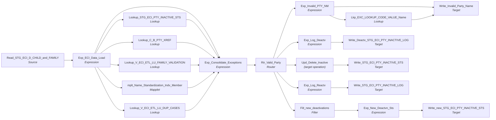

# m_Tgt_C_S_ECI_Pty_Validation

IDQ mapping &rarr; CDI **Mapping** `m_Tgt_C_S_ECI_Pty_Validation`.

> Check party data to see if it passes criteria to be included in the MDM.  If not, record keys in a deactivation list that is used as a filter in subsequent jobs.   Handle reactivations (removal from deactivation list).

DEACTIVATION_STS In the PTY_INACTIVE_STS table is populated as follows
			H - Records were deactivates as the time of the historical load so record was never loaded into the MDM
			P - Deactivation is pending (to be processed)
			D - Deactivated (Hub state ind = 1 in MDM)

[MLayne 09/26/2024]  Added FAMILY to data source (Previously only CHILD)

[MLayne 10/17/2024]  Added name mapplet, which changes malformed names to null, before the check for null names.  (Response to iTest finding)


[MLayne 12/20/24] Removed source system from XREF lookup criteria as the MDM source system is padded with blanks (Response to iTest finding).
[MLayne 1/10/2025] Changed duplicate case lookup (Reason code 8) to use a view that includes family IDs.

## Summary

| IDQ transformation | CDI transformation | Count |
|---|---|---|
| ExpressionTx | Expression | 6 |
| FilterTx | Filter | 1 |
| LookupTx | Lookup | 5 |
| MappletTx | Mapplet | 1 |
| RouterTx | Router | 1 |
| SourceTx | Source | 1 |
| TargetTx | Target | 5 |
| UpdateStrategyTx | (target operation) | 1 |

Sources:

| Instance | Object | Connection |
|---|---|---|
| Read_STG_ECI_D_CHILD_and_FAMILY | `STG_ECI_D_CHILD`, `STG_ECI_D_FAMILY` | STAGING |

Targets:

| Instance | Object | Connection |
|---|---|---|
| Write_Invalid_Party_Name | `EXC_STG_BAD_REC_MEMB` | STAGING |
| Write_new_STG_ECI_PTY_INACTIVE_STS | `STG_ECI_PTY_INACTIVE_STS` | STAGING |
| Write_Deactv_STG_ECI_PTY_INACTIVE_LOG | `STG_ECI_PTY_INACTIVE_LOG` | STAGING |
| Write_STG_ECI_PTY_INACTIVE_LOG | `STG_ECI_PTY_INACTIVE_LOG` | STAGING |
| Write_STG_ECI_PTY_INACTIVE_STS | `STG_ECI_PTY_INACTIVE_STS` | STAGING |

## Parameters

Create as CDI input parameters (`$$Name`); defaults go in the parameter file.

| Parameter | Type | Precision | Default | Used in this mapping |
|---|---|---|---|---|
| PTY_BO_CLASS_CD_Member | string | 10 | Indiv | no (declared only) |
| ECI_PTY_TBL_SRC | string | 1000 | ECI_CHILD | no (declared only) |
| RLE_BO_CLASS_CD_Member | string | 10 | Member | no (declared only) |

`$sys.MappingName` is translated to the input parameter `$$MappingName` (default: the mapping name).

## Flow



## Transformations

In data-flow order.

### Read_STG_ECI_D_CHILD_and_FAMILY

IDQ `SourceTx` &rarr; CDI **Source**. Oracle connector source; carry the SQL override / filter below verbatim.

| Property | Value |
|---|---|
| Connection | STAGING |
| Object | STG_ECI_D_CHILD |
| Object | STG_ECI_D_FAMILY |
| queryMode | SEMI |

SQL override (CDI *SQL Override*; translated):

```sql
SELECT 
'ECI_CHILD' SOURCE_TABLE
,"STG_ECI_D_CHILD"."ID_CHILD","STG_ECI_D_CHILD"."FIRST_NAME","STG_ECI_D_CHILD"."LAST_NAME","STG_ECI_D_CHILD"."MIDDLE_INITIAL"
,"STG_ECI_D_CHILD"."DOB"
,"STG_ECI_D_CHILD"."DATE_CREATED","STG_ECI_D_CHILD"."DATE_MODIFIED","STG_ECI_D_CHILD"."MODIFIED_BY","STG_ECI_D_CHILD"."CREATED_BY","STG_ECI_D_CHILD"."LOAD_DATE" FROM "STG_ECI_D_CHILD"

UNION ALL

SELECT
 'ECI_FAMILY' 				as SOURCE_TABLE
,fam.ID_FAMILY    as ID
,fam.FIRST_NAME
,fam.LAST_NAME
,fam.MIDDLE_INITIAL
,fam.DOB
,fam.DATE_CREATED
,fam.DATE_MODIFIED
,fam.MODIFIED_BY
,fam.CREATED_BY
,fam.LOAD_DATE
FROM STG_ECI_D_FAMILY  fam
```

Columns: `None`, `None`, `None`, `None`, `None`, `None`, `None`, `None`, `None`, `None`, `None`

### Exp_ECI_Data_Load

IDQ `ExpressionTx` &rarr; CDI **Expression**. Same expression language; variable fields are supported.

| Field | Kind | Type | Expression (CDI) |
|---|---|---|---|
| SOURCE_TABLE | in/out | string(255) | `SOURCE_TABLE` |
| ID | in/out | decimal(10) |  |
| PKEY_SRC_OBJECT | out | string(255) | `LPAD(ID,10,'0')\|\| IIF(SOURCE_TABLE = 'ECI_FAMILY', 'F','')` |
| PARTY_TYPE | out | string(10) | `'Indv'` |
| FIRST_NAME | in/out | string(20) |  |
| LAST_NAME | in/out | string(30) |  |
| MIDDLE_INITIAL | in/out | string(1) |  |
| DOB | in/out | date/time |  |
| DATE_CREATED | in/out | date/time |  |
| DATE_MODIFIED | in/out | date/time |  |
| MODIFIED_BY | in/out | string(30) |  |
| CREATED_BY | in/out | string(30) |  |
| SRC_SYSTEM | out | string(10) | `'ECI'` |
| OBJECT_NAME | out | string(50) | `'C_S_ECI_PTY'` |
| v_FULL_NAME | variable | string(10) | `LTRIM(RTRIM(<br>FIRST_NAME\|\| IIF(NOT ISNULL(MIDDLE_INITIAL ) ,<br>' ' \|\| LTRIM(RTRIM(MIDDLE_INITIAL)), '') \|\| ' ' \|\|  LTRIM(LAST_NAME)) )` |
| FULL_NAME | out | string(255) | `v_FULL_NAME` |
| SRC_FULL_NAME | out | string(255) | `v_FULL_NAME` |
| MISSING_FIRST_NM_Fl | out | string(255) | `IIF(LENGTH(RTRIM(FIRST_NAME))=0 , 'Y', 'N')` |
| MISSING_LAST_NM_Fl | out | string(255) | `IIF(LENGTH(RTRIM(LAST_NAME))=0 , 'Y', 'N')` |
| LOAD_DATE | in/out | string(20) |  |

Links (target field &larr; upstream field):

| Field | From |
|---|---|
| ID | Read_STG_ECI_D_CHILD_and_FAMILY.ID_CHILD |
| FIRST_NAME | Read_STG_ECI_D_CHILD_and_FAMILY.FIRST_NAME |
| LAST_NAME | Read_STG_ECI_D_CHILD_and_FAMILY.LAST_NAME |
| MIDDLE_INITIAL | Read_STG_ECI_D_CHILD_and_FAMILY.MIDDLE_INITIAL |
| DATE_CREATED | Read_STG_ECI_D_CHILD_and_FAMILY.DATE_CREATED |
| DATE_MODIFIED | Read_STG_ECI_D_CHILD_and_FAMILY.DATE_MODIFIED |
| MODIFIED_BY | Read_STG_ECI_D_CHILD_and_FAMILY.MODIFIED_BY |
| CREATED_BY | Read_STG_ECI_D_CHILD_and_FAMILY.CREATED_BY |
| LOAD_DATE | Read_STG_ECI_D_CHILD_and_FAMILY.LOAD_DATE |
| SOURCE_TABLE | Read_STG_ECI_D_CHILD_and_FAMILY.SOURCE_TABLE |
| DOB | Read_STG_ECI_D_CHILD_and_FAMILY.DOB |

### Lookup_STG_ECI_PTY_INACTIVE_STS

IDQ `LookupTx` &rarr; CDI **Lookup**. Connected lookup unless a return port is set (then unconnected).

| Property | Value |
|---|---|
| Connection | STAGING |
| Object | STG_ECI_PTY_INACTIVE_STS |
| Lookup condition | SRC_KEY = PKEY_SRC_OBJECT AND ROWID_SYSTEM = SRC_SYSTEM |
| Multiple matches | Report error |
| Cache | static cache |

| Lookup input field | Type |
|---|---|
| SRC_SYSTEM | string(10) |
| PKEY_SRC_OBJECT | string(255) |

| Return / pass-through field | Feeds |
|---|---|
| DEACTIVATION_STS | Exp_Consolidate_Exceptions.DEACTIVATION_STS |

Links (target field &larr; upstream field):

| Field | From |
|---|---|
| SRC_SYSTEM | Exp_ECI_Data_Load.SRC_SYSTEM |
| PKEY_SRC_OBJECT | Exp_ECI_Data_Load.PKEY_SRC_OBJECT |

### Lookup_C_B_PTY_XREF

IDQ `LookupTx` &rarr; CDI **Lookup**. Connected lookup unless a return port is set (then unconnected).

| Property | Value |
|---|---|
| Connection | HHS_MDM_ORS |
| Object | C_B_PTY_XREF |
| Lookup condition | PKEY_SRC_OBJECT = PKEY_SRC_OBJECT1 |
| Multiple matches | Report error |
| Cache | static cache |

Filter (CDI source/lookup *Filter* property; translated):

```sql
"C_B_PTY_XREF"."ROWID_SYSTEM" = 'ECI'
```

| Lookup input field | Type |
|---|---|
| SRC_SYSTEM | string(10) |
| PKEY_SRC_OBJECT1 | string(255) |

| Return / pass-through field | Feeds |
|---|---|
| HUB_STATE_IND | Exp_Consolidate_Exceptions.HUB_STATE_IND |

Links (target field &larr; upstream field):

| Field | From |
|---|---|
| SRC_SYSTEM | Exp_ECI_Data_Load.SRC_SYSTEM |
| PKEY_SRC_OBJECT1 | Exp_ECI_Data_Load.PKEY_SRC_OBJECT |

### Lookup_V_ECI_ETL_LU_FAMILY_VALIDATION

IDQ `LookupTx` &rarr; CDI **Lookup**. Connected lookup unless a return port is set (then unconnected).

| Property | Value |
|---|---|
| Connection | STAGING |
| Object | V_ECI_ETL_LU_FAMILY_VALIDATION |
| Lookup condition | SOURCE_TABLE = SOURCE_TABLE1 AND ID_FAMILY = ID |
| Multiple matches | Return any row |
| Cache | static cache |

| Lookup input field | Type |
|---|---|
| SOURCE_TABLE1 | string(255) |
| ID | double |

| Return / pass-through field | Feeds |
|---|---|
| FAM_NAME_STATUS | Exp_Consolidate_Exceptions.FAM_NAME_STATUS |
| FAM_PHONE_AND_ADDRESS_STS | Exp_Consolidate_Exceptions.FAM_PHONE_AND_ADDRESS_STS |
| FAM_INACTIVE_STS | Exp_Consolidate_Exceptions.FAM_INACTIVE_STATUS |

Links (target field &larr; upstream field):

| Field | From |
|---|---|
| SOURCE_TABLE1 | Exp_ECI_Data_Load.SOURCE_TABLE |
| ID | Exp_ECI_Data_Load.ID |

### mplt_Name_Standardization_Indv_Member

IDQ `MappletTx` &rarr; CDI **Mapplet**. Reusable CDI mapplet (see the mapplets folder).

Mapplet: [`mplt_Name_Standardization_Indv_Member`](../mapplets/mplt_Name_Standardization_Indv_Member.md)

Links (target field &larr; upstream field):

| Field | From |
|---|---|
| Group.First_Name | Exp_ECI_Data_Load.FIRST_NAME |
| Group.Mdl_Name | Exp_ECI_Data_Load.MIDDLE_INITIAL |
| Group.Lst_Name | Exp_ECI_Data_Load.LAST_NAME |
| Group.Src_System | Exp_ECI_Data_Load.SRC_SYSTEM |
| Group.Full_Name | Exp_ECI_Data_Load.FULL_NAME |

### Lookup_V_ECI_ETL_LU_DUP_CASES

IDQ `LookupTx` &rarr; CDI **Lookup**. Connected lookup unless a return port is set (then unconnected).

| Property | Value |
|---|---|
| Connection | STAGING |
| Object | V_ECI_ETL_LU_DUP_CASES (view) |
| Lookup condition | SOURCE_TABLE = SOURCE_TABLE1 AND ID = ID1 |
| Multiple matches | Return any row |
| Cache | static cache |

| Lookup input field | Type |
|---|---|
| SOURCE_TABLE1 | string(255) |
| ID1 | decimal(10) |

| Return / pass-through field | Feeds |
|---|---|
| ID | Exp_Consolidate_Exceptions.OMIT_ID |

Links (target field &larr; upstream field):

| Field | From |
|---|---|
| SOURCE_TABLE1 | Exp_ECI_Data_Load.SOURCE_TABLE |
| ID1 | Exp_ECI_Data_Load.ID |

### Exp_Consolidate_Exceptions

IDQ `ExpressionTx` &rarr; CDI **Expression**. Same expression language; variable fields are supported.

| Field | Kind | Type | Expression (CDI) |
|---|---|---|---|
| ID_CHILD | in/out | decimal(10) |  |
| PKEY_SRC_OBJECT | in/out | string(255) | `PKEY_SRC_OBJECT` |
| PARTY_TYPE | in/out | string(10) | `PARTY_TYPE` |
| FIRST_NAME | in/out | string(20) |  |
| LAST_NAME | in/out | string(30) |  |
| MIDDLE_INITIAL | in/out | string(1) |  |
| DOB | in/out | date/time |  |
| DATE_CREATED | in/out | date/time |  |
| DATE_MODIFIED | in/out | date/time |  |
| MODIFIED_BY | in/out | string(30) |  |
| CREATED_BY | in/out | string(30) |  |
| LOAD_DATE | in/out | string(20) |  |
| SRC_SYSTEM | in/out | string(10) | `SRC_SYSTEM` |
| OBJECT_NAME | in/out | string(50) | `OBJECT_NAME` |
| SOURCE_TABLE | in/out | string(255) | `SOURCE_TABLE` |
| FULL_NAME | in/out | string(255) | `FULL_NAME` |
| SRC_FULL_NAME | in/out | string(255) | `SRC_FULL_NAME` |
| MISSING_FIRST_NM_Fl | in/out | string(255) | `MISSING_FIRST_NM_Fl` |
| MISSING_LAST_NM_Fl | in/out | string(255) | `MISSING_LAST_NM_Fl` |
| Exception_Desc_Name | out | string(50) | `Decode(True,<br>MISSING_FIRST_NM_Fl = 'Y' ,'Missing First Name',<br>MISSING_LAST_NM_Fl ='Y','Missing Last Name',NULL)` |
| Exception_Type_Name | out | string(50) | `Decode(True,<br>MISSING_FIRST_NM_Fl = 'Y' ,'Exception Value',<br>MISSING_LAST_NM_Fl ='Y','Exception Value',NULL)` |
| Attribute_Name_Name | out | string(50) | `'Name'` |
| HUB_STATE_IND | in/out | decimal(38) |  |
| DEACTIVATION_STS | in/out | string(8) |  |
| OMIT_ID | in/out | decimal(10) |  |
| FAM_NAME_STATUS | in/out | string(15) |  |
| FAM_PHONE_AND_ADDRESS_STS | in/out | string(31) |  |
| FAM_INACTIVE_STATUS | in/out | string(31) |  |
| FAM_INACTIVE_YN | out | string(1) | `IIF(ISNULL(FAM_NAME_STATUS) and ISNULL(FAM_PHONE_AND_ADDRESS_STS) and ISNULL(FAM_INACTIVE_STATUS), 'N','Y')` |

Links (target field &larr; upstream field):

| Field | From |
|---|---|
| ID_CHILD | Exp_ECI_Data_Load.ID |
| PARTY_TYPE | Exp_ECI_Data_Load.PARTY_TYPE |
| FIRST_NAME | mplt_Name_Standardization_Indv_Member.out_Standardized_Names.First_Name |
| LAST_NAME | mplt_Name_Standardization_Indv_Member.out_Standardized_Names.Lst_Name |
| MIDDLE_INITIAL | mplt_Name_Standardization_Indv_Member.out_Standardized_Names.Mdl_Name |
| DATE_CREATED | Exp_ECI_Data_Load.DATE_CREATED |
| DATE_MODIFIED | Exp_ECI_Data_Load.DATE_MODIFIED |
| MODIFIED_BY | Exp_ECI_Data_Load.MODIFIED_BY |
| CREATED_BY | Exp_ECI_Data_Load.CREATED_BY |
| LOAD_DATE | Exp_ECI_Data_Load.LOAD_DATE |
| SRC_SYSTEM | Exp_ECI_Data_Load.SRC_SYSTEM |
| OBJECT_NAME | Exp_ECI_Data_Load.OBJECT_NAME |
| SOURCE_TABLE | Exp_ECI_Data_Load.SOURCE_TABLE |
| PKEY_SRC_OBJECT | Exp_ECI_Data_Load.PKEY_SRC_OBJECT |
| SRC_FULL_NAME | Exp_ECI_Data_Load.SRC_FULL_NAME |
| MISSING_FIRST_NM_Fl | Exp_ECI_Data_Load.MISSING_FIRST_NM_Fl |
| MISSING_LAST_NM_Fl | Exp_ECI_Data_Load.MISSING_LAST_NM_Fl |
| HUB_STATE_IND | Lookup_C_B_PTY_XREF.HUB_STATE_IND |
| DEACTIVATION_STS | Lookup_STG_ECI_PTY_INACTIVE_STS.DEACTIVATION_STS |
| OMIT_ID | Lookup_V_ECI_ETL_LU_DUP_CASES.ID |
| DOB | Exp_ECI_Data_Load.DOB |
| FAM_NAME_STATUS | Lookup_V_ECI_ETL_LU_FAMILY_VALIDATION.FAM_NAME_STATUS |
| FAM_PHONE_AND_ADDRESS_STS | Lookup_V_ECI_ETL_LU_FAMILY_VALIDATION.FAM_PHONE_AND_ADDRESS_STS |
| FAM_INACTIVE_STATUS | Lookup_V_ECI_ETL_LU_FAMILY_VALIDATION.FAM_INACTIVE_STS |
| FULL_NAME | mplt_Name_Standardization_Indv_Member.out_Standardized_Names.Full_Name |

### Rtr_Valid_Party

IDQ `RouterTx` &rarr; CDI **Router**. One output group per IDQ group; the default group is created automatically.

| Output group | Condition |
|---|---|
| Invalid_Party_Name | `(Length(Rtrim(FIRST_NAME))=0 <br>OR <br>Length(Rtrim(LAST_NAME))=0 <br>OR <br>IsNULL(FIRST_NAME) <br>OR <br>IsNULL(LAST_NAME)<br>)<br>-- Suppress name exception when family is already marked as inactive <br>AND FAM_INACTIVE_YN  = 'N'` |
| Deactivation | `Length(Rtrim(FIRST_NAME))=0 <br>OR <br>Length(Rtrim(LAST_NAME))=0 <br>OR <br>IsNULL(FIRST_NAME) <br>OR <br>IsNULL(LAST_NAME)<br>OR <br>NOT IsNull(OMIT_ID) -- i.e. all cases are reason cd 8<br>OR <br>FAM_INACTIVE_YN = 'Y'` |
| Reactivation | `NOT IsNull(DEACTIVATION_STS) <br>and <br>Length(Rtrim(FIRST_NAME))>0 <br>and<br>Length(Rtrim(LAST_NAME))>0	 <br>and <br>IsNull(OMIT_ID)  -- i.e. NOT flagged as a duplicate<br>and	<br>FAM_INACTIVE_YN='N'` |
| Default | (default group) |

Links (target field &larr; upstream field):

| Field | From |
|---|---|
| ID_CHILD | Exp_Consolidate_Exceptions.ID_CHILD |
| PARTY_TYPE | Exp_Consolidate_Exceptions.PARTY_TYPE |
| FIRST_NAME | Exp_Consolidate_Exceptions.FIRST_NAME |
| LAST_NAME | Exp_Consolidate_Exceptions.LAST_NAME |
| MIDDLE_INITIAL | Exp_Consolidate_Exceptions.MIDDLE_INITIAL |
| DATE_CREATED | Exp_Consolidate_Exceptions.DATE_CREATED |
| DATE_MODIFIED | Exp_Consolidate_Exceptions.DATE_MODIFIED |
| MODIFIED_BY | Exp_Consolidate_Exceptions.MODIFIED_BY |
| CREATED_BY | Exp_Consolidate_Exceptions.CREATED_BY |
| LOAD_DATE | Exp_Consolidate_Exceptions.LOAD_DATE |
| SRC_SYSTEM | Exp_Consolidate_Exceptions.SRC_SYSTEM |
| OBJECT_NAME | Exp_Consolidate_Exceptions.OBJECT_NAME |
| SOURCE_TABLE | Exp_Consolidate_Exceptions.SOURCE_TABLE |
| PKEY_SRC_OBJECT | Exp_Consolidate_Exceptions.PKEY_SRC_OBJECT |
| Exception_Desc_Name | Exp_Consolidate_Exceptions.Exception_Desc_Name |
| Exception_Type_Name | Exp_Consolidate_Exceptions.Exception_Type_Name |
| Attribute_Name_Name | Exp_Consolidate_Exceptions.Attribute_Name_Name |
| HUB_STATE_IND | Exp_Consolidate_Exceptions.HUB_STATE_IND |
| DEACTIVATION_STS | Exp_Consolidate_Exceptions.DEACTIVATION_STS |
| OMIT_ID | Exp_Consolidate_Exceptions.OMIT_ID |
| DOB | Exp_Consolidate_Exceptions.DOB |
| FAM_INACTIVE_YN | Exp_Consolidate_Exceptions.FAM_INACTIVE_YN |

### Exp_Invalid_PTY_NM

IDQ `ExpressionTx` &rarr; CDI **Expression**. Same expression language; variable fields are supported.

| Field | Kind | Type | Expression (CDI) |
|---|---|---|---|
| SRC_SYSTEM | in/out | string(10) | `SRC_SYSTEM` |
| PKEY_SRC_OBJECT | in/out | string(255) | `PKEY_SRC_OBJECT` |
| EXCEPTION_TYPE_Name | in/out | string(50) | `EXCEPTION_TYPE_Name` |
| EXCEPTION_DESC_Name | out | string(255) | `Decode(True,<br>Length(Rtrim(FIRST_NAME))=0 <br>OR <br>IsNULL(FIRST_NAME) ,'Missing First Name',<br>Length(Rtrim(LAST_NAME))=0 <br>OR <br>IsNULL(LAST_NAME),'Missing Last Name')` |
| RUN_DATE | out | date/time | `SYSTIMESTAMP()` |
| FIRST_NAME | in/out | string(50) |  |
| MIDDLE_NAME | in/out | string(50) |  |
| LAST_NAME | in/out | string(50) |  |
| MAPPING_NAME | out | string(255) | `$$MappingName` |
| ATTRIBUTE_NAME_Name | out | string(50) | `Decode(True,<br>Length(Rtrim(FIRST_NAME))=0 <br>OR <br>IsNULL(FIRST_NAME) ,'First Name',<br>Length(Rtrim(LAST_NAME))=0 <br>OR <br>IsNULL(LAST_NAME),'Last Name')` |
| ATTRIBUTE_VALUE_Name | out | string(255) | `Decode(True,<br>Length(Rtrim(FIRST_NAME))=0 <br>OR <br>IsNULL(FIRST_NAME) ,FIRST_NAME,<br>Length(Rtrim(LAST_NAME))=0 <br>OR <br>IsNULL(LAST_NAME),LAST_NAME)` |
| PERIOD_START_DATE | in/out | date/time |  |
| Exception_Code_Name | out | string(150) | `Decode(True,<br>Length(Rtrim(FIRST_NAME))=0 <br>OR <br>IsNULL(FIRST_NAME) ,'Missing_First_Name',<br>Length(Rtrim(LAST_NAME))=0 <br>OR <br>IsNULL(LAST_NAME),'Missing_Last_Name')` |
| BIRTH_DATE | in/out | date/time |  |

Links (target field &larr; upstream field):

| Field | From |
|---|---|
| SRC_SYSTEM | Rtr_Valid_Party.Invalid_Party_Name.SRC_SYSTEM |
| PERIOD_START_DATE | Rtr_Valid_Party.Invalid_Party_Name.DATE_CREATED |
| FIRST_NAME | Rtr_Valid_Party.Invalid_Party_Name.FIRST_NAME |
| MIDDLE_NAME | Rtr_Valid_Party.Invalid_Party_Name.MIDDLE_INITIAL |
| LAST_NAME | Rtr_Valid_Party.Invalid_Party_Name.LAST_NAME |
| PKEY_SRC_OBJECT | Rtr_Valid_Party.Invalid_Party_Name.PKEY_SRC_OBJECT |
| EXCEPTION_TYPE_Name | Rtr_Valid_Party.Invalid_Party_Name.Exception_Type_Name |
| BIRTH_DATE | Rtr_Valid_Party.Invalid_Party_Name.DOB |

### Lkp_EXC_LOOKUP_CODE_VALUE_Name

IDQ `LookupTx` &rarr; CDI **Lookup**. Connected lookup unless a return port is set (then unconnected).

| Property | Value |
|---|---|
| Connection | STAGING |
| Object | EXC_LOOKUP_CODE_VALUE |
| Lookup condition | EXCEPTION_CODE = Exception_Code_Name |
| Multiple matches | Report error |
| Cache | static cache |

| Lookup input field | Type |
|---|---|
| Exception_Code_Name | string(150) |

| Return / pass-through field | Feeds |
|---|---|
| EXCEPTION_DESC | Write_Invalid_Party_Name.EXCEPTION_DESC |
| EXCEPTION_TYPE | Write_Invalid_Party_Name.EXCEPTION_TYPE |

Links (target field &larr; upstream field):

| Field | From |
|---|---|
| Exception_Code_Name | Exp_Invalid_PTY_NM.Exception_Code_Name |

### Write_Invalid_Party_Name

IDQ `TargetTx` &rarr; CDI **Target**. Oracle connector target.

| Property | Value |
|---|---|
| Connection | STAGING |
| Object | EXC_STG_BAD_REC_MEMB |
| Operation | Insert |
| Truncate target table | no |
| Load type | normal (no bulk load) |
| Reject file | Write_EXC_STG_BAD_REC_MEMB.bad |

Links (target field &larr; upstream field):

| Field | From |
|---|---|
| PERIOD_START_DATE | Exp_Invalid_PTY_NM.PERIOD_START_DATE |
| MAPPING_NAME | Exp_Invalid_PTY_NM.MAPPING_NAME |
| ATTRIBUTE_NAME | Exp_Invalid_PTY_NM.ATTRIBUTE_NAME_Name |
| ATTRIBUTE_VALUE | Exp_Invalid_PTY_NM.ATTRIBUTE_VALUE_Name |
| FIRST_NAME | Exp_Invalid_PTY_NM.FIRST_NAME |
| MIDDLE_NAME | Exp_Invalid_PTY_NM.MIDDLE_NAME |
| LAST_NAME | Exp_Invalid_PTY_NM.LAST_NAME |
| RUN_DATE | Exp_Invalid_PTY_NM.RUN_DATE |
| SRC_SYS | Exp_Invalid_PTY_NM.SRC_SYSTEM |
| SRC_SYS_ID_1 | Exp_Invalid_PTY_NM.PKEY_SRC_OBJECT |
| EXCEPTION_DESC | Lkp_EXC_LOOKUP_CODE_VALUE_Name.EXCEPTION_DESC |
| EXCEPTION_TYPE | Lkp_EXC_LOOKUP_CODE_VALUE_Name.EXCEPTION_TYPE |
| EXCEPTION_CODE | Exp_Invalid_PTY_NM.Exception_Code_Name |
| BIRTH_DATE | Exp_Invalid_PTY_NM.BIRTH_DATE |

### Filt_new_deactivations

IDQ `FilterTx` &rarr; CDI **Filter**. Advanced filter condition.

Filter condition:

```
IsNull(DEACTIVATION_STS)
```

Links (target field &larr; upstream field):

| Field | From |
|---|---|
| SRC_SYSTEM | Rtr_Valid_Party.Deactivation.SRC_SYSTEM |
| PKEY_SRC_OBJECT | Rtr_Valid_Party.Deactivation.PKEY_SRC_OBJECT |
| HUB_STATE_IND | Rtr_Valid_Party.Deactivation.HUB_STATE_IND |
| DEACTIVATION_STS | Rtr_Valid_Party.Deactivation.DEACTIVATION_STS |
| OMIT_ID_CHILD | Rtr_Valid_Party.Deactivation.OMIT_ID |

### Exp_New_Deactvn_Sts

IDQ `ExpressionTx` &rarr; CDI **Expression**. Same expression language; variable fields are supported.

| Field | Kind | Type | Expression (CDI) |
|---|---|---|---|
| SRC_KEY | in/out | string(255) |  |
| ROWID_SYSTEM | in/out | string(14) |  |
| DEACTIVATION_STS | out | string(8) | `IIF(IsNull(HUB_STATE_IND), 'H' -- History<br>	,IIF(HUB_STATE_IND = -1, 'D'  -- Deactivated<br>			,'P' -- Pending deactivation<br>        	)<br>     )` |
| DEACTIVATION_DT | out | date/time | `SYSTIMESTAMP()` |
| HUB_STATE_IND | in/out | decimal(38) |  |

Links (target field &larr; upstream field):

| Field | From |
|---|---|
| SRC_KEY | Filt_new_deactivations.PKEY_SRC_OBJECT |
| ROWID_SYSTEM | Filt_new_deactivations.SRC_SYSTEM |
| HUB_STATE_IND | Filt_new_deactivations.HUB_STATE_IND |

### Write_new_STG_ECI_PTY_INACTIVE_STS

IDQ `TargetTx` &rarr; CDI **Target**. Oracle connector target.

| Property | Value |
|---|---|
| Connection | STAGING |
| Object | STG_ECI_PTY_INACTIVE_STS |
| Operation | Insert |
| Truncate target table | no |
| Load type | normal (no bulk load) |
| Reject file | Write_STG_ECI_PTY_INACTIVE_STS.bad |

Links (target field &larr; upstream field):

| Field | From |
|---|---|
| SRC_KEY | Exp_New_Deactvn_Sts.SRC_KEY |
| ROWID_SYSTEM | Exp_New_Deactvn_Sts.ROWID_SYSTEM |
| DEACTIVATION_STS | Exp_New_Deactvn_Sts.DEACTIVATION_STS |
| DEACTIVATION_DT | Exp_New_Deactvn_Sts.DEACTIVATION_DT |

### Exp_Log_Deactv

IDQ `ExpressionTx` &rarr; CDI **Expression**. Same expression language; variable fields are supported.

| Field | Kind | Type | Expression (CDI) |
|---|---|---|---|
| SRC_KEY | in/out | string(255) |  |
| ROWID_SYSTEM | in/out | string(14) |  |
| ACTION | out | string(255) | `'Deactivation'` |
| ACTION_DT | out | date/time | `SYSTIMESTAMP()` |

Links (target field &larr; upstream field):

| Field | From |
|---|---|
| SRC_KEY | Rtr_Valid_Party.Deactivation.PKEY_SRC_OBJECT |
| ROWID_SYSTEM | Rtr_Valid_Party.Deactivation.SRC_SYSTEM |

### Write_Deactv_STG_ECI_PTY_INACTIVE_LOG

IDQ `TargetTx` &rarr; CDI **Target**. Oracle connector target.

| Property | Value |
|---|---|
| Connection | STAGING |
| Object | STG_ECI_PTY_INACTIVE_LOG |
| Operation | Insert |
| Truncate target table | no |
| Load type | normal (no bulk load) |
| Reject file | Write_STG_ECI_PTY_INACTIVE_LOG.bad |

Links (target field &larr; upstream field):

| Field | From |
|---|---|
| SRC_KEY | Exp_Log_Deactv.SRC_KEY |
| ROWID_SYSTEM | Exp_Log_Deactv.ROWID_SYSTEM |
| ACTION | Exp_Log_Deactv.ACTION |
| ACTION_DT | Exp_Log_Deactv.ACTION_DT |

### Upd_Delete_Inactive

IDQ `UpdateStrategyTx` &rarr; CDI **(target operation)**. CDI has no Update Strategy transformation: set the downstream target operation to Data Driven with the condition below.

Update strategy expression: `DD_DELETE` (forward rejected rows: true). In CDI set the target operation to **Data Driven** with condition `DD_DELETE` (or simply **Delete** when the expression is a constant), and mark the linked target columns as the update/delete key.

Links (target field &larr; upstream field):

| Field | From |
|---|---|
| SRC_KEY | Rtr_Valid_Party.Reactivation.PKEY_SRC_OBJECT |
| ROWID_SYSTEM | Rtr_Valid_Party.Reactivation.SRC_SYSTEM |

### Write_STG_ECI_PTY_INACTIVE_STS

IDQ `TargetTx` &rarr; CDI **Target**. Oracle connector target.

| Property | Value |
|---|---|
| Connection | STAGING |
| Object | STG_ECI_PTY_INACTIVE_STS |
| Operation | Data Driven (see the upstream Update Strategy) |
| Truncate target table | no |
| Load type | normal (no bulk load) |
| Reject file | Write_STG_ECI_PTY_INACTIVE_STS.bad |

Links (target field &larr; upstream field):

| Field | From |
|---|---|
| SRC_KEY | Upd_Delete_Inactive.SRC_KEY |
| ROWID_SYSTEM | Upd_Delete_Inactive.ROWID_SYSTEM |

### Exp_Log_Reactv

IDQ `ExpressionTx` &rarr; CDI **Expression**. Same expression language; variable fields are supported.

| Field | Kind | Type | Expression (CDI) |
|---|---|---|---|
| SRC_KEY | in/out | string(255) |  |
| ROWID_SYSTEM | in/out | string(14) |  |
| ACTION | out | string(255) | `'Reactivation'` |
| ACTION_DT | out | date/time | `SYSTIMESTAMP()` |

Links (target field &larr; upstream field):

| Field | From |
|---|---|
| SRC_KEY | Rtr_Valid_Party.Reactivation.PKEY_SRC_OBJECT |
| ROWID_SYSTEM | Rtr_Valid_Party.Reactivation.SRC_SYSTEM |

### Write_STG_ECI_PTY_INACTIVE_LOG

IDQ `TargetTx` &rarr; CDI **Target**. Oracle connector target.

| Property | Value |
|---|---|
| Connection | STAGING |
| Object | STG_ECI_PTY_INACTIVE_LOG |
| Operation | Insert |
| Truncate target table | no |
| Load type | normal (no bulk load) |
| Reject file | Write_STG_ECI_PTY_INACTIVE_LOG.bad |

Links (target field &larr; upstream field):

| Field | From |
|---|---|
| SRC_KEY | Exp_Log_Reactv.SRC_KEY |
| ROWID_SYSTEM | Exp_Log_Reactv.ROWID_SYSTEM |
| ACTION | Exp_Log_Reactv.ACTION |
| ACTION_DT | Exp_Log_Reactv.ACTION_DT |
