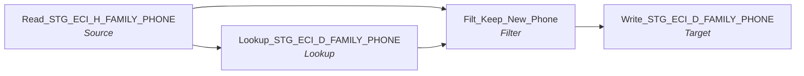

# m_Tgt_Stg_ECI_Pty_Reactivation_D_Family_Phn

IDQ mapping &rarr; CDI **Mapping** `m_Tgt_Stg_ECI_Pty_Reactivation_D_Family_Phn`.

> Move heirarchical child records of reactivated parties to from stage history to stage delta tables.   This will enable the creation of hub state 1 records for reactivation of  these dependant tables.

## Summary

| IDQ transformation | CDI transformation | Count |
|---|---|---|
| FilterTx | Filter | 1 |
| LookupTx | Lookup | 1 |
| SourceTx | Source | 1 |
| TargetTx | Target | 1 |

Sources:

| Instance | Object | Connection |
|---|---|---|
| Read_STG_ECI_H_FAMILY_PHONE | `STG_ECI_H_FAMILY_PHONE` | STAGING |

Targets:

| Instance | Object | Connection |
|---|---|---|
| Write_STG_ECI_D_FAMILY_PHONE | `STG_ECI_D_FAMILY_PHONE` | STAGING |

## Flow



## Transformations

In data-flow order.

### Read_STG_ECI_H_FAMILY_PHONE

IDQ `SourceTx` &rarr; CDI **Source**. Oracle connector source; carry the SQL override / filter below verbatim.

| Property | Value |
|---|---|
| Connection | STAGING |
| Object | STG_ECI_H_FAMILY_PHONE |

Filter (CDI source/lookup *Filter* property; translated):

```sql
(ID_FAMILY_PHONE,LOAD_DATE) 
IN 
(Select ID_FAMILY_PHONE, Max(LOAD_DATE)
from STG_ECI_H_FAMILY_PHONE
where ID_FAMILY in (select ID from V_ECI_ETL_LU_REACTIVATED_ID where ID_TYPE = 'ID_FAMILY')
group by ID_FAMILY_PHONE)
```

Columns: `ID_FAMILY_PHONE`, `ID_FAMILY`, `ID_CASE`, `HOME_AC`, `HOME_NBR`, `WORK_AC`, `WORK_NBR`, `WORK_EXT`, `CELL_AC`, `CELL_NBR`, `FAX_AC`, `FAX_NBR`, `PAGER_AC`, `PAGER_NBR`, `OTHER_AC`, `OTHER_NBR`, `EMAIL_ADDRESS`, `DATE_CREATED`, `DATE_MODIFIED`, `MODIFIED_BY`, `CREATED_BY`, `CHILD_RESIDES_IND`, `INACTIVE_IND`, `PRIMARY_CONTACT_IND`, `LOAD_DATE`

### Lookup_STG_ECI_D_FAMILY_PHONE

IDQ `LookupTx` &rarr; CDI **Lookup**. Connected lookup unless a return port is set (then unconnected).

| Property | Value |
|---|---|
| Connection | STAGING |
| Object | STG_ECI_D_FAMILY_PHONE |
| Lookup condition | ID_FAMILY_PHONE = ID_FAMILY_PHONE1 |
| Multiple matches | Return any row |
| Cache | static cache |

| Lookup input field | Type |
|---|---|
| ID_FAMILY_PHONE1 | decimal(10) |

| Return / pass-through field | Feeds |
|---|---|
| ID_FAMILY_PHONE | Filt_Keep_New_Phone.lkp_ID_FAMILY_PHONE |

Links (target field &larr; upstream field):

| Field | From |
|---|---|
| ID_FAMILY_PHONE1 | Read_STG_ECI_H_FAMILY_PHONE.ID_FAMILY_PHONE |

### Filt_Keep_New_Phone

IDQ `FilterTx` &rarr; CDI **Filter**. Advanced filter condition.

Filter condition:

```
IsNull(lkp_ID_FAMILY_PHONE)
```

Links (target field &larr; upstream field):

| Field | From |
|---|---|
| ID_FAMILY_PHONE | Read_STG_ECI_H_FAMILY_PHONE.ID_FAMILY_PHONE |
| ID_FAMILY | Read_STG_ECI_H_FAMILY_PHONE.ID_FAMILY |
| ID_CASE | Read_STG_ECI_H_FAMILY_PHONE.ID_CASE |
| HOME_AC | Read_STG_ECI_H_FAMILY_PHONE.HOME_AC |
| HOME_NBR | Read_STG_ECI_H_FAMILY_PHONE.HOME_NBR |
| WORK_AC | Read_STG_ECI_H_FAMILY_PHONE.WORK_AC |
| WORK_NBR | Read_STG_ECI_H_FAMILY_PHONE.WORK_NBR |
| WORK_EXT | Read_STG_ECI_H_FAMILY_PHONE.WORK_EXT |
| CELL_AC | Read_STG_ECI_H_FAMILY_PHONE.CELL_AC |
| CELL_NBR | Read_STG_ECI_H_FAMILY_PHONE.CELL_NBR |
| FAX_AC | Read_STG_ECI_H_FAMILY_PHONE.FAX_AC |
| FAX_NBR | Read_STG_ECI_H_FAMILY_PHONE.FAX_NBR |
| PAGER_AC | Read_STG_ECI_H_FAMILY_PHONE.PAGER_AC |
| PAGER_NBR | Read_STG_ECI_H_FAMILY_PHONE.PAGER_NBR |
| OTHER_AC | Read_STG_ECI_H_FAMILY_PHONE.OTHER_AC |
| OTHER_NBR | Read_STG_ECI_H_FAMILY_PHONE.OTHER_NBR |
| EMAIL_ADDRESS | Read_STG_ECI_H_FAMILY_PHONE.EMAIL_ADDRESS |
| DATE_CREATED | Read_STG_ECI_H_FAMILY_PHONE.DATE_CREATED |
| DATE_MODIFIED | Read_STG_ECI_H_FAMILY_PHONE.DATE_MODIFIED |
| MODIFIED_BY | Read_STG_ECI_H_FAMILY_PHONE.MODIFIED_BY |
| CREATED_BY | Read_STG_ECI_H_FAMILY_PHONE.CREATED_BY |
| CHILD_RESIDES_IND | Read_STG_ECI_H_FAMILY_PHONE.CHILD_RESIDES_IND |
| INACTIVE_IND | Read_STG_ECI_H_FAMILY_PHONE.INACTIVE_IND |
| PRIMARY_CONTACT_IND | Read_STG_ECI_H_FAMILY_PHONE.PRIMARY_CONTACT_IND |
| LOAD_DATE | Read_STG_ECI_H_FAMILY_PHONE.LOAD_DATE |
| lkp_ID_FAMILY_PHONE | Lookup_STG_ECI_D_FAMILY_PHONE.ID_FAMILY_PHONE |

### Write_STG_ECI_D_FAMILY_PHONE

IDQ `TargetTx` &rarr; CDI **Target**. Oracle connector target.

| Property | Value |
|---|---|
| Connection | STAGING |
| Object | STG_ECI_D_FAMILY_PHONE |
| Operation | Insert |
| Truncate target table | no |
| Load type | normal (no bulk load) |
| Reject file | Write_STG_ECI_D_FAMILY_PHONE.bad |

Links (target field &larr; upstream field):

| Field | From |
|---|---|
| ID_FAMILY_PHONE | Filt_Keep_New_Phone.ID_FAMILY_PHONE |
| ID_FAMILY | Filt_Keep_New_Phone.ID_FAMILY |
| ID_CASE | Filt_Keep_New_Phone.ID_CASE |
| HOME_AC | Filt_Keep_New_Phone.HOME_AC |
| HOME_NBR | Filt_Keep_New_Phone.HOME_NBR |
| WORK_AC | Filt_Keep_New_Phone.WORK_AC |
| WORK_NBR | Filt_Keep_New_Phone.WORK_NBR |
| WORK_EXT | Filt_Keep_New_Phone.WORK_EXT |
| CELL_AC | Filt_Keep_New_Phone.CELL_AC |
| CELL_NBR | Filt_Keep_New_Phone.CELL_NBR |
| FAX_AC | Filt_Keep_New_Phone.FAX_AC |
| FAX_NBR | Filt_Keep_New_Phone.FAX_NBR |
| PAGER_AC | Filt_Keep_New_Phone.PAGER_AC |
| PAGER_NBR | Filt_Keep_New_Phone.PAGER_NBR |
| OTHER_AC | Filt_Keep_New_Phone.OTHER_AC |
| OTHER_NBR | Filt_Keep_New_Phone.OTHER_NBR |
| EMAIL_ADDRESS | Filt_Keep_New_Phone.EMAIL_ADDRESS |
| DATE_CREATED | Filt_Keep_New_Phone.DATE_CREATED |
| DATE_MODIFIED | Filt_Keep_New_Phone.DATE_MODIFIED |
| MODIFIED_BY | Filt_Keep_New_Phone.MODIFIED_BY |
| CREATED_BY | Filt_Keep_New_Phone.CREATED_BY |
| CHILD_RESIDES_IND | Filt_Keep_New_Phone.CHILD_RESIDES_IND |
| INACTIVE_IND | Filt_Keep_New_Phone.INACTIVE_IND |
| PRIMARY_CONTACT_IND | Filt_Keep_New_Phone.PRIMARY_CONTACT_IND |
| LOAD_DATE | Filt_Keep_New_Phone.LOAD_DATE |
