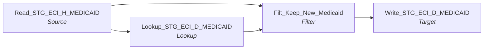

# m_Tgt_Stg_ECI_Pty_Reactivation_D_Medicaid

IDQ mapping &rarr; CDI **Mapping** `m_Tgt_Stg_ECI_Pty_Reactivation_D_Medicaid`.

> Move heirarchical child records of reactivated parties to from stage history to stage delta tables.   This will enable the creation of hub state 1 records for reactivation of  these dependant tables.

## Summary

| IDQ transformation | CDI transformation | Count |
|---|---|---|
| FilterTx | Filter | 1 |
| LookupTx | Lookup | 1 |
| SourceTx | Source | 1 |
| TargetTx | Target | 1 |

Sources:

| Instance | Object | Connection |
|---|---|---|
| Read_STG_ECI_H_MEDICAID | `STG_ECI_H_MEDICAID` | STAGING |

Targets:

| Instance | Object | Connection |
|---|---|---|
| Write_STG_ECI_D_MEDICAID | `STG_ECI_D_MEDICAID` | STAGING |

## Flow



## Filtered data

Every step that can stop, divert or collapse rows, and what happens to the rows that do not pass. A Filter keeps a row only when its condition is TRUE: FALSE **or NULL** drops the row silently (no target, no reject file). A Router writes a row to **every** group whose condition is TRUE; a row that matches no group goes to the default group and is discarded when that group is not linked. Comments (`--`, `//`) are removed from the conditions shown here. A `= ...` line reads a null check on a lookup return in plain terms; *no matching row* also covers a matching row whose returned field is NULL.

### Steps that filter rows

| Step | IDQ type | Rule | Rows that pass go to | Rows that do not pass |
|---|---|---|---|---|
| Read_STG_ECI_H_MEDICAID | SourceTx | source filter `(ID_MEDICAID,LOAD_DATE) IN (Select ID_MEDICAID, Max(m.LOAD_DATE) from STG_ECI_H_MEDICAID m inner join STG_ECI_SN_CASE c on m.ID_CASE = c.ID_CASE where ID_CHILD in (select ID from V_ECI_ETL_LU_REACTIVA …` | `STG_ECI_D_MEDICAID` | never read |
| Filt_Keep_New_Medicaid | FilterTx | keep `IsNull(ID_MEDICAID)` | `STG_ECI_D_MEDICAID` | **discarded** |

### Where the condition fields come from

| Step | Field | Origin |
|---|---|---|
| Filt_Keep_New_Medicaid | `ID_MEDICAID` | source column `ID_MEDICAID` read by `Read_STG_ECI_H_MEDICAID` |

### Rows that do not reach `C_S_*` tables

This mapping writes no `C_S_*` table (it loads `STG_ECI_D_MEDICAID`); the steps above decide which rows it writes.

## Transformations

In data-flow order.

### Read_STG_ECI_H_MEDICAID

IDQ `SourceTx` &rarr; CDI **Source**. Oracle connector source; carry the SQL override / filter below verbatim.

| Property | Value |
|---|---|
| Connection | STAGING |
| Object | STG_ECI_H_MEDICAID |

Filter (CDI source/lookup *Filter* property; translated):

```sql
(ID_MEDICAID,LOAD_DATE) 
IN 
(Select ID_MEDICAID, Max(m.LOAD_DATE)
from STG_ECI_H_MEDICAID m
inner join STG_ECI_SN_CASE c
on m.ID_CASE = c.ID_CASE
where ID_CHILD in (select ID from V_ECI_ETL_LU_REACTIVATED_ID where ID_TYPE = 'ID_CHILD')
group by ID_MEDICAID)
```

Columns: `ID_MEDICAID`, `ID_CASE`, `MEDICAID_NBR`, `ELIG_DATE`, `END_DATE`, `CURRENT_IND`, `CANCEL_DATE`, `HMO_DESC`, `DATE_CREATED`, `DATE_MODIFIED`, `MODIFIED_BY`, `CREATED_BY`, `CONSENT_TO_BILL`, `LOAD_DATE`

### Lookup_STG_ECI_D_MEDICAID

IDQ `LookupTx` &rarr; CDI **Lookup**. Connected lookup unless a return port is set (then unconnected).

| Property | Value |
|---|---|
| Connection | STAGING |
| Object | STG_ECI_D_MEDICAID |
| Lookup condition | ID_MEDICAID = ID_MEDICAID1 |
| Multiple matches | Return any row |
| Cache | static cache |

| Lookup input field | Type |
|---|---|
| ID_MEDICAID1 | decimal(10) |

| Return / pass-through field | Feeds |
|---|---|
| ID_MEDICAID | Filt_Keep_New_Medicaid.lkp_ID_MEDICAID |

Links (target field &larr; upstream field):

| Field | From |
|---|---|
| ID_MEDICAID1 | Read_STG_ECI_H_MEDICAID.ID_MEDICAID |

### Filt_Keep_New_Medicaid

IDQ `FilterTx` &rarr; CDI **Filter**. Advanced filter condition.

Filter condition:

```
IsNull(ID_MEDICAID)
```

Links (target field &larr; upstream field):

| Field | From |
|---|---|
| ID_MEDICAID | Read_STG_ECI_H_MEDICAID.ID_MEDICAID |
| ID_CASE | Read_STG_ECI_H_MEDICAID.ID_CASE |
| MEDICAID_NBR | Read_STG_ECI_H_MEDICAID.MEDICAID_NBR |
| ELIG_DATE | Read_STG_ECI_H_MEDICAID.ELIG_DATE |
| END_DATE | Read_STG_ECI_H_MEDICAID.END_DATE |
| CURRENT_IND | Read_STG_ECI_H_MEDICAID.CURRENT_IND |
| CANCEL_DATE | Read_STG_ECI_H_MEDICAID.CANCEL_DATE |
| HMO_DESC | Read_STG_ECI_H_MEDICAID.HMO_DESC |
| DATE_CREATED | Read_STG_ECI_H_MEDICAID.DATE_CREATED |
| DATE_MODIFIED | Read_STG_ECI_H_MEDICAID.DATE_MODIFIED |
| MODIFIED_BY | Read_STG_ECI_H_MEDICAID.MODIFIED_BY |
| CREATED_BY | Read_STG_ECI_H_MEDICAID.CREATED_BY |
| CONSENT_TO_BILL | Read_STG_ECI_H_MEDICAID.CONSENT_TO_BILL |
| LOAD_DATE | Read_STG_ECI_H_MEDICAID.LOAD_DATE |
| lkp_ID_MEDICAID | Lookup_STG_ECI_D_MEDICAID.ID_MEDICAID |

### Write_STG_ECI_D_MEDICAID

IDQ `TargetTx` &rarr; CDI **Target**. Oracle connector target.

| Property | Value |
|---|---|
| Connection | STAGING |
| Object | STG_ECI_D_MEDICAID |
| Operation | Insert |
| Truncate target table | no |
| Load type | normal (no bulk load) |
| Reject file | Write_STG_ECI_D_MEDICAID.bad |

Links (target field &larr; upstream field):

| Field | From |
|---|---|
| ID_MEDICAID | Filt_Keep_New_Medicaid.ID_MEDICAID |
| ID_CASE | Filt_Keep_New_Medicaid.ID_CASE |
| MEDICAID_NBR | Filt_Keep_New_Medicaid.MEDICAID_NBR |
| ELIG_DATE | Filt_Keep_New_Medicaid.ELIG_DATE |
| END_DATE | Filt_Keep_New_Medicaid.END_DATE |
| CURRENT_IND | Filt_Keep_New_Medicaid.CURRENT_IND |
| CANCEL_DATE | Filt_Keep_New_Medicaid.CANCEL_DATE |
| HMO_DESC | Filt_Keep_New_Medicaid.HMO_DESC |
| DATE_CREATED | Filt_Keep_New_Medicaid.DATE_CREATED |
| DATE_MODIFIED | Filt_Keep_New_Medicaid.DATE_MODIFIED |
| MODIFIED_BY | Filt_Keep_New_Medicaid.MODIFIED_BY |
| CREATED_BY | Filt_Keep_New_Medicaid.CREATED_BY |
| CONSENT_TO_BILL | Filt_Keep_New_Medicaid.CONSENT_TO_BILL |
| LOAD_DATE | Filt_Keep_New_Medicaid.LOAD_DATE |
