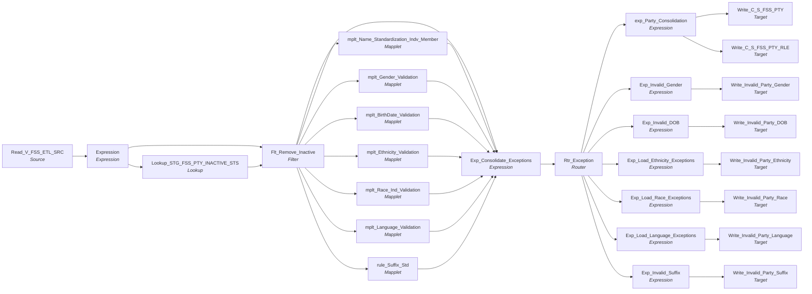

# m_Tgt_C_S_FSS_Pty

IDQ mapping &rarr; CDI **Mapping** `m_Tgt_C_S_FSS_Pty`.

> Smohammed  05/15/2025	Objective: Develop the Data Load Process for FSS Data
									

Scope: Transfer data from Staging DB to MDM Staging


									Focus: Valid Party & Party Relation Data

## Summary

| IDQ transformation | CDI transformation | Count |
|---|---|---|
| ExpressionTx | Expression | 9 |
| FilterTx | Filter | 1 |
| LookupTx | Lookup | 1 |
| MappletTx | Mapplet | 7 |
| RouterTx | Router | 1 |
| SourceTx | Source | 1 |
| TargetTx | Target | 8 |

Sources:

| Instance | Object | Connection |
|---|---|---|
| Read_V_FSS_ETL_SRC | `V_FSS_ETL_SRC` | STAGING |

Targets:

| Instance | Object | Connection |
|---|---|---|
| Write_Invalid_Party_Gender | `EXC_STG_BAD_REC_MEMB` | STAGING |
| Write_Invalid_Party_DOB | `EXC_STG_BAD_REC_MEMB` | STAGING |
| Write_Invalid_Party_Ethnicity | `EXC_STG_BAD_REC_MEMB` | STAGING |
| Write_Invalid_Party_Race | `EXC_STG_BAD_REC_MEMB` | STAGING |
| Write_Invalid_Party_Language | `EXC_STG_BAD_REC_MEMB` | STAGING |
| Write_C_S_FSS_PTY | `C_S_FSS_PTY` | HHS_MDM_ORS |
| Write_C_S_FSS_PTY_RLE | `C_S_FSS_PTY_RLE` | HHS_MDM_ORS |
| Write_Invalid_Party_Suffix | `EXC_STG_BAD_REC_MEMB` | STAGING |

## Parameters

Create as CDI input parameters (`$$Name`); defaults go in the parameter file.

| Parameter | Type | Precision | Default | Used in this mapping |
|---|---|---|---|---|
| PTY_BO_CLASS_CD_Member | string | 10 | Indv | yes |
| ECI_PTY_TBL_SRC | string | 1000 | ECI_CHILD | no (declared only) |
| RLE_BO_CLASS_CD_Member | string | 10 | Member | yes |

`$sys.MappingName` is translated to the input parameter `$$MappingName` (default: the mapping name).

## Flow



## Transformations

In data-flow order.

### Read_V_FSS_ETL_SRC

IDQ `SourceTx` &rarr; CDI **Source**. Oracle connector source; carry the SQL override / filter below verbatim.

| Property | Value |
|---|---|
| Connection | STAGING |
| Object | V_FSS_ETL_SRC (view) |

Filter (CDI source/lookup *Filter* property; translated):

```sql
"V_FSS_ETL_SRC"."LAST_ACTIVE_CLIENT_REGISTRATION_YN"='Y' 
-- Filter for Testing
/*
and (ORA_HASH(ID_CLIENT,9999) in (1)
or "V_FSS_ETL_SRC"."PTY_SRC_KEY" in ('0000018326'
,'0000028796'
,'0000031710F'
,'0000091821')) */
```

Columns: `SOURCE_TYPE`, `DT_CREATED`, `DT_LAST_UPDATE`, `ID_CLIENT`, `PTY_SRC_KEY`, `NM_FIRST`, `NM_LAST`, `NM_MIDDLE`, `DT_DOB`, `CD_GENDER`, `LANGUAGE_CD`, `CD_HISPANIC`, `RACE_AN`, `RACE_ASIAN`, `RACE_AA`, `RACE_WHITE`, `RACE_PI`, `RACE_DECLINED`, `RACE_UNABLE_TO_DETERMINE`, `RACE_INVALID`, `ADDR_LINE1`, `ADDR_LINE2`, `ADDR_CITY`, `ADDR_STATE`, `ADDR_ZIP`, `CD_CNTY`, `NBR_PHONE`, `NBR_PHONE_EXT`, `ADDR_EMAIL`, `CD_RELTSHP_TO_TC`, `CD_CLNT_TYPE`, `DTL__CAPXACTION`, `DTL__CAPXTIMESTAMP`, `ID_REGISTRATION_CLIENT`, `ID_REGISTRATION`, `LAST_ACTIVE_CLIENT_REGISTRATION_YN`, `None`, `None`, `None`, `None`, `None`, `None`

### Expression

IDQ `ExpressionTx` &rarr; CDI **Expression**. Same expression language; variable fields are supported.

| Field | Kind | Type | Expression (CDI) |
|---|---|---|---|
| SOURCE_TABLE | in/out | string(6) |  |
| DATEKEY | in/out | date/time |  |
| LOAD_DATE | in/out | date/time |  |
| ID_CLIENT | in/out | decimal(4000) |  |
| PTY_SRC_KEY | in/out | string(48) |  |
| FIRST_NAME | in/out | string(4000) |  |
| LAST_NAME | in/out | string(4000) |  |
| MIDDLE_NAME | in/out | string(4000) |  |
| CD_SUFFIX | in/out | string(16) |  |
| DOB | in/out | date/time |  |
| GENDER | in/out | string(4000) |  |
| BIRTH_WT_LB | in/out | double |  |
| BIRTH_WT_OZ | in/out | double |  |
| LANGUAGE_CD | in/out | string(4000) |  |
| ETHNICITY | in/out | string(4000) |  |
| O_ETHNICITY_CD | out | string(5) | `IIF(ETHNICITY='H','1','0')` |
| RACE_WHITE_IND | in/out | double |  |
| RACE_AA_IND | in/out | double |  |
| RACE_ASIAN_IND | in/out | double |  |
| RACE_PI_IND | in/out | double |  |
| RACE_AN_IND | in/out | double |  |
| SRC_SYSTEM | out | string(10) | `'FSS'` |
| PARTY_TYPE | out | string(10) | `'Indv'` |
| OBJECT_NM | out | string(50) | `'C_S_FSS_PTY'` |
| FULL_NM | out | string(100) | `LTRIM(RTRIM(<br>FIRST_NAME\|\| IIF(NOT ISNULL(MIDDLE_NAME ) ,<br>' ' \|\| LTRIM(RTRIM(MIDDLE_NAME)), '') \|\| ' ' \|\|  LTRIM(LAST_NAME)) )` |

Links (target field &larr; upstream field):

| Field | From |
|---|---|
| SOURCE_TABLE | Read_V_FSS_ETL_SRC.SOURCE_TYPE |
| DATEKEY | Read_V_FSS_ETL_SRC.DT_LAST_UPDATE |
| ID_CLIENT | Read_V_FSS_ETL_SRC.ID_CLIENT |
| PTY_SRC_KEY | Read_V_FSS_ETL_SRC.PTY_SRC_KEY |
| FIRST_NAME | Read_V_FSS_ETL_SRC.NM_FIRST |
| LAST_NAME | Read_V_FSS_ETL_SRC.NM_LAST |
| MIDDLE_NAME | Read_V_FSS_ETL_SRC.NM_MIDDLE |
| DOB | Read_V_FSS_ETL_SRC.DT_DOB |
| GENDER | Read_V_FSS_ETL_SRC.CD_GENDER |
| LANGUAGE_CD | Read_V_FSS_ETL_SRC.LANGUAGE_CD |
| ETHNICITY | Read_V_FSS_ETL_SRC.CD_HISPANIC |
| RACE_WHITE_IND | Read_V_FSS_ETL_SRC.RACE_WHITE |
| RACE_AA_IND | Read_V_FSS_ETL_SRC.RACE_AA |
| RACE_ASIAN_IND | Read_V_FSS_ETL_SRC.RACE_ASIAN |
| RACE_PI_IND | Read_V_FSS_ETL_SRC.RACE_PI |
| RACE_AN_IND | Read_V_FSS_ETL_SRC.RACE_AN |
| CD_SUFFIX | Read_V_FSS_ETL_SRC.CD_SUFFIX |

### Lookup_STG_FSS_PTY_INACTIVE_STS

IDQ `LookupTx` &rarr; CDI **Lookup**. Connected lookup unless a return port is set (then unconnected).

| Property | Value |
|---|---|
| Connection | STAGING |
| Object | STG_FSS_PTY_INACTIVE_STS |
| Lookup condition | SRC_KEY = PTY_SRC_KEY AND ROWID_SYSTEM = SRC_SYSTEM |
| Multiple matches | Return any row |
| Cache | static cache |

| Lookup input field | Type |
|---|---|
| PTY_SRC_KEY | string(48) |
| SRC_SYSTEM | string(10) |

| Return / pass-through field | Feeds |
|---|---|
| DEACTIVATION_STS | Flt_Remove_Inactive.DEACTIVATION_STS |

Links (target field &larr; upstream field):

| Field | From |
|---|---|
| PTY_SRC_KEY | Expression.PTY_SRC_KEY |
| SRC_SYSTEM | Expression.SRC_SYSTEM |

### Flt_Remove_Inactive

IDQ `FilterTx` &rarr; CDI **Filter**. Advanced filter condition.

Filter condition:

```
isnull(DEACTIVATION_STS)
```

Links (target field &larr; upstream field):

| Field | From |
|---|---|
| ID_CLIENT | Expression.ID_CLIENT |
| PARTY_TYPE | Expression.PARTY_TYPE |
| FIRST_NAME | Expression.FIRST_NAME |
| LAST_NAME | Expression.LAST_NAME |
| MIDDLE_NAME | Expression.MIDDLE_NAME |
| DOB | Expression.DOB |
| GENDER | Expression.GENDER |
| BIRTH_WT_LB | Expression.BIRTH_WT_LB |
| BIRTH_WT_OZ | Expression.BIRTH_WT_OZ |
| LANGUAGE_CD | Expression.LANGUAGE_CD |
| DATE_CREATED | Expression.DATEKEY |
| DATE_MODIFIED | Expression.DATEKEY |
| ETHNICITY | Expression.ETHNICITY |
| SRC_SYSTEM | Expression.SRC_SYSTEM |
| OBJECT_NAME | Expression.OBJECT_NM |
| SRC_TBL | Expression.SOURCE_TABLE |
| PKEY_SRC_OBJECT | Expression.PTY_SRC_KEY |
| FULL_NAME | Expression.FULL_NM |
| SRC_FULL_NAME | Expression.FULL_NM |
| RACE_AA | Expression.RACE_AA_IND |
| RACE_ASIAN | Expression.RACE_ASIAN_IND |
| RACE_PI | Expression.RACE_PI_IND |
| RACE_AN | Expression.RACE_AN_IND |
| LOAD_DATE | Expression.LOAD_DATE |
| O_ETHNICITY_CD | Expression.O_ETHNICITY_CD |
| DEACTIVATION_STS | Lookup_STG_FSS_PTY_INACTIVE_STS.DEACTIVATION_STS |
| CD_SUFFIX | Expression.CD_SUFFIX |
| RACE_WHITE_IND | Expression.RACE_WHITE_IND |

### mplt_Name_Standardization_Indv_Member

IDQ `MappletTx` &rarr; CDI **Mapplet**. Reusable CDI mapplet (see the mapplets folder).

Mapplet: [`mplt_Name_Standardization_Indv_Member`](../mapplets/mplt_Name_Standardization_Indv_Member.md)

Links (target field &larr; upstream field):

| Field | From |
|---|---|
| Group.First_Name | Flt_Remove_Inactive.FIRST_NAME |
| Group.Mdl_Name | Flt_Remove_Inactive.MIDDLE_NAME |
| Group.Lst_Name | Flt_Remove_Inactive.LAST_NAME |
| Group.Full_Name | Flt_Remove_Inactive.SRC_FULL_NAME |
| Group.Src_System | Flt_Remove_Inactive.SRC_SYSTEM |
| Group.Sfx_Name | Flt_Remove_Inactive.CD_SUFFIX |

### mplt_Gender_Validation

IDQ `MappletTx` &rarr; CDI **Mapplet**. Reusable CDI mapplet (see the mapplets folder).

Mapplet: [`mplt_Gender_Validation`](../mapplets/mplt_Gender_Validation.md)

Links (target field &larr; upstream field):

| Field | From |
|---|---|
| Group.Party_Type | Flt_Remove_Inactive.PARTY_TYPE |
| Group.Src_Sys | Flt_Remove_Inactive.SRC_SYSTEM |
| Group.Gender_Code | Flt_Remove_Inactive.GENDER |

### mplt_BirthDate_Validation

IDQ `MappletTx` &rarr; CDI **Mapplet**. Reusable CDI mapplet (see the mapplets folder).

Mapplet: [`mplt_BirthDate_Validation`](../mapplets/mplt_BirthDate_Validation.md)

Links (target field &larr; upstream field):

| Field | From |
|---|---|
| Group.BirthDate | Flt_Remove_Inactive.DOB |
| Group.SrcSys | Flt_Remove_Inactive.SRC_SYSTEM |
| Group.PartyType | Flt_Remove_Inactive.PARTY_TYPE |

### mplt_Ethnicity_Validation

IDQ `MappletTx` &rarr; CDI **Mapplet**. Reusable CDI mapplet (see the mapplets folder).

Mapplet: [`mplt_Ethnicity_Validation`](../mapplets/mplt_Ethnicity_Validation.md)

Links (target field &larr; upstream field):

| Field | From |
|---|---|
| Group1.Src_Sys | Flt_Remove_Inactive.SRC_SYSTEM |
| Group1.Ethnicity_Cd | Flt_Remove_Inactive.ETHNICITY |

### mplt_Race_Ind_Validation

IDQ `MappletTx` &rarr; CDI **Mapplet**. Reusable CDI mapplet (see the mapplets folder).

Mapplet: [`mplt_Race_Ind_Validation`](../mapplets/mplt_Race_Ind_Validation.md)

Links (target field &larr; upstream field):

| Field | From |
|---|---|
| Group.Black_Ind | Flt_Remove_Inactive.RACE_AA |
| Group.Asian_Ind | Flt_Remove_Inactive.RACE_ASIAN |
| Group.Pacific_Islander_Ind | Flt_Remove_Inactive.RACE_PI |
| Group.Native_American_Ind | Flt_Remove_Inactive.RACE_AN |
| Group.White_Ind | Flt_Remove_Inactive.RACE_WHITE_IND |

### mplt_Language_Validation

IDQ `MappletTx` &rarr; CDI **Mapplet**. Reusable CDI mapplet (see the mapplets folder).

Mapplet: [`mplt_Language_Validation`](../mapplets/mplt_Language_Validation.md)

Links (target field &larr; upstream field):

| Field | From |
|---|---|
| Group1.Language_Cd | Flt_Remove_Inactive.LANGUAGE_CD |
| Group1.Src_Sys | Flt_Remove_Inactive.SRC_SYSTEM |

### rule_Suffix_Std

IDQ `MappletTx` &rarr; CDI **Mapplet**. Reusable CDI mapplet (see the mapplets folder).

Mapplet: [`rule_Suffix_Std`](../mapplets/rule_Suffix_Std.md)

Links (target field &larr; upstream field):

| Field | From |
|---|---|
| Group.Suffix | Flt_Remove_Inactive.CD_SUFFIX |
| Group.Src_Sys | Flt_Remove_Inactive.SRC_SYSTEM |

### Exp_Consolidate_Exceptions

IDQ `ExpressionTx` &rarr; CDI **Expression**. Same expression language; variable fields are supported.

| Field | Kind | Type | Expression (CDI) |
|---|---|---|---|
| ID_CLIENT | in/out | decimal(10) |  |
| PARTY_TYPE | in/out | string(10) | `PARTY_TYPE` |
| FIRST_NAME | in/out | string(60) |  |
| LAST_NAME | in/out | string(60) |  |
| MIDDLE_INITIAL | in/out | string(60) |  |
| DOB | in/out | date/time |  |
| GENDER | in/out | string(20) |  |
| BIRTH_WT_LB | in/out | double |  |
| BIRTH_WT_OZ | in/out | double |  |
| LANGUAGE_CD | in/out | string(20) |  |
| DATE_CREATED | in/out | date/time |  |
| DATE_MODIFIED | in/out | date/time |  |
| ETHNICITY | in/out | string(30) |  |
| LOAD_DATE | in/out | string(20) |  |
| SRC_SYSTEM | in/out | string(10) | `SRC_SYSTEM` |
| OBJECT_NAME | in/out | string(50) | `OBJECT_NAME` |
| SRC_TBL | in/out | string(255) | `SRC_TBL` |
| PKEY_SRC_OBJECT | in/out | string(255) | `PKEY_SRC_OBJECT` |
| FULL_NAME | in/out | string(255) | `FULL_NAME` |
| SRC_FULL_NAME | in/out | string(255) | `SRC_FULL_NAME` |
| First_Name1 | in/out | string(50) | `First_Name1` |
| Mdl_Name | in/out | string(50) | `Mdl_Name` |
| Lst_Name | in/out | string(50) | `Lst_Name` |
| Full_Name1 | in/out | string(100) | `Full_Name1` |
| Src_Full_Name1 | in/out | string(100) | `Src_Full_Name1` |
| Prfx_Name | in/out | string(10) | `Prfx_Name` |
| Gender_Code | in/out | string(10) | `Gender_Code` |
| Gender_Exception_Code | in/out | string(100) | `Gender_Exception_Code` |
| Gender_Exception_Description | in/out | string(100) | `Gender_Exception_Description` |
| Gender_Exception_Type | in/out | string(100) | `Gender_Exception_Type` |
| MDM_Gender_Code | in/out | string(255) | `MDM_Gender_Code` |
| BirthDate | in/out | date/time | `BirthDate` |
| BirthDate_Exception_Code | in/out | string(100) | `BirthDate_Exception_Code` |
| BirthDate_Exception_Description | in/out | string(100) | `BirthDate_Exception_Description` |
| BirthDate_Exception_Type | in/out | string(100) | `BirthDate_Exception_Type` |
| Attribute_Name_BirthDate | in/out | string(100) | `Attribute_Name_BirthDate` |
| Attribute_Name_Name | out | string(50) | `'Name'` |
| Attribute_Name_Gender | out | string(50) | `'Gender'` |
| BirthDate_Attribute_Value | in/out | date/time | `BirthDate_Attribute_Value` |
| Ethnicity_Cd | in/out | string(20) | `Ethnicity_Cd` |
| Ethnicity_MSTR_CODE_VALUE | in/out | string(255) | `Ethnicity_MSTR_CODE_VALUE` |
| Ethnicity_EXCEPTION_CODE | in/out | string(300) | `Ethnicity_EXCEPTION_CODE` |
| Ethnicity_EXCEPTION_DESC | in/out | string(300) | `Ethnicity_EXCEPTION_DESC` |
| Ethnicity_EXCEPTION_TYPE | in/out | string(300) | `Ethnicity_EXCEPTION_TYPE` |
| MDM_Race_Cd | in/out | string(3) | `MDM_Race_Cd` |
| Race_Exception_Cd | in/out | string(300) | `Race_Exception_Cd` |
| Race_Exception_Desc | in/out | string(300) | `Race_Exception_Desc` |
| Race_Exception_Type | in/out | string(300) | `Race_Exception_Type` |
| Src_Race_Ind_List | in/out | string(40) | `Src_Race_Ind_List` |
| Language_Cd1 | in/out | string(20) | `Language_Cd1` |
| Language_MSTR_CODE_VALUE | in/out | string(255) | `Language_MSTR_CODE_VALUE` |
| Language_EXCEPTION_CODE | in/out | string(300) | `Language_EXCEPTION_CODE` |
| Language_EXCEPTION_DESC | in/out | string(300) | `Language_EXCEPTION_DESC` |
| Language_EXCEPTION_TYPE | in/out | string(300) | `Language_EXCEPTION_TYPE` |
| Standardized_Suffix | in/out | string(20) | `Standardized_Suffix` |
| Source_Suffix | in/out | string(10) | `Source_Suffix` |
| Suffix_Exception_Type | in/out | string(300) | `Suffix_Exception_Type` |
| Suffix_Exception_Code | in/out | string(20) | `Suffix_Exception_Code` |
| Suffix_Exception_Desc | in/out | string(300) | `Suffix_Exception_Desc` |

Links (target field &larr; upstream field):

| Field | From |
|---|---|
| ID_CLIENT | Flt_Remove_Inactive.ID_CLIENT |
| PARTY_TYPE | Flt_Remove_Inactive.PARTY_TYPE |
| FIRST_NAME | Flt_Remove_Inactive.FIRST_NAME |
| LAST_NAME | Flt_Remove_Inactive.LAST_NAME |
| MIDDLE_INITIAL | Flt_Remove_Inactive.MIDDLE_NAME |
| DOB | Flt_Remove_Inactive.DOB |
| GENDER | Flt_Remove_Inactive.GENDER |
| BIRTH_WT_LB | Flt_Remove_Inactive.BIRTH_WT_LB |
| BIRTH_WT_OZ | Flt_Remove_Inactive.BIRTH_WT_OZ |
| LANGUAGE_CD | Flt_Remove_Inactive.LANGUAGE_CD |
| DATE_CREATED | Flt_Remove_Inactive.DATE_CREATED |
| DATE_MODIFIED | Flt_Remove_Inactive.DATE_MODIFIED |
| ETHNICITY | Flt_Remove_Inactive.ETHNICITY |
| LOAD_DATE | Flt_Remove_Inactive.LOAD_DATE |
| SRC_SYSTEM | Flt_Remove_Inactive.SRC_SYSTEM |
| OBJECT_NAME | Flt_Remove_Inactive.OBJECT_NAME |
| SRC_TBL | Flt_Remove_Inactive.SRC_TBL |
| PKEY_SRC_OBJECT | Flt_Remove_Inactive.PKEY_SRC_OBJECT |
| FULL_NAME | Flt_Remove_Inactive.FULL_NAME |
| SRC_FULL_NAME | Flt_Remove_Inactive.SRC_FULL_NAME |
| First_Name1 | mplt_Name_Standardization_Indv_Member.out_Standardized_Names.First_Name |
| Mdl_Name | mplt_Name_Standardization_Indv_Member.out_Standardized_Names.Mdl_Name |
| Lst_Name | mplt_Name_Standardization_Indv_Member.out_Standardized_Names.Lst_Name |
| Full_Name1 | mplt_Name_Standardization_Indv_Member.out_Standardized_Names.Full_Name |
| Src_Full_Name1 | mplt_Name_Standardization_Indv_Member.out_Standardized_Names.Src_Full_Name |
| Prfx_Name | mplt_Name_Standardization_Indv_Member.out_Standardized_Names.Prfx_Name |
| Gender_Code | mplt_Gender_Validation.out_Gender_Code_Validation.Gender_Code |
| Gender_Exception_Code | mplt_Gender_Validation.out_Gender_Code_Validation.Gender_Exception_Code |
| Gender_Exception_Description | mplt_Gender_Validation.out_Gender_Code_Validation.Gender_Exception_Description |
| Gender_Exception_Type | mplt_Gender_Validation.out_Gender_Code_Validation.Gender_Exception_Type |
| MDM_Gender_Code | mplt_Gender_Validation.out_Gender_Code_Validation.MDM_Gender_Code |
| BirthDate | mplt_BirthDate_Validation.o_BirthDate.BirthDate |
| BirthDate_Exception_Code | mplt_BirthDate_Validation.o_BirthDate.Exception_Code |
| BirthDate_Exception_Description | mplt_BirthDate_Validation.o_BirthDate.Exception_Description |
| BirthDate_Exception_Type | mplt_BirthDate_Validation.o_BirthDate.Exception_Type |
| Attribute_Name_BirthDate | mplt_BirthDate_Validation.o_BirthDate.Attribute_Name |
| BirthDate_Attribute_Value | mplt_BirthDate_Validation.o_BirthDate.Attribute_Value |
| Ethnicity_Cd | mplt_Ethnicity_Validation.NEWOUTPUT.Ethnicity_Cd |
| Ethnicity_MSTR_CODE_VALUE | mplt_Ethnicity_Validation.NEWOUTPUT.MSTR_CODE_VALUE |
| Ethnicity_EXCEPTION_CODE | mplt_Ethnicity_Validation.NEWOUTPUT.EXCEPTION_CODE |
| Ethnicity_EXCEPTION_DESC | mplt_Ethnicity_Validation.NEWOUTPUT.EXCEPTION_DESC |
| Ethnicity_EXCEPTION_TYPE | mplt_Ethnicity_Validation.NEWOUTPUT.EXCEPTION_TYPE |
| MDM_Race_Cd | mplt_Race_Ind_Validation.Out_Race_Ind.MDM_Race_Cd |
| Race_Exception_Cd | mplt_Race_Ind_Validation.Out_Race_Ind.Exception_Cd |
| Race_Exception_Desc | mplt_Race_Ind_Validation.Out_Race_Ind.Exception_Desc |
| Race_Exception_Type | mplt_Race_Ind_Validation.Out_Race_Ind.Exception_Type |
| Src_Race_Ind_List | mplt_Race_Ind_Validation.Out_Race_Ind.Src_Race_Ind_List |
| Language_Cd1 | mplt_Language_Validation.NEWOUTPUT.Language_Cd |
| Language_MSTR_CODE_VALUE | mplt_Language_Validation.NEWOUTPUT.MSTR_CODE_VALUE |
| Language_EXCEPTION_CODE | mplt_Language_Validation.NEWOUTPUT.EXCEPTION_CODE |
| Language_EXCEPTION_DESC | mplt_Language_Validation.NEWOUTPUT.EXCEPTION_DESC |
| Language_EXCEPTION_TYPE | mplt_Language_Validation.NEWOUTPUT.EXCEPTION_TYPE |
| Standardized_Suffix | rule_Suffix_Std.NEWOUTPUT.Standardized_Suffix |
| Source_Suffix | rule_Suffix_Std.NEWOUTPUT.Source_Suffix |
| Suffix_Exception_Type | rule_Suffix_Std.NEWOUTPUT.Suffix_Exception_Type |
| Suffix_Exception_Code | rule_Suffix_Std.NEWOUTPUT.Suffix_Exception_Code |
| Suffix_Exception_Desc | rule_Suffix_Std.NEWOUTPUT.Suffix_Exception_Desc |

### Rtr_Exception

IDQ `RouterTx` &rarr; CDI **Router**. One output group per IDQ group; the default group is created automatically.

| Output group | Condition |
|---|---|
| Valid_Party | `TRUE` |
| Invalid_Birth_Date | `NOT ISNULL(BirthDate_Exception_Code)` |
| Invalid_Gender_Code | `NOT ISNULL(Gender_Exception_Description) and SRC_TBL='CLIENT'` |
| Invalid_Ethnicity | `NOT IsNull(Ethnicity_EXCEPTION_CODE) and SRC_TBL='CLIENT'` |
| Invalid_Race | `NOT IsNull(Race_Exception_Desc) and SRC_TBL='CLIENT'` |
| Invalid_Language | `NOT IsNull(Language_EXCEPTION_CODE)` |
| Invalid_Suffix | `NOT IsNull(Suffix_Exception_Code)` |
| Default | (default group) |

Links (target field &larr; upstream field):

| Field | From |
|---|---|
| ID_CLIENT | Exp_Consolidate_Exceptions.ID_CLIENT |
| PARTY_TYPE | Exp_Consolidate_Exceptions.PARTY_TYPE |
| FIRST_NAME | Exp_Consolidate_Exceptions.FIRST_NAME |
| LAST_NAME | Exp_Consolidate_Exceptions.LAST_NAME |
| MIDDLE_INITIAL | Exp_Consolidate_Exceptions.MIDDLE_INITIAL |
| DOB | Exp_Consolidate_Exceptions.DOB |
| GENDER | Exp_Consolidate_Exceptions.GENDER |
| BIRTH_WT_LB | Exp_Consolidate_Exceptions.BIRTH_WT_LB |
| BIRTH_WT_OZ | Exp_Consolidate_Exceptions.BIRTH_WT_OZ |
| LANGUAGE_CD | Exp_Consolidate_Exceptions.LANGUAGE_CD |
| DATE_CREATED | Exp_Consolidate_Exceptions.DATE_CREATED |
| DATE_MODIFIED | Exp_Consolidate_Exceptions.DATE_MODIFIED |
| ETHNICITY | Exp_Consolidate_Exceptions.ETHNICITY |
| LOAD_DATE | Exp_Consolidate_Exceptions.LOAD_DATE |
| SRC_SYSTEM | Exp_Consolidate_Exceptions.SRC_SYSTEM |
| OBJECT_NAME | Exp_Consolidate_Exceptions.OBJECT_NAME |
| SRC_TBL | Exp_Consolidate_Exceptions.SRC_TBL |
| PKEY_SRC_OBJECT | Exp_Consolidate_Exceptions.PKEY_SRC_OBJECT |
| FULL_NAME | Exp_Consolidate_Exceptions.FULL_NAME |
| SRC_FULL_NAME | Exp_Consolidate_Exceptions.SRC_FULL_NAME |
| Src_Full_Name1 | Exp_Consolidate_Exceptions.Src_Full_Name1 |
| Prfx_Name | Exp_Consolidate_Exceptions.Prfx_Name |
| Gender_Code | Exp_Consolidate_Exceptions.Gender_Code |
| MDM_Gender_Code | Exp_Consolidate_Exceptions.MDM_Gender_Code |
| BirthDate | Exp_Consolidate_Exceptions.BirthDate |
| Attribute_Name_BirthDate | Exp_Consolidate_Exceptions.Attribute_Name_BirthDate |
| BirthDate_Attribute_Value | Exp_Consolidate_Exceptions.BirthDate_Attribute_Value |
| Gender_Exception_Description | Exp_Consolidate_Exceptions.Gender_Exception_Description |
| BirthDate_Exception_Code | Exp_Consolidate_Exceptions.BirthDate_Exception_Code |
| BirthDate_Exception_Description | Exp_Consolidate_Exceptions.BirthDate_Exception_Description |
| BirthDate_Exception_Type | Exp_Consolidate_Exceptions.BirthDate_Exception_Type |
| Gender_Exception_Code | Exp_Consolidate_Exceptions.Gender_Exception_Code |
| Gender_Exception_Type | Exp_Consolidate_Exceptions.Gender_Exception_Type |
| Attribute_Name_Gender | Exp_Consolidate_Exceptions.Attribute_Name_Gender |
| Attribute_Name_Name | Exp_Consolidate_Exceptions.Attribute_Name_Name |
| Ethnicity_EXCEPTION_CODE | Exp_Consolidate_Exceptions.Ethnicity_EXCEPTION_CODE |
| Ethnicity_EXCEPTION_DESC | Exp_Consolidate_Exceptions.Ethnicity_EXCEPTION_DESC |
| Ethnicity_EXCEPTION_TYPE | Exp_Consolidate_Exceptions.Ethnicity_EXCEPTION_TYPE |
| MDM_Race_Cd | Exp_Consolidate_Exceptions.MDM_Race_Cd |
| Race_Exception_Desc | Exp_Consolidate_Exceptions.Race_Exception_Desc |
| Race_Exception_Type | Exp_Consolidate_Exceptions.Race_Exception_Type |
| Src_Race_Ind_List | Exp_Consolidate_Exceptions.Src_Race_Ind_List |
| Race_Exception_Cd | Exp_Consolidate_Exceptions.Race_Exception_Cd |
| MDM_Ethnicity_Cd | Exp_Consolidate_Exceptions.Ethnicity_MSTR_CODE_VALUE |
| Ethnicity_Cd | Exp_Consolidate_Exceptions.Ethnicity_Cd |
| Language_Cd1 | Exp_Consolidate_Exceptions.Language_Cd1 |
| MDM_Language_Cd | Exp_Consolidate_Exceptions.Language_MSTR_CODE_VALUE |
| Language_EXCEPTION_CODE | Exp_Consolidate_Exceptions.Language_EXCEPTION_CODE |
| Language_EXCEPTION_DESC | Exp_Consolidate_Exceptions.Language_EXCEPTION_DESC |
| Language_EXCEPTION_TYPE | Exp_Consolidate_Exceptions.Language_EXCEPTION_TYPE |
| First_Name1 | Exp_Consolidate_Exceptions.First_Name1 |
| Mdl_Name | Exp_Consolidate_Exceptions.Mdl_Name |
| Lst_Name | Exp_Consolidate_Exceptions.Lst_Name |
| Full_Name1 | Exp_Consolidate_Exceptions.Full_Name1 |
| Standardized_Suffix | Exp_Consolidate_Exceptions.Standardized_Suffix |
| Source_Suffix | Exp_Consolidate_Exceptions.Source_Suffix |
| Suffix_Exception_Type | Exp_Consolidate_Exceptions.Suffix_Exception_Type |
| Suffix_Exception_Code | Exp_Consolidate_Exceptions.Suffix_Exception_Code |
| Suffix_Exception_Desc | Exp_Consolidate_Exceptions.Suffix_Exception_Desc |

### exp_Party_Consolidation

IDQ `ExpressionTx` &rarr; CDI **Expression**. Same expression language; variable fields are supported.

| Field | Kind | Type | Expression (CDI) |
|---|---|---|---|
| ID_CLIENT | in/out | decimal(10) |  |
| PKEY_SRC_OBJECT | in | string(255) |  |
| PARTY_TYPE | in/out | string(10) |  |
| DOB | in/out | date/time | `DOB` |
| GENDER | in/out | string(1) |  |
| BIRTH_WT_LB | in/out | double |  |
| BIRTH_WT_OZ | in/out | double |  |
| LANGUAGE_CD | in/out | string(20) | `LANGUAGE_CD` |
| RACE_CD | in/out | decimal(5) |  |
| DATE_CREATED | in/out | date/time |  |
| DATE_MODIFIED | in/out | date/time |  |
| ETHNICITY | in/out | string(30) |  |
| LOAD_DATE | in/out | string(20) |  |
| SRC_SYSTEM | in/out | string(10) |  |
| OBJECT_NAME | in/out | string(50) |  |
| SRC_TBL | in/out | string(255) |  |
| v_CUR_PKEY_SRC_OBJECT | variable | string(255) | `PKEY_SRC_OBJECT` |
| o_PKEY_SRC_OBJECT | out | string(255) | `LTRIM(RTRIM(PKEY_SRC_OBJECT))` |
| First_Name | in/out | string(50) |  |
| Mdl_Name | in/out | string(50) |  |
| Lst_Name | in/out | string(50) |  |
| Full_Name | in/out | string(100) |  |
| Src_Full_Name | in/out | string(100) |  |
| Prfx_Name | in/out | string(10) |  |
| v_MD5 | variable | string(30) | `MD5(TO_CHAR(GENDER) \|\| '\|' \|\|<br>First_Name \|\| '\|' \|\|<br>Prfx_Name \|\| '\|' \|\|<br>Lst_Name \|\| '\|' \|\|<br>Mdl_Name \|\| '\|' \|\|<br>Full_Name \|\| '\|' \|\|<br>TO_CHAR(DOB, 'YYYYDDMM') )` |
| v_VERS_SEQ_NUM | variable | integer | `1` |
| v_DUP_RANK (stale timeline: omit) | variable | integer | `IIF(v_CUR_PKEY_SRC_OBJECT<> v_LST_PKEY_SRC_OBJECT, 1, IIF(v_VERS_SEQ_NUM>v_LST_VERS_SEQ_NUM, 1, v_DUP_RANK+1))` |
| DUP_RANK (stale timeline: omit) | out | string(10) | `v_DUP_RANK` |
| BirthDate | in/out | date/time |  |
| v_LAST_MD5 | variable | string(30) | `v_MD5` |
| v_UPDATE_DT_LAST | variable | date/time | `TO_DATE(LOAD_DATE)` |
| v_LST_PKEY_SRC_OBJECT | variable | string(255) | `v_CUR_PKEY_SRC_OBJECT` |
| v_LST_VERS_SEQ_NUM | variable | integer | `v_VERS_SEQ_NUM` |
| Src_Ethnicity_Cd | in/out | string(20) | `Src_Ethnicity_Cd` |
| MDM_Ethnicity_Code | in/out | string(255) | `MDM_Ethnicity_Code` |
| MDM_Race_Code | in/out | string(255) | `MDM_Race_Code` |
| VERSION_SEQ_NUM (stale timeline: omit) | out | integer | `v_VERS_SEQ_NUM` |
| Src_Race_Ind_List | in/out | string(40) |  |
| Src_Race_Ind_List1 | out | string(40) | `IIF(MDM_Race_Code='100',null,Src_Race_Ind_List)<br>` |
| LAST_UPDATE_DATE | out | date/time | `SYSDATE` |
| PTY_BO_CLASS_CD | out | string(255) | `$$PTY_BO_CLASS_CD_Member` |
| PKEY_SRC_OBJECT_Pty_Rle | out | string(255) | `LTRIM(RTRIM(PKEY_SRC_OBJECT))\|\| '\|' \|\|$$RLE_BO_CLASS_CD_Member` |
| RLE_BO_CLASS_CD | out | string(255) | `$$RLE_BO_CLASS_CD_Member` |
| O_Birth_weight_grams | out | decimal(8,2) | `BIRTH_WT_OZ*28.35 --+BIRTH_WT_LB*453.6` |
| HUB_STATE_IND | out | decimal(38) | `1` |
| MDM_Language_Cd | in/out | string(255) | `MDM_Language_Cd` |
| Standardized_Suffix | in/out | string(20) | `Standardized_Suffix` |

Links (target field &larr; upstream field):

| Field | From |
|---|---|
| ID_CLIENT | Rtr_Exception.Valid_Party.ID_CLIENT |
| PARTY_TYPE | Rtr_Exception.Valid_Party.PARTY_TYPE |
| DOB | Rtr_Exception.Valid_Party.DOB |
| GENDER | Rtr_Exception.Valid_Party.MDM_Gender_Code |
| BIRTH_WT_LB | Rtr_Exception.Valid_Party.BIRTH_WT_LB |
| BIRTH_WT_OZ | Rtr_Exception.Valid_Party.BIRTH_WT_OZ |
| DATE_CREATED | Rtr_Exception.Valid_Party.DATE_CREATED |
| DATE_MODIFIED | Rtr_Exception.Valid_Party.DATE_MODIFIED |
| ETHNICITY | Rtr_Exception.Valid_Party.ETHNICITY |
| LOAD_DATE | Rtr_Exception.Valid_Party.LOAD_DATE |
| SRC_SYSTEM | Rtr_Exception.Valid_Party.SRC_SYSTEM |
| OBJECT_NAME | Rtr_Exception.Valid_Party.OBJECT_NAME |
| SRC_TBL | Rtr_Exception.Valid_Party.SRC_TBL |
| First_Name | Rtr_Exception.Valid_Party.First_Name1 |
| Mdl_Name | Rtr_Exception.Valid_Party.Mdl_Name |
| Lst_Name | Rtr_Exception.Valid_Party.Lst_Name |
| Full_Name | Rtr_Exception.Valid_Party.Full_Name1 |
| Src_Full_Name | Rtr_Exception.Valid_Party.Src_Full_Name1 |
| Prfx_Name | Rtr_Exception.Valid_Party.Prfx_Name |
| BirthDate | Rtr_Exception.Valid_Party.BirthDate |
| Src_Ethnicity_Cd | Rtr_Exception.Valid_Party.ETHNICITY |
| MDM_Ethnicity_Code | Rtr_Exception.Valid_Party.MDM_Ethnicity_Cd |
| MDM_Race_Code | Rtr_Exception.Valid_Party.MDM_Race_Cd |
| Src_Race_Ind_List | Rtr_Exception.Valid_Party.Src_Race_Ind_List |
| PKEY_SRC_OBJECT | Rtr_Exception.Valid_Party.PKEY_SRC_OBJECT |
| MDM_Language_Cd | Rtr_Exception.Valid_Party.MDM_Language_Cd |
| LANGUAGE_CD | Rtr_Exception.Valid_Party.Language_Cd1 |
| Standardized_Suffix | Rtr_Exception.Valid_Party.Standardized_Suffix |

### Exp_Invalid_Gender

IDQ `ExpressionTx` &rarr; CDI **Expression**. Same expression language; variable fields are supported.

| Field | Kind | Type | Expression (CDI) |
|---|---|---|---|
| ID_CLIENT | in/out | decimal(10) | `ID_CLIENT` |
| SRC_SYSTEM | in/out | string(10) | `SRC_SYSTEM` |
| PKEY_SRC_OBJECT | in/out | string(255) | `PKEY_SRC_OBJECT` |
| MAPPING_NAME | out | string(255) | `$$MappingName` |
| FIRST_NAME | in/out | string(50) |  |
| MIDDLE_NAME | in/out | string(50) |  |
| LAST_NAME | in/out | string(50) |  |
| BIRTH_DATE | in/out | date/time |  |
| GENDER | in/out | string(20) |  |
| Gender_Exception_Code | in/out | string(100) | `Gender_Exception_Code` |
| Gender_Exception_Type | in/out | string(100) | `Gender_Exception_Type` |
| Gender_Exception_Description | in/out | string(100) | `Gender_Exception_Description` |
| Attribute_Name_Gender | in/out | string(50) | `Attribute_Name_Gender` |
| RUN_DATE | out | date/time | `SESSSTARTTIME` |

Links (target field &larr; upstream field):

| Field | From |
|---|---|
| ID_CLIENT | Rtr_Exception.Invalid_Gender_Code.ID_CLIENT |
| SRC_SYSTEM | Rtr_Exception.Invalid_Gender_Code.SRC_SYSTEM |
| PKEY_SRC_OBJECT | Rtr_Exception.Invalid_Gender_Code.PKEY_SRC_OBJECT |
| LAST_NAME | Rtr_Exception.Invalid_Gender_Code.LAST_NAME |
| MIDDLE_NAME | Rtr_Exception.Invalid_Gender_Code.MIDDLE_INITIAL |
| FIRST_NAME | Rtr_Exception.Invalid_Gender_Code.FIRST_NAME |
| BIRTH_DATE | Rtr_Exception.Invalid_Gender_Code.DOB |
| GENDER | Rtr_Exception.Invalid_Gender_Code.GENDER |
| Gender_Exception_Code | Rtr_Exception.Invalid_Gender_Code.Gender_Exception_Code |
| Gender_Exception_Type | Rtr_Exception.Invalid_Gender_Code.Gender_Exception_Type |
| Gender_Exception_Description | Rtr_Exception.Invalid_Gender_Code.Gender_Exception_Description |
| Attribute_Name_Gender | Rtr_Exception.Invalid_Gender_Code.Attribute_Name_Gender |

### Exp_Invalid_DOB

IDQ `ExpressionTx` &rarr; CDI **Expression**. Same expression language; variable fields are supported.

| Field | Kind | Type | Expression (CDI) |
|---|---|---|---|
| SRC_SYSTEM | in/out | string(10) | `SRC_SYSTEM` |
| DOB | in/out | date/time | `DOB` |
| BirthDate | out | string(29) | `TO_CHAR(DOB,'MM/DD/YYYY')` |
| Pkey_Source_Object | in/out | string(255) | `Pkey_Source_Object` |
| DATE_CREATED | in/out | date/time | `DATE_CREATED` |
| MAPPING_NAME | out | string(255) | `$$MappingName` |
| FIRST_NAME | in/out | string(20) | `FIRST_NAME` |
| LAST_NAME | in/out | string(30) | `LAST_NAME` |
| MIDDLE_INITIAL | in/out | string(1) | `MIDDLE_INITIAL` |
| GENDER | in/out | string(20) | `GENDER` |
| Attribut_Name_DOB | in/out | string(50) |  |
| BirthDate_Exception_Code | in/out | string(100) | `BirthDate_Exception_Code` |
| BirthDate_Exception_Description | in/out | string(100) | `BirthDate_Exception_Description` |
| BirthDate_Exception_Type | in/out | string(100) | `BirthDate_Exception_Type` |
| RUN_DATE | out | date/time | `SESSSTARTTIME` |
| Prfx_Name | in/out | string(10) | `Prfx_Name` |
| ID_CLIENT | in/out | decimal(10) | `ID_CLIENT` |

Links (target field &larr; upstream field):

| Field | From |
|---|---|
| SRC_SYSTEM | Rtr_Exception.Invalid_Birth_Date.SRC_SYSTEM |
| Pkey_Source_Object | Rtr_Exception.Invalid_Birth_Date.PKEY_SRC_OBJECT |
| DOB | Rtr_Exception.Invalid_Birth_Date.DOB |
| DATE_CREATED | Rtr_Exception.Invalid_Birth_Date.DATE_CREATED |
| FIRST_NAME | Rtr_Exception.Invalid_Birth_Date.FIRST_NAME |
| LAST_NAME | Rtr_Exception.Invalid_Birth_Date.LAST_NAME |
| MIDDLE_INITIAL | Rtr_Exception.Invalid_Birth_Date.MIDDLE_INITIAL |
| GENDER | Rtr_Exception.Invalid_Birth_Date.GENDER |
| BirthDate_Exception_Code | Rtr_Exception.Invalid_Birth_Date.BirthDate_Exception_Code |
| BirthDate_Exception_Description | Rtr_Exception.Invalid_Birth_Date.BirthDate_Exception_Description |
| BirthDate_Exception_Type | Rtr_Exception.Invalid_Birth_Date.BirthDate_Exception_Type |
| Attribut_Name_DOB | Rtr_Exception.Invalid_Birth_Date.Attribute_Name_BirthDate |
| Prfx_Name | Rtr_Exception.Invalid_Birth_Date.Prfx_Name |
| ID_CLIENT | Rtr_Exception.Invalid_Birth_Date.ID_CLIENT |

### Exp_Load_Ethnicity_Exceptions

IDQ `ExpressionTx` &rarr; CDI **Expression**. Same expression language; variable fields are supported.

| Field | Kind | Type | Expression (CDI) |
|---|---|---|---|
| Attribute_Name_Ethnicity | out | string(255) | `'Ethnicity_Cd'` |
| Src_Ethnicity_Cd | in/out | string(20) |  |
| PKEY_SRC_OBJECT | in/out | string(255) |  |
| SRC_SYSTEM | in/out | string(10) |  |
| LOAD_DATE | in/out | string(20) |  |
| ETHNICITY | in/out | string(30) |  |
| DATE_CREATED | in/out | date/time |  |
| GENDER | in/out | string(20) |  |
| DOB | in/out | date/time |  |
| First_Name | in/out | string(50) |  |
| Mdl_Name | in/out | string(50) |  |
| Lst_Name | in/out | string(50) |  |
| Full_Name | in/out | string(100) |  |
| MAPPING_NAME | out | string(255) | `$$MappingName` |
| Ethnicity_Exception_Code | in/out | string(300) |  |
| Ethnicity_Exception_Desc | in/out | string(300) |  |
| Ethnicity_Exception_Type | in/out | string(300) |  |
| RUN_DATE | out | date/time | `SESSSTARTTIME` |
| ID_CLIENT | in/out | decimal(10) |  |

Links (target field &larr; upstream field):

| Field | From |
|---|---|
| PKEY_SRC_OBJECT | Rtr_Exception.Invalid_Ethnicity.PKEY_SRC_OBJECT |
| SRC_SYSTEM | Rtr_Exception.Invalid_Ethnicity.SRC_SYSTEM |
| DATE_CREATED | Rtr_Exception.Invalid_Ethnicity.DATE_CREATED |
| GENDER | Rtr_Exception.Invalid_Ethnicity.GENDER |
| DOB | Rtr_Exception.Invalid_Ethnicity.DOB |
| First_Name | Rtr_Exception.Invalid_Ethnicity.FIRST_NAME |
| Mdl_Name | Rtr_Exception.Invalid_Ethnicity.Mdl_Name |
| Lst_Name | Rtr_Exception.Invalid_Ethnicity.Lst_Name |
| Ethnicity_Exception_Code | Rtr_Exception.Invalid_Ethnicity.Ethnicity_EXCEPTION_CODE |
| Ethnicity_Exception_Desc | Rtr_Exception.Invalid_Ethnicity.Ethnicity_EXCEPTION_DESC |
| Ethnicity_Exception_Type | Rtr_Exception.Invalid_Ethnicity.Ethnicity_EXCEPTION_TYPE |
| ID_CLIENT | Rtr_Exception.Invalid_Ethnicity.ID_CLIENT |
| ETHNICITY | Rtr_Exception.Invalid_Ethnicity.ETHNICITY |
| LOAD_DATE | Rtr_Exception.Invalid_Ethnicity.LOAD_DATE |
| Full_Name | Rtr_Exception.Invalid_Ethnicity.FULL_NAME |
| Src_Ethnicity_Cd | Rtr_Exception.Invalid_Ethnicity.Ethnicity_Cd |

### Write_Invalid_Party_Gender

IDQ `TargetTx` &rarr; CDI **Target**. Oracle connector target.

| Property | Value |
|---|---|
| Connection | STAGING |
| Object | EXC_STG_BAD_REC_MEMB |
| Operation | Insert |
| Truncate target table | no |
| Load type | normal (no bulk load) |
| Reject file | Write_EXC_STG_BAD_REC_MEMB.bad |

Links (target field &larr; upstream field):

| Field | From |
|---|---|
| SRC_SYS | Exp_Invalid_Gender.SRC_SYSTEM |
| EXCEPTION_TYPE | Exp_Invalid_Gender.Gender_Exception_Type |
| EXCEPTION_CODE | Exp_Invalid_Gender.Gender_Exception_Code |
| EXCEPTION_DESC | Exp_Invalid_Gender.Gender_Exception_Description |
| ATTRIBUTE_NAME | Exp_Invalid_Gender.Attribute_Name_Gender |
| ATTRIBUTE_VALUE | Exp_Invalid_Gender.GENDER |
| MAPPING_NAME | Exp_Invalid_Gender.MAPPING_NAME |
| SRC_SYS_ID_1 | Exp_Invalid_Gender.PKEY_SRC_OBJECT |
| SRC_SYS_ID_2 | Exp_Invalid_Gender.ID_CLIENT |
| GENDER | Exp_Invalid_Gender.GENDER |
| BIRTH_DATE | Exp_Invalid_Gender.BIRTH_DATE |
| RUN_DATE | Exp_Invalid_Gender.RUN_DATE |
| FIRST_NAME | Exp_Invalid_Gender.FIRST_NAME |
| MIDDLE_NAME | Exp_Invalid_Gender.MIDDLE_NAME |
| LAST_NAME | Exp_Invalid_Gender.LAST_NAME |

### Write_Invalid_Party_DOB

IDQ `TargetTx` &rarr; CDI **Target**. Oracle connector target.

| Property | Value |
|---|---|
| Connection | STAGING |
| Object | EXC_STG_BAD_REC_MEMB |
| Operation | Insert |
| Truncate target table | no |
| Load type | normal (no bulk load) |
| Reject file | Write_EXC_STG_BAD_REC_MEMB.bad |

Links (target field &larr; upstream field):

| Field | From |
|---|---|
| SRC_SYS | Exp_Invalid_DOB.SRC_SYSTEM |
| SRC_SYS_ID_1 | Exp_Invalid_DOB.Pkey_Source_Object |
| EXCEPTION_CODE | Exp_Invalid_DOB.BirthDate_Exception_Code |
| EXCEPTION_DESC | Exp_Invalid_DOB.BirthDate_Exception_Description |
| EXCEPTION_TYPE | Exp_Invalid_DOB.BirthDate_Exception_Type |
| RUN_DATE | Exp_Invalid_DOB.RUN_DATE |
| MAPPING_NAME | Exp_Invalid_DOB.MAPPING_NAME |
| GENDER | Exp_Invalid_DOB.GENDER |
| ATTRIBUTE_NAME | Exp_Invalid_DOB.Attribut_Name_DOB |
| SRC_SYS_ID_2 | Exp_Invalid_DOB.ID_CLIENT |
| PREFIX | Exp_Invalid_DOB.Prfx_Name |
| FIRST_NAME | Exp_Invalid_DOB.FIRST_NAME |
| LAST_NAME | Exp_Invalid_DOB.LAST_NAME |
| MIDDLE_NAME | Exp_Invalid_DOB.MIDDLE_INITIAL |
| ATTRIBUTE_VALUE | Exp_Invalid_DOB.BirthDate |
| BIRTH_DATE | Exp_Invalid_DOB.DOB |

### Write_Invalid_Party_Ethnicity

IDQ `TargetTx` &rarr; CDI **Target**. Oracle connector target.

| Property | Value |
|---|---|
| Connection | STAGING |
| Object | EXC_STG_BAD_REC_MEMB |
| Operation | Insert |
| Truncate target table | no |
| Load type | normal (no bulk load) |
| Reject file | Write_EXC_STG_BAD_REC_MEMB.bad |

Links (target field &larr; upstream field):

| Field | From |
|---|---|
| RUN_DATE | Exp_Load_Ethnicity_Exceptions.RUN_DATE |
| EXCEPTION_CODE | Exp_Load_Ethnicity_Exceptions.Ethnicity_Exception_Code |
| EXCEPTION_TYPE | Exp_Load_Ethnicity_Exceptions.Ethnicity_Exception_Type |
| EXCEPTION_DESC | Exp_Load_Ethnicity_Exceptions.Ethnicity_Exception_Desc |
| ATTRIBUTE_NAME | Exp_Load_Ethnicity_Exceptions.Attribute_Name_Ethnicity |
| GENDER | Exp_Load_Ethnicity_Exceptions.GENDER |
| SRC_SYS_ID_1 | Exp_Load_Ethnicity_Exceptions.PKEY_SRC_OBJECT |
| SRC_SYS | Exp_Load_Ethnicity_Exceptions.SRC_SYSTEM |
| FIRST_NAME | Exp_Load_Ethnicity_Exceptions.First_Name |
| LAST_NAME | Exp_Load_Ethnicity_Exceptions.Lst_Name |
| MIDDLE_NAME | Exp_Load_Ethnicity_Exceptions.Mdl_Name |
| MAPPING_NAME | Exp_Load_Ethnicity_Exceptions.MAPPING_NAME |
| BIRTH_DATE | Exp_Load_Ethnicity_Exceptions.DOB |
| PERIOD_START_DATE | Exp_Load_Ethnicity_Exceptions.DATE_CREATED |
| SRC_SYS_ID_2 | Exp_Load_Ethnicity_Exceptions.ID_CLIENT |
| ATTRIBUTE_VALUE | Exp_Load_Ethnicity_Exceptions.Src_Ethnicity_Cd |

### Exp_Load_Race_Exceptions

IDQ `ExpressionTx` &rarr; CDI **Expression**. Same expression language; variable fields are supported.

| Field | Kind | Type | Expression (CDI) |
|---|---|---|---|
| ID_CLIENT | in/out | decimal(10) |  |
| PARTY_TYPE | in/out | string(10) |  |
| DOB | in/out | date/time |  |
| GESTATION_AGE | in/out | string(3) |  |
| GENDER | in/out | string(20) |  |
| BIRTH_WT_LB | in/out | double |  |
| BIRTH_WT_OZ | in/out | double |  |
| LANGUAGE_CD | in/out | string(20) |  |
| RACE_CD | in/out | decimal(5) |  |
| DATE_CREATED | in/out | date/time |  |
| DATE_MODIFIED | in/out | date/time |  |
| ETHNICITY | in/out | string(20) |  |
| LOAD_DATE | in/out | string(20) |  |
| SRC_SYSTEM | in/out | string(10) |  |
| OBJECT_NAME | in/out | string(50) |  |
| SRC_TBL | in/out | string(255) |  |
| PKEY_SRC_OBJECT | in/out | string(255) |  |
| First_Name | in/out | string(50) |  |
| Mdl_Name | in/out | string(50) |  |
| Lst_Name | in/out | string(50) |  |
| Full_Name | in/out | string(100) |  |
| Src_Full_Name | in/out | string(100) |  |
| Prfx_Name | in/out | string(10) |  |
| DUP_RANK (stale timeline: omit) | in/out | string(10) |  |
| BirthDate | in/out | date/time |  |
| Src_Race_Cd | in/out | string(20) |  |
| MDM_Race_Code | in/out | string(255) |  |
| Attribute_Name_Race | out | string(255) | `'Race_Cd'` |
| EXCEPTION_CODE | in/out | string(300) |  |
| EXCEPTION_DESC | in/out | string(300) |  |
| EXCEPTION_TYPE | in/out | string(300) |  |
| RUN_DATE | out | date/time | `SESSSTARTTIME` |
| MAPPING_NAME | out | string(255) | `$$MappingName` |

Links (target field &larr; upstream field):

| Field | From |
|---|---|
| ID_CLIENT | Rtr_Exception.Invalid_Race.ID_CLIENT |
| DOB | Rtr_Exception.Invalid_Race.DOB |
| GENDER | Rtr_Exception.Invalid_Race.GENDER |
| DATE_CREATED | Rtr_Exception.Invalid_Race.DATE_CREATED |
| SRC_SYSTEM | Rtr_Exception.Invalid_Race.SRC_SYSTEM |
| PKEY_SRC_OBJECT | Rtr_Exception.Invalid_Race.PKEY_SRC_OBJECT |
| First_Name | Rtr_Exception.Invalid_Race.FIRST_NAME |
| Mdl_Name | Rtr_Exception.Invalid_Race.Mdl_Name |
| Lst_Name | Rtr_Exception.Invalid_Race.Lst_Name |
| Prfx_Name | Rtr_Exception.Invalid_Race.Prfx_Name |
| EXCEPTION_CODE | Rtr_Exception.Invalid_Race.Race_Exception_Cd |
| EXCEPTION_DESC | Rtr_Exception.Invalid_Race.Race_Exception_Desc |
| EXCEPTION_TYPE | Rtr_Exception.Invalid_Race.Race_Exception_Type |
| PARTY_TYPE | Rtr_Exception.Invalid_Race.PARTY_TYPE |
| BIRTH_WT_LB | Rtr_Exception.Invalid_Race.BIRTH_WT_LB |
| BIRTH_WT_OZ | Rtr_Exception.Invalid_Race.BIRTH_WT_OZ |
| LANGUAGE_CD | Rtr_Exception.Invalid_Race.LANGUAGE_CD |
| DATE_MODIFIED | Rtr_Exception.Invalid_Race.DATE_MODIFIED |
| LOAD_DATE | Rtr_Exception.Invalid_Race.LOAD_DATE |
| OBJECT_NAME | Rtr_Exception.Invalid_Race.OBJECT_NAME |
| SRC_TBL | Rtr_Exception.Invalid_Race.SRC_TBL |
| Full_Name | Rtr_Exception.Invalid_Race.FULL_NAME |
| Src_Full_Name | Rtr_Exception.Invalid_Race.SRC_FULL_NAME |
| BirthDate | Rtr_Exception.Invalid_Race.BirthDate |
| Src_Race_Cd | Rtr_Exception.Invalid_Race.Src_Race_Ind_List |
| MDM_Race_Code | Rtr_Exception.Invalid_Race.MDM_Race_Cd |

### Write_Invalid_Party_Race

IDQ `TargetTx` &rarr; CDI **Target**. Oracle connector target.

| Property | Value |
|---|---|
| Connection | STAGING |
| Object | EXC_STG_BAD_REC_MEMB |
| Operation | Insert |
| Truncate target table | no |
| Load type | normal (no bulk load) |
| Reject file | Write_EXC_STG_BAD_REC_MEMB.bad |

Links (target field &larr; upstream field):

| Field | From |
|---|---|
| SRC_SYS_ID_2 | Exp_Load_Race_Exceptions.ID_CLIENT |
| SRC_SYS_ID_1 | Exp_Load_Race_Exceptions.PKEY_SRC_OBJECT |
| SRC_SYS | Exp_Load_Race_Exceptions.SRC_SYSTEM |
| EXCEPTION_CODE | Exp_Load_Race_Exceptions.EXCEPTION_CODE |
| EXCEPTION_DESC | Exp_Load_Race_Exceptions.EXCEPTION_DESC |
| EXCEPTION_TYPE | Exp_Load_Race_Exceptions.EXCEPTION_TYPE |
| RUN_DATE | Exp_Load_Race_Exceptions.RUN_DATE |
| FIRST_NAME | Exp_Load_Race_Exceptions.First_Name |
| MIDDLE_NAME | Exp_Load_Race_Exceptions.Mdl_Name |
| LAST_NAME | Exp_Load_Race_Exceptions.Lst_Name |
| GENDER | Exp_Load_Race_Exceptions.GENDER |
| BIRTH_DATE | Exp_Load_Race_Exceptions.DOB |
| ATTRIBUTE_NAME | Exp_Load_Race_Exceptions.Attribute_Name_Race |
| PREFIX | Exp_Load_Race_Exceptions.Prfx_Name |
| PERIOD_START_DATE | Exp_Load_Race_Exceptions.DATE_CREATED |
| MAPPING_NAME | Exp_Load_Race_Exceptions.MAPPING_NAME |
| ATTRIBUTE_VALUE | Exp_Load_Race_Exceptions.Src_Race_Cd |

### Exp_Load_Language_Exceptions

IDQ `ExpressionTx` &rarr; CDI **Expression**. Same expression language; variable fields are supported.

| Field | Kind | Type | Expression (CDI) |
|---|---|---|---|
| Attribute_Name_Language | out | string(255) | `'Language_Cd'` |
| Src_Language_Cd | in/out | string(20) |  |
| PKEY_SRC_OBJECT | in/out | string(255) |  |
| SRC_SYSTEM | in/out | string(10) |  |
| LOAD_DATE | in/out | string(20) |  |
| LANGUAGE_CD | in/out | string(20) |  |
| DATE_CREATED | in/out | date/time |  |
| GENDER | in/out | string(20) |  |
| DOB | in/out | date/time |  |
| First_Name | in/out | string(50) |  |
| Mdl_Name | in/out | string(50) |  |
| Lst_Name | in/out | string(50) |  |
| Full_Name | in/out | string(100) |  |
| MAPPING_NAME | out | string(255) | `$$MappingName` |
| Language_Exception_Code | in/out | string(300) |  |
| Language_Exception_Desc | in/out | string(300) |  |
| Language_Exception_Type | in/out | string(300) |  |
| RUN_DATE | out | date/time | `SESSSTARTTIME` |
| ID_CLIENT | in/out | decimal(10) |  |

Links (target field &larr; upstream field):

| Field | From |
|---|---|
| PKEY_SRC_OBJECT | Rtr_Exception.Invalid_Language.PKEY_SRC_OBJECT |
| Src_Language_Cd | Rtr_Exception.Invalid_Language.Language_Cd1 |
| LOAD_DATE | Rtr_Exception.Invalid_Language.LOAD_DATE |
| LANGUAGE_CD | Rtr_Exception.Invalid_Language.LANGUAGE_CD |
| DATE_CREATED | Rtr_Exception.Invalid_Language.DATE_CREATED |
| GENDER | Rtr_Exception.Invalid_Language.Gender_Code |
| DOB | Rtr_Exception.Invalid_Language.BirthDate |
| First_Name | Rtr_Exception.Invalid_Language.FIRST_NAME |
| Mdl_Name | Rtr_Exception.Invalid_Language.Mdl_Name |
| Lst_Name | Rtr_Exception.Invalid_Language.Lst_Name |
| Full_Name | Rtr_Exception.Invalid_Language.FULL_NAME |
| Language_Exception_Code | Rtr_Exception.Invalid_Language.Language_EXCEPTION_CODE |
| Language_Exception_Desc | Rtr_Exception.Invalid_Language.Language_EXCEPTION_DESC |
| Language_Exception_Type | Rtr_Exception.Invalid_Language.Language_EXCEPTION_TYPE |
| ID_CLIENT | Rtr_Exception.Invalid_Language.ID_CLIENT |
| SRC_SYSTEM | Rtr_Exception.Invalid_Language.SRC_SYSTEM |

### Write_Invalid_Party_Language

IDQ `TargetTx` &rarr; CDI **Target**. Oracle connector target.

| Property | Value |
|---|---|
| Connection | STAGING |
| Object | EXC_STG_BAD_REC_MEMB |
| Operation | Insert |
| Truncate target table | no |
| Load type | normal (no bulk load) |
| Reject file | Write_Invalid_Party_Language.bad |

Links (target field &larr; upstream field):

| Field | From |
|---|---|
| SRC_SYS | Exp_Load_Language_Exceptions.SRC_SYSTEM |
| SRC_SYS_ID_1 | Exp_Load_Language_Exceptions.PKEY_SRC_OBJECT |
| SRC_SYS_ID_2 | Exp_Load_Language_Exceptions.ID_CLIENT |
| EXCEPTION_TYPE | Exp_Load_Language_Exceptions.Language_Exception_Type |
| EXCEPTION_CODE | Exp_Load_Language_Exceptions.Language_Exception_Code |
| EXCEPTION_DESC | Exp_Load_Language_Exceptions.Language_Exception_Desc |
| RUN_DATE | Exp_Load_Language_Exceptions.RUN_DATE |
| FIRST_NAME | Exp_Load_Language_Exceptions.First_Name |
| MIDDLE_NAME | Exp_Load_Language_Exceptions.Mdl_Name |
| LAST_NAME | Exp_Load_Language_Exceptions.Lst_Name |
| BIRTH_DATE | Exp_Load_Language_Exceptions.DOB |
| GENDER | Exp_Load_Language_Exceptions.GENDER |
| ATTRIBUTE_NAME | Exp_Load_Language_Exceptions.Attribute_Name_Language |
| ATTRIBUTE_VALUE | Exp_Load_Language_Exceptions.Src_Language_Cd |
| MAPPING_NAME | Exp_Load_Language_Exceptions.MAPPING_NAME |
| PERIOD_START_DATE | Exp_Load_Language_Exceptions.DATE_CREATED |

### Write_C_S_FSS_PTY

IDQ `TargetTx` &rarr; CDI **Target**. Oracle connector target.

| Property | Value |
|---|---|
| Connection | HHS_MDM_ORS |
| Object | C_S_FSS_PTY |
| Operation | Insert |
| Truncate target table | yes |
| Load type | normal (no bulk load) |
| Reject file | Write_C_S_FSS_PTY.bad |

Links (target field &larr; upstream field):

| Field | From |
|---|---|
| PKEY_SRC_OBJECT | exp_Party_Consolidation.o_PKEY_SRC_OBJECT |
| PERIOD_START_DATE | exp_Party_Consolidation.DATE_MODIFIED |
| VERSION_SEQ (stale timeline: do not map) | exp_Party_Consolidation.VERSION_SEQ_NUM |
| LAST_UPDATE_DATE | exp_Party_Consolidation.LAST_UPDATE_DATE |
| CREATE_DATE | exp_Party_Consolidation.DATE_CREATED |
| SRC_ROWID | exp_Party_Consolidation.o_PKEY_SRC_OBJECT |
| HUB_STATE_IND | exp_Party_Consolidation.HUB_STATE_IND |
| PTY_BO_CLASS_CD | exp_Party_Consolidation.PTY_BO_CLASS_CD |
| PRFX_NM | exp_Party_Consolidation.Prfx_Name |
| FRST_NM | exp_Party_Consolidation.First_Name |
| MDL_NM | exp_Party_Consolidation.Mdl_Name |
| LST_NM | exp_Party_Consolidation.Lst_Name |
| FULL_NM | exp_Party_Consolidation.Full_Name |
| GNDR_CD | exp_Party_Consolidation.GENDER |
| BIRTH_DT | exp_Party_Consolidation.DOB |
| SRC_FULL_NM | exp_Party_Consolidation.Src_Full_Name |
| ETHNCTY | exp_Party_Consolidation.MDM_Ethnicity_Code |
| SRC_ETHNCTY | exp_Party_Consolidation.Src_Ethnicity_Cd |
| RACE_CD | exp_Party_Consolidation.MDM_Race_Code |
| SRC_RACE_CD | exp_Party_Consolidation.Src_Race_Ind_List |
| SRC_LAST_UPD_DT | exp_Party_Consolidation.DATE_MODIFIED |
| PRFRD_LANG_CD | exp_Party_Consolidation.MDM_Language_Cd |
| SFX_NM | exp_Party_Consolidation.Standardized_Suffix |

### Write_C_S_FSS_PTY_RLE

IDQ `TargetTx` &rarr; CDI **Target**. Oracle connector target.

| Property | Value |
|---|---|
| Connection | HHS_MDM_ORS |
| Object | C_S_FSS_PTY_RLE |
| Operation | Insert |
| Truncate target table | yes |
| Load type | normal (no bulk load) |
| Reject file | Write_C_S_FSS_PTY_RLE.bad |

Links (target field &larr; upstream field):

| Field | From |
|---|---|
| PKEY_SRC_OBJECT | exp_Party_Consolidation.PKEY_SRC_OBJECT_Pty_Rle |
| PERIOD_START_DATE | exp_Party_Consolidation.DATE_MODIFIED |
| VERSION_SEQ (stale timeline: do not map) | exp_Party_Consolidation.VERSION_SEQ_NUM |
| LAST_UPDATE_DATE | exp_Party_Consolidation.LAST_UPDATE_DATE |
| CREATE_DATE | exp_Party_Consolidation.DATE_CREATED |
| SRC_ROWID | exp_Party_Consolidation.PKEY_SRC_OBJECT_Pty_Rle |
| HUB_STATE_IND | exp_Party_Consolidation.HUB_STATE_IND |
| PTY_FK | exp_Party_Consolidation.o_PKEY_SRC_OBJECT |
| RLE_BO_CLASS_CD | exp_Party_Consolidation.RLE_BO_CLASS_CD |
| SRC_LAST_UPD_DT | exp_Party_Consolidation.DATE_MODIFIED |

### Exp_Invalid_Suffix

IDQ `ExpressionTx` &rarr; CDI **Expression**. Same expression language; variable fields are supported.

| Field | Kind | Type | Expression (CDI) |
|---|---|---|---|
| ID_CLIENT | in/out | decimal(10) | `ID_CLIENT` |
| SRC_SYSTEM | in/out | string(10) | `SRC_SYSTEM` |
| PKEY_SRC_OBJECT | in/out | string(255) | `PKEY_SRC_OBJECT` |
| MAPPING_NAME | out | string(255) | `$$MappingName` |
| FIRST_NAME | in/out | string(60) |  |
| MIDDLE_NAME | in/out | string(60) |  |
| LAST_NAME | in/out | string(60) |  |
| BIRTH_DATE | in/out | date/time |  |
| Attribute_Name_Gender | out | string(50) | `'Name Suffix'` |
| RUN_DATE | out | date/time | `SESSSTARTTIME` |
| Standardized_Suffix | in/out | string(20) | `Standardized_Suffix` |
| Source_Suffix | in/out | string(10) | `Source_Suffix` |
| Suffix_Exception_Type | in/out | string(300) | `Suffix_Exception_Type` |
| Suffix_Exception_Code | in/out | string(20) | `Suffix_Exception_Code` |
| Suffix_Exception_Desc | in/out | string(300) | `Suffix_Exception_Desc` |

Links (target field &larr; upstream field):

| Field | From |
|---|---|
| ID_CLIENT | Rtr_Exception.Invalid_Suffix.ID_CLIENT |
| SRC_SYSTEM | Rtr_Exception.Invalid_Suffix.SRC_SYSTEM |
| PKEY_SRC_OBJECT | Rtr_Exception.Invalid_Suffix.PKEY_SRC_OBJECT |
| FIRST_NAME | Rtr_Exception.Invalid_Suffix.FIRST_NAME |
| MIDDLE_NAME | Rtr_Exception.Invalid_Suffix.MIDDLE_INITIAL |
| LAST_NAME | Rtr_Exception.Invalid_Suffix.LAST_NAME |
| Standardized_Suffix | Rtr_Exception.Invalid_Suffix.Standardized_Suffix |
| Source_Suffix | Rtr_Exception.Invalid_Suffix.Source_Suffix |
| Suffix_Exception_Type | Rtr_Exception.Invalid_Suffix.Suffix_Exception_Type |
| Suffix_Exception_Code | Rtr_Exception.Invalid_Suffix.Suffix_Exception_Code |
| Suffix_Exception_Desc | Rtr_Exception.Invalid_Suffix.Suffix_Exception_Desc |
| BIRTH_DATE | Rtr_Exception.Invalid_Suffix.BirthDate_Attribute_Value |

### Write_Invalid_Party_Suffix

IDQ `TargetTx` &rarr; CDI **Target**. Oracle connector target.

| Property | Value |
|---|---|
| Connection | STAGING |
| Object | EXC_STG_BAD_REC_MEMB |
| Operation | Insert |
| Truncate target table | no |
| Load type | normal (no bulk load) |
| Reject file | Write_EXC_STG_BAD_REC_MEMB.bad |

Links (target field &larr; upstream field):

| Field | From |
|---|---|
| SRC_SYS | Exp_Invalid_Suffix.SRC_SYSTEM |
| SRC_SYS_ID_1 | Exp_Invalid_Suffix.PKEY_SRC_OBJECT |
| SRC_SYS_ID_2 | Exp_Invalid_Suffix.ID_CLIENT |
| EXCEPTION_TYPE | Exp_Invalid_Suffix.Suffix_Exception_Type |
| EXCEPTION_CODE | Exp_Invalid_Suffix.Suffix_Exception_Code |
| EXCEPTION_DESC | Exp_Invalid_Suffix.Suffix_Exception_Desc |
| RUN_DATE | Exp_Invalid_Suffix.RUN_DATE |
| FIRST_NAME | Exp_Invalid_Suffix.FIRST_NAME |
| MIDDLE_NAME | Exp_Invalid_Suffix.MIDDLE_NAME |
| LAST_NAME | Exp_Invalid_Suffix.LAST_NAME |
| SUFFIX | Exp_Invalid_Suffix.Source_Suffix |
| ALIAS_SUFFIX | Exp_Invalid_Suffix.Standardized_Suffix |
| BIRTH_DATE | Exp_Invalid_Suffix.BIRTH_DATE |
| ATTRIBUTE_NAME | Exp_Invalid_Suffix.Attribute_Name_Gender |
| ATTRIBUTE_VALUE | Exp_Invalid_Suffix.Source_Suffix |
| MAPPING_NAME | Exp_Invalid_Suffix.MAPPING_NAME |
