# m_Tgt_C_S_FSS_Pty_Addr

IDQ mapping &rarr; CDI **Mapping** `m_Tgt_C_S_FSS_Pty_Addr`.

> [SMohammed] Copied from ECI Address mapping and adapted for FSSData

## Summary

| IDQ transformation | CDI transformation | Count |
|---|---|---|
| ExpressionTx | Expression | 8 |
| FilterTx | Filter | 1 |
| LookupTx | Lookup | 1 |
| MappletTx | Mapplet | 1 |
| RouterTx | Router | 1 |
| SourceTx | Source | 1 |
| TargetTx | Target | 3 |

Sources:

| Instance | Object | Connection |
|---|---|---|
| Read_V_FSS_ETL_SRC | `V_FSS_ETL_SRC` | STAGING |

Targets:

| Instance | Object | Connection |
|---|---|---|
| Write_DQM_ADDRESS | `DQM_ADDRESS` | STAGING |
| write_Exc_Member_Rec | `EXC_STG_BAD_REC_MEMB` | STAGING |
| Write_C_S_FSS_PTY_RLE_ADDR | `C_S_FSS_PTY_RLE_ADDR` | HHS_MDM_ORS |

## Parameters

Create as CDI input parameters (`$$Name`); defaults go in the parameter file.

| Parameter | Type | Precision | Default | Used in this mapping |
|---|---|---|---|---|
| Member_Role_Type | string | 30 | Member | no (declared only) |
| Member_Hierarchy_Code | string | 100 | Member | yes |
| Member_HM_REL_TP_CD | string | 1000 | Member Addr | yes |
| Min_Valid_Mailability_Score | integer | 10 | 3 | no (declared only) |
| Default_TX_State_CD | string | 2 | 48 | no (declared only) |
| County_CD_NonTX | string | 1000 | 996 | no (declared only) |
| CountyCD_DefaultAll | string | 1000 | 998 | no (declared only) |
| Default_NonUS_State_CD | string | 2 | 99 | no (declared only) |
| Default_NonUS_Country_CD | string | 2 | ZZ | no (declared only) |

`$sys.MappingName` is translated to the input parameter `$$MappingName` (default: the mapping name).

## Flow

```mermaid
flowchart LR
  n0["Read_V_FSS_ETL_SRC<br/><i>Source</i>"]
  n1["Exp_src<br/><i>Expression</i>"]
  n2["Exp_Build_Src_key<br/><i>Expression</i>"]
  n3["Lookup_STG_FSS_PTY_INACTIVE_STS<br/><i>Lookup</i>"]
  n4["Fil_Inactive_recs<br/><i>Filter</i>"]
  n5["Exp_all_active<br/><i>Expression</i>"]
  n6["mplt_Global_Addr_Validation<br/><i>Mapplet</i>"]
  n7["exp_Score_and_Exception_details<br/><i>Expression</i>"]
  n8["rtr_Good_vs_Exception_Pty_Records<br/><i>Router</i>"]
  n9["exp_US_Addr_Good_Rec<br/><i>Expression</i>"]
  n10["exp_Address_Hold<br/><i>Expression</i>"]
  n11["exp_Stage_Target_Party_Role_Addr_Attributes<br/><i>Expression</i>"]
  n12["Write_DQM_ADDRESS<br/><i>Target</i>"]
  n13["exp_US_Addr_Exc_Rec<br/><i>Expression</i>"]
  n14["write_Exc_Member_Rec<br/><i>Target</i>"]
  n15["Write_C_S_FSS_PTY_RLE_ADDR<br/><i>Target</i>"]
  n0 --> n1
  n1 --> n2
  n1 --> n4
  n2 --> n3
  n2 --> n4
  n3 --> n4
  n4 --> n5
  n5 --> n6
  n5 --> n7
  n6 --> n7
  n7 --> n8
  n7 --> n12
  n8 --> n9
  n8 --> n13
  n9 --> n10
  n10 --> n11
  n11 --> n15
  n13 --> n14
```



## Transformations

In data-flow order.

### Read_V_FSS_ETL_SRC

IDQ `SourceTx` &rarr; CDI **Source**. Oracle connector source; carry the SQL override / filter below verbatim.

| Property | Value |
|---|---|
| Connection | STAGING |
| Object | V_FSS_ETL_SRC (view) |

Filter (CDI source/lookup *Filter* property; translated):

```sql
"V_FSS_ETL_SRC"."DTL__CAPXACTION"<>'D'
```

Columns: `SOURCE_TYPE`, `DT_CREATED`, `DT_LAST_UPDATE`, `STG_UPDATE_DATE`, `ID_CLIENT`, `PTY_SRC_KEY`, `NM_FIRST`, `NM_LAST`, `NM_MIDDLE`, `CD_SUFFIX`, `DT_DOB`, `CD_GENDER`, `LANGUAGE_CD`, `CD_HISPANIC`, `SSN`, `RACE_AN`, `RACE_ASIAN`, `RACE_AA`, `RACE_WHITE`, `RACE_PI`, `RACE_DECLINED`, `RACE_UNABLE_TO_DETERMINE`, `RACE_INVALID`, `ADDR_LINE1`, `ADDR_LINE2`, `ADDR_CITY`, `ADDR_STATE`, `ADDR_ZIP`, `CD_CNTY`, `NBR_PHONE`, `NBR_PHONE_EXT`, `ADDR_EMAIL`, `CD_RELTSHP_TO_TC`, `CD_CLNT_TYPE`, `DTL__CAPXACTION`, `DTL__CAPXTIMESTAMP`, `CLIENT_DTL__CAPXACTION`, `CLIENT_DTL__CAPXTIMESTAMP`, `ID_REGISTRATION_CLIENT`, `ID_REGISTRATION`, `LAST_ACTIVE_CLIENT_REGISTRATION_YN`, `LAST_INACTV_CLIENT_YN`

### Exp_src

IDQ `ExpressionTx` &rarr; CDI **Expression**. Same expression language; variable fields are supported.

| Field | Kind | Type | Expression (CDI) |
|---|---|---|---|
| SOURCE_TYPE | in/out | string(10) |  |
| ID_CLIENT | in/out | decimal(10) |  |
| ID_REGISTRATION_CLIENT | in/out | decimal(10) |  |
| ADDR_LN_1 | in/out | string(200) |  |
| ADDR_LN_2 | in/out | string(100) |  |
| ADDRESS_TYPE_CD | out | string(4) | `'002'` |
| CITY | in/out | string(50) |  |
| COUNTY | in/out | string(10) |  |
| STATE | in/out | string(50) | `STATE` |
| CNTRY_CD | out | string(2) | `'US'` |
| PSTL_CD | in/out | string(10) |  |
| PSTL_CD_EXT | in/out | string(10) |  |
| LAST_UPDATE_DATE | in/out | date/time |  |
| SRC_ADDR_LN_1 | in/out | string(200) |  |
| SRC_ADDR_LN_2 | in/out | string(100) |  |
| SRC_CITY | in/out | string(50) |  |
| SRC_COUNTY | in/out | string(100) |  |
| SRC_STATE | in/out | string(50) |  |
| SRC_CNTRY | out | string(50) | `'US'` |
| SRC_PSTL_CD | in/out | string(10) |  |
| SRC_PSTL_CD_EXT | in/out | string(10) |  |
| SRC_SYS | out | string(10) | `'FSS'` |
| MAPPING_RUN_DATE | out | date/time | `SESSSTARTTIME` |
| PTY_SRC_KEY | in/out | string(50) |  |
| DT_CREATED | in/out | date/time |  |

Links (target field &larr; upstream field):

| Field | From |
|---|---|
| ADDR_LN_1 | Read_V_FSS_ETL_SRC.ADDR_LINE1 |
| ADDR_LN_2 | Read_V_FSS_ETL_SRC.ADDR_LINE2 |
| CITY | Read_V_FSS_ETL_SRC.ADDR_CITY |
| COUNTY | Read_V_FSS_ETL_SRC.CD_CNTY |
| LAST_UPDATE_DATE | Read_V_FSS_ETL_SRC.DT_LAST_UPDATE |
| SRC_ADDR_LN_1 | Read_V_FSS_ETL_SRC.ADDR_LINE1 |
| SRC_ADDR_LN_2 | Read_V_FSS_ETL_SRC.ADDR_LINE2 |
| SRC_CITY | Read_V_FSS_ETL_SRC.ADDR_CITY |
| SRC_COUNTY | Read_V_FSS_ETL_SRC.CD_CNTY |
| SRC_STATE | Read_V_FSS_ETL_SRC.ADDR_STATE |
| SRC_PSTL_CD | Read_V_FSS_ETL_SRC.ADDR_ZIP |
| ID_CLIENT | Read_V_FSS_ETL_SRC.ID_CLIENT |
| ID_REGISTRATION_CLIENT | Read_V_FSS_ETL_SRC.ID_REGISTRATION_CLIENT |
| PSTL_CD | Read_V_FSS_ETL_SRC.ADDR_ZIP |
| SOURCE_TYPE | Read_V_FSS_ETL_SRC.SOURCE_TYPE |
| PTY_SRC_KEY | Read_V_FSS_ETL_SRC.PTY_SRC_KEY |
| STATE | Read_V_FSS_ETL_SRC.ADDR_STATE |
| DT_CREATED | Read_V_FSS_ETL_SRC.DT_CREATED |

### Exp_Build_Src_key

IDQ `ExpressionTx` &rarr; CDI **Expression**. Same expression language; variable fields are supported.

| Field | Kind | Type | Expression (CDI) |
|---|---|---|---|
| SOURCE_TYPE | in/out | string(10) |  |
| ID_CLIENT | in/out | decimal(10) |  |
| ID_REGISTRATION_CLIENT | in/out | decimal(10) |  |
| ADDR_LN_1 | in/out | string(200) |  |
| ADDR_LN_2 | in/out | string(100) |  |
| ADDRESS_CD | in/out | string(4) |  |
| CITY | in/out | string(50) |  |
| COUNTY | in/out | string(10) |  |
| STATE | in/out | string(50) |  |
| PSTL_CD | in/out | string(10) |  |
| PSTL_CD_EXT | in/out | string(10) |  |
| MSTR_ADDR_TP | in/out | string(3) |  |
| PTY_SRC_KEY | in/out | string(50) | `PTY_SRC_KEY` |
| PKEY_SRC_OBJECT | out | string(255) | `PTY_SRC_KEY \|\| '\|Member'<br>\|\| '\|' \|\|MSTR_ADDR_TP\|\| '\|' \|\| LPAD(ID_REGISTRATION_CLIENT,10,'0')\|\|'\|'\|\|LTRIM(RTRIM(UPPER(ADDR_LN_1)))\|\| '\|' \|\| LTRIM(RTRIM(UPPER(ADDR_LN_2)))\|\| '\|' \|\| UPPER(CITY)\|\| '\|' \|\| UPPER(STATE)\|\| '\|'  \|\| PSTL_CD` |
| PTY_RLE_FK | out | string(50) | `PTY_SRC_KEY<br>\|\| '\|Member'` |
| SRC_SYS | in/out | string(10) | `SRC_SYS` |

Links (target field &larr; upstream field):

| Field | From |
|---|---|
| SOURCE_TYPE | Exp_src.SOURCE_TYPE |
| ID_CLIENT | Exp_src.ID_CLIENT |
| ID_REGISTRATION_CLIENT | Exp_src.ID_REGISTRATION_CLIENT |
| ADDR_LN_1 | Exp_src.ADDR_LN_1 |
| ADDR_LN_2 | Exp_src.ADDR_LN_2 |
| ADDRESS_CD | Exp_src.ADDRESS_TYPE_CD |
| CITY | Exp_src.CITY |
| COUNTY | Exp_src.COUNTY |
| PSTL_CD | Exp_src.PSTL_CD |
| PSTL_CD_EXT | Exp_src.PSTL_CD_EXT |
| MSTR_ADDR_TP | Exp_src.ADDRESS_TYPE_CD |
| PTY_SRC_KEY | Exp_src.PTY_SRC_KEY |
| SRC_SYS | Exp_src.SRC_SYS |
| STATE | Exp_src.STATE |

### Lookup_STG_FSS_PTY_INACTIVE_STS

IDQ `LookupTx` &rarr; CDI **Lookup**. Connected lookup unless a return port is set (then unconnected).

| Property | Value |
|---|---|
| Connection | STAGING |
| Object | STG_FSS_PTY_INACTIVE_STS |
| Lookup condition | SRC_KEY = PTY_SRC_KEY AND ROWID_SYSTEM = SRC_SYS |
| Multiple matches | Return any row |
| Cache | static cache |

| Lookup input field | Type |
|---|---|
| PTY_SRC_KEY | string(50) |
| SRC_SYS | string(10) |

| Return / pass-through field | Feeds |
|---|---|
| DEACTIVATION_STS | Fil_Inactive_recs.DEACTIVATION_STS |

Links (target field &larr; upstream field):

| Field | From |
|---|---|
| PTY_SRC_KEY | Exp_Build_Src_key.PTY_SRC_KEY |
| SRC_SYS | Exp_Build_Src_key.SRC_SYS |

### Fil_Inactive_recs

IDQ `FilterTx` &rarr; CDI **Filter**. Advanced filter condition.

Filter condition:

```
IsNull(DEACTIVATION_STS)
```

Links (target field &larr; upstream field):

| Field | From |
|---|---|
| ID_CLIENT | Exp_src.ID_CLIENT |
| ID_REGISTRATION_CLIENT | Exp_src.ID_REGISTRATION_CLIENT |
| ADDR_LN_1 | Exp_src.ADDR_LN_1 |
| ADDR_LN_2 | Exp_src.ADDR_LN_2 |
| CITY | Exp_src.CITY |
| COUNTY | Exp_src.COUNTY |
| STATE | Exp_src.STATE |
| CNTRY_CD | Exp_src.CNTRY_CD |
| PSTL_CD | Exp_src.PSTL_CD |
| PSTL_CD_EXT | Exp_src.PSTL_CD_EXT |
| LAST_UPDATE_DATE | Exp_src.LAST_UPDATE_DATE |
| SRC_ADDR_LN_1 | Exp_src.SRC_ADDR_LN_1 |
| SRC_ADDR_LN_2 | Exp_src.SRC_ADDR_LN_2 |
| SRC_CITY | Exp_src.SRC_CITY |
| SRC_COUNTY | Exp_src.SRC_COUNTY |
| SRC_STATE | Exp_src.SRC_STATE |
| SRC_CNTRY | Exp_src.SRC_CNTRY |
| SRC_PSTL_CD | Exp_src.SRC_PSTL_CD |
| SRC_PSTL_CD_EXT | Exp_src.SRC_PSTL_CD_EXT |
| SRC_SYS | Exp_src.SRC_SYS |
| MAPPING_RUN_DATE | Exp_src.MAPPING_RUN_DATE |
| PTY_RLE_FK | Exp_Build_Src_key.PTY_RLE_FK |
| PKEY_SRC_OBJECT | Exp_Build_Src_key.PKEY_SRC_OBJECT |
| MSTR_ADDR_TP | Exp_src.ADDRESS_TYPE_CD |
| SOURCE_TABLE | Exp_src.SOURCE_TYPE |
| ADDRESS_CD | Exp_src.ADDRESS_TYPE_CD |
| DEACTIVATION_STS | Lookup_STG_FSS_PTY_INACTIVE_STS.DEACTIVATION_STS |
| DT_CREATED | Exp_src.DT_CREATED |

### Exp_all_active

IDQ `ExpressionTx` &rarr; CDI **Expression**. Same expression language; variable fields are supported.

| Field | Kind | Type | Expression (CDI) |
|---|---|---|---|
| ID_CLIENT | in/out | decimal(15) |  |
| ID_CLIENT_REGISTRATION | in/out | decimal(15) |  |
| ADDR_LN_1 | in/out | string(200) |  |
| ADDR_LN_2 | in/out | string(100) |  |
| CITY | in/out | string(50) |  |
| COUNTY | in/out | string(10) |  |
| STATE | in/out | string(50) |  |
| CNTRY_CD | in/out | string(2) |  |
| PSTL_CD | in/out | string(10) |  |
| PSTL_CD_EXT | in/out | string(10) |  |
| FULL_PSTL_CD | out | string(10) | `PSTL_CD \|\| IIF(ISNULL(PSTL_CD_EXT),'', '-' \|\|PSTL_CD_EXT)` |
| LAST_UPDATE_DATE | in/out | date/time |  |
| SRC_ADDR_LN_1 | in/out | string(200) |  |
| SRC_ADDR_LN_2 | in/out | string(100) |  |
| SRC_CITY | in/out | string(50) |  |
| SRC_COUNTY | in/out | string(100) |  |
| SRC_STATE | in/out | string(50) |  |
| SRC_CNTRY | in/out | string(50) |  |
| SRC_PSTL_CD | in/out | string(10) |  |
| SRC_PSTL_CD_EXT | in/out | string(10) |  |
| SRC_SYS | in/out | string(10) |  |
| MAPPING_RUN_DATE | in/out | date/time |  |
| PTY_RLE_FK | in/out | string(255) |  |
| PKEY_SRC_OBJECT | in/out | string(255) |  |
| MSTR_ADDR_TP | in/out | string(3) |  |
| SOURCE_TABLE | in/out | string(10) |  |
| ADDRESS_CD | in/out | double |  |
| DT_CREATED | in/out | date/time |  |

Links (target field &larr; upstream field):

| Field | From |
|---|---|
| ID_CLIENT | Fil_Inactive_recs.ID_CLIENT |
| ID_CLIENT_REGISTRATION | Fil_Inactive_recs.ID_REGISTRATION_CLIENT |
| ADDR_LN_1 | Fil_Inactive_recs.ADDR_LN_1 |
| ADDR_LN_2 | Fil_Inactive_recs.ADDR_LN_2 |
| CITY | Fil_Inactive_recs.CITY |
| COUNTY | Fil_Inactive_recs.COUNTY |
| STATE | Fil_Inactive_recs.STATE |
| CNTRY_CD | Fil_Inactive_recs.CNTRY_CD |
| PSTL_CD | Fil_Inactive_recs.PSTL_CD |
| PSTL_CD_EXT | Fil_Inactive_recs.PSTL_CD_EXT |
| LAST_UPDATE_DATE | Fil_Inactive_recs.LAST_UPDATE_DATE |
| SRC_ADDR_LN_1 | Fil_Inactive_recs.SRC_ADDR_LN_1 |
| SRC_ADDR_LN_2 | Fil_Inactive_recs.SRC_ADDR_LN_2 |
| SRC_CITY | Fil_Inactive_recs.SRC_CITY |
| SRC_COUNTY | Fil_Inactive_recs.SRC_COUNTY |
| SRC_STATE | Fil_Inactive_recs.SRC_STATE |
| SRC_CNTRY | Fil_Inactive_recs.SRC_CNTRY |
| SRC_PSTL_CD | Fil_Inactive_recs.SRC_PSTL_CD |
| SRC_PSTL_CD_EXT | Fil_Inactive_recs.SRC_PSTL_CD_EXT |
| SRC_SYS | Fil_Inactive_recs.SRC_SYS |
| MAPPING_RUN_DATE | Fil_Inactive_recs.MAPPING_RUN_DATE |
| PTY_RLE_FK | Fil_Inactive_recs.PTY_RLE_FK |
| PKEY_SRC_OBJECT | Fil_Inactive_recs.PKEY_SRC_OBJECT |
| MSTR_ADDR_TP | Fil_Inactive_recs.MSTR_ADDR_TP |
| SOURCE_TABLE | Fil_Inactive_recs.SOURCE_TABLE |
| ADDRESS_CD | Fil_Inactive_recs.ADDRESS_CD |
| DT_CREATED | Fil_Inactive_recs.DT_CREATED |

### mplt_Global_Addr_Validation

IDQ `MappletTx` &rarr; CDI **Mapplet**. Reusable CDI mapplet (see the mapplets folder).

Mapplet: [`mplt_Global_Addr_Validation`](../mapplets/mplt_Global_Addr_Validation.md)

Links (target field &larr; upstream field):

| Field | From |
|---|---|
| Group.Address_1 | Exp_all_active.ADDR_LN_1 |
| Group.Address_2 | Exp_all_active.ADDR_LN_2 |
| Group.City | Exp_all_active.CITY |
| Group.State | Exp_all_active.STATE |
| Group.Country | Exp_all_active.CNTRY_CD |
| Group.Src_sys | Exp_all_active.SRC_SYS |
| Group.Postal_Code | Exp_all_active.FULL_PSTL_CD |

### exp_Score_and_Exception_details

IDQ `ExpressionTx` &rarr; CDI **Expression**. Same expression language; variable fields are supported.

| Field | Kind | Type | Expression (CDI) |
|---|---|---|---|
| MailabilityScore | in/out | string(2) | `MailabilityScore` |
| MatchCode | in/out | string(4) | `MatchCode` |
| Addr_Tp_Cd_Src | in/out | string(2) |  |
| Addr_Tp_Mstr_Cd | in/out | string(20) |  |
| Addr_Issue_Desc | variable | string(100) | `Decode(True,<br><br>Addr_Tp_Mstr_Cd != '002'<br>AND<br>MailabilityScore <= '3',<br>'Invalid Address',<br>--<br>Addr_Tp_Mstr_Cd = '002'<br>AND<br>MailabilityScore < '3'<br>AND<br>IN(SUBSTR(MatchCode,1,1),'I','N'),<br>'Invalid Address',<br>--<br>ISNULL(Addr_Tp_Mstr_Cd), 'Invalid Address Type',<br>NULL)` |
| Issue_Type_Addr | variable | string(30) | `Decode(True,<br>NOT ISNULL(Addr_Issue_Desc), 'Address',<br>NULL)` |
| Attribute_Name | out | string(30) | `Decode(True,<br>NOT ISNULL(Addr_Issue_Desc), 'Address',<br>NULL)` |
| Attribute_Value | out | string(255) | `Decode(True,<br>NOT ISNULL(Addr_Issue_Desc), SRC_ADDR_LN_1\|\|' '\|\|SRC_ADDR_LN_2\|\|' '\|\|SRC_CITY\|\|' '\|\|SRC_STATE\|\|' '\|\|SRC_PSTL_CD\|\|' '\|\|SRC_PSTL_CD_EXT\|\|' '\|\|SRC_CNTRY,<br>NULL)` |
| Score | out | string(10) | `--IIF(MailabilityScore<= '3','40','100')<br>Decode(True,<br>--If Address Type is not Physcial Mail and<br>--mailability scores are equal or less than 3 , then route mails to exception queue <br>Addr_Tp_Mstr_Cd != '002'<br>AND<br>MailabilityScore <= '3','40',<br><br>--If Address Type is Physcial Mail and<br>--mailability scores are less than  3, Check Match --codes as well. If the Match code starts with I or N , then --route mails to exception queue else consider it as valid --address.<br><br>Addr_Tp_Mstr_Cd = '002'<br>AND<br>MailabilityScore < '3'<br>AND<br>IN(SUBSTR(MatchCode,1,1),'I','N'),'40',<br><br>-- If valid Address Type is not returned from Lookup Code value table, the record should be routed to Exception.This is applicable for P23 since we are not receiving Address Type from P23<br><br>ISNULL(Addr_Tp_Mstr_Cd), '40', '100')` |
| SRC_ADDR_LN_1 | in/out | string(200) | `SRC_ADDR_LN_1` |
| SRC_ADDR_LN_2 | in/out | string(100) | `SRC_ADDR_LN_2` |
| SRC_CITY | in/out | string(50) | `SRC_CITY` |
| SRC_COUNTY | in/out | string(100) | `SRC_COUNTY` |
| SRC_STATE | in/out | string(50) | `SRC_STATE` |
| SRC_CNTRY | in/out | string(50) | `SRC_CNTRY` |
| SRC_PSTL_CD | in/out | string(10) | `SRC_PSTL_CD` |
| SRC_PSTL_CD_EXT | in/out | string(10) | `SRC_PSTL_CD_EXT` |
| GeoCodingLatitude | in/out | decimal(38,6) | `GeoCodingLatitude` |
| GeoCodingLongitude | in/out | decimal(38,6) | `GeoCodingLongitude` |
| GeocodingStatus | in/out | string(10) | `GeocodingStatus` |
| MatchCode_Description | in/out | string(500) | `MatchCode_Description` |
| ResidentialDeliveryIndicator | in/out | string(1) | `ResidentialDeliveryIndicator` |
| Sub_buildingNumber | in/out | string(50) | `Sub_buildingNumber` |
| OrganizationDescriptor | in/out | string(50) | `OrganizationDescriptor` |
| OrganizationName | in/out | string(50) | `OrganizationName` |
| BuildingName | in/out | string(50) | `BuildingName` |
| Sub_buildingComplete | in/out | string(128) | `Sub_buildingComplete` |
| Sub_buildingDescriptor | in/out | string(20) | `Sub_buildingDescriptor` |
| OrganizationComplete | in/out | string(128) | `OrganizationComplete` |
| BuildingNumber | in/out | string(20) | `BuildingNumber` |
| DeliveryAddressLine1 | in/out | string(128) | `DeliveryAddressLine1` |
| DeliveryAddressLine2 | in/out | string(128) | `DeliveryAddressLine2` |
| City | in/out | string(50) | `City` |
| PostcodeComplete | in/out | string(15) | `PostcodeComplete` |
| ProvinceISO3 | in/out | string(50) | `ProvinceISO3` |
| CountryISO2Char | in/out | string(2) | `CountryISO2Char` |
| CountyFederalInformationProcessingStandardCode | in/out | string(3) | `CountyFederalInformationProcessingStandardCode` |
| StateFederalInformationProcessingStandardCode | in/out | string(2) | `StateFederalInformationProcessingStandardCode` |
| OrganizationDepartment | in/out | string(50) | `OrganizationDepartment` |
| BuildingComplete | in/out | string(128) | `BuildingComplete` |
| StatusInfoResultPercentage | in/out | string(6) | `StatusInfoResultPercentage` |
| Rslt_Perc | out | string(6) | `TO_DECIMAL(StatusInfoResultPercentage,2)<br>` |
| AddressType | in/out | string(5) | `AddressType` |
| EarlyWarningSystemReturnCode | in/out | string(1) | `EarlyWarningSystemReturnCode` |
| CASSErrorCode | in/out | string(2) | `CASSErrorCode` |
| DeliveryPointValidationConfirmation | in/out | string(1) | `DeliveryPointValidationConfirmation` |
| PTY_RLE_FK | in/out | string(255) |  |
| PKEY_SRC_OBJECT | in/out | string(255) |  |
| ADDR_TP | in/out | string(3) |  |
| LAST_UPDATE_DATE | in/out | date/time |  |
| SRC_SYS | in/out | string(10) |  |
| ID_CLIENT | in/out | decimal(15) |  |
| ID_REGISTRATION_CLIENT | in/out | decimal(15) |  |
| Zip_cd_5 | in/out | string(10) | `Zip_cd_5` |
| Zip_cd_4_extn | in/out | string(10) | `Zip_cd_4_extn` |
| SOURCE_TABLE | in/out | string(10) |  |
| Mapping_Run_Date | out | date/time | `SESSSTARTTIME` |
| PTY_SRC_KEY | out | string(11) | `LPAD(ID_CLIENT,10,'0')<br>\|\| IIF(SOURCE_TABLE = 'ECI_FAMILY','F','')<br>` |
| DT_CREATED | in/out | date/time |  |

Links (target field &larr; upstream field):

| Field | From |
|---|---|
| MailabilityScore | mplt_Global_Addr_Validation.out_Std_Address.MailabilityScore |
| MatchCode | mplt_Global_Addr_Validation.out_Std_Address.MatchCode |
| GeoCodingLatitude | mplt_Global_Addr_Validation.out_Std_Address.GeoCodingLatitude |
| GeoCodingLongitude | mplt_Global_Addr_Validation.out_Std_Address.GeoCodingLongitude |
| GeocodingStatus | mplt_Global_Addr_Validation.out_Std_Address.GeocodingStatus |
| MatchCode_Description | mplt_Global_Addr_Validation.out_Std_Address.MatchCode_Description |
| ResidentialDeliveryIndicator | mplt_Global_Addr_Validation.out_Std_Address.ResidentialDeliveryIndicator |
| Sub_buildingNumber | mplt_Global_Addr_Validation.out_Std_Address.Sub_buildingNumber |
| OrganizationDescriptor | mplt_Global_Addr_Validation.out_Std_Address.OrganizationDescriptor |
| OrganizationName | mplt_Global_Addr_Validation.out_Std_Address.OrganizationName |
| BuildingName | mplt_Global_Addr_Validation.out_Std_Address.BuildingName |
| Sub_buildingComplete | mplt_Global_Addr_Validation.out_Std_Address.Sub_buildingComplete |
| Sub_buildingDescriptor | mplt_Global_Addr_Validation.out_Std_Address.Sub_buildingDescriptor |
| SRC_ADDR_LN_1 | Exp_all_active.SRC_ADDR_LN_1 |
| SRC_ADDR_LN_2 | Exp_all_active.SRC_ADDR_LN_2 |
| SRC_CITY | Exp_all_active.SRC_CITY |
| SRC_COUNTY | Exp_all_active.SRC_COUNTY |
| SRC_STATE | Exp_all_active.SRC_STATE |
| SRC_CNTRY | Exp_all_active.SRC_CNTRY |
| SRC_PSTL_CD | Exp_all_active.SRC_PSTL_CD |
| SRC_PSTL_CD_EXT | Exp_all_active.SRC_PSTL_CD_EXT |
| Addr_Tp_Mstr_Cd | Exp_all_active.MSTR_ADDR_TP |
| OrganizationComplete | mplt_Global_Addr_Validation.out_Std_Address.OrganizationComplete |
| BuildingNumber | mplt_Global_Addr_Validation.out_Std_Address.BuildingNumber |
| DeliveryAddressLine1 | mplt_Global_Addr_Validation.out_Std_Address.DeliveryAddressLine1 |
| DeliveryAddressLine2 | mplt_Global_Addr_Validation.out_Std_Address.DeliveryAddressLine2 |
| City | mplt_Global_Addr_Validation.out_Std_Address.City |
| PostcodeComplete | mplt_Global_Addr_Validation.out_Std_Address.PostcodeComplete |
| ProvinceISO3 | mplt_Global_Addr_Validation.out_Std_Address.ProvinceISO3 |
| CountryISO2Char | mplt_Global_Addr_Validation.out_Std_Address.CountryISO2Char |
| CountyFederalInformationProcessingStandardCode | mplt_Global_Addr_Validation.out_Std_Address.CountyFederalInformationProcessingStandardCode |
| StateFederalInformationProcessingStandardCode | mplt_Global_Addr_Validation.out_Std_Address.StateFederalInformationProcessingStandardCode |
| OrganizationDepartment | mplt_Global_Addr_Validation.out_Std_Address.OrganizationDepartment |
| BuildingComplete | mplt_Global_Addr_Validation.out_Std_Address.BuildingComplete |
| StatusInfoResultPercentage | mplt_Global_Addr_Validation.out_Std_Address.StatusInfoResultPercentage |
| AddressType | mplt_Global_Addr_Validation.out_Std_Address.AddressType |
| EarlyWarningSystemReturnCode | mplt_Global_Addr_Validation.out_Std_Address.EarlyWarningSystemReturnCode |
| CASSErrorCode | mplt_Global_Addr_Validation.out_Std_Address.CASSErrorCode |
| DeliveryPointValidationConfirmation | mplt_Global_Addr_Validation.out_Std_Address.DeliveryPointValidationConfirmation |
| PTY_RLE_FK | Exp_all_active.PTY_RLE_FK |
| PKEY_SRC_OBJECT | Exp_all_active.PKEY_SRC_OBJECT |
| ADDR_TP | Exp_all_active.MSTR_ADDR_TP |
| LAST_UPDATE_DATE | Exp_all_active.LAST_UPDATE_DATE |
| SRC_SYS | Exp_all_active.SRC_SYS |
| Addr_Tp_Cd_Src | Exp_all_active.ADDRESS_CD |
| ID_CLIENT | Exp_all_active.ID_CLIENT |
| ID_REGISTRATION_CLIENT | Exp_all_active.ID_CLIENT_REGISTRATION |
| Zip_cd_5 | mplt_Global_Addr_Validation.out_Std_Address.Zip_cd_5 |
| Zip_cd_4_extn | mplt_Global_Addr_Validation.out_Std_Address.Zip_cd_4_extn |
| SOURCE_TABLE | Exp_all_active.SOURCE_TABLE |
| DT_CREATED | Exp_all_active.DT_CREATED |

### rtr_Good_vs_Exception_Pty_Records

IDQ `RouterTx` &rarr; CDI **Router**. One output group per IDQ group; the default group is created automatically.

| Output group | Condition |
|---|---|
| Good | `Score = '100'` |
| Exception | `Score = '40'` |
| Default | (default group) |

Links (target field &larr; upstream field):

| Field | From |
|---|---|
| SRC_ADDR_LN_1 | exp_Score_and_Exception_details.SRC_ADDR_LN_1 |
| SRC_ADDR_LN_2 | exp_Score_and_Exception_details.SRC_ADDR_LN_2 |
| SRC_CITY | exp_Score_and_Exception_details.SRC_CITY |
| SRC_COUNTY | exp_Score_and_Exception_details.SRC_COUNTY |
| SRC_STATE | exp_Score_and_Exception_details.SRC_STATE |
| SRC_CNTRY | exp_Score_and_Exception_details.SRC_CNTRY |
| SRC_PSTL_CD | exp_Score_and_Exception_details.SRC_PSTL_CD |
| SRC_PSTL_CD_EXT | exp_Score_and_Exception_details.SRC_PSTL_CD_EXT |
| LAST_UPDATE_DATE | exp_Score_and_Exception_details.LAST_UPDATE_DATE |
| PKEY_SRC_OBJECT | exp_Score_and_Exception_details.PKEY_SRC_OBJECT |
| Src_Sys | exp_Score_and_Exception_details.SRC_SYS |
| AddressLine1 | exp_Score_and_Exception_details.DeliveryAddressLine1 |
| AddressLine2 | exp_Score_and_Exception_details.DeliveryAddressLine2 |
| City | exp_Score_and_Exception_details.City |
| PostalCode | exp_Score_and_Exception_details.PostcodeComplete |
| State | exp_Score_and_Exception_details.ProvinceISO3 |
| Country | exp_Score_and_Exception_details.CountryISO2Char |
| MailabilityScore | exp_Score_and_Exception_details.MailabilityScore |
| MatchCode | exp_Score_and_Exception_details.MatchCode |
| MatchCode_Description | exp_Score_and_Exception_details.MatchCode_Description |
| Latitude | exp_Score_and_Exception_details.GeoCodingLatitude |
| Longitude | exp_Score_and_Exception_details.GeoCodingLongitude |
| GeocodingStatus | exp_Score_and_Exception_details.GeocodingStatus |
| County_FIPS_Cd | exp_Score_and_Exception_details.CountyFederalInformationProcessingStandardCode |
| State_FIPS_Cd | exp_Score_and_Exception_details.StateFederalInformationProcessingStandardCode |
| ResidentialDeliveryIndicator | exp_Score_and_Exception_details.ResidentialDeliveryIndicator |
| BuildingName | exp_Score_and_Exception_details.BuildingName |
| Sub_buildingComplete | exp_Score_and_Exception_details.Sub_buildingComplete |
| Sub_buildingDescriptor | exp_Score_and_Exception_details.Sub_buildingDescriptor |
| AD_AddressType | exp_Score_and_Exception_details.AddressType |
| Addr_Tp_Cd_Src | exp_Score_and_Exception_details.Addr_Tp_Cd_Src |
| Addr_Tp_Mstr_Cd | exp_Score_and_Exception_details.Addr_Tp_Mstr_Cd |
| Attribute_Name | exp_Score_and_Exception_details.Attribute_Name |
| Attribute_Value | exp_Score_and_Exception_details.Attribute_Value |
| Score | exp_Score_and_Exception_details.Score |
| OrganizationName | exp_Score_and_Exception_details.OrganizationName |
| OrganizationDescriptor | exp_Score_and_Exception_details.OrganizationDescriptor |
| ID | exp_Score_and_Exception_details.ID_CLIENT |
| ID_FAMILY_ADDRESS | exp_Score_and_Exception_details.ID_REGISTRATION_CLIENT |
| PTY_RLE_FK | exp_Score_and_Exception_details.PTY_RLE_FK |
| Zip_cd_5 | exp_Score_and_Exception_details.Zip_cd_5 |
| Zip_cd_4_extn | exp_Score_and_Exception_details.Zip_cd_4_extn |
| SOURCE_TABLE | exp_Score_and_Exception_details.SOURCE_TABLE |
| BuildingNumber | exp_Score_and_Exception_details.BuildingNumber |
| DT_CREATED | exp_Score_and_Exception_details.DT_CREATED |

### exp_US_Addr_Good_Rec

IDQ `ExpressionTx` &rarr; CDI **Expression**. Same expression language; variable fields are supported.

| Field | Kind | Type | Expression (CDI) |
|---|---|---|---|
| Src_Sys | in/out | string(50) | `Src_Sys` |
| Eff_Begin_Dt | in/out | date/time | `Eff_Begin_Dt` |
| Eff_End_Dt | in/out | date/time | `Eff_End_Dt` |
| AddressLine1 | in/out | string(128) | `AddressLine1` |
| AddressLine2 | in/out | string(128) | `AddressLine2` |
| City | in/out | string(50) | `City` |
| PostalCode | in/out | string(10) | `PostalCode` |
| PostalCode_Ext | in/out | string(10) | `PostalCode_Ext` |
| Country | in/out | string(2) | `Country` |
| MailabilityScore | in/out | string(2) | `MailabilityScore` |
| MatchCode | in/out | string(4) | `MatchCode` |
| Latitude | in/out | string(30) | `Latitude` |
| Longitude | in/out | string(30) | `Longitude` |
| GeocodingStatus | in/out | string(10) | `GeocodingStatus` |
| County_FIPS_Cd | in/out | string(3) | `County_FIPS_Cd` |
| State_FIPS_Cd | in/out | string(2) | `State_FIPS_Cd` |
| ResidentialDeliveryIndicator | in/out | string(1) | `ResidentialDeliveryIndicator` |
| Sub_buildingNumber | in/out | string(50) | `Sub_buildingNumber` |
| OrganizationDescriptor | in/out | string(50) | `OrganizationDescriptor` |
| OrganizationName | in/out | string(50) | `OrganizationName` |
| BuildingName | in/out | string(50) | `BuildingName` |
| Sub_buildingComplete | in/out | string(128) | `Sub_buildingComplete` |
| Sub_buildingDescriptor | in/out | string(20) | `Sub_buildingDescriptor` |
| AD_AddressType | in/out | string(5) | `AD_AddressType` |
| Addr_Tp_Mstr_Cd | in/out | string(20) | `Addr_Tp_Mstr_Cd` |
| BuildingNumber | in/out | string(20) | `BuildingNumber` |
| PTY_RLE_FK | in/out | string(255) | `PTY_RLE_FK` |
| SRC_ADDR_LN_1 | in/out | string(200) | `SRC_ADDR_LN_1` |
| SRC_ADDR_LN_2 | in/out | string(100) | `SRC_ADDR_LN_2` |
| SRC_CITY | in/out | string(50) | `SRC_CITY` |
| SRC_COUNTY | in/out | string(100) | `SRC_COUNTY` |
| SRC_STATE | in/out | string(50) | `SRC_STATE` |
| SRC_CNTRY | in/out | string(50) | `SRC_CNTRY` |
| SRC_PSTL_CD | in/out | string(10) | `SRC_PSTL_CD` |
| SRC_PSTL_CD_EXT | in/out | string(10) | `SRC_PSTL_CD_EXT` |
| LAST_UPDATE_DATE | in/out | date/time | `LAST_UPDATE_DATE` |
| PKEY_SRC_OBJECT | in/out | string(255) | `PKEY_SRC_OBJECT` |
| ID_CLIENT | in/out | decimal(15) | `ID_CLIENT` |
| ID_REGISTRATION_CLIENT | in/out | decimal(15) | `ID_REGISTRATION_CLIENT` |
| Zip_cd_5 | in/out | string(10) | `Zip_cd_5` |
| Zip_cd_4_extn | in/out | string(10) | `Zip_cd_4_extn` |
| DT_CREATED | in/out | date/time | `DT_CREATED` |

Links (target field &larr; upstream field):

| Field | From |
|---|---|
| Src_Sys | rtr_Good_vs_Exception_Pty_Records.Good.Src_Sys |
| Eff_Begin_Dt | rtr_Good_vs_Exception_Pty_Records.Good.LAST_UPDATE_DATE |
| AddressLine1 | rtr_Good_vs_Exception_Pty_Records.Good.AddressLine1 |
| AddressLine2 | rtr_Good_vs_Exception_Pty_Records.Good.AddressLine2 |
| City | rtr_Good_vs_Exception_Pty_Records.Good.City |
| PostalCode | rtr_Good_vs_Exception_Pty_Records.Good.PostalCode |
| PostalCode_Ext | rtr_Good_vs_Exception_Pty_Records.Good.PostalCode_Ext |
| Country | rtr_Good_vs_Exception_Pty_Records.Good.Country |
| MailabilityScore | rtr_Good_vs_Exception_Pty_Records.Good.MailabilityScore |
| MatchCode | rtr_Good_vs_Exception_Pty_Records.Good.MatchCode |
| Latitude | rtr_Good_vs_Exception_Pty_Records.Good.Latitude |
| Longitude | rtr_Good_vs_Exception_Pty_Records.Good.Longitude |
| GeocodingStatus | rtr_Good_vs_Exception_Pty_Records.Good.GeocodingStatus |
| County_FIPS_Cd | rtr_Good_vs_Exception_Pty_Records.Good.County_FIPS_Cd |
| State_FIPS_Cd | rtr_Good_vs_Exception_Pty_Records.Good.State_FIPS_Cd |
| ResidentialDeliveryIndicator | rtr_Good_vs_Exception_Pty_Records.Good.ResidentialDeliveryIndicator |
| Sub_buildingNumber | rtr_Good_vs_Exception_Pty_Records.Good.Sub_buildingNumber |
| OrganizationDescriptor | rtr_Good_vs_Exception_Pty_Records.Good.OrganizationDescriptor |
| OrganizationName | rtr_Good_vs_Exception_Pty_Records.Good.OrganizationName |
| BuildingName | rtr_Good_vs_Exception_Pty_Records.Good.BuildingName |
| Sub_buildingComplete | rtr_Good_vs_Exception_Pty_Records.Good.Sub_buildingComplete |
| Sub_buildingDescriptor | rtr_Good_vs_Exception_Pty_Records.Good.Sub_buildingDescriptor |
| AD_AddressType | rtr_Good_vs_Exception_Pty_Records.Good.AD_AddressType |
| Addr_Tp_Mstr_Cd | rtr_Good_vs_Exception_Pty_Records.Good.Addr_Tp_Mstr_Cd |
| BuildingNumber | rtr_Good_vs_Exception_Pty_Records.Good.BuildingNumber |
| PTY_RLE_FK | rtr_Good_vs_Exception_Pty_Records.Good.PTY_RLE_FK |
| SRC_ADDR_LN_1 | rtr_Good_vs_Exception_Pty_Records.Good.SRC_ADDR_LN_1 |
| SRC_ADDR_LN_2 | rtr_Good_vs_Exception_Pty_Records.Good.SRC_ADDR_LN_2 |
| SRC_CITY | rtr_Good_vs_Exception_Pty_Records.Good.SRC_CITY |
| SRC_COUNTY | rtr_Good_vs_Exception_Pty_Records.Good.SRC_COUNTY |
| SRC_STATE | rtr_Good_vs_Exception_Pty_Records.Good.SRC_STATE |
| SRC_CNTRY | rtr_Good_vs_Exception_Pty_Records.Good.SRC_CNTRY |
| SRC_PSTL_CD | rtr_Good_vs_Exception_Pty_Records.Good.SRC_PSTL_CD |
| SRC_PSTL_CD_EXT | rtr_Good_vs_Exception_Pty_Records.Good.SRC_PSTL_CD_EXT |
| LAST_UPDATE_DATE | rtr_Good_vs_Exception_Pty_Records.Good.LAST_UPDATE_DATE |
| PKEY_SRC_OBJECT | rtr_Good_vs_Exception_Pty_Records.Good.PKEY_SRC_OBJECT |
| ID_CLIENT | rtr_Good_vs_Exception_Pty_Records.Good.ID |
| ID_REGISTRATION_CLIENT | rtr_Good_vs_Exception_Pty_Records.Good.ID_FAMILY_ADDRESS |
| Zip_cd_5 | rtr_Good_vs_Exception_Pty_Records.Good.Zip_cd_5 |
| Zip_cd_4_extn | rtr_Good_vs_Exception_Pty_Records.Good.Zip_cd_4_extn |
| DT_CREATED | rtr_Good_vs_Exception_Pty_Records.Good.DT_CREATED |

### exp_Address_Hold

IDQ `ExpressionTx` &rarr; CDI **Expression**. Same expression language; variable fields are supported.

| Field | Kind | Type | Expression (CDI) |
|---|---|---|---|
| PTY_RLE_FK | in/out | string(255) | `PTY_RLE_FK` |
| ADDR_ST_TYPE_CD | in/out | string(20) | `ADDR_ST_TYPE_CD` |
| EFF_BEGIN_DT | in/out | date/time | `EFF_BEGIN_DT` |
| EFF_END_DT | in/out | date/time | `EFF_END_DT` |
| ADDR_TYPE_CD | in/out | string(20) | `ADDR_TYPE_CD` |
| ADDR_LINE_1 | in | string(200) |  |
| out_ADDR_LINE_1 | out | string(200) | `IIF(ISNULL(ADDR_LINE_1) or ltrim(rtrim(ADDR_LINE_1)) = '', ADDR_LINE_2, ADDR_LINE_1)` |
| v_ADDR_LINE_1 | variable | string(200) | `IIF(ISNULL(ADDR_LINE_1) or ltrim(rtrim(ADDR_LINE_1)) = '', ADDR_LINE_2, ADDR_LINE_1)` |
| ADDR_LINE_2 | in | string(100) |  |
| out_ADDR_LINE_2 | out | string(100) | `IIF(v_ADDR_LINE_1 = ADDR_LINE_2, null, ADDR_LINE_2)` |
| ADDR_CITY | in/out | string(50) | `ADDR_CITY` |
| ZIP_CD | in/out | string(10) | `ZIP_CD` |
| ZIP_EXT | in/out | string(10) | `ZIP_EXT` |
| SRC_SYS | in/out | string(10) | `SRC_SYS` |
| Country | in/out | string(2) | `Country` |
| COUNTRY_CD | in/out | string(2) | `COUNTRY_CD` |
| VLDTN_MSG | in/out | string(50) | `VLDTN_MSG` |
| LATTD | in/out | string(30) | `LATTD` |
| LNGTD | in/out | string(30) | `LNGTD` |
| PSTL_BRCD | in/out | string(20) | `PSTL_BRCD` |
| RGN_CD | in/out | string(20) | `RGN_CD` |
| COUNTY | in/out | string(10) | `COUNTY` |
| CRDNT_SYS | in/out | string(50) | `CRDNT_SYS` |
| LCTN_CRDNT_DESC | in/out | string(50) | `LCTN_CRDNT_DESC` |
| BLDNG_NM | in/out | string(50) | `BLDNG_NM` |
| FLR_NUM | in/out | string(10) | `FLR_NUM` |
| Out_MailabilityScore | in/out | string(1) | `Out_MailabilityScore` |
| Address_Type_LBL | in/out | string(20) | `Address_Type_LBL` |
| STD_STATE_CD | in/out | string(50) | `STD_STATE_CD` |
| ResidentialDeliveryIndicator | in/out | string(1) | `ResidentialDeliveryIndicator` |
| OrganizationDescriptor | in/out | string(50) | `OrganizationDescriptor` |
| OrganizationName | in/out | string(50) | `OrganizationName` |
| Sub_buildingComplete | in/out | string(128) | `Sub_buildingComplete` |
| Sub_buildingDescriptor | in/out | string(20) | `Sub_buildingDescriptor` |
| AD_AddressType | in/out | string(5) | `AD_AddressType` |
| GeoCodingGeocodingComplete | in/out | string(60) | `GeoCodingGeocodingComplete` |
| GeocodingStatus | in/out | string(10) | `GeocodingStatus` |
| BuildingNumber | in/out | string(20) | `BuildingNumber` |
| SRC_ADDR_LN_1 | in/out | string(200) | `SRC_ADDR_LN_1` |
| SRC_ADDR_LN_2 | in/out | string(100) | `SRC_ADDR_LN_2` |
| SRC_CITY | in/out | string(50) | `SRC_CITY` |
| SRC_COUNTY | in/out | string(100) | `SRC_COUNTY` |
| SRC_STATE | in/out | string(50) | `SRC_STATE` |
| SRC_CNTRY | in/out | string(50) | `SRC_CNTRY` |
| SRC_PSTL_CD | in/out | string(10) | `SRC_PSTL_CD` |
| SRC_PSTL_CD_EXT | in/out | string(10) | `SRC_PSTL_CD_EXT` |
| SRC_LAST_UPDATE_DATE | in/out | date/time | `SRC_LAST_UPDATE_DATE` |
| PKEY_SRC_OBJECT | in/out | string(255) | `PKEY_SRC_OBJECT` |
| ID_CLIENT | in/out | decimal(15) | `ID_CLIENT` |
| ID_REGISTRATION_CLIENT | in/out | decimal(15) | `ID_REGISTRATION_CLIENT` |
| Zip_cd_5 | in/out | string(10) | `Zip_cd_5` |
| Zip_cd_4_extn | in/out | string(10) | `Zip_cd_4_extn` |
| DT_CREATED | in/out | date/time | `DT_CREATED` |

Links (target field &larr; upstream field):

| Field | From |
|---|---|
| EFF_BEGIN_DT | exp_US_Addr_Good_Rec.Eff_Begin_Dt |
| EFF_END_DT | exp_US_Addr_Good_Rec.Eff_End_Dt |
| ADDR_TYPE_CD | exp_US_Addr_Good_Rec.Addr_Tp_Mstr_Cd |
| ADDR_CITY | exp_US_Addr_Good_Rec.City |
| ZIP_CD | exp_US_Addr_Good_Rec.PostalCode |
| ZIP_EXT | exp_US_Addr_Good_Rec.PostalCode_Ext |
| COUNTRY_CD | exp_US_Addr_Good_Rec.Country |
| VLDTN_MSG | exp_US_Addr_Good_Rec.MatchCode |
| LATTD | exp_US_Addr_Good_Rec.Latitude |
| LNGTD | exp_US_Addr_Good_Rec.Longitude |
| COUNTY | exp_US_Addr_Good_Rec.County_FIPS_Cd |
| Out_MailabilityScore | exp_US_Addr_Good_Rec.MailabilityScore |
| STD_STATE_CD | exp_US_Addr_Good_Rec.State_FIPS_Cd |
| PTY_RLE_FK | exp_US_Addr_Good_Rec.PTY_RLE_FK |
| ADDR_LINE_1 | exp_US_Addr_Good_Rec.AddressLine1 |
| ResidentialDeliveryIndicator | exp_US_Addr_Good_Rec.ResidentialDeliveryIndicator |
| OrganizationDescriptor | exp_US_Addr_Good_Rec.OrganizationDescriptor |
| OrganizationName | exp_US_Addr_Good_Rec.OrganizationName |
| Sub_buildingComplete | exp_US_Addr_Good_Rec.Sub_buildingComplete |
| Sub_buildingDescriptor | exp_US_Addr_Good_Rec.Sub_buildingDescriptor |
| AD_AddressType | exp_US_Addr_Good_Rec.AD_AddressType |
| ADDR_LINE_2 | exp_US_Addr_Good_Rec.AddressLine2 |
| SRC_SYS | exp_US_Addr_Good_Rec.Src_Sys |
| Country | exp_US_Addr_Good_Rec.Country |
| BLDNG_NM | exp_US_Addr_Good_Rec.BuildingName |
| FLR_NUM | exp_US_Addr_Good_Rec.Sub_buildingNumber |
| Address_Type_LBL | exp_US_Addr_Good_Rec.Addr_Tp_Mstr_Cd |
| GeocodingStatus | exp_US_Addr_Good_Rec.GeocodingStatus |
| BuildingNumber | exp_US_Addr_Good_Rec.BuildingNumber |
| SRC_ADDR_LN_1 | exp_US_Addr_Good_Rec.SRC_ADDR_LN_1 |
| SRC_ADDR_LN_2 | exp_US_Addr_Good_Rec.SRC_ADDR_LN_2 |
| SRC_CITY | exp_US_Addr_Good_Rec.SRC_CITY |
| SRC_COUNTY | exp_US_Addr_Good_Rec.SRC_COUNTY |
| SRC_STATE | exp_US_Addr_Good_Rec.SRC_STATE |
| SRC_CNTRY | exp_US_Addr_Good_Rec.SRC_CNTRY |
| SRC_PSTL_CD | exp_US_Addr_Good_Rec.SRC_PSTL_CD |
| SRC_PSTL_CD_EXT | exp_US_Addr_Good_Rec.SRC_PSTL_CD_EXT |
| SRC_LAST_UPDATE_DATE | exp_US_Addr_Good_Rec.LAST_UPDATE_DATE |
| PKEY_SRC_OBJECT | exp_US_Addr_Good_Rec.PKEY_SRC_OBJECT |
| ID_CLIENT | exp_US_Addr_Good_Rec.ID_CLIENT |
| ID_REGISTRATION_CLIENT | exp_US_Addr_Good_Rec.ID_REGISTRATION_CLIENT |
| Zip_cd_5 | exp_US_Addr_Good_Rec.Zip_cd_5 |
| Zip_cd_4_extn | exp_US_Addr_Good_Rec.Zip_cd_4_extn |
| DT_CREATED | exp_US_Addr_Good_Rec.DT_CREATED |

### exp_Stage_Target_Party_Role_Addr_Attributes

IDQ `ExpressionTx` &rarr; CDI **Expression**. Same expression language; variable fields are supported.

| Field | Kind | Type | Expression (CDI) |
|---|---|---|---|
| PKEY_SRC_OBJECT | in/out | string(255) |  |
| ROWID_OBJECT | in/out | string(14) | `ROWID_OBJECT` |
| DELETED_IND | in/out | decimal(38) | `DELETED_IND` |
| DELETED_DATE | in/out | date/time | `DELETED_DATE` |
| DELETED_BY | in/out | string(50) | `DELETED_BY` |
| PTY_RLE_FK | in/out | string(255) |  |
| EFF_BEGIN_DT | in/out | date/time |  |
| EFF_END_DT | in/out | date/time |  |
| VERSION_SEQ_NUM (stale timeline: omit) | out | integer | `1` |
| UPDATED_BY | out | string(50) | `$$MappingName` |
| CREATE_DATE | in/out | date/time | `CREATE_DATE` |
| CREATOR | in/out | string(50) | `CREATOR` |
| ADDR_TYPE_CD | in/out | string(20) |  |
| LAST_UPDATE_DATE_out | out | date/time | `SESSSTARTTIME` |
| PREF_LVL | out | string(10) | `'Primary'` |
| LOC_IDN | out | string(100) | `TO_CHAR(ID_CLIENT)<br> \|\| '\|' \|\| TO_CHAR(ID_REGISTRATION_CLIENT)` |
| SRC_ROWID | out | string(200) | `PKEY_SRC_OBJECT` |
| HUB_STATE_IND | out | decimal(38) | `1` |
| USG_TP | in/out | string(50) | `USG_TP` |
| HIERARCHY_CODE | out | string(200) | `$$Member_Hierarchy_Code` |
| HM_REL_TP_CD | out | string(100) | `$$Member_HM_REL_TP_CD` |
| PERIOD_REFERENCE_TIME (stale timeline: omit) | out | date/time | `IIF(NOT ISNULL(EFF_END_DT),SESSSTARTTIME,NULL)` |
| ADDR_LINE_1 | in/out | string(200) |  |
| ADDR_LINE_2 | in/out | string(100) |  |
| ADDR_CITY | in/out | string(50) |  |
| ZIP_CD | in/out | string(10) |  |
| ZIP_EXT | in/out | string(10) |  |
| COUNTRY_DEFAULT | in/out | string(2) |  |
| VLDTN_MSG | in/out | string(50) |  |
| LATTD | in/out | string(30) |  |
| LNGTD | in/out | string(30) |  |
| PSTL_BRCD | in/out | string(20) |  |
| RGN_CD | in/out | string(20) |  |
| COUNTY | in/out | string(10) |  |
| CRDNT_SYS | in/out | string(50) |  |
| LCTN_CRDNT_DESC | in/out | string(50) | `LCTN_CRDNT_DESC` |
| Out_MailabilityScore | in/out | string(1) |  |
| STD_STATE_CD | in/out | string(50) |  |
| ResidentialDeliveryIndicator | in/out | string(1) |  |
| OrganizationDescriptor | in/out | string(50) |  |
| AD_AddressType | in/out | string(5) |  |
| OrganizationName | in/out | string(50) |  |
| BLDNG_NM | in/out | string(50) |  |
| FLR_NUM | in/out | string(10) |  |
| GeoCodingGeocodingComplete | in/out | string(60) |  |
| GeocodingStatus | in/out | string(10) |  |
| Sub_buildingComplete | in/out | string(128) |  |
| Sub_buildingDescriptor | in/out | string(20) |  |
| BuildingNumber | in/out | string(20) |  |
| SRC_ADDR_LN_1 | in/out | string(200) |  |
| SRC_ADDR_LN_2 | in/out | string(100) |  |
| SRC_CITY | in/out | string(50) |  |
| SRC_COUNTY | in/out | string(100) |  |
| SRC_STATE | in/out | string(50) |  |
| SRC_CNTRY | in/out | string(50) |  |
| SRC_PSTL_CD | in/out | string(10) |  |
| SRC_PSTL_CD_EXT | in/out | string(10) |  |
| SRC_LAST_UPDATE_DATE | in/out | date/time |  |
| ID_CLIENT | in/out | decimal(10) | `ID_CLIENT` |
| ID_REGISTRATION_CLIENT | in/out | decimal(10) | `ID_REGISTRATION_CLIENT` |
| DT_CREATED | in/out | date/time | `DT_CREATED` |

Links (target field &larr; upstream field):

| Field | From |
|---|---|
| PKEY_SRC_OBJECT | exp_Address_Hold.PKEY_SRC_OBJECT |
| EFF_BEGIN_DT | exp_Address_Hold.EFF_BEGIN_DT |
| EFF_END_DT | exp_Address_Hold.EFF_END_DT |
| ADDR_TYPE_CD | exp_Address_Hold.ADDR_TYPE_CD |
| CREATE_DATE | exp_Address_Hold.SRC_LAST_UPDATE_DATE |
| ADDR_LINE_1 | exp_Address_Hold.out_ADDR_LINE_1 |
| ADDR_LINE_2 | exp_Address_Hold.out_ADDR_LINE_2 |
| ADDR_CITY | exp_Address_Hold.ADDR_CITY |
| ZIP_CD | exp_Address_Hold.Zip_cd_5 |
| ZIP_EXT | exp_Address_Hold.Zip_cd_4_extn |
| COUNTRY_DEFAULT | exp_Address_Hold.COUNTRY_CD |
| VLDTN_MSG | exp_Address_Hold.VLDTN_MSG |
| LATTD | exp_Address_Hold.LATTD |
| LNGTD | exp_Address_Hold.LNGTD |
| PSTL_BRCD | exp_Address_Hold.PSTL_BRCD |
| RGN_CD | exp_Address_Hold.RGN_CD |
| COUNTY | exp_Address_Hold.COUNTY |
| CRDNT_SYS | exp_Address_Hold.CRDNT_SYS |
| Out_MailabilityScore | exp_Address_Hold.Out_MailabilityScore |
| STD_STATE_CD | exp_Address_Hold.STD_STATE_CD |
| ResidentialDeliveryIndicator | exp_Address_Hold.ResidentialDeliveryIndicator |
| OrganizationDescriptor | exp_Address_Hold.OrganizationDescriptor |
| AD_AddressType | exp_Address_Hold.AD_AddressType |
| OrganizationName | exp_Address_Hold.OrganizationName |
| BLDNG_NM | exp_Address_Hold.BLDNG_NM |
| FLR_NUM | exp_Address_Hold.FLR_NUM |
| GeocodingStatus | exp_Address_Hold.GeocodingStatus |
| Sub_buildingComplete | exp_Address_Hold.Sub_buildingComplete |
| Sub_buildingDescriptor | exp_Address_Hold.Sub_buildingDescriptor |
| BuildingNumber | exp_Address_Hold.BuildingNumber |
| LCTN_CRDNT_DESC | exp_Address_Hold.LCTN_CRDNT_DESC |
| SRC_ADDR_LN_1 | exp_Address_Hold.SRC_ADDR_LN_1 |
| SRC_ADDR_LN_2 | exp_Address_Hold.SRC_ADDR_LN_2 |
| SRC_CITY | exp_Address_Hold.SRC_CITY |
| SRC_COUNTY | exp_Address_Hold.SRC_COUNTY |
| SRC_STATE | exp_Address_Hold.SRC_STATE |
| SRC_CNTRY | exp_Address_Hold.SRC_CNTRY |
| SRC_PSTL_CD | exp_Address_Hold.SRC_PSTL_CD |
| SRC_PSTL_CD_EXT | exp_Address_Hold.SRC_PSTL_CD_EXT |
| SRC_LAST_UPDATE_DATE | exp_Address_Hold.SRC_LAST_UPDATE_DATE |
| GeoCodingGeocodingComplete | exp_Address_Hold.GeoCodingGeocodingComplete |
| PTY_RLE_FK | exp_Address_Hold.PTY_RLE_FK |
| ID_CLIENT | exp_Address_Hold.ID_CLIENT |
| ID_REGISTRATION_CLIENT | exp_Address_Hold.ID_REGISTRATION_CLIENT |
| DT_CREATED | exp_Address_Hold.DT_CREATED |

### Write_DQM_ADDRESS

IDQ `TargetTx` &rarr; CDI **Target**. Oracle connector target.

| Property | Value |
|---|---|
| Connection | STAGING |
| Object | DQM_ADDRESS |
| Operation | Insert |
| Truncate target table | no |
| Load type | normal (no bulk load) |
| Reject file | Write_DQM_ADDRESS.bad |

Links (target field &larr; upstream field):

| Field | From |
|---|---|
| MLBLTY_SCR | exp_Score_and_Exception_details.MailabilityScore |
| SRC_ADDR_1 | exp_Score_and_Exception_details.SRC_ADDR_LN_1 |
| SRC_ADDR_2 | exp_Score_and_Exception_details.SRC_ADDR_LN_2 |
| SRC_CITY | exp_Score_and_Exception_details.SRC_CITY |
| SRC_STATE | exp_Score_and_Exception_details.SRC_STATE |
| SRC_PSTL_CD | exp_Score_and_Exception_details.SRC_PSTL_CD |
| SRC_CNTRY | exp_Score_and_Exception_details.SRC_CNTRY |
| SRC_COUNTY | exp_Score_and_Exception_details.SRC_COUNTY |
| RSLT_ADDR_1 | exp_Score_and_Exception_details.DeliveryAddressLine1 |
| RSLT_ADDR_2 | exp_Score_and_Exception_details.DeliveryAddressLine2 |
| RSLT_CITY | exp_Score_and_Exception_details.City |
| RSLT_PSTL_CD | exp_Score_and_Exception_details.PostcodeComplete |
| RSLT_CNTRY | exp_Score_and_Exception_details.CountryISO2Char |
| RSLT_COUNTY | exp_Score_and_Exception_details.CountyFederalInformationProcessingStandardCode |
| COUNTY_FIPS | exp_Score_and_Exception_details.CountyFederalInformationProcessingStandardCode |
| STATE_FIPS | exp_Score_and_Exception_details.StateFederalInformationProcessingStandardCode |
| LATTD | exp_Score_and_Exception_details.GeoCodingLatitude |
| LNGTD | exp_Score_and_Exception_details.GeoCodingLongitude |
| GEOCD_STS_CD | exp_Score_and_Exception_details.GeocodingStatus |
| RSDNTL_DLVRY_IND | exp_Score_and_Exception_details.ResidentialDeliveryIndicator |
| ORG_NM | exp_Score_and_Exception_details.OrganizationName |
| ORG_DESC | exp_Score_and_Exception_details.OrganizationDescriptor |
| ORG_DEPT | exp_Score_and_Exception_details.OrganizationDepartment |
| BLDG | exp_Score_and_Exception_details.BuildingComplete |
| SUB_BLDG | exp_Score_and_Exception_details.Sub_buildingComplete |
| ADDRDR_MTCH_CD | exp_Score_and_Exception_details.MatchCode |
| ADDRDR_RSLT_PCT | exp_Score_and_Exception_details.Rslt_Perc |
| ADDRDR_ADDR_TP_CD | exp_Score_and_Exception_details.AddressType |
| ERLY_WRNG_CD | exp_Score_and_Exception_details.EarlyWarningSystemReturnCode |
| CASS_ERR_CD | exp_Score_and_Exception_details.CASSErrorCode |
| DLVRY_PNT_VLDN | exp_Score_and_Exception_details.DeliveryPointValidationConfirmation |
| MDM_ADDR_TP | exp_Score_and_Exception_details.Addr_Tp_Mstr_Cd |
| SRC_SYSTEM | exp_Score_and_Exception_details.SRC_SYS |
| ADDR_SRC_KEY | exp_Score_and_Exception_details.PKEY_SRC_OBJECT |
| LOAD_DT | exp_Score_and_Exception_details.Mapping_Run_Date |
| PTY_SRC_KEY | exp_Score_and_Exception_details.PTY_SRC_KEY |
| RSLT_STATE | exp_Score_and_Exception_details.StateFederalInformationProcessingStandardCode |

### exp_US_Addr_Exc_Rec

IDQ `ExpressionTx` &rarr; CDI **Expression**. Same expression language; variable fields are supported.

| Field | Kind | Type | Expression (CDI) |
|---|---|---|---|
| Src_Sys | in/out | string(50) | `Src_Sys` |
| ID_CLIENT | in/out | decimal(15) | `ID_CLIENT` |
| ID_REGISTRATIN_CLIENT | in/out | decimal(15) | `ID_REGISTRATIN_CLIENT` |
| Eff_Begin_Dt | in/out | date/time | `Eff_Begin_Dt` |
| Eff_End_Dt | in/out | date/time | `Eff_End_Dt` |
| Last_Update_Date | in/out | date/time | `Last_Update_Date` |
| AddressLine1 | in/out | string(128) | `AddressLine1` |
| AddressLine2 | in/out | string(128) | `AddressLine2` |
| City | in/out | string(50) | `City` |
| PostalCode | in/out | string(10) | `PostalCode` |
| PostalCode_Ext | in/out | string(10) | `PostalCode_Ext` |
| State | in/out | string(2) | `State` |
| Country | in/out | string(2) | `Country` |
| MailabilityScore | in/out | string(2) | `MailabilityScore` |
| MatchCode | in/out | string(4) | `MatchCode` |
| MatchCode_Description | in/out | string(500) | `MatchCode_Description` |
| Addr_Tp_Cd_Src | in/out | string(2) | `Addr_Tp_Cd_Src` |
| Addr_Tp_Mstr_Cd | in/out | string(20) | `Addr_Tp_Mstr_Cd` |
| Attribute_Name | in/out | string(30) | `Attribute_Name` |
| Attribute_Value | in/out | string(255) | `Attribute_Value` |
| Score | in/out | string(10) | `Score` |
| Mstr_State_Cd | in/out | string(255) | `Mstr_State_Cd` |
| GeoCodingGeocodingComplete | in/out | string(60) | `GeoCodingGeocodingComplete` |
| Mapping_Name | out | string(30) | `Substr($$MappingName, INSTR($$MappingName,'/',0)+1)` |
| SRC_LAST_UPDATE_DATE | in/out | date/time | `SRC_LAST_UPDATE_DATE` |
| Exception_Code | out | string(100) | `'Invalid_Address'` |
| Exception_Description | out | string(255) | `'Invalid Address per Address Doctor'` |
| Run_Date | out | date/time | `SESSSTARTTIME` |
| Exception_Type | out | string(10) | `'Bad Value'` |
| SRC_ADDR_LN_1 | in/out | string(200) | `SRC_ADDR_LN_1` |
| SRC_ADDR_LN_2 | in/out | string(100) | `SRC_ADDR_LN_2` |
| SRC_CITY | in/out | string(50) | `SRC_CITY` |
| SRC_COUNTY | in/out | string(100) | `SRC_COUNTY` |
| SRC_STATE | in/out | string(50) | `SRC_STATE` |
| SRC_CNTRY | in/out | string(50) | `SRC_CNTRY` |
| SRC_PSTL_CD | in/out | string(10) | `SRC_PSTL_CD` |
| SRC_PSTL_CD_EXT | in/out | string(10) | `SRC_PSTL_CD_EXT` |
| LAST_UPDATE_DATE1 | in/out | date/time | `LAST_UPDATE_DATE1` |
| SOURCE_TABLE | in/out | string(10) | `SOURCE_TABLE` |

Links (target field &larr; upstream field):

| Field | From |
|---|---|
| Src_Sys | rtr_Good_vs_Exception_Pty_Records.Exception.Src_Sys |
| Eff_Begin_Dt | rtr_Good_vs_Exception_Pty_Records.Exception.LAST_UPDATE_DATE |
| MailabilityScore | rtr_Good_vs_Exception_Pty_Records.Exception.MailabilityScore |
| MatchCode | rtr_Good_vs_Exception_Pty_Records.Exception.MatchCode |
| MatchCode_Description | rtr_Good_vs_Exception_Pty_Records.Exception.MatchCode_Description |
| Addr_Tp_Cd_Src | rtr_Good_vs_Exception_Pty_Records.Exception.Addr_Tp_Cd_Src |
| Attribute_Name | rtr_Good_vs_Exception_Pty_Records.Exception.Attribute_Name |
| Attribute_Value | rtr_Good_vs_Exception_Pty_Records.Exception.Attribute_Value |
| SRC_ADDR_LN_1 | rtr_Good_vs_Exception_Pty_Records.Exception.SRC_ADDR_LN_1 |
| SRC_ADDR_LN_2 | rtr_Good_vs_Exception_Pty_Records.Exception.SRC_ADDR_LN_2 |
| SRC_CITY | rtr_Good_vs_Exception_Pty_Records.Exception.SRC_CITY |
| SRC_COUNTY | rtr_Good_vs_Exception_Pty_Records.Exception.SRC_COUNTY |
| SRC_STATE | rtr_Good_vs_Exception_Pty_Records.Exception.SRC_STATE |
| SRC_CNTRY | rtr_Good_vs_Exception_Pty_Records.Exception.SRC_CNTRY |
| SRC_PSTL_CD | rtr_Good_vs_Exception_Pty_Records.Exception.SRC_PSTL_CD |
| SRC_PSTL_CD_EXT | rtr_Good_vs_Exception_Pty_Records.Exception.SRC_PSTL_CD_EXT |
| AddressLine1 | rtr_Good_vs_Exception_Pty_Records.Exception.AddressLine1 |
| AddressLine2 | rtr_Good_vs_Exception_Pty_Records.Exception.AddressLine2 |
| City | rtr_Good_vs_Exception_Pty_Records.Exception.City |
| State | rtr_Good_vs_Exception_Pty_Records.Exception.State |
| Country | rtr_Good_vs_Exception_Pty_Records.Exception.Country |
| Addr_Tp_Mstr_Cd | rtr_Good_vs_Exception_Pty_Records.Exception.Addr_Tp_Mstr_Cd |
| Score | rtr_Good_vs_Exception_Pty_Records.Exception.Score |
| LAST_UPDATE_DATE1 | rtr_Good_vs_Exception_Pty_Records.Exception.LAST_UPDATE_DATE |
| ID_CLIENT | rtr_Good_vs_Exception_Pty_Records.Exception.ID |
| ID_REGISTRATIN_CLIENT | rtr_Good_vs_Exception_Pty_Records.Exception.ID_FAMILY_ADDRESS |
| PostalCode | rtr_Good_vs_Exception_Pty_Records.Exception.Zip_cd_5 |
| PostalCode_Ext | rtr_Good_vs_Exception_Pty_Records.Exception.Zip_cd_4_extn |
| SOURCE_TABLE | rtr_Good_vs_Exception_Pty_Records.Exception.SOURCE_TABLE |
| SRC_LAST_UPDATE_DATE | rtr_Good_vs_Exception_Pty_Records.Exception.LAST_UPDATE_DATE |

### write_Exc_Member_Rec

IDQ `TargetTx` &rarr; CDI **Target**. Oracle connector target.

| Property | Value |
|---|---|
| Connection | STAGING |
| Object | EXC_STG_BAD_REC_MEMB |
| Operation | Insert |
| Truncate target table | no |
| Load type | normal (no bulk load) |
| Reject file | Write_EXC_STG_BAD_REC_MEMB.bad |

Links (target field &larr; upstream field):

| Field | From |
|---|---|
| SRC_SYS | exp_US_Addr_Exc_Rec.Src_Sys |
| ADDRESS_DR_ERROR_CODE | exp_US_Addr_Exc_Rec.MatchCode |
| ADDRESS_DR_ERROR_DESC | exp_US_Addr_Exc_Rec.MatchCode_Description |
| ADDRESS_DR_MAILABILITY_SCORE | exp_US_Addr_Exc_Rec.MailabilityScore |
| ATTRIBUTE_NAME | exp_US_Addr_Exc_Rec.Attribute_Name |
| ATTRIBUTE_VALUE | exp_US_Addr_Exc_Rec.Attribute_Value |
| MAPPING_NAME | exp_US_Addr_Exc_Rec.Mapping_Name |
| ADDRESS_TYPE | exp_US_Addr_Exc_Rec.Addr_Tp_Cd_Src |
| PERIOD_START_DATE | exp_US_Addr_Exc_Rec.Eff_Begin_Dt |
| PERIOD_END_DATE | exp_US_Addr_Exc_Rec.Eff_End_Dt |
| EXCEPTION_CODE | exp_US_Addr_Exc_Rec.Exception_Code |
| EXCEPTION_DESC | exp_US_Addr_Exc_Rec.Exception_Description |
| RUN_DATE | exp_US_Addr_Exc_Rec.Run_Date |
| EXCEPTION_TYPE | exp_US_Addr_Exc_Rec.Exception_Type |
| ADDRESS_LINE_1 | exp_US_Addr_Exc_Rec.SRC_ADDR_LN_1 |
| ADDRESS_LINE_2 | exp_US_Addr_Exc_Rec.SRC_ADDR_LN_2 |
| ADDRESS_CITY | exp_US_Addr_Exc_Rec.SRC_CITY |
| ADDRESS_COUNTY | exp_US_Addr_Exc_Rec.SRC_COUNTY |
| ADDRESS_STATE | exp_US_Addr_Exc_Rec.SRC_STATE |
| ADDRESS_ZIP | exp_US_Addr_Exc_Rec.SRC_PSTL_CD |
| ADDRESS_ZIP_EXT | exp_US_Addr_Exc_Rec.SRC_PSTL_CD_EXT |
| ADDRESS_COUNTRY | exp_US_Addr_Exc_Rec.SRC_CNTRY |
| SRC_SYS_ID_1 | exp_US_Addr_Exc_Rec.ID_CLIENT |
| SRC_SYS_ID_2 | exp_US_Addr_Exc_Rec.ID_REGISTRATIN_CLIENT |
| SRC_SYS_ID_3 | exp_US_Addr_Exc_Rec.SOURCE_TABLE |

### Write_C_S_FSS_PTY_RLE_ADDR

IDQ `TargetTx` &rarr; CDI **Target**. Oracle connector target.

| Property | Value |
|---|---|
| Connection | HHS_MDM_ORS |
| Object | C_S_FSS_PTY_RLE_ADDR |
| Operation | Insert |
| Truncate target table | yes |
| Load type | normal (no bulk load) |
| Reject file | Write_C_S_FSS_PTY_RLE_ADDR.bad |

Links (target field &larr; upstream field):

| Field | From |
|---|---|
| PKEY_SRC_OBJECT | exp_Stage_Target_Party_Role_Addr_Attributes.PKEY_SRC_OBJECT |
| ROWID_OBJECT | exp_Stage_Target_Party_Role_Addr_Attributes.ROWID_OBJECT |
| DELETED_IND | exp_Stage_Target_Party_Role_Addr_Attributes.DELETED_IND |
| DELETED_DATE | exp_Stage_Target_Party_Role_Addr_Attributes.DELETED_DATE |
| DELETED_BY | exp_Stage_Target_Party_Role_Addr_Attributes.DELETED_BY |
| VERSION_SEQ (stale timeline: do not map) | exp_Stage_Target_Party_Role_Addr_Attributes.VERSION_SEQ_NUM |
| PERIOD_REFERENCE_TIME (stale timeline: do not map) | exp_Stage_Target_Party_Role_Addr_Attributes.EFF_END_DT |
| LAST_UPDATE_DATE | exp_Stage_Target_Party_Role_Addr_Attributes.LAST_UPDATE_DATE_out |
| UPDATED_BY | exp_Stage_Target_Party_Role_Addr_Attributes.UPDATED_BY |
| CREATE_DATE | exp_Stage_Target_Party_Role_Addr_Attributes.CREATE_DATE |
| CREATOR | exp_Stage_Target_Party_Role_Addr_Attributes.CREATOR |
| SRC_ROWID | exp_Stage_Target_Party_Role_Addr_Attributes.SRC_ROWID |
| HUB_STATE_IND | exp_Stage_Target_Party_Role_Addr_Attributes.HUB_STATE_IND |
| PTY_RLE_FK | exp_Stage_Target_Party_Role_Addr_Attributes.PTY_RLE_FK |
| ADDR_TP | exp_Stage_Target_Party_Role_Addr_Attributes.ADDR_TYPE_CD |
| USG_TP | exp_Stage_Target_Party_Role_Addr_Attributes.USG_TP |
| PREF_LVL | exp_Stage_Target_Party_Role_Addr_Attributes.PREF_LVL |
| HIERARCHY_CODE | exp_Stage_Target_Party_Role_Addr_Attributes.HIERARCHY_CODE |
| HM_REL_TP_CD | exp_Stage_Target_Party_Role_Addr_Attributes.HM_REL_TP_CD |
| LOC_IDN | exp_Stage_Target_Party_Role_Addr_Attributes.LOC_IDN |
| SRC_LAST_UPD_DT | exp_Stage_Target_Party_Role_Addr_Attributes.SRC_LAST_UPDATE_DATE |
| ADDR_LN_1 | exp_Stage_Target_Party_Role_Addr_Attributes.ADDR_LINE_1 |
| ADDR_LN_2 | exp_Stage_Target_Party_Role_Addr_Attributes.ADDR_LINE_2 |
| BLDNG_NM | exp_Stage_Target_Party_Role_Addr_Attributes.BLDNG_NM |
| FLR_NUM | exp_Stage_Target_Party_Role_Addr_Attributes.FLR_NUM |
| CITY | exp_Stage_Target_Party_Role_Addr_Attributes.ADDR_CITY |
| COUNTY | exp_Stage_Target_Party_Role_Addr_Attributes.COUNTY |
| STATE | exp_Stage_Target_Party_Role_Addr_Attributes.STD_STATE_CD |
| CNTRY_CD | exp_Stage_Target_Party_Role_Addr_Attributes.COUNTRY_DEFAULT |
| PSTL_CD | exp_Stage_Target_Party_Role_Addr_Attributes.ZIP_CD |
| PSTL_CD_EXT | exp_Stage_Target_Party_Role_Addr_Attributes.ZIP_EXT |
| LCTN_CRDNT_DESC | exp_Stage_Target_Party_Role_Addr_Attributes.LCTN_CRDNT_DESC |
| LATTD | exp_Stage_Target_Party_Role_Addr_Attributes.LATTD |
| LNGTD | exp_Stage_Target_Party_Role_Addr_Attributes.LNGTD |
| PSTL_BRCD | exp_Stage_Target_Party_Role_Addr_Attributes.PSTL_BRCD |
| VLDTN_MSG | exp_Stage_Target_Party_Role_Addr_Attributes.VLDTN_MSG |
| RGN_CD | exp_Stage_Target_Party_Role_Addr_Attributes.RGN_CD |
| MLBLTY_SCR | exp_Stage_Target_Party_Role_Addr_Attributes.Out_MailabilityScore |
| ADDR_TP_CD | exp_Stage_Target_Party_Role_Addr_Attributes.AD_AddressType |
| ORG_DESC | exp_Stage_Target_Party_Role_Addr_Attributes.OrganizationDescriptor |
| ORG_NM | exp_Stage_Target_Party_Role_Addr_Attributes.OrganizationName |
| BLDG_NMBR | exp_Stage_Target_Party_Role_Addr_Attributes.BuildingNumber |
| SUB_BLDG_NM | exp_Stage_Target_Party_Role_Addr_Attributes.Sub_buildingComplete |
| SUB_BLDG_DESC | exp_Stage_Target_Party_Role_Addr_Attributes.Sub_buildingDescriptor |
| GEOCD_STS_CD | exp_Stage_Target_Party_Role_Addr_Attributes.GeocodingStatus |
| RSDNTL_DLVRY_IND | exp_Stage_Target_Party_Role_Addr_Attributes.ResidentialDeliveryIndicator |
| SRC_ADDR_LN_1 | exp_Stage_Target_Party_Role_Addr_Attributes.SRC_ADDR_LN_1 |
| SRC_ADDR_LN_2 | exp_Stage_Target_Party_Role_Addr_Attributes.SRC_ADDR_LN_2 |
| SRC_CITY | exp_Stage_Target_Party_Role_Addr_Attributes.SRC_CITY |
| SRC_COUNTY | exp_Stage_Target_Party_Role_Addr_Attributes.SRC_COUNTY |
| SRC_STATE | exp_Stage_Target_Party_Role_Addr_Attributes.SRC_STATE |
| SRC_CNTRY | exp_Stage_Target_Party_Role_Addr_Attributes.SRC_CNTRY |
| SRC_PSTL_CD | exp_Stage_Target_Party_Role_Addr_Attributes.SRC_PSTL_CD |
| SRC_PSTL_CD_EXT | exp_Stage_Target_Party_Role_Addr_Attributes.SRC_PSTL_CD_EXT |
| EFF_STRT_DT | exp_Stage_Target_Party_Role_Addr_Attributes.EFF_BEGIN_DT |
| EFF_END_DT | exp_Stage_Target_Party_Role_Addr_Attributes.EFF_END_DT |
| PERIOD_START_DATE | exp_Stage_Target_Party_Role_Addr_Attributes.DT_CREATED |
