# m_Tgt_C_S_TRS_Pty_Mng_Attr_Auth_Rep_Ongoing

IDQ mapping &rarr; CDI **Mapping** `m_Tgt_C_S_TRS_Pty_Mng_Attr_Auth_Rep_Ongoing`.

> [ML 10/25/2020] Corrected source SQL that was returning a null create date for some union clauses

## Summary

| IDQ transformation | CDI transformation | Count |
|---|---|---|
| AggregatorTx | Aggregator | 1 |
| ExpressionTx | Expression | 2 |
| SorterTx | Sorter | 1 |
| SourceTx | Source | 1 |
| TargetTx | Target | 1 |

## Not ported (stale MDM timeline)

These steps are not built (and not counted above); their sections below say how to rewire around them.

| Step | IDQ type | Reason |
|---|---|---|
| exp_Rank | ExpressionTx | `VERSION_SEQ_NUM` rank, hard-coded to 1. Link the fields that feed it straight to the fields it fed. |
| srtr_Rank | SorterTx | Distinct re-sort around `exp_Rank`. Link the fields that feed it straight to the fields it fed. |

Sources:

| Instance | Object | Connection |
|---|---|---|
| Read_STG_TRS_D_DC_Primary_Payee | `STG_TRS_D_DC_PRIMARY_PAYEE` | STAGING |

Targets:

| Instance | Object | Connection |
|---|---|---|
| Write_C_S_TRS_Pty_Mng_Attr | `C_S_TRS_PTY_MNG_ATTR` | HHS_MDM_ORS |

## Parameters

Create as CDI input parameters (`$$Name`); defaults go in the parameter file.

| Parameter | Type | Precision | Default | Used in this mapping |
|---|---|---|---|---|
| ATTR_TP_AUTH_REP | string | 1000 | Auth_Rep_Flag | yes |

## Flow

```mermaid
flowchart LR
  n0["Read_STG_TRS_D_DC_Primary_Payee<br/><i>Source</i>"]
  n1["exp_TRS_Pty_Mng_Attr<br/><i>Expression</i>"]
  n2["srtr_Indv_Id<br/><i>Sorter</i>"]
  n3["exp_Rank<br/><i>not ported</i>"]
  n4["srtr_Rank<br/><i>not ported</i>"]
  n5["exp_Pkey_Generation<br/><i>Expression</i>"]
  n6["agg_Dedup_TRS_Pty_Mng_Attr<br/><i>Aggregator</i>"]
  n7["Write_C_S_TRS_Pty_Mng_Attr<br/><i>Target</i>"]
  n0 --> n1
  n1 --> n2
  n2 --> n3
  n3 --> n4
  n4 --> n5
  n5 --> n6
  n6 --> n7
  classDef retired stroke-dasharray: 5 5,opacity:0.5
  class n3,n4 retired
```



## Transformations

In data-flow order.

### Read_STG_TRS_D_DC_Primary_Payee

IDQ `SourceTx` &rarr; CDI **Source**. Oracle connector source; carry the SQL override / filter below verbatim.

| Property | Value |
|---|---|
| Connection | STAGING |
| Object | STG_TRS_D_DC_PRIMARY_PAYEE |
| queryMode | SEMI |

SQL override (CDI *SQL Override*; translated):

```sql
-- Query for On-going loads
select
DISTINCT a.indv_id as INDV_ID,
	a.AR_FLAG,
	a.eff_begin_dt,
	a.eff_end_dt,
	a.create_dt
from
(
-- [Sense] first 3 are for AR addresses that apply to specific indv in cases
-- [ML]  1st 3 are inner joins to Payee, using the Indv from the edge, each pass using a different _D_ (delta) table

select 	-- In1
	ed.indv_id,
	'Y' AR_FLAG,
	ed.elig_eff_begin_dt as eff_begin_dt,
	ed.elig_eff_end_dt as eff_end_dt,
	p.create_dt as create_dt
from stg_trs_d_dc_primary_payee p                              -- payee delta
join stg_trs_cv_ed_mci_edg_indv ed
	on p.case_num = ed.case_num
	and p.edg_num = ed.edg_num
	and ed.elig_eff_end_dt is null
join stg_trs_dc_cases c
	on p.case_num = c.case_num
where ( p.ADDR_TYPE_CD = 'MA' or p.ADDR_TYPE_CD is null)
and p.ALT_PAYEE_EXISTS_SW='Y'
and c.AUTHREP_VERF_CD in ('CS', 'FH', 'LD', 'OA')
and c.SENT_AUTHREP_SW = 'Y'

union all

select  -- In2
	ed.indv_id,
	'Y' AR_FLAG,
	ed.elig_eff_begin_dt as eff_begin_dt,
	ed.elig_eff_end_dt as eff_end_dt,
	p.create_dt as create_dt
from stg_trs_d_dc_cases c                                     -- cases delta
join stg_trs_dc_primary_payee p
	on p.case_num = c.case_num
join stg_trs_cv_ed_mci_edg_indv ed
	on p.case_num = ed.case_num
	and p.edg_num = ed.edg_num
	and ed.elig_eff_end_dt is null
where ( p.ADDR_TYPE_CD = 'MA' or p.ADDR_TYPE_CD is null)
and p.ALT_PAYEE_EXISTS_SW='Y'
and c.AUTHREP_VERF_CD in ('CS', 'FH', 'LD', 'OA')
and c.SENT_AUTHREP_SW = 'Y'

union all

select    -- In3
	ed.indv_id,
	'Y' AR_FLAG,
	ed.elig_eff_begin_dt  as eff_begin_dt,
	ed.elig_eff_end_dt as eff_end_dt,
	p.create_dt as create_dt
from stg_trs_dc_cases c
join stg_trs_dc_primary_payee p
	on p.case_num = c.case_num
join stg_trs_d_cv_ed_mci_edg_indv ed                          -- delta edg
	on p.case_num = ed.case_num
	and p.edg_num = ed.edg_num
	and ed.elig_eff_end_dt is null
where ( p.ADDR_TYPE_CD = 'MA' or p.ADDR_TYPE_CD is null)
and p.ALT_PAYEE_EXISTS_SW='Y'
and c.AUTHREP_VERF_CD in ('CS', 'FH', 'LD', 'OA')
	and c.SENT_AUTHREP_SW = 'Y'

union all


-- [ML] For AR addresses that apply to all indv in a case
-- [ML] 2nd 3 are outer joins to Payee, using the Indv from the case, each pass using a different _D_ (delta) table

select      --Out1
	ci.indv_id,
	'Y' AR_FLAG,
	ed.elig_eff_begin_dt as eff_begin_dt,
	ed.elig_eff_end_dt as eff_end_dt,
	nvl(p.create_dt,ed.create_dt) as create_dt
from stg_trs_d_cv_ed_mci_edg_indv ed                           -- delta edg
left join stg_trs_dc_primary_payee p                           -- outer
	on ed.case_num = p.case_num
	and ed.edg_num = p.edg_num
	and ed.elig_eff_end_dt is null
	and ( p.ADDR_TYPE_CD = 'MA' or p.ADDR_TYPE_CD is null)
	and p.ALT_PAYEE_EXISTS_SW='Y'
	and p.edg_num is null
join stg_trs_dc_cases c
	on ed.case_num = c.case_num
join stg_trs_dc_case_indv ci
	on c.case_num = ci.case_num
where c.AUTHREP_VERF_CD in ('CS', 'FH', 'LD', 'OA')
	and c.SENT_AUTHREP_SW = 'Y'

union all

select     -- Inner
	ci.indv_id,
	'Y' AR_FLAG,
	ed.elig_eff_begin_dt as eff_begin_dt,
	ed.elig_eff_end_dt as eff_end_dt,
	p.create_dt as create_dt
from stg_trs_cv_ed_mci_edg_indv ed
join stg_trs_d_dc_primary_payee p                      		-- delta payee - [ML 9/18/2020] Changed to Inner to contstrain to delta as intended.  When outer the result is 2.1M rows
	on ed.case_num = p.case_num
	and ed.edg_num = p.edg_num
	and ed.elig_eff_end_dt is null
	and ( p.ADDR_TYPE_CD = 'MA' or p.ADDR_TYPE_CD is null)
	and p.ALT_PAYEE_EXISTS_SW='Y'
	and p.edg_num is null
join stg_trs_dc_cases c
	on ed.case_num = c.case_num
join stg_trs_dc_case_indv ci
	on c.case_num = ci.case_num
where c.AUTHREP_VERF_CD in ('CS', 'FH', 'LD', 'OA')
	and c.SENT_AUTHREP_SW = 'Y'

union all

select      -- Out3
	ci.indv_id,
	'Y' AR_FLAG,
	ed.elig_eff_begin_dt as eff_begin_dt,
	ed.elig_eff_end_dt as eff_end_dt,
	nvl(p.create_dt,ed.create_dt) as create_dt
from stg_trs_cv_ed_mci_edg_indv ed
left join stg_trs_dc_primary_payee p                     -- outer
	on ed.case_num = p.case_num
	and ed.edg_num = p.edg_num
	and ed.elig_eff_end_dt is null
	and ( p.ADDR_TYPE_CD = 'MA' or p.ADDR_TYPE_CD is null)
	and p.ALT_PAYEE_EXISTS_SW='Y'
	and p.edg_num is null
join stg_trs_d_dc_cases c                                -- delta cases
	on ed.case_num = c.case_num
join stg_trs_dc_case_indv ci
	on c.case_num = ci.case_num
where c.AUTHREP_VERF_CD in ('CS', 'FH', 'LD', 'OA')
	and c.SENT_AUTHREP_SW = 'Y'
)
a
JOIN
STG_TRS_VALID_MEMBERS IM
on TO_CHAR(a.INDV_ID) = IM.PTY_PK

order by INDV_ID, EFF_BEGIN_DT, EFF_END_DT
```

Columns: `None`, `None`, `None`, `None`, `None`

### exp_TRS_Pty_Mng_Attr

IDQ `ExpressionTx` &rarr; CDI **Expression**. Same expression language; variable fields are supported.

| Field | Kind | Type | Expression (CDI) |
|---|---|---|---|
| INDV_ID | in/out | double |  |
| AR_FLAG | in/out | string(1) |  |
| EFF_BEGIN_DT | in/out | date/time |  |
| EFF_END_DT | in/out | date/time |  |
| CREATE_DT | in/out | date/time |  |

Links (target field &larr; upstream field):

| Field | From |
|---|---|
| INDV_ID | Read_STG_TRS_D_DC_Primary_Payee.INDV_ID |
| AR_FLAG | Read_STG_TRS_D_DC_Primary_Payee.AR_FLAG |
| EFF_BEGIN_DT | Read_STG_TRS_D_DC_Primary_Payee.EFF_BEGIN_DT |
| EFF_END_DT | Read_STG_TRS_D_DC_Primary_Payee.EFF_END_DT |
| CREATE_DT | Read_STG_TRS_D_DC_Primary_Payee.CREATE_DT |

### srtr_Indv_Id

IDQ `SorterTx` &rarr; CDI **Sorter**. Sort keys in the order listed; distinct, case and null settings below.

| # | Sort key | Order |
|---|---|---|
| 1 | INDV_ID | ascending |
| 2 | EFF_BEGIN_DT | ascending |

| Property | Value |
|---|---|
| Distinct | no |
| Case sensitive | yes |
| Null treated high | yes |

Links (target field &larr; upstream field):

| Field | From |
|---|---|
| INDV_ID | exp_TRS_Pty_Mng_Attr.INDV_ID |
| AR_FLAG | exp_TRS_Pty_Mng_Attr.AR_FLAG |
| EFF_BEGIN_DT | exp_TRS_Pty_Mng_Attr.EFF_BEGIN_DT |
| EFF_END_DT | exp_TRS_Pty_Mng_Attr.EFF_END_DT |
| CREATE_DT | exp_TRS_Pty_Mng_Attr.CREATE_DT |

### exp_Rank (not ported)

IDQ `ExpressionTx`. **Not ported: stale MDM timeline.** `VERSION_SEQ_NUM` rank, hard-coded to 1. Link the fields that feed it straight to the fields it fed.

Links (target field &larr; upstream field):

| Field | From |
|---|---|
| INDV_ID | srtr_Indv_Id.INDV_ID |
| EFF_BEGIN_DT_in | srtr_Indv_Id.EFF_BEGIN_DT |
| EFF_END_DT | srtr_Indv_Id.EFF_END_DT |
| AR_FLAG | srtr_Indv_Id.AR_FLAG |
| CREATE_DT | srtr_Indv_Id.CREATE_DT |

### srtr_Rank (not ported)

IDQ `SorterTx`. **Not ported: stale MDM timeline.** Distinct re-sort around `exp_Rank`. Link the fields that feed it straight to the fields it fed.

Links (target field &larr; upstream field):

| Field | From |
|---|---|
| INDV_ID | exp_Rank.INDV_ID |
| VERSION_SEQ_NUM (stale timeline: do not map) | exp_Rank.VERSION_SEQ_NUM |
| EFF_BEGIN_DT_in | exp_Rank.EFF_BEGIN_DT_in |
| EFF_END_DT | exp_Rank.EFF_END_DT |
| AR_FLAG | exp_Rank.AR_FLAG |
| CREATE_DT | exp_Rank.CREATE_DT |

### exp_Pkey_Generation

IDQ `ExpressionTx` &rarr; CDI **Expression**. Same expression language; variable fields are supported.

| Field | Kind | Type | Expression (CDI) |
|---|---|---|---|
| INDV_ID | in/out | double |  |
| AR_FLAG | in/out | string(1) |  |
| EFF_BEGIN_DT | in/out | date/time |  |
| EFF_END_DT | in/out | date/time |  |
| PKEY_SRC_OBJECT | out | string(255) | `TO_CHAR(INDV_ID) \|\| '\|' \|\| $$ATTR_TP_AUTH_REP` |
| VERSION_SEQ (stale timeline: omit) | in/out | integer | `VERSION_SEQ` |
| PTY_PK | out | string(255) | `TO_CHAR(INDV_ID)` |
| ATTR_TP | out | string(50) | `$$ATTR_TP_AUTH_REP` |
| LAST_UPDATE_DATE | out | date/time | `SESSSTARTTIME` |
| CREATE_DT | in/out | date/time |  |

Links (target field &larr; upstream field):

| Field | From |
|---|---|
| AR_FLAG | srtr_Rank.AR_FLAG |
| EFF_BEGIN_DT | srtr_Rank.EFF_BEGIN_DT_in |
| VERSION_SEQ (stale timeline: do not map) | srtr_Rank.VERSION_SEQ_NUM |
| EFF_END_DT | srtr_Rank.EFF_END_DT |
| CREATE_DT | srtr_Rank.CREATE_DT |
| INDV_ID | srtr_Rank.INDV_ID |

### agg_Dedup_TRS_Pty_Mng_Attr

IDQ `AggregatorTx` &rarr; CDI **Aggregator**. Group-by fields and aggregate expressions below.

| Property | Value |
|---|---|
| Group by | `PKEY_SRC_OBJECT` |
| Sorted input | no |

| Field | Kind | Type | Aggregate expression (CDI) |
|---|---|---|---|
| INDV_ID | in/out | double |  |
| AR_FLAG | in/out | string(1) |  |
| EFF_BEGIN_DT | in/out | date/time |  |
| EFF_END_DT | in/out | date/time |  |
| out_Eff_End_Dt | out | date/time | `MAX(EFF_END_DT)` |
| PKEY_SRC_OBJECT | group by | string(255) | `PKEY_SRC_OBJECT` |
| VERSION_SEQ (stale timeline: omit) | in/out | integer | `VERSION_SEQ` |
| PTY_PK | in/out | string(255) | `PTY_PK` |
| ATTR_TP | in/out | string(50) | `ATTR_TP` |
| LAST_UPDATE_DATE | in/out | date/time | `LAST_UPDATE_DATE` |
| CREATE_DT | in/out | date/time |  |

Links (target field &larr; upstream field):

| Field | From |
|---|---|
| INDV_ID | exp_Pkey_Generation.INDV_ID |
| AR_FLAG | exp_Pkey_Generation.AR_FLAG |
| EFF_BEGIN_DT | exp_Pkey_Generation.EFF_BEGIN_DT |
| EFF_END_DT | exp_Pkey_Generation.EFF_END_DT |
| PKEY_SRC_OBJECT | exp_Pkey_Generation.PKEY_SRC_OBJECT |
| VERSION_SEQ (stale timeline: do not map) | exp_Pkey_Generation.VERSION_SEQ |
| PTY_PK | exp_Pkey_Generation.PTY_PK |
| ATTR_TP | exp_Pkey_Generation.ATTR_TP |
| LAST_UPDATE_DATE | exp_Pkey_Generation.LAST_UPDATE_DATE |
| CREATE_DT | exp_Pkey_Generation.CREATE_DT |

### Write_C_S_TRS_Pty_Mng_Attr

IDQ `TargetTx` &rarr; CDI **Target**. Oracle connector target.

| Property | Value |
|---|---|
| Connection | HHS_MDM_ORS |
| Object | C_S_TRS_PTY_MNG_ATTR |
| Operation | Insert |
| Truncate target table | no |
| Load type | normal (no bulk load) |
| Reject file | Write_C_S_TRS_PTY_MNG_ATTR.bad |

Links (target field &larr; upstream field):

| Field | From |
|---|---|
| CREATE_DATE | agg_Dedup_TRS_Pty_Mng_Attr.CREATE_DT |
| LAST_UPDATE_DATE | agg_Dedup_TRS_Pty_Mng_Attr.LAST_UPDATE_DATE |
| MNG_ATTR_TP | agg_Dedup_TRS_Pty_Mng_Attr.ATTR_TP |
| PTY_FK | agg_Dedup_TRS_Pty_Mng_Attr.PTY_PK |
| PERIOD_END_DATE | agg_Dedup_TRS_Pty_Mng_Attr.out_Eff_End_Dt |
| PERIOD_START_DATE | agg_Dedup_TRS_Pty_Mng_Attr.EFF_BEGIN_DT |
| VERSION_SEQ (stale timeline: do not map) | agg_Dedup_TRS_Pty_Mng_Attr.VERSION_SEQ |
| SRC_ROWID | agg_Dedup_TRS_Pty_Mng_Attr.PKEY_SRC_OBJECT |
| PKEY_SRC_OBJECT | agg_Dedup_TRS_Pty_Mng_Attr.PKEY_SRC_OBJECT |
| SRC_LAST_UPD_DT | agg_Dedup_TRS_Pty_Mng_Attr.CREATE_DT |
| MNG_ATTR_VAL | agg_Dedup_TRS_Pty_Mng_Attr.AR_FLAG |
