# m_Tgt_C_S_TRS_Pty_Mng_Attr_Sw

IDQ mapping &rarr; CDI **Mapping** `m_Tgt_C_S_TRS_Pty_Mng_Attr_Sw`.

> [ML 10/24/2020]  Changed Source SQL to remove dups, modified mapping to output 'source_table' attribute that was previously written from the PTY mapping

## Summary

| IDQ transformation | CDI transformation | Count |
|---|---|---|
| ExpressionTx | Expression | 3 |
| FilterTx | Filter | 1 |
| NormalizerTx | Normalizer | 1 |
| SorterTx | Sorter | 1 |
| SourceTx | Source | 1 |
| TargetTx | Target | 1 |

Sources:

| Instance | Object | Connection |
|---|---|---|
| Read_Stg_TRS_D_DC_Indv | `STG_TRS_D_DC_INDV` | STAGING |

Targets:

| Instance | Object | Connection |
|---|---|---|
| Write_C_S_TRS_PTY_MNG_ATTR | `C_S_TRS_PTY_MNG_ATTR` | HHS_MDM_ORS |

## Flow

```mermaid
flowchart LR
  n0["Read_Stg_TRS_D_DC_Indv<br/><i>Source</i>"]
  n1["exp_Attr_Type<br/><i>Expression</i>"]
  n2["nrm_Attribute_Types<br/><i>Normalizer</i>"]
  n3["fltr_Null_Values<br/><i>Filter</i>"]
  n4["exp_Pkey_Src_Object<br/><i>Expression</i>"]
  n5["srtr_Pkey<br/><i>Sorter</i>"]
  n6["exp_Version_Seq_No<br/><i>Expression</i>"]
  n7["Write_C_S_TRS_PTY_MNG_ATTR<br/><i>Target</i>"]
  n0 --> n1
  n1 --> n2
  n2 --> n3
  n3 --> n4
  n4 --> n5
  n5 --> n6
  n6 --> n7
```



## Filtered data

Every step that can stop, divert or collapse rows, and what happens to the rows that do not pass. A Filter keeps a row only when its condition is TRUE: FALSE **or NULL** drops the row silently (no target, no reject file). A Router writes a row to **every** group whose condition is TRUE; a row that matches no group goes to the default group and is discarded when that group is not linked. Comments (`--`, `//`) are removed from the conditions shown here. A `= ...` line reads a null check on a lookup return in plain terms; *no matching row* also covers a matching row whose returned field is NULL.

### Steps that filter rows

| Step | IDQ type | Rule | Rows that pass go to | Rows that do not pass |
|---|---|---|---|---|
| Read_Stg_TRS_D_DC_Indv | SourceTx | custom SQL query (see the step): only the rows it returns | `C_S_TRS_PTY_MNG_ATTR` | never read |
| fltr_Null_Values | FilterTx | keep `NOT ISNULL(ATTR_VALUE) AND LENGTH(RTRIM(ATTR_VALUE)) > 0` | `C_S_TRS_PTY_MNG_ATTR` | **discarded** |
| srtr_Pkey | SorterTx | distinct: exact duplicate rows are collapsed into one | `C_S_TRS_PTY_MNG_ATTR` | collapsed into the row kept for the same key |

### Where the condition fields come from

| Step | Field | Origin |
|---|---|---|
| fltr_Null_Values | `ATTR_VALUE` | `ATTR_VALUE_1` output of `nrm_Attribute_Types` (CDI Normalizer) |

### Rows that do not reach `C_S_*` tables

**`C_S_TRS_PTY_MNG_ATTR`** (`Write_C_S_TRS_PTY_MNG_ATTR`): a source row is written only when it passes every step below.

| Step | Must hold | Otherwise the row |
|---|---|---|
| `Read_Stg_TRS_D_DC_Indv` | custom SQL query (see the step): only the rows it returns | never read |
| `fltr_Null_Values` | `NOT ISNULL(ATTR_VALUE) AND LENGTH(RTRIM(ATTR_VALUE)) > 0` | **discarded** (not written anywhere) |
| `srtr_Pkey` | not an exact duplicate of an earlier row | collapsed into the identical row |

## Transformations

In data-flow order.

### Read_Stg_TRS_D_DC_Indv

IDQ `SourceTx` &rarr; CDI **Source**. Oracle connector source; carry the SQL override / filter below verbatim.

| Property | Value |
|---|---|
| Connection | STAGING |
| Object | STG_TRS_D_DC_INDV |
| queryMode | SEMI |

SQL override (CDI *SQL Override*; translated):

```sql
with daily_indv as
(
SELECT
	dc.indv_id as INDV_ID,
	dc.FILE_CLEARANCE_SW,
	dc.SSA_VALIDATION_SW ,
	dc.CREATE_DT as EFF_BEGIN_DT,   -- remove?
	null as TW_CONVERT_IND,
	null as LTC_CONVERT_IND,
	TO_CHAR(dc.INDV_ID) || '|DC_INDV' as PTY_PK,
	create_dt,
	'DC_INDV'  SRC_TBL,
	ROW_NUMBER() OVER (PARTITION BY INDV_ID ORDER BY CREATE_DT DESC) KEY_RN
FROM STG_TRS_D_DC_INDV dc

UNION

SELECT
	indv_id as INDV_ID,
	null as FILE_CLEARANCE_SW,
	null as SSA_VALIDATION_SW ,
	create_dt as EFF_BEGIN_DT,
	TW_CONVERT_IND,
	LTC_CONVERT_IND,
	TO_CHAR(INDV_ID) as PTY_PK,
	create_dt,
	'MCI'  SRC_TBL,
	ROW_NUMBER() OVER (PARTITION BY INDV_ID ORDER BY CREATE_DT DESC) KEY_RN
FROM STG_TRS_D_CV_DC_MCI_INDV cv
)
select 
	dly.INDV_ID,
	dly.FILE_CLEARANCE_SW,
	dly.SSA_VALIDATION_SW,
	dly.EFF_BEGIN_DT,
	dly.TW_CONVERT_IND,
	dly.LTC_CONVERT_IND,
	dly.PTY_PK,
	dly.CREATE_DT,
	dly.SRC_TBL
from daily_indv dly
JOIN STG_TRS_VALID_MEMBERS IM
	on dly.INDV_ID= IM.INDV_ID
	and dly.SRC_TBL = IM.SRC_TBL
where key_rn = 1  -- [ML 10/24/2020] Added filter to keep only last create_dt per indiv.
--and ora_hash(IM.INDV_ID, 99999) = 1  -- limit volume for testing
```

Columns: `None`, `None`, `None`, `None`, `None`, `None`, `None`, `None`, `None`

### exp_Attr_Type

IDQ `ExpressionTx` &rarr; CDI **Expression**. Same expression language; variable fields are supported.

| Field | Kind | Type | Expression (CDI) |
|---|---|---|---|
| INDV_ID | in/out | double |  |
| FILE_CLEARANCE_SW | in/out | string(1) |  |
| SSA_VALIDATION_SW | in/out | string(1) |  |
| EFF_BEGIN_DT | in/out | date/time |  |
| ATTR_TYPE_FILE_CL | out | string(30) | `'File_Clearance_SW'` |
| ATTR_TYPE_SSA_VAL | out | string(30) | `'SSA_Validation_SW'` |
| ATTR_TYPE_TW_IND | out | string(30) | `'TW_Convert_Ind'` |
| ATTR_TYPE_LTC_IND | out | string(30) | `'LTC_Convert_Ind'` |
| ATTR_TYPE_SRC_TABLE | out | string(30) | `'Source_Table'` |
| TW_CONVERT_IND | in/out | string(1) |  |
| LTC_CONVERT_IND | in/out | string(1) |  |
| PTY_PK | in/out | string(72) |  |
| SRC_LAST_UPD_DT | in/out | date/time |  |
| SRC_TBL | in/out | string(7) |  |

Links (target field &larr; upstream field):

| Field | From |
|---|---|
| INDV_ID | Read_Stg_TRS_D_DC_Indv.INDV_ID |
| FILE_CLEARANCE_SW | Read_Stg_TRS_D_DC_Indv.FILE_CLEARANCE_SW |
| SSA_VALIDATION_SW | Read_Stg_TRS_D_DC_Indv.SSA_VALIDATION_SW |
| EFF_BEGIN_DT | Read_Stg_TRS_D_DC_Indv.EFF_BEGIN_DT |
| PTY_PK | Read_Stg_TRS_D_DC_Indv.PTY_PK |
| TW_CONVERT_IND | Read_Stg_TRS_D_DC_Indv.TW_CONVERT_IND |
| LTC_CONVERT_IND | Read_Stg_TRS_D_DC_Indv.LTC_CONVERT_IND |
| SRC_LAST_UPD_DT | Read_Stg_TRS_D_DC_Indv.CREATE_DT |
| SRC_TBL | Read_Stg_TRS_D_DC_Indv.SRC_TBL |

### nrm_Attribute_Types

IDQ `NormalizerTx` &rarr; CDI **Normalizer**. Normalized fields with their occurrence counts below.

Normalized fields (a record with *Occurs* > 1 is a multiple-occurring field group):

| Field / record | Type | Occurs |
|---|---|---|
| INDV_ID | double | 1 |
| PTY_PK | string(255) | 1 |
| EFF_BEGIN_DT | date/time | 1 |
| SRC_LAST_UPD_DT | date/time | 1 |
| Attribute | record | 5 |
| &nbsp;&nbsp;ATTR_TYPE_1 | string(30) | 1 |
| &nbsp;&nbsp;ATTR_VALUE_1 | string(30) | 1 |

Links (target field &larr; upstream field):

| Field | From |
|---|---|
| INDV_ID | exp_Attr_Type.INDV_ID |
| ATTR_VALUE_1 | exp_Attr_Type.FILE_CLEARANCE_SW |
| ATTR_VALUE_2 | exp_Attr_Type.SSA_VALIDATION_SW |
| ATTR_TYPE_1 | exp_Attr_Type.ATTR_TYPE_FILE_CL |
| ATTR_TYPE_2 | exp_Attr_Type.ATTR_TYPE_SSA_VAL |
| EFF_BEGIN_DT | exp_Attr_Type.EFF_BEGIN_DT |
| PTY_PK | exp_Attr_Type.PTY_PK |
| ATTR_TYPE_3 | exp_Attr_Type.ATTR_TYPE_TW_IND |
| ATTR_VALUE_3 | exp_Attr_Type.TW_CONVERT_IND |
| ATTR_TYPE_4 | exp_Attr_Type.ATTR_TYPE_LTC_IND |
| ATTR_VALUE_4 | exp_Attr_Type.LTC_CONVERT_IND |
| SRC_LAST_UPD_DT | exp_Attr_Type.SRC_LAST_UPD_DT |
| ATTR_TYPE_5 | exp_Attr_Type.ATTR_TYPE_SRC_TABLE |
| ATTR_VALUE_5 | exp_Attr_Type.SRC_TBL |

### fltr_Null_Values

IDQ `FilterTx` &rarr; CDI **Filter**. Advanced filter condition.

Filter condition:

```
NOT ISNULL(ATTR_VALUE) AND LENGTH(RTRIM(ATTR_VALUE)) > 0
```

Links (target field &larr; upstream field):

| Field | From |
|---|---|
| INDV_ID | nrm_Attribute_Types.Output3.INDV_ID |
| EFF_BEGIN_DT | nrm_Attribute_Types.Output3.EFF_BEGIN_DT |
| PTY_PK | nrm_Attribute_Types.Output3.PTY_PK |
| ATTR_TYPE | nrm_Attribute_Types.Output3.ATTR_TYPE_1 |
| ATTR_VALUE | nrm_Attribute_Types.Output3.ATTR_VALUE_1 |
| SRC_LAST_UPD_DT | nrm_Attribute_Types.Output3.SRC_LAST_UPD_DT |

### exp_Pkey_Src_Object

IDQ `ExpressionTx` &rarr; CDI **Expression**. Same expression language; variable fields are supported.

| Field | Kind | Type | Expression (CDI) |
|---|---|---|---|
| INDV_ID | in/out | double |  |
| EFF_BEGIN_DT | in/out | date/time |  |
| PTY_PK | in/out | string(255) |  |
| ATTR_TYPE | in/out | string(30) |  |
| ATTR_VALUE | in/out | string(30) |  |
| PKEY_SRC_OBJECT | out | string(255) | `PTY_PK \|\| '\|' \|\| ATTR_TYPE<br>--TO_CHAR(INDV_ID) \|\| '\|' \|\| ATTR_TYPE --[ML 10/24/2020] corrected` |
| SRC_LAST_UPD_DT | in/out | date/time |  |

Links (target field &larr; upstream field):

| Field | From |
|---|---|
| INDV_ID | fltr_Null_Values.INDV_ID |
| EFF_BEGIN_DT | fltr_Null_Values.EFF_BEGIN_DT |
| PTY_PK | fltr_Null_Values.PTY_PK |
| ATTR_TYPE | fltr_Null_Values.ATTR_TYPE |
| ATTR_VALUE | fltr_Null_Values.ATTR_VALUE |
| SRC_LAST_UPD_DT | fltr_Null_Values.SRC_LAST_UPD_DT |

### srtr_Pkey

IDQ `SorterTx` &rarr; CDI **Sorter**. Sort keys in the order listed; distinct, case and null settings below.

| # | Sort key | Order |
|---|---|---|
| 1 | PKEY_SRC_OBJECT | ascending |
| 2 | EFF_BEGIN_DT | ascending |

| Property | Value |
|---|---|
| Distinct | yes |
| Case sensitive | yes |
| Null treated high | yes |

Links (target field &larr; upstream field):

| Field | From |
|---|---|
| PKEY_SRC_OBJECT | exp_Pkey_Src_Object.PKEY_SRC_OBJECT |
| EFF_BEGIN_DT | exp_Pkey_Src_Object.EFF_BEGIN_DT |
| PTY_PK | exp_Pkey_Src_Object.PTY_PK |
| ATTR_TYPE | exp_Pkey_Src_Object.ATTR_TYPE |
| ATTR_VALUE | exp_Pkey_Src_Object.ATTR_VALUE |
| SRC_LAST_UPD_DT | exp_Pkey_Src_Object.SRC_LAST_UPD_DT |

### exp_Version_Seq_No

IDQ `ExpressionTx` &rarr; CDI **Expression**. Same expression language; variable fields are supported.

| Field | Kind | Type | Expression (CDI) |
|---|---|---|---|
| PKEY_SRC_OBJECT1 | in/out | string(255) |  |
| ROWID_OBJECT | in/out | string(14) | `ROWID_OBJECT` |
| DELETED_IND | in/out | decimal(38) | `DELETED_IND` |
| DELETED_DATE | in/out | date/time | `DELETED_DATE` |
| DELETED_BY | in/out | string(50) | `DELETED_BY` |
| EFF_BEGIN_DT | in/out | date/time | `EFF_BEGIN_DT` |
| PERIOD_END_DATE | in/out | date/time | `PERIOD_END_DATE` |
| ATTR_TYPE | in/out | string(30) | `ATTR_TYPE` |
| ATTR_VALUE | in/out | string(30) | `ATTR_VALUE` |
| v_VERSION_SEQ_NUM (stale timeline: omit) | variable | integer | `IIF(PKEY_SRC_OBJECT1<>v_LAST_PK, 1, v_LAST_VER_SEQ+1)` |
| VERSION_SEQ_NUM (stale timeline: omit) | out | integer | `--v_VERSION_SEQ_NUM<br>1` |
| PERIOD_REFERENCE_TIME (stale timeline: omit) | in/out | date/time | `PERIOD_REFERENCE_TIME` |
| TIMELINE_ACTION (stale timeline: omit) | in/out | decimal(38) | `TIMELINE_ACTION` |
| UPDATED_BY | in/out | string(50) | `UPDATED_BY` |
| CREATOR | in/out | string(50) | `CREATOR` |
| Create_Date | out | date/time | `SYSTIMESTAMP()` |
| HUB_STATE_IND | in/out | decimal(38) | `HUB_STATE_IND` |
| PTY_FK | in/out | string(30) | `PTY_FK` |
| UPDATE_DT | out | date/time | `SESSSTARTTIME` |
| v_LAST_VER_SEQ (stale timeline: omit) | variable | integer | `v_VERSION_SEQ_NUM` |
| v_LAST_PK | variable | string(255) | `PKEY_SRC_OBJECT1` |
| SRC_LAST_UPD_DT | in/out | date/time |  |

Links (target field &larr; upstream field):

| Field | From |
|---|---|
| ATTR_TYPE | srtr_Pkey.ATTR_TYPE |
| ATTR_VALUE | srtr_Pkey.ATTR_VALUE |
| EFF_BEGIN_DT | srtr_Pkey.EFF_BEGIN_DT |
| PTY_FK | srtr_Pkey.PTY_PK |
| PKEY_SRC_OBJECT1 | srtr_Pkey.PKEY_SRC_OBJECT |
| SRC_LAST_UPD_DT | srtr_Pkey.SRC_LAST_UPD_DT |

### Write_C_S_TRS_PTY_MNG_ATTR

IDQ `TargetTx` &rarr; CDI **Target**. Oracle connector target.

| Property | Value |
|---|---|
| Connection | HHS_MDM_ORS |
| Object | C_S_TRS_PTY_MNG_ATTR |
| Operation | Insert |
| Truncate target table | yes |
| Load type | normal (no bulk load) |
| Reject file | Write_C_S_TRS_PTY_TRS_MNG_ATTR.bad |

Links (target field &larr; upstream field):

| Field | From |
|---|---|
| PKEY_SRC_OBJECT | exp_Version_Seq_No.PKEY_SRC_OBJECT1 |
| ROWID_OBJECT | exp_Version_Seq_No.ROWID_OBJECT |
| DELETED_IND | exp_Version_Seq_No.DELETED_IND |
| DELETED_DATE | exp_Version_Seq_No.DELETED_DATE |
| DELETED_BY | exp_Version_Seq_No.DELETED_BY |
| PERIOD_START_DATE | exp_Version_Seq_No.EFF_BEGIN_DT |
| PERIOD_END_DATE | exp_Version_Seq_No.PERIOD_END_DATE |
| MNG_ATTR_TP | exp_Version_Seq_No.ATTR_TYPE |
| MNG_ATTR_VAL | exp_Version_Seq_No.ATTR_VALUE |
| VERSION_SEQ (stale timeline: do not map) | exp_Version_Seq_No.VERSION_SEQ_NUM |
| PERIOD_REFERENCE_TIME (stale timeline: do not map) | exp_Version_Seq_No.PERIOD_REFERENCE_TIME |
| TIMELINE_ACTION (stale timeline: do not map) | exp_Version_Seq_No.TIMELINE_ACTION |
| UPDATED_BY | exp_Version_Seq_No.CREATOR |
| CREATE_DATE | exp_Version_Seq_No.Create_Date |
| SRC_ROWID | exp_Version_Seq_No.PKEY_SRC_OBJECT1 |
| CREATOR | exp_Version_Seq_No.CREATOR |
| LAST_UPDATE_DATE | exp_Version_Seq_No.UPDATE_DT |
| SRC_LAST_UPD_DT | exp_Version_Seq_No.SRC_LAST_UPD_DT |
| PTY_FK | exp_Version_Seq_No.PTY_FK |
| HUB_STATE_IND | exp_Version_Seq_No.HUB_STATE_IND |
