# m_Tgt_C_S_TRS_Pty_Nm

IDQ mapping &rarr; CDI **Mapping** `m_Tgt_C_S_TRS_Pty_Nm`.

## Summary

| IDQ transformation | CDI transformation | Count |
|---|---|---|
| ExpressionTx | Expression | 3 |
| FilterTx | Filter | 1 |
| MappletTx | Mapplet | 2 |
| SorterTx | Sorter | 2 |
| SourceTx | Source | 1 |
| TargetTx | Target | 1 |

Sources:

| Instance | Object | Connection |
|---|---|---|
| Read_STG_TRS_D_CV_DC_MCI_Alias | `STG_TRS_D_CV_DC_MCI_ALIAS` | STAGING |

Targets:

| Instance | Object | Connection |
|---|---|---|
| Write_C_S_TRS_PTY_NM | `C_S_TRS_PTY_NM` | HHS_MDM_ORS |

## Parameters

Create as CDI input parameters (`$$Name`); defaults go in the parameter file.

| Parameter | Type | Precision | Default | Used in this mapping |
|---|---|---|---|---|
| PTY_BO_CLASS_CD_Member | string | 10 | Indv | no (declared only) |
| MemberNameTypeLabel | string | 30 | Alias | no (declared only) |
| MemberNameTypeCode | string | 1000 | 002 | yes |

## Flow

```mermaid
flowchart LR
  n0["Read_STG_TRS_D_CV_DC_MCI_Alias<br/><i>Source</i>"]
  n1["exp_Memb_Id<br/><i>Expression</i>"]
  n2["fltr_Null_Fn_Ln<br/><i>Filter</i>"]
  n3["mplt_Name_Standardization_Trailing_Num_Removal<br/><i>Mapplet</i>"]
  n4["mplt_Name_Standardization_Indv_Member<br/><i>Mapplet</i>"]
  n5["srtr_Pkey<br/><i>Sorter</i>"]
  n6["exp_Party_Consolidation<br/><i>Expression</i>"]
  n7["srtr_TRS_Pty_Nm<br/><i>Sorter</i>"]
  n8["exp_Pkey<br/><i>Expression</i>"]
  n9["Write_C_S_TRS_PTY_NM<br/><i>Target</i>"]
  n0 --> n1
  n1 --> n2
  n2 --> n3
  n2 --> n4
  n2 --> n5
  n3 --> n4
  n4 --> n5
  n5 --> n6
  n6 --> n7
  n7 --> n8
  n8 --> n9
```



## Filtered data

Every step that can stop, divert or collapse rows, and what happens to the rows that do not pass. A Filter keeps a row only when its condition is TRUE: FALSE **or NULL** drops the row silently (no target, no reject file). A Router writes a row to **every** group whose condition is TRUE; a row that matches no group goes to the default group and is discarded when that group is not linked. Comments (`--`, `//`) are removed from the conditions shown here. A `= ...` line reads a null check on a lookup return in plain terms; *no matching row* also covers a matching row whose returned field is NULL.

### Steps that filter rows

| Step | IDQ type | Rule | Rows that pass go to | Rows that do not pass |
|---|---|---|---|---|
| Read_STG_TRS_D_CV_DC_MCI_Alias | SourceTx | custom SQL query (see the step): only the rows it returns | `C_S_TRS_PTY_NM` | never read |
| fltr_Null_Fn_Ln | FilterTx | keep `NOT ISNULL(FIRST_NAME) AND NOT ISNULL(LAST_NAME)` | `C_S_TRS_PTY_NM` | **discarded** |
| srtr_Pkey | SorterTx | distinct: exact duplicate rows are collapsed into one | `C_S_TRS_PTY_NM` | collapsed into the row kept for the same key |
| srtr_TRS_Pty_Nm | SorterTx | distinct: exact duplicate rows are collapsed into one | `C_S_TRS_PTY_NM` | collapsed into the row kept for the same key |

### Where the condition fields come from

| Step | Field | Origin |
|---|---|---|
| fltr_Null_Fn_Ln | `FIRST_NAME` | source column `FIRST_NAME` read by `Read_STG_TRS_D_CV_DC_MCI_Alias` |
| fltr_Null_Fn_Ln | `LAST_NAME` | source column `LAST_NAME` read by `Read_STG_TRS_D_CV_DC_MCI_Alias` |

### Rows that do not reach `C_S_*` tables

**`C_S_TRS_PTY_NM`** (`Write_C_S_TRS_PTY_NM`): a source row is written only when it passes every step below.

| Step | Must hold | Otherwise the row |
|---|---|---|
| `Read_STG_TRS_D_CV_DC_MCI_Alias` | custom SQL query (see the step): only the rows it returns | never read |
| `fltr_Null_Fn_Ln` | `NOT ISNULL(FIRST_NAME) AND NOT ISNULL(LAST_NAME)` | **discarded** (not written anywhere) |
| `srtr_Pkey` | not an exact duplicate of an earlier row | collapsed into the identical row |
| `srtr_TRS_Pty_Nm` | not an exact duplicate of an earlier row | collapsed into the identical row |

## Transformations

In data-flow order.

### Read_STG_TRS_D_CV_DC_MCI_Alias

IDQ `SourceTx` &rarr; CDI **Source**. Oracle connector source; carry the SQL override / filter below verbatim.

| Property | Value |
|---|---|
| Connection | STAGING |
| Object | STG_TRS_D_CV_DC_MCI_ALIAS |
| queryMode | SEMI |

SQL override (CDI *SQL Override*; translated):

```sql
SELECT DISTINCT DC_ALIAS.INDV_ID as INDV_ID,
DC_ALIAS.PKEY_PTY as PKEY_PTY,
RTRIM(LTRIM(DC_ALIAS.FIRST_NAME)) AS FIRST_NAME,
RTRIM(LTRIM(DC_ALIAS.MID_NAME)) AS MID_NAME,
RTRIM(LTRIM(DC_ALIAS.LAST_NAME)) AS LAST_NAME,
RTRIM(DC_ALIAS.SUFX_NAME) AS SUFX_NAME,
RTRIM(DC_ALIAS.PREFIX_NAME) AS PREFIX_NAME,
DC_ALIAS.CREATE_DT as CREATE_DT,
DC_ALIAS.SEQUENCE_NUM as SEQUENCE_NUM
FROM
(
SELECT INDV_ID, TO_CHAR(INDV_ID) as PKEY_PTY,
FIRST_NAME,MID_NAME,LAST_NAME,
SUFX_NAME,PREFIX_NAME,
CREATE_DT,
SEQUENCE_NUM
FROM
STG_TRS_D_CV_DC_MCI_ALIAS MCI_ALIAS
UNION ALL
SELECT
INDV_ID, TO_CHAR(INDV_ID) || '|DC_INDV' as PKEY_PTY,
FIRST_NAME,MID_NAME,LAST_NAME,
SUFX_NAME,PREFIX_NAME
,CREATE_DT
,SEQ_NUM
FROM STG_TRS_D_DC_ALIAS DC_ALIAS
--UNION ALL
--Select
--ABSENT_PARENT_SEQ_NUM,
--'DC_ABSENT_PARENTS' || '|' || TO_CHAR(ABSENT_PARENT_SEQ_NUM) as PKEY_PTY,
--ALIAS_FIRST_NAME as FIRST_NAME,
--ALIAS_MID_NAME as MID_NAME,
--ALIAS_LAST_NAME as LAST_NAME,
--NULL as SUFX_NAME,
--NULL as PREFFIX_NAME,
--INSERT_DT AS CREATE_DT
--FROM STG_TRS_D_DC_ABSENT_PARENTS ABSENT_PARENTS
) DC_ALIAS
JOIN
STG_TRS_VALID_MEMBERS VM
on  DC_ALIAS.PKEY_PTY = VM.PTY_PK
```

Columns: `None`, `None`, `None`, `None`, `None`, `None`, `None`, `None`, `None`

### exp_Memb_Id

IDQ `ExpressionTx` &rarr; CDI **Expression**. Same expression language; variable fields are supported.

| Field | Kind | Type | Expression (CDI) |
|---|---|---|---|
| INDV_ID | in/out | double | `INDV_ID` |
| MEMBER_ID | out | string(10) | `LTRIM(TO_CHAR(INDV_ID))` |
| FIRST_NAME | in/out | string(30) | `FIRST_NAME` |
| MID_NAME | in/out | string(30) | `MID_NAME` |
| LAST_NAME | in/out | string(30) | `LAST_NAME` |
| SUFX_NAME | in/out | string(4) | `SUFX_NAME` |
| PREFIX_NAME | in/out | string(4) | `PREFIX_NAME` |
| GENDER_CD | in/out | string(1) | `GENDER_CD` |
| DOB_DT | in/out | date/time | `DOB_DT` |
| CREATE_DT | in/out | date/time | `CREATE_DT` |
| PKEY_PTY | in/out | string(255) |  |
| SRC_SYS | out | string(10) | `'TRS'` |
| v_Ful_Name | variable | string(255) | `LTRIM(RTRIM(<br>FIRST_NAME\|\| IIF(NOT ISNULL(MID_NAME ) ,<br>' ' \|\| LTRIM(RTRIM(MID_NAME)), '') \|\| ' ' \|\|  LTRIM(LAST_NAME)) )` |
| Ful_Name | out | string(255) | `v_Ful_Name` |
| Src_Full_Name | out | string(255) | `v_Ful_Name` |
| SEQUENCE_NUM | in/out | double |  |

Links (target field &larr; upstream field):

| Field | From |
|---|---|
| FIRST_NAME | Read_STG_TRS_D_CV_DC_MCI_Alias.FIRST_NAME |
| MID_NAME | Read_STG_TRS_D_CV_DC_MCI_Alias.MID_NAME |
| LAST_NAME | Read_STG_TRS_D_CV_DC_MCI_Alias.LAST_NAME |
| SUFX_NAME | Read_STG_TRS_D_CV_DC_MCI_Alias.SUFX_NAME |
| PREFIX_NAME | Read_STG_TRS_D_CV_DC_MCI_Alias.PREFIX_NAME |
| CREATE_DT | Read_STG_TRS_D_CV_DC_MCI_Alias.CREATE_DT |
| PKEY_PTY | Read_STG_TRS_D_CV_DC_MCI_Alias.PKEY_PTY |
| INDV_ID | Read_STG_TRS_D_CV_DC_MCI_Alias.INDV_ID |
| SEQUENCE_NUM | Read_STG_TRS_D_CV_DC_MCI_Alias.SEQUENCE_NUM |

### fltr_Null_Fn_Ln

IDQ `FilterTx` &rarr; CDI **Filter**. Advanced filter condition.

Filter condition:

```
NOT ISNULL(FIRST_NAME) AND NOT ISNULL(LAST_NAME)
```

Links (target field &larr; upstream field):

| Field | From |
|---|---|
| PKEY_PTY | exp_Memb_Id.PKEY_PTY |
| CREATE_DT | exp_Memb_Id.CREATE_DT |
| MEMBER_ID | exp_Memb_Id.MEMBER_ID |
| DOB_DT | exp_Memb_Id.DOB_DT |
| GENDER_CD | exp_Memb_Id.GENDER_CD |
| PREFIX_NAME | exp_Memb_Id.PREFIX_NAME |
| FIRST_NAME | exp_Memb_Id.FIRST_NAME |
| MID_NAME | exp_Memb_Id.MID_NAME |
| LAST_NAME | exp_Memb_Id.LAST_NAME |
| SUFX_NAME | exp_Memb_Id.SUFX_NAME |
| SRC_SYS | exp_Memb_Id.SRC_SYS |
| Ful_Name | exp_Memb_Id.Ful_Name |
| Src_Full_Name | exp_Memb_Id.Src_Full_Name |
| SEQUENCE_NUM | exp_Memb_Id.SEQUENCE_NUM |

### mplt_Name_Standardization_Trailing_Num_Removal

IDQ `MappletTx` &rarr; CDI **Mapplet**. Reusable CDI mapplet (see the mapplets folder).

Mapplet: [`mplt_Name_Standardization_Trailing_Num_Removal`](../mapplets/mplt_Name_Standardization_Trailing_Num_Removal.md)

Links (target field &larr; upstream field):

| Field | From |
|---|---|
| Group.First_Name | fltr_Null_Fn_Ln.FIRST_NAME |
| Group.Middle_Name | fltr_Null_Fn_Ln.MID_NAME |
| Group.Last_Name | fltr_Null_Fn_Ln.LAST_NAME |

### mplt_Name_Standardization_Indv_Member

IDQ `MappletTx` &rarr; CDI **Mapplet**. Reusable CDI mapplet (see the mapplets folder).

Mapplet: [`mplt_Name_Standardization_Indv_Member`](../mapplets/mplt_Name_Standardization_Indv_Member.md)

Links (target field &larr; upstream field):

| Field | From |
|---|---|
| Group.Prfx_Name | fltr_Null_Fn_Ln.PREFIX_NAME |
| Group.Sfx_Name | fltr_Null_Fn_Ln.SUFX_NAME |
| Group.Full_Name | fltr_Null_Fn_Ln.Ful_Name |
| Group.First_Name | mplt_Name_Standardization_Trailing_Num_Removal.out_Corrected_Name.out_FName |
| Group.Lst_Name | mplt_Name_Standardization_Trailing_Num_Removal.out_Corrected_Name.out_LName |
| Group.Mdl_Name | mplt_Name_Standardization_Trailing_Num_Removal.out_Corrected_Name.out_MName |

### srtr_Pkey

IDQ `SorterTx` &rarr; CDI **Sorter**. Sort keys in the order listed; distinct, case and null settings below.

| # | Sort key | Order |
|---|---|---|
| 1 | PKEY_PTY | ascending |
| 2 | GNDR_CD | ascending |
| 3 | PERIOD_START_DATE | ascending |
| 4 | SFX_NM | ascending |
| 5 | FRST_NM | ascending |
| 6 | PRFX_NM | ascending |
| 7 | LST_NM | ascending |
| 8 | MDL_NM | ascending |

| Property | Value |
|---|---|
| Distinct | yes |
| Case sensitive | yes |
| Null treated high | yes |

Links (target field &larr; upstream field):

| Field | From |
|---|---|
| PKEY_PTY | fltr_Null_Fn_Ln.PKEY_PTY |
| PERIOD_START_DATE | fltr_Null_Fn_Ln.CREATE_DT |
| GNDR_CD | fltr_Null_Fn_Ln.GENDER_CD |
| SFX_NM | mplt_Name_Standardization_Indv_Member.out_Standardized_Names.Sfx_Name |
| FRST_NM | mplt_Name_Standardization_Indv_Member.out_Standardized_Names.First_Name |
| PRFX_NM | mplt_Name_Standardization_Indv_Member.out_Standardized_Names.Prfx_Name |
| LST_NM | mplt_Name_Standardization_Indv_Member.out_Standardized_Names.Lst_Name |
| MDL_NM | mplt_Name_Standardization_Indv_Member.out_Standardized_Names.Mdl_Name |
| FULL_NM | mplt_Name_Standardization_Indv_Member.out_Standardized_Names.Full_Name |
| PREFIX_NAME | mplt_Name_Standardization_Indv_Member.out_Standardized_Names.Prfx_Name |
| Src_Full_Name | fltr_Null_Fn_Ln.Src_Full_Name |
| CREATE_DT | fltr_Null_Fn_Ln.CREATE_DT |
| SEQUENCE_NUM | fltr_Null_Fn_Ln.SEQUENCE_NUM |

### exp_Party_Consolidation

IDQ `ExpressionTx` &rarr; CDI **Expression**. Same expression language; variable fields are supported.

| Field | Kind | Type | Expression (CDI) |
|---|---|---|---|
| PERIOD_START_DATE | in/out | date/time |  |
| PKEY_PTY | in/out | string(255) |  |
| v_CUR_PKEY_SRC_OBJECT | variable | string(255) | `PKEY_PTY \|\| '\|' \|\| 'Alias'` |
| GNDR_CD1 | in/out | string(1) |  |
| SFX_NM | in/out | string(10) | `SFX_NM` |
| FRST_NM | in/out | string(50) | `FRST_NM` |
| PRFX_NM | in/out | string(10) | `PRFX_NM` |
| LST_NM | in/out | string(50) | `LST_NM` |
| MDL_NM | in/out | string(50) | `MDL_NM` |
| v_VERSION_SEQ_RANK (stale timeline: omit) | variable | integer | `IIF(v_CUR_PKEY_SRC_OBJECT <> v_LST_PKEY_SRC_OBJECT, 1, IIF(PERIOD_START_DATE <>v_LAST_STRT_DATE, v_LST_VERSION_SEQ_RANK + 1, v_LST_VERSION_SEQ_RANK ))` |
| v_DUP_RANK (stale timeline: omit) | variable | integer | `IIF(v_CUR_PKEY_SRC_OBJECT<> v_LST_PKEY_SRC_OBJECT OR v_VERSION_SEQ_RANK <>v_LST_VERSION_SEQ_RANK, 1, v_DUP_RANK+1)` |
| FULL_NM | in/out | string(100) |  |
| DUP_RANK (stale timeline: omit) | out | integer | `v_DUP_RANK` |
| VERSION_SEQ_NUM (stale timeline: omit) | out | integer | `--v_VERSION_SEQ_RANK<br>1` |
| v_LST_PKEY_SRC_OBJECT | variable | string(255) | `v_CUR_PKEY_SRC_OBJECT` |
| v_LST_VERSION_SEQ_RANK (stale timeline: omit) | variable | integer | `v_VERSION_SEQ_RANK` |
| PERIOD_START_DATE_OUT | out | date/time | `IIF(v_DUP_RANK=1, PERIOD_START_DATE, v_LAST_STRT_DATE)`<br>**Timeline, not ported as is:** timeline carry-forward: pass `PERIOD_START_DATE` (the alias create date) instead |
| v_LAST_STRT_DATE | variable | date/time | `PERIOD_START_DATE` |
| Src_Full_Name | in/out | string(255) |  |
| CREATE_DT | in/out | date/time | `CREATE_DT` |
| SEQUENCE_NUM | in/out | double |  |

Links (target field &larr; upstream field):

| Field | From |
|---|---|
| PKEY_PTY | srtr_Pkey.PKEY_PTY |
| MDL_NM | srtr_Pkey.MDL_NM |
| LST_NM | srtr_Pkey.LST_NM |
| PRFX_NM | srtr_Pkey.PRFX_NM |
| FRST_NM | srtr_Pkey.FRST_NM |
| SFX_NM | srtr_Pkey.SFX_NM |
| GNDR_CD1 | srtr_Pkey.GNDR_CD |
| PERIOD_START_DATE | srtr_Pkey.PERIOD_START_DATE |
| FULL_NM | srtr_Pkey.FULL_NM |
| Src_Full_Name | srtr_Pkey.Src_Full_Name |
| CREATE_DT | srtr_Pkey.CREATE_DT |
| SEQUENCE_NUM | srtr_Pkey.SEQUENCE_NUM |

### srtr_TRS_Pty_Nm

IDQ `SorterTx` &rarr; CDI **Sorter**. Sort keys in the order listed; distinct, case and null settings below.

| Property | Value |
|---|---|
| Distinct | yes |
| Case sensitive | yes |
| Null treated high | yes |

Links (target field &larr; upstream field):

| Field | From |
|---|---|
| PERIOD_START_DATE | exp_Party_Consolidation.PERIOD_START_DATE |
| PKEY_PTY | exp_Party_Consolidation.PKEY_PTY |
| GNDR_CD1 | exp_Party_Consolidation.GNDR_CD1 |
| SFX_NM | exp_Party_Consolidation.SFX_NM |
| FRST_NM | exp_Party_Consolidation.FRST_NM |
| PRFX_NM | exp_Party_Consolidation.PRFX_NM |
| LST_NM | exp_Party_Consolidation.LST_NM |
| MDL_NM | exp_Party_Consolidation.MDL_NM |
| FULL_NM | exp_Party_Consolidation.FULL_NM |
| DUP_RANK (stale timeline: do not map) | exp_Party_Consolidation.DUP_RANK |
| VERSION_SEQ_NUM (stale timeline: do not map) | exp_Party_Consolidation.VERSION_SEQ_NUM |
| PERIOD_START_DATE_OUT | exp_Party_Consolidation.PERIOD_START_DATE_OUT |
| Src_Full_Name | exp_Party_Consolidation.Src_Full_Name |
| CREATE_DT | exp_Party_Consolidation.CREATE_DT |
| SEQUENCE_NUM | exp_Party_Consolidation.SEQUENCE_NUM |

### exp_Pkey

IDQ `ExpressionTx` &rarr; CDI **Expression**. Same expression language; variable fields are supported.

| Field | Kind | Type | Expression (CDI) |
|---|---|---|---|
| PKEY_SRC_OBJECT_PTY | in/out | string(255) | `PKEY_SRC_OBJECT_PTY` |
| ROWID_OBJECT | in/out | string(14) | `ROWID_OBJECT` |
| DELETED_IND | in/out | decimal(38) | `DELETED_IND` |
| DELETED_DATE | in/out | date/time | `DELETED_DATE` |
| DELETED_BY | in/out | string(50) | `DELETED_BY` |
| PERIOD_END_DATE | in/out | date/time | `PERIOD_END_DATE` |
| SFX_NM | in/out | string(10) | `SFX_NM` |
| FRST_NM | in/out | string(50) | `FRST_NM` |
| PRFX_NM | in/out | string(10) | `PRFX_NM` |
| LST_NM | in/out | string(50) | `LST_NM` |
| MDL_NM | in/out | string(50) | `MDL_NM` |
| FULL_NM | in/out | string(100) | `FULL_NM` |
| VERSION_SEQ (stale timeline: omit) | in/out | decimal(38) | `VERSION_SEQ` |
| PERIOD_REFERENCE_TIME (stale timeline: omit) | in/out | date/time | `PERIOD_REFERENCE_TIME` |
| TIMELINE_ACTION (stale timeline: omit) | in/out | decimal(38) | `TIMELINE_ACTION` |
| PERIOD_START_DATE | in/out | date/time | `PERIOD_START_DATE` |
| LAST_UPDATE_DATE | out | date/time | `SESSSTARTTIME` |
| UPDATED_BY | in/out | string(50) | `UPDATED_BY` |
| CREATE_DATE | in/out | date/time | `CREATE_DATE` |
| CREATOR | in/out | string(50) | `CREATOR` |
| NAME_TP | out | string(30) | `$$MemberNameTypeCode` |
| PKEY_SRC_OBJECT | out | string(255) | `PKEY_SRC_OBJECT_PTY \|\| '\|' \|\| $$MemberNameTypeCode \|\| '\|' \|\| v_SEQUENCE_NUM` |
| HUB_STATE_IND | in/out | decimal(38) | `HUB_STATE_IND` |
| Src_Full_Name | in/out | string(255) |  |
| PERIOD_START_DATE_OUT | in/out | date/time |  |
| SEQUENCE_NUM | in/out | double |  |
| v_SEQUENCE_NUM | variable | string(15) | `TO_CHAR(SEQUENCE_NUM)` |

Links (target field &larr; upstream field):

| Field | From |
|---|---|
| PKEY_SRC_OBJECT_PTY | srtr_TRS_Pty_Nm.PKEY_PTY |
| SFX_NM | srtr_TRS_Pty_Nm.SFX_NM |
| FRST_NM | srtr_TRS_Pty_Nm.FRST_NM |
| PRFX_NM | srtr_TRS_Pty_Nm.PRFX_NM |
| LST_NM | srtr_TRS_Pty_Nm.LST_NM |
| MDL_NM | srtr_TRS_Pty_Nm.MDL_NM |
| FULL_NM | srtr_TRS_Pty_Nm.FULL_NM |
| VERSION_SEQ (stale timeline: do not map) | srtr_TRS_Pty_Nm.VERSION_SEQ_NUM |
| CREATE_DATE | srtr_TRS_Pty_Nm.CREATE_DT |
| Src_Full_Name | srtr_TRS_Pty_Nm.Src_Full_Name |
| PERIOD_START_DATE | srtr_TRS_Pty_Nm.PERIOD_START_DATE |
| PERIOD_START_DATE_OUT | srtr_TRS_Pty_Nm.PERIOD_START_DATE_OUT |
| SEQUENCE_NUM | srtr_TRS_Pty_Nm.SEQUENCE_NUM |

### Write_C_S_TRS_PTY_NM

IDQ `TargetTx` &rarr; CDI **Target**. Oracle connector target.

| Property | Value |
|---|---|
| Connection | HHS_MDM_ORS |
| Object | C_S_TRS_PTY_NM |
| Operation | Insert |
| Truncate target table | yes |
| Load type | normal (no bulk load) |
| Reject file | Write_C_S_TRS_PTY_NM1.bad |

Links (target field &larr; upstream field):

| Field | From |
|---|---|
| PTY_FK | exp_Pkey.PKEY_SRC_OBJECT_PTY |
| SFX_NM | exp_Pkey.SFX_NM |
| FRST_NM | exp_Pkey.FRST_NM |
| PFX_NM | exp_Pkey.PRFX_NM |
| LST_NM | exp_Pkey.LST_NM |
| MDL_NM | exp_Pkey.MDL_NM |
| FULL_NM | exp_Pkey.FULL_NM |
| VERSION_SEQ (stale timeline: do not map) | exp_Pkey.VERSION_SEQ |
| LAST_UPDATE_DATE | exp_Pkey.LAST_UPDATE_DATE |
| NM_TP | exp_Pkey.NAME_TP |
| SRC_ROWID | exp_Pkey.PKEY_SRC_OBJECT |
| ROWID_OBJECT | exp_Pkey.ROWID_OBJECT |
| DELETED_IND | exp_Pkey.DELETED_IND |
| DELETED_DATE | exp_Pkey.DELETED_DATE |
| DELETED_BY | exp_Pkey.DELETED_BY |
| PERIOD_END_DATE | exp_Pkey.PERIOD_END_DATE |
| PERIOD_REFERENCE_TIME (stale timeline: do not map) | exp_Pkey.PERIOD_REFERENCE_TIME |
| UPDATED_BY | exp_Pkey.UPDATED_BY |
| CREATE_DATE | exp_Pkey.CREATE_DATE |
| CREATOR | exp_Pkey.CREATOR |
| HUB_STATE_IND | exp_Pkey.HUB_STATE_IND |
| SRC_FULL_NM | exp_Pkey.Src_Full_Name |
| SRC_LAST_UPD_DT | exp_Pkey.CREATE_DATE |
| PKEY_SRC_OBJECT | exp_Pkey.PKEY_SRC_OBJECT |
| PERIOD_START_DATE | exp_Pkey.PERIOD_START_DATE_OUT |
